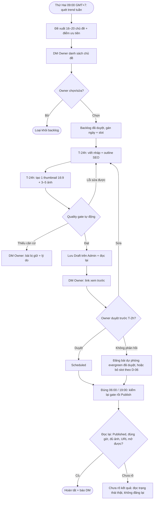
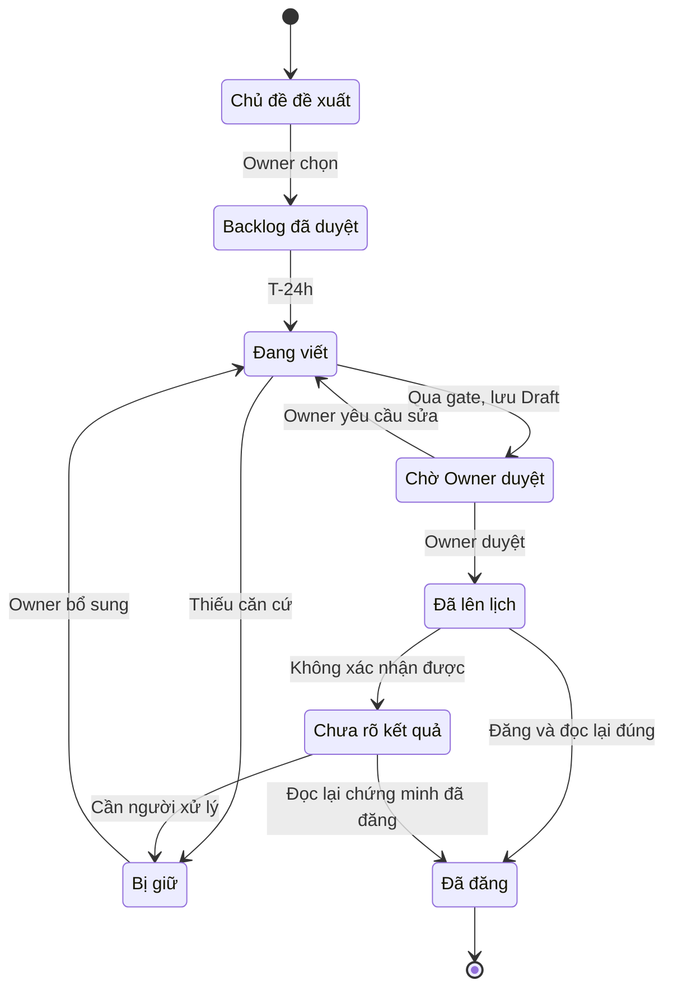

> **Cập nhật đối chiếu v1.0.9 — 2026-10-28 14:17 (Asia/Ho_Chi_Minh).** Tác giả: Codex; trạng thái: chờ review.

**Đối chiếu hiện trạng source:** commit `89a5ac8` trên nhánh `claude/nailblog-automation-review-091e47`. Đây là trạng thái mã nguồn, không khẳng định cấu hình hay phiên bản đang chạy trên THINKPAD. Các mô tả phía dưới có thể thuộc quyết định cũ; khi khác với bản cập nhật này, dùng phần cập nhật và kiểm tra cấu hình thực tế.

## Hiện trạng và tài liệu liên quan

NailBlog tự đề xuất/chốt chủ đề, viết bài, tạo ảnh, lưu Draft và đăng theo lịch trên staging. Source hiện dùng Agy qua worker cho cả chữ và ảnh; sổ chi API cũ chỉ đọc. Cấu hình mẫu có bốn slot 06:00, 10:00, 15:00, 19:00 theo giờ Việt Nam; thời gian thực tế do cấu hình quyết định. Mỗi slot tối đa một chủ đề được chốt.

Chế độ duyệt tay vẫn tồn tại. Tự duyệt chỉ được bật trên staging, yêu cầu bài đạt cổng chất lượng và ảnh qua kiểm tra xác định. Hạn xử lý ảnh và Draft vẫn có hiệu lực. Mục tiêu không chữ trên thumbnail đã có trong commit source `89a5ac8`, chưa có bằng chứng triển khai hoặc ảnh thật sau sửa. Không coi nhiệm vụ đã nghiệm thu toàn bộ.

Liên kết: [Nghiệp vụ](../01-product/nailhub-blog-noissue_business_261015_v1.0.0.md) · [Chuẩn nội dung](../01-product/nailhub-blog-noissue_content-standard_261016_v1.0.0.md) · [Kỹ thuật](../02-engineering/nailhub-blog-noissue_engineering_261027_v1.0.0.md) · [Vận hành](../02-engineering/nailhub-blog-noissue_cutover-runbook_261027_v1.0.0.md) · [QA](../03-qa/nailhub-blog-noissue_qa_261027_v1.0.0.md) · [Công việc](../04-tasks/nailhub-blog-noissue_tasks_261027_v2.0.0.md).

**Lịch sử thay đổi:** v1.0.9 — 2026-10-28 14:17 — đối chiếu source, vận hành và bằng chứng; không thay đổi trạng thái phê duyệt cũ.

---

> **Nội dung lịch sử bên dưới:** giữ để truy vết; nếu khác với cập nhật phía trên, dùng phần cập nhật và kiểm tra cấu hình thực tế.

# Master Document: NailHub — Flow tạo bài blog tự động

## Metadata
- **Feature ID**: noissue
- **Branch Name**: claude/nailhub-blog-creation-flow-e75996
- **File Naming Convention**: nailhub-blog-noissue_<type>_<yymmdd>_v1.0.0.md
- **Created Date**: 2026-10-14 (Asia/Ho_Chi_Minh)
- **Last Updated**: 2026-10-14
- **Current Version**: v1.0.3
- **Author**: AlexChu (Claude executor)
- **Status**: Draft — đề xuất, chờ Owner chốt các quyết định ở mục 9
- **Approved By**: —

Tài liệu này là **nghiên cứu + đề xuất**. Chưa có code, chưa thao tác Admin, chưa tạo issue. Flow được thiết kế theo cùng nguyên tắc với [quy trình duyệt tin NailHub v1.0.8](../01-product/nailhub-postings-noissue_business_261013_v1.0.0.md): có căn cứ trước khi ghi, Owner điều khiển qua DM Telegram, đọc lại sau mỗi thao tác ghi, kết quả chưa rõ thì không tự gửi lại.

## 1. Feature Overview

### Problem Statement
Blog NailHub (`/blog/all-blog`, API `GET api.nailhub.ai/api/v1/blogs`) đang được đăng thủ công theo đợt, không có lịch, không có chuẩn ảnh và chuẩn SEO thống nhất.

### Audit hiện trạng — 33 bài, đọc từ API công khai ngày 2026-10-14

| Chỉ số | Hiện trạng | Yêu cầu mới |
| --- | --- | --- |
| Ảnh bìa | 31/33 là **1200×630 (1.91:1, tỷ lệ OG)**; 1 bài 1280×720; 1 bài 1030×570 | Thumbnail **16:9** |
| Ảnh trong bài | **31/33 bài 0 ảnh**, 2 bài 1 ảnh; field `images` = null ở cả 33 bài; 0 ảnh có alt | **3–5 ảnh/bài**, có alt + caption |
| Định dạng ảnh | PNG/JPG, 37–249 KB | WebP, tên file mô tả |
| Ngôn ngữ | Chỉ `Vi` (33/33) | Giữ Vi; En là quyết định D-05 |
| Hashtag | 20/33 bài không có hashtag | 3–5 hashtag/bài |
| Tiêu đề | ~60% bài > 60 ký tự (dài nhất 135, có bài lẫn hậu tố `\| N…` của meta title vào tiêu đề) | ≤ 60 ký tự cho tiêu đề SEO |
| Summary | 1 bài trống | 140–160 ký tự, bắt buộc |
| Độ dài | 193–1.340 từ; nhóm NEXORA/trend ngắn (193–455) | 800–1.200 từ (bài trend có thể 600+) |
| Lịch đăng | Đăng dồn: 10 bài trong ~1 giờ ngày 13/10, 9 bài trong 4 phút ngày 11/10 | 2 slot/ngày, 06:00 và 19:00 GMT+7 |
| Danh mục | `nail-salon` 15, `did-you-know` 11, `nail-job` 6, `hot-trend` 2 | Phân bổ theo lịch nội dung (mục 4.3) |
| Cân bằng nội dung | 9/33 bài là giới thiệu sản phẩm NEXORA TOUCH, 7 bài đăng trong cùng ngày 13/10 | Tối đa 1 bài quảng bá sản phẩm/ngày |

**Lỗi nền tảng ảnh hưởng SEO (ngoài phạm vi flow nội dung, nhưng chặn hiệu quả):**
- Trang chi tiết `/blog/<slug>` là SPA shell: HTML trả về **cùng `<title>`, description, `og:image` mặc định** cho mọi bài, nội dung bài không có trong HTML. Google có thể render JS nhưng mạng xã hội (Facebook/Zalo/Telegram preview) thì không → mọi bài chia sẻ hiện cùng một ảnh.
- `sitemap.xml` chỉ có 4 URL, **không có bài blog nào**.
- Slug làm rơi ký tự tiếng Việt thay vì bỏ dấu: “mang lại gì cho tiệm” → `mang-li-g-cho-tim`. Cần chuyển dấu (`mang-lai-gi-cho-tiem`).
- Tất cả 33 bài `status=Published` nhưng `isPublic=false`; ý nghĩa field chưa rõ (D-02).
- `publishedAt` không có offset múi giờ (D-03).

### Business Context
Người đọc chính là thợ nail và chủ tiệm người Việt ở Mỹ. Blog là kênh SEO kéo người dùng vào danh sách việc làm/sang tiệm và tải app. Bài có ảnh thật, đúng mùa và đúng luật giúp tăng thời gian đọc và tần suất chia sẻ trong nhóm Facebook/Zalo của ngành.

### Goals & Objectives
- 2 bài/ngày, đúng giờ 06:00 và 19:00 Asia/Ho_Chi_Minh, không đăng dồn.
- Mỗi bài: 1 thumbnail 16:9 + 3–5 ảnh trong bài đạt chuẩn SEO.
- Chủ đề bám trend và mùa vụ, không trùng bài đã có, số liệu luật/thuế/license có nguồn.
- Owner duyệt bằng một DM, không cần mở Admin trừ khi muốn sửa.

## 2. Scope

### In-Scope
- Pipeline: nghiên cứu chủ đề → backlog → viết nháp → tạo ảnh → kiểm tra chất lượng → Owner duyệt → đăng đúng slot → đọc lại xác nhận.
- Lệnh Telegram namespace riêng `/nailblog …`, dùng chung listener/DM Owner hiện có (không tạo Telegram session thứ hai).
- Chuẩn ảnh, chuẩn SEO on-page và lịch nội dung.

### Out-of-Scope
- Sửa SPA/SSR, sitemap, slug generator của nailhub.ai (ghi nhận là dependency cho team FE/BE — mục 7).
- Đăng lại hoặc sửa 33 bài cũ (đề xuất làm một đợt riêng sau khi flow chạy ổn).
- Đăng chéo Facebook/TikTok.
- Thay đổi workflow duyệt tin tuyển dụng/sang nhượng hiện hành.

## 3. Key Personas
- **Owner (@SotaThao)**: chọn chủ đề tuần, duyệt bài qua DM, xử lý bài bị giữ.
- **Worker NailBlog (THINKPAD)**: chạy pipeline, upload, lên lịch, đăng, đọc lại.
- **Người đọc**: thợ nail (tìm việc, license, tay nghề, trend) và chủ tiệm (vận hành, luật, marketing mùa lễ).

## 4. Flow đề xuất

### 4.1 Tổng quan pipeline

### 4.2 Hai slot đăng mỗi ngày

| Slot (Asia/Ho_Chi_Minh) | Giờ Mỹ đến 31/10 (EDT/PDT) | Giờ Mỹ từ 01/11 (EST/PST) | Người đọc đang làm gì | Nội dung phù hợp |
| --- | --- | --- | --- | --- |
| **06:00** | 19:00 ET / 16:00 PT hôm trước | 18:00 ET / 15:00 PT hôm trước | Thợ bờ Đông vừa tan ca, lướt điện thoại buổi tối | `hot-trend`, `nail-job` (trend, tay nghề, tìm việc, license) |
| **19:00** | 08:00 ET / 05:00 PT | 07:00 ET / 04:00 PT | Chủ tiệm bờ Đông chuẩn bị mở cửa | `nail-salon`, `did-you-know` (vận hành, luật, thuế, marketing) |

- Giờ đăng cố định theo GMT+7 như yêu cầu; bảng giờ Mỹ chỉ để chọn loại nội dung. Mỹ đổi giờ ngày **01/11/2026**, giờ VN không đổi.
- Lịch chạy bằng Windows Task Scheduler hoặc systemd timer với `TZ=Asia/Ho_Chi_Minh`, giống job `sync-task-badge`. Nếu Admin hỗ trợ đặt `publishedAt` tương lai thì lên lịch trên Admin và worker chỉ đọc lại (D-04).
- Mỗi slot có cửa sổ trễ tối đa 15 phút. Quá 15 phút (máy tắt, mất phiên) thì không đăng bù lúc đêm mà DM Owner chọn đăng ngay hay dời slot.

| Mốc | Việc |
| --- | --- |
| T-24h | Nháp + ảnh xong, qua quality gate, lưu Draft, DM Owner |
| T-2h | Hạn Owner duyệt; sau mốc này áp dụng D-06 |
| T-10 phút | Kiểm lại: bài vẫn đúng bản đã duyệt (fingerprint), ảnh còn truy cập được, không trùng slot |
| T | Publish, đọc lại trạng thái + `publishedAt` + URL công khai |
| T+5 phút | DM kết quả; lỗi thì kèm link và chẩn đoán |

### 4.3 Lịch nội dung tuần (14 bài)

| | Thứ 2 | Thứ 3 | Thứ 4 | Thứ 5 | Thứ 6 | Thứ 7 | CN |
| --- | --- | --- | --- | --- | --- | --- | --- |
| 06:00 | Trend màu/kiểu | Tay nghề, how-to | Việc làm / license | Trend mùa lễ | Tay nghề | Trend ảnh mẫu (bài nhiều ảnh) | Việc làm |
| 19:00 | Vận hành tiệm | Luật / thuế | Marketing | Did you know (số liệu) | Sản phẩm NEXORA | Tuyển & giữ thợ | Tổng hợp tuần |

Tỷ lệ: ~40% trend/tay nghề, ~30% vận hành/luật, ~15% việc làm, ≤15% giới thiệu sản phẩm.

### 4.4 Bước 1 — Nghiên cứu và gợi ý chủ đề

**Nguồn trend** (đọc, không chép):
1. Báo làm đẹp Mỹ: The Zoe Report, Bustle, Allure, Vogue — trend màu/kiểu theo mùa.
2. Báo ngành: NAILS Magazine, Salon Today, Modern Salon — luật, sự kiện, kinh doanh.
3. Google Trends (US, nhóm Beauty) và gợi ý tìm kiếm tiếng Việt (“mẫu nail…”, “bằng nail…”).
4. Cơ quan nhà nước: State Board từng bang, IRS, DOL — chỉ dùng cho số liệu luật/thuế.
5. Dữ liệu nội bộ NailHub: từ khóa tìm kiếm trên site, bang có nhiều tin tuyển, câu hỏi lặp lại trong nhóm cộng đồng.

**Chấm điểm chủ đề** (mỗi tiêu chí 1–5): độ hot/mùa vụ, khớp người đọc, khả năng có ảnh tốt, nguồn tin đáng tin, không trùng bài cũ. Chủ đề trùng ý với bài đã đăng trong 90 ngày (so tiêu đề + slug + hashtag) bị loại hoặc đánh dấu “bài cập nhật”.

**DM gợi ý chủ đề mẫu:**
> NailBlog: 18 chủ đề tuần 19–25/10\
> 1. [hot-trend · 06:00 T2] Màu merlot và chocolate: 2 màu nail mùa đông 2026 — điểm 23/25 — nguồn: Bustle, The Zoe Report\
> 2. …\
> Trả lời: `/nailblog topics ok 1,2,5-9` · `/nailblog topics drop 3` · `/nailblog topics edit 4 <tiêu đề mới>`

### 4.5 Bước 2 — Viết nội dung

**Khung bài chuẩn:**
1. Tiêu đề SEO ≤ 60 ký tự, chứa từ khóa chính; tiêu đề hiển thị có thể dài hơn nhưng tách riêng nếu Admin có field meta title.
2. Summary 140–160 ký tự (dùng làm meta description).
3. Mở bài 2–3 câu trả lời ngay “bài này giúp gì”.
4. 4–7 mục `H2`, mỗi mục 120–200 từ; danh sách/bảng khi so sánh giá, giờ học, phí.
5. 3–5 ảnh xen giữa các mục (mục 4.6).
6. Mục “Câu hỏi thường gặp” 3 câu (phục vụ snippet).
7. CTA cuối bài: link danh sách việc làm/sang tiệm liên quan trên NailHub + tải app; tối đa 2 link nội bộ tới bài cũ cùng chủ đề.
8. 3–5 hashtag, slug bỏ dấu ≤ 60 ký tự.

**Giọng văn:** giữ phong cách các bài tốt hiện có — câu ngắn, xưng hô trung tính, dùng từ ngành quen thuộc (thợ, tiệm, turn, tip, bằng), giữ thuật ngữ tiếng Anh khi người đọc gặp hàng ngày (builder gel, cat-eye, 1099-NEC).

**Quy tắc căn cứ (áp dụng tinh thần BR của flow duyệt tin):**
- Số liệu về luật, thuế, phí, số giờ học, hạn gia hạn license **phải có nguồn chính thức** và ghi “cập nhật ngày …”. Không có nguồn thì bỏ số hoặc giữ bài.
- Không bịa trích dẫn, khảo sát, tên tiệm, lời khách.
- Tên thương hiệu sơn/sản phẩm chỉ khi có trong nguồn; không viết như quảng cáo cho hãng.
- Bài về sức khỏe/hóa chất: chỉ thông tin chung, dẫn nguồn FDA/OSHA.

### 4.6 Bước 3 — Hình ảnh chuẩn SEO

| Loại | Số lượng | Kích thước | Định dạng / dung lượng | Vị trí |
| --- | --- | --- | --- | --- |
| Thumbnail | 1 | **1600×900** (16:9), vùng an toàn chữ ở giữa 1200×630 để crop OG không mất chữ | WebP ≤ 200 KB (giữ thêm bản JPG nếu Admin không nhận WebP) | `coverImage` |
| Ảnh trong bài | **3–5** | Ngang 1200×675 (16:9) hoặc dọc 1080×1350 cho ảnh mẫu móng | WebP ≤ 150 KB/ảnh | Sau mở bài và giữa các `H2`, không 2 ảnh liền nhau |

**Mỗi ảnh bắt buộc có:**
- Tên file bỏ dấu, mô tả: `nail-merlot-cat-eye-mua-dong-2026.webp` (không `IMG_1234`, không nhồi từ khóa).
- `alt` tiếng Việt 5–15 từ mô tả đúng nội dung ảnh.
- Caption 1 dòng khi ảnh mang thông tin (bảng giá, bước làm).
- `width`/`height` và `loading="lazy"` cho ảnh dưới màn hình đầu tiên (nếu editor cho phép HTML).
- Ảnh khác nhau thật, không lặp thumbnail trong thân bài.

**Nguồn ảnh theo thứ tự ưu tiên:**
1. Ảnh có quyền dùng: ảnh tiệm/thợ gửi kèm đồng ý bằng văn bản, ảnh portfolio trên NailHub **chỉ khi chủ ảnh đồng ý**.
2. Ảnh minh họa AI cho trend màu/kiểu móng — không giả là ảnh tiệm thật, không có logo hãng, kiểm tra lỗi ngón tay/móng trước khi dùng.
3. Infographic/bảng tự dựng theo template thương hiệu NailHub (giờ học, phí, checklist) — dùng tốt cho bài license, thuế.
4. Ảnh chụp màn hình sản phẩm NEXORA cho bài sản phẩm.
5. Ảnh stock có license thương mại, lưu nguồn + license trong audit.

**Không dùng:** ảnh lấy từ Pinterest/Instagram/TikTok/báo khác, ảnh có mặt người không có đồng ý, ảnh có watermark.

**Template thumbnail:** nền ảnh chính + dải màu thương hiệu + tiêu đề ngắn ≤ 6 chữ + nhãn danh mục. Thống nhất một bộ 4 template theo 4 danh mục để người đọc nhận diện.

### 4.6b Pha tạo và tự duyệt ảnh (Cách C, Owner đề xuất 2026-10-14)

Khung **01:00–04:00 Asia/Ho_Chi_Minh** mỗi ngày chuẩn bị ảnh cho 2 bài của ngày hôm sau; worker chạy 24/7 trên THINKPAD, không cần người.

| Giờ | Việc |
| --- | --- |
| 01:00 | DeepSeek sinh 1 prompt thumbnail + 3–5 prompt ảnh thân bài cho mỗi bài |
| 01:10 | Gọi **API ảnh** (không tự động hóa giao diện ChatGPT — vi phạm điều khoản OpenAI), 2 ứng viên/prompt |
| 01:30 | Tự duyệt ảnh, chọn ảnh tốt nhất mỗi vị trí |
| 02:00 | Ảnh trượt: tạo lại tối đa 2 vòng; vẫn trượt → infographic/template |
| 02:30 | Hậu kỳ: crop 16:9, ghép chữ bằng template HTML, WebP, tên file, alt |
| 03:00 | Ghép bài, quality gate, lưu Draft, đọc lại |
| 03:30 | DM Owner link xem trước + ảnh thu nhỏ |

**Tiêu chí tự duyệt ảnh** (đạt tất cả; điểm lưu trong audit): kỹ thuật (tỷ lệ, độ phân giải, dung lượng — code kiểm); giải phẫu tay (5 ngón, không dính/thừa ngón, móng đều — model đọc ảnh); đúng prompt (màu/kiểu móng); an toàn thương hiệu (không chữ lạ, logo, watermark, mặt người nhận diện được); không trùng ảnh khác trong bài và bài cũ (perceptual hash).

Model tạo ảnh chọn bằng thử mù ~10 prompt nail thật trên 2–3 model (ứng viên: Nano Banana Pro, GPT Image high; phương án rẻ: Seedream, Flux 2 Pro). Model đọc ảnh dùng của cùng nhà cung cấp API ảnh.

### 4.7 Bước 4 — Quality gate tự động trước khi lưu Draft

| Nhóm | Điều kiện đạt |
| --- | --- |
| Ảnh | 1 cover đúng 16:9; 3–5 ảnh thân bài; mỗi ảnh có alt, tên file hợp lệ, dung lượng đúng ngưỡng, URL CDN trả 200 |
| SEO | Tiêu đề SEO ≤ 60; summary 140–160; slug bỏ dấu, không trùng; 4–7 H2; 3–5 hashtag; có link nội bộ + CTA |
| Nội dung | 800–1.200 từ (trend ≥ 600); không trùng bài 90 ngày; đúng danh mục |
| Căn cứ | Mọi số liệu luật/thuế/phí/giờ có nguồn trong audit; nguồn chưa xác nhận → giữ bài |
| Lịch | Slot chưa có bài khác; quảng bá sản phẩm ≤ 1/ngày |

Bài không đạt phần sửa được (độ dài, alt, tiêu đề) thì worker sửa và chạy lại gate tối đa 1 lần. Bài thiếu căn cứ thì DM Owner theo mẫu:
> NailBlog: Bài bị giữ — slot 19:00 ngày 16/10\
> Tiêu đề: …\
> Lý do: Phí gia hạn license Texas chưa có nguồn TDLR xác nhận.\
> Trường: đoạn H2 “Chi phí”\
> Cần làm: Gửi link nguồn hoặc `/nailblog approve <id> --drop-section 3`.

### 4.8 Bước 5 — Owner duyệt và đăng

**Lệnh Telegram** (DM đúng Owner, cùng cơ chế xác thực ID số như `/nailhub`):

| Lệnh | Tác dụng |
| --- | --- |
| `/nailblog topics` | Xem chủ đề đề xuất của tuần |
| `/nailblog topics ok <số>` / `drop` / `edit` | Duyệt, loại, sửa chủ đề |
| `/nailblog queue` | Xem 2 ngày tới: slot, bài, trạng thái |
| `/nailblog approve <id>` | Duyệt bài nháp cho slot đã gán |
| `/nailblog hold <id> <lý do>` | Giữ bài, slot dùng bài dự phòng |
| `/nailblog move <id> <ngày> <06\|19>` | Dời slot |
| `/nailblog pause` / `resume` / `status` | Như worker duyệt tin |

**Đăng đúng giờ:** Admin lưu Draft trước, đến slot mới chuyển Published. Sau thao tác ghi phải đọc lại qua API: `status=Published`, `publishedAt` đúng slot (sai số ≤ 15 phút), cover + số ảnh đúng, URL `/blog/<slug>` mở được. Kết quả chưa rõ → trạng thái “Chưa rõ kết quả”, đọc trạng thái thật, **không bấm Publish lần hai** (tránh bài trùng).

### 4.9 Vòng đời trạng thái

## 5. Gợi ý chủ đề 14 ngày đầu (15–28/10/2026)

Đã loại các chủ đề trùng bài hiện có (thuế 1099, gift card mùa lễ, Black Friday, tuyển thợ mùa lễ, license TX/CA/FL/IL, BIAB vs acrylic, booth rent, chăm da tay mùa đông). Ngày lễ: Halloween 31/10, Thanksgiving 26/11, Black Friday 27/11, Small Business Saturday 28/11, Tết Nguyên Đán 2027 (06/02/2027).

| Ngày | 06:00 (trend / thợ) | 19:00 (chủ tiệm) |
| --- | --- | --- |
| T5 15/10 | 10 mẫu nail Halloween 2026 làm nhanh dưới 45 phút | Bảng giá dịch vụ mùa lễ: tăng giá bao nhiêu là khách chấp nhận |
| T6 16/10 | Merlot, oxblood, black cherry: phân biệt 3 tông đỏ rượu đang hot | Nhắc khách đặt lịch Halloween/Thanksgiving qua SMS: mẫu tin nhắn |
| T7 17/10 | Chocolate và espresso: màu nâu thay màu đen mùa đông | Giữ chân thợ giỏi trước mùa lễ: chia turn công bằng |
| CN 18/10 | Thợ mới qua Mỹ: 5 việc cần làm trong tháng đầu tìm tiệm | Tổng hợp tuần: trend + tin ngành |
| T2 19/10 | Velvet cat-eye: cách làm hiệu ứng nhung không bị lem nam châm | Checklist vệ sinh dụng cụ mùa đông (cúm, nấm móng) |
| T3 20/10 | Modern French mùa đông: viền đôi, viền màu, negative space | Đánh giá Google 5 sao: cách xin review không vi phạm chính sách |
| T4 21/10 | Thợ chuyển bang: bang nào cho tính giờ kinh nghiệm thay giờ học | Combo mùa lễ: tạo gói dịch vụ tăng giá trị hóa đơn |
| T5 22/10 | Chrome và metallic: đồng, bronze, amber cho tiệc cuối năm | Chuẩn bị nhân sự cuối tuần Halloween: lịch, walk-in, đặt cọc |
| T6 23/10 | Tweed và argyle: nail “áo len” làm thế nào cho nhanh | NEXORA: báo cáo doanh thu theo thợ trong mùa đông khách |
| T7 24/10 | Album 20 ảnh nail Halloween từ tiệm trên NailHub (cần ảnh có đồng ý) | Chống no-show cuối năm: đặt cọc và tin nhắn nhắc |
| CN 25/10 | Hỏi trước khi nhận việc mùa lễ: lương ngày hay commission | Tổng hợp tuần |
| T2 26/10 | Glitter fade và glass nail: 6 kiểu dễ bán thêm | Mỹ đổi giờ 01/11: chỉnh giờ mở cửa và lịch hẹn ra sao |
| T3 27/10 | Tay nghề: giữ gel bền 3 tuần trong thời tiết lạnh, khô | Chụp ảnh mẫu móng bằng điện thoại để đăng mạng xã hội |
| T4 28/10 | Snowflake và accent nail tối giản cho khách công sở | Thanksgiving còn 4 tuần: kế hoạch nhận khách và giờ làm |

Nguồn trend tham khảo khi viết: [The Zoe Report — Winter 2026 Nail Trends](https://www.thezoereport.com/beauty/winter-2026-nail-trends), [Bustle — Winter 2026 Nail Polish Color Trends](https://www.bustle.com/beauty/winter-2026-nail-polish-color-trends), [Manucurist — Christmas Nails 2026](https://us.manucurist.com/blogs/journal/collection-holiday-it-s-time-to-shine). Các bài luật/thuế/license phải tra nguồn chính thức tại thời điểm viết.

## 6. Success Metrics (KPIs)
- Đăng đúng slot: ≥ 95% bài trong cửa sổ ±15 phút; 0 bài đăng trùng.
- 100% bài có 1 cover 16:9 + 3–5 ảnh có alt.
- 100% số liệu luật/thuế/license có nguồn trong audit.
- Sau 8 tuần (khi dependency SEO mục 7 xong): bài blog có trong Google Search Console, tăng lượt click từ blog sang danh sách việc làm/sang tiệm. Mục tiêu số cụ thể chốt sau 2 tuần đo baseline.

## 7. Dependencies (team FE/BE nailhub.ai)
| # | Việc | Lý do |
| --- | --- | --- |
| DEP-1 | SSR/prerender `/blog/<slug>`: `<title>`, description, `og:image` = cover của bài, JSON-LD `BlogPosting` | Hiện mọi bài cùng meta mặc định; 3–5 ảnh/bài ít tác dụng SEO nếu crawler không thấy |
| DEP-2 | Thêm bài blog + ảnh vào `sitemap.xml` (hoặc image sitemap) | Sitemap hiện không có bài nào |
| DEP-3 | Slug bỏ dấu tiếng Việt đúng | `tiệm` → `tim` hiện sai nghĩa và xấu URL |
| DEP-4 | Xác nhận editor giữ `alt`/caption/`figure` khi lưu; hoặc dùng field `images` | Field `images` đang null; flow duyệt tin đã thấy editor làm phẳng rich text |
| DEP-5 | Xác nhận Admin hỗ trợ đặt giờ đăng tương lai | Quyết định cách lên lịch (D-04) |

## 8. High-Level Timeline
- **Phase 0 — Chốt quyết định (mục 9) + đọc form Admin blog có đăng nhập**: 1–2 ngày.
- **Phase 1 — Bán tự động**: worker gợi ý chủ đề, viết nháp, tạo ảnh, DM Owner; Owner tự bấm đăng. 1 tuần, đo chất lượng.
- **Phase 2 — Tự động đăng đúng slot** với đọc lại và trạng thái chưa rõ. 1 tuần chạy có kiểm soát (1 slot/ngày), sau đó bật 2 slot.
- **Phase 3 — Tối ưu**: thêm bản tiếng Anh (nếu D-05 chọn), sửa 33 bài cũ, báo cáo hiệu quả hàng tuần.

## 9. Quyết định cần Owner chốt
| ID | Câu hỏi | Đề xuất |
| --- | --- | --- |
| D-01 | Thumbnail 16:9 thay 1200×630 hiện tại? | 1600×900, vùng chữ an toàn để crop OG 1.91:1 khi DEP-1 xong |
| D-02 | `isPublic=false` trên bài Published nghĩa là gì, có cần bật? | Kiểm form Admin trước khi tự động đăng |
| D-03 | `publishedAt` lưu UTC hay giờ VN? | Kiểm bằng 1 bài thử, ghi vào contract |
| D-04 | Lên lịch trên Admin hay worker đăng đúng giờ? | Ưu tiên lịch trên Admin nếu có; worker vẫn đọc lại |
| D-05 | Chỉ tiếng Việt hay thêm bản tiếng Anh? | Phase 1 chỉ Vi; En khi đã ổn định |
| D-06 | Owner không duyệt trước T-2h thì làm gì? | Đăng bài dự phòng evergreen đã duyệt (giữ sẵn 3 bài); không có thì bỏ slot |
| D-07 | Cho phép ảnh minh họa AI cho bài trend? | Cho phép, ghi rõ là ảnh minh họa, không giả ảnh tiệm thật |
| D-09 | Nguồn tạo ảnh cho pha 4.6b | API ảnh (OpenAI/Google/…) có key riêng; không tự động hóa giao diện ChatGPT |
| D-08 | Mỗi bài cần Owner duyệt, hay chỉ duyệt chủ đề rồi tự đăng? | Phase 1–2 duyệt từng bài; xem lại sau 4 tuần |

## 10. Stakeholders & Responsibilities
- **Owner / Product**: @SotaThao
- **Harness / data owner**: AlexChu
- **Development**: chưa phân công
- **QA**: chưa phân công

## 11. Related Documents
- [Quy trình duyệt tin NailHub v1.0.8](../01-product/nailhub-postings-noissue_business_261013_v1.0.0.md) — nguồn nguyên tắc vận hành
- [Master duyệt tin](nailhub-postings-noissue_master_261012_v1.0.0.md)
- [Business Doc v1.0.0](../01-product/nailhub-blog-noissue_business_261015_v1.0.0.md) — bản gửi trình
- [Engineering Doc v1.0.0](../02-engineering/nailhub-blog-noissue_engineering_261016_v1.0.0.md)
- Product / QA / Tasks Doc: chưa tạo
- GitHub Issue / PR: chưa có

## 12. Changelog
| Version | Date | Time (HH:mm) | Author | Description | Reviewed By | Status |
|---------|------|--------------|--------|-------------|-------------|--------|
| v1.0.0 | 2026-10-14 | — | AlexChu (Claude executor) | Nghiên cứu hiện trạng 33 bài blog + đề xuất flow tạo bài, chuẩn ảnh, lịch 2 slot, chủ đề 14 ngày | — | Draft |
| v1.0.1 | 2026-10-14 | — | AlexChu (Claude executor) | Thêm pha tạo/tự duyệt ảnh 01:00–04:00 (Cách C), D-09 nguồn ảnh qua API | — | Draft |
| v1.0.2 | 2026-10-15 | — | AlexChu (Claude executor) | Owner chốt nguồn ảnh OpenAI API; liên kết Business Doc gửi trình | — | Draft |
| v1.0.3 | 2026-10-16 | — | AlexChu (Claude executor) | Owner: thực hiện theo plan; Gemini API cho ảnh giai đoạn code; liên kết Engineering Doc | — | Draft |

## 13. Approval & Sign-off
- [ ] **Owner**: @SotaThao — Date:
- [ ] **Tech Lead**: — Date:

## 14. Notes & Assumptions
- Audit dựa trên API công khai `GET api.nailhub.ai/api/v1/blogs?pageSize=50` ngày 2026-10-14; chưa đăng nhập Admin blog nên tên field form (meta title, `images`, lịch đăng) là giả định cần xác minh ở Phase 0.
- Hướng dẫn SEO ảnh lấy từ tài liệu thực hành của bên thứ ba, chưa đối chiếu Google Search Central; số ảnh 3–5/bài là yêu cầu của Owner, không phải quy định của Google.
- Trend lấy từ báo làm đẹp Mỹ mùa đông 2026; cần quét lại mỗi tuần.
