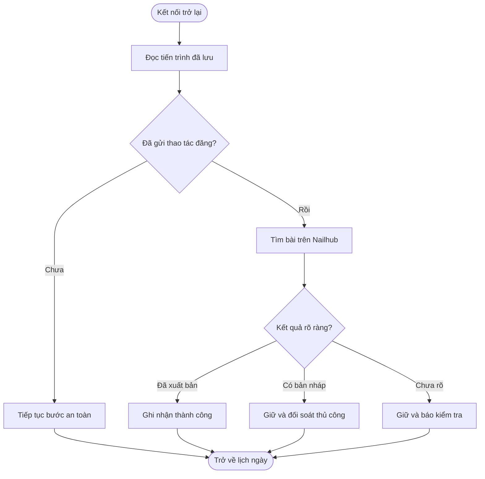
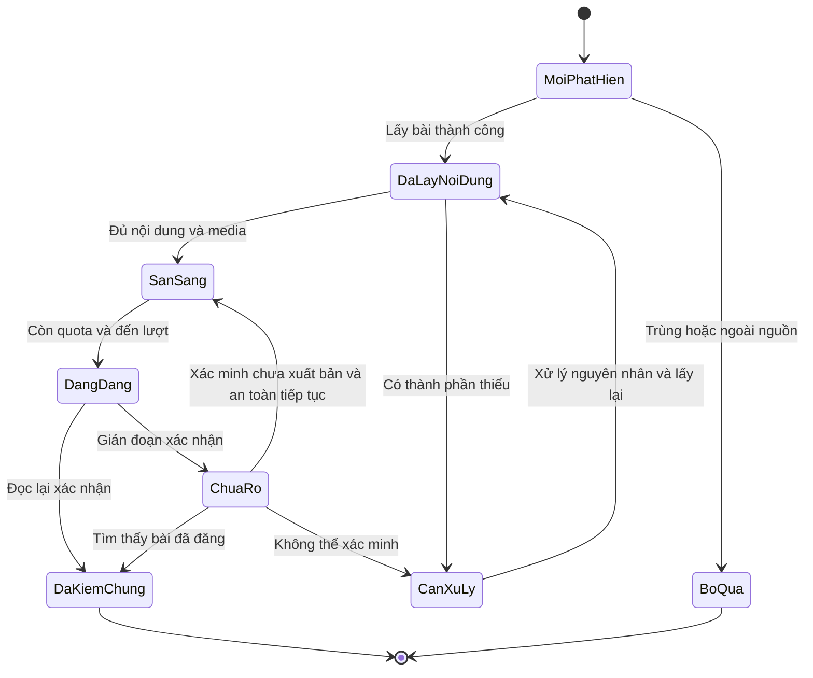
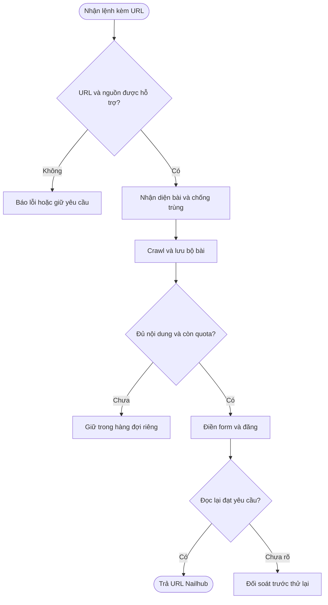
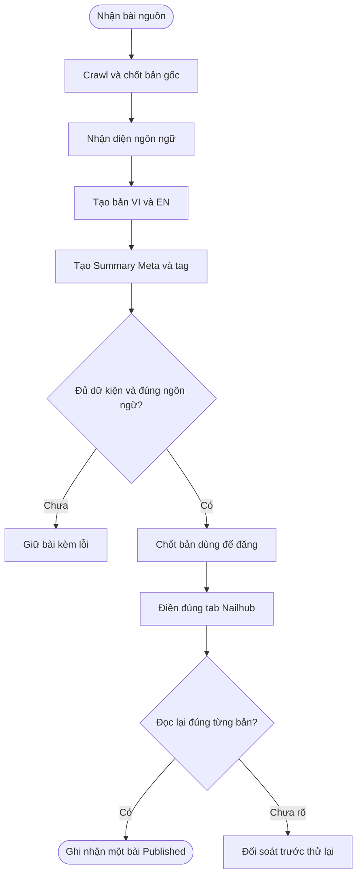

# Tự động đăng lại bài nguồn lên Nailhub PROD

## Metadata

- Version: v1.0.12 (giữ tên file gốc để không làm gãy liên kết).
- Created: 2026-10-28 17:40; Updated: 2026-10-29 10:40, giờ Việt Nam.
- Document status: **Approved / Active — Owner yêu cầu proceed đến Published PROD ngày 28/10/2026**.
- Audience: Owner, Marketing, vận hành, Development, QA.
- Harness / data / state owner: AlexChu.
- Executor được Owner chọn: Codex · gpt-6.1-terra · high.
- Branch: `codex/nailhub-source-mirror-docs`.
- Task: `T-261028-nailhub-source-article-mirror-on-thinkpa` trong checkout chính AgentBuilder.
- Không có issue/PR; chưa commit. Product, Engineering, QA và Tasks Doc đã tạo theo chuỗi sau khi Owner yêu cầu proceed; xem §12.
- Đồng bộ tài liệu: Owner yêu cầu ngày 29/10/2026 chép bộ 5 DOCS mới nhất từ worktree về `C:/Users/AD/Documents/GitHub/AgentBuilder/Docs/`, chưa commit. Bản repo chính là điểm đọc chung sau đồng bộ; giữ bản worktree trùng nội dung tại thời điểm bàn giao.
- Phần bổ sung ngày 29/10: đặc tả business `nailblog <URL>` tại §10.1, do Owner yêu cầu; chưa triển khai parser, điểm nhận lệnh hoặc kiểm thử lệnh này trên THINKPAD. Kết quả PROD tại §11.3 là bằng chứng ngày 28/10, không phải kiểm tra vận hành mới ngày 29/10.

## 1. Overview

**Goal được Owner xác nhận:** crawl được một bài thực từ website nguồn, lưu đủ nội dung/media trên THINKPAD, rồi dùng Playwright đăng bài đó ở trạng thái **Published trên Nailhub PROD**. Bài phải có URL công khai và mở đọc được bằng phiên khách. Đây là mốc nghiệm thu end-to-end đầu tiên; crawl local, chạy test hoặc tạo Draft riêng lẻ chưa đạt goal.

**Mục tiêu vận hành tiếp theo:** tự động duy trì 4 bài/ngày theo lịch đã chốt, với cơ chế chống trùng và phục hồi lỗi. Mốc một bài Published không thay thế hoặc loại bỏ yêu cầu 4 bài/ngày.

**Đầu vào Owner đã xác nhận:** một automation độc lập chạy trên THINKPAD, máy khác kết nối với AgentBuilder, lấy bài viết từ website chuyên về nail rồi đăng lại tương tự lên Nailhub PROD bằng Playwright thao tác trên giao diện. Sản lượng yêu cầu là **4 bài/ngày**. Owner yêu cầu làm rõ business DOCS trước khi thực hiện.

Automation phục vụ việc đưa nội dung nail từ nguồn đã chọn lên Nailhub mà không cần người vận hành mở từng bài, nhập lại nội dung hoặc bấm đăng theo từng lượt. **Baseline đang chạy giữ nguyên văn nguồn, chưa dùng AI viết lại, dịch hoặc tạo ảnh.** Theo yêu cầu bổ sung ngày 29/10, phương án Việt hóa được phân tích tại §10.3; chưa triển khai hoặc đổi chế độ worker.

Đây là yêu cầu mới, **độc lập hoàn toàn với hệ thống NailBlog**. Các tài liệu, cổng duyệt, trạng thái, quota và luồng AI của NailBlog không phải yêu cầu đầu vào của automation này.

Đích được cung cấp: [Nailhub PROD Admin](https://nailhub.ai/admin/dashboard). Tài khoản đăng nhập do Owner cung cấp riêng; **không ghi credential trong tài liệu, task hoặc mã nguồn**. Màn tạo bài thực đã xác minh tại `/admin/blogs`: Create Blog, Published và Public. Playwright thao tác qua form, upload native và clipboard HTML; đọc lại qua admin và phiên khách.

## 2. Key Concepts

| Khái niệm | Ý nghĩa trong flow này |
|---|---|
| Nguồn | Website/chuyên mục nail đã được Owner chọn để theo dõi và xác nhận phạm vi được đăng lại. |
| Bài nguồn | Một bài viết riêng có URL, nội dung và các media thuộc bài. |
| Bản chụp nội dung | Nội dung và danh sách media của bài nguồn tại thời điểm lấy; dùng để đối chiếu trước/sau khi đăng. |
| Bài đủ điều kiện | Thuộc nguồn được bật, chưa đăng, lấy đủ nội dung/media bắt buộc và có thể chuyển sang Nailhub. |
| Một bài thành công | Một bài Nailhub đã xuất bản, có URL đọc lại được, nội dung/media được đối chiếu với bản chụp nguồn. Bấm Đăng hoặc lưu Draft chưa tính thành công. |
| Kết quả chưa rõ | Đã bắt đầu gửi thao tác đăng nhưng chưa xác nhận được bài có được tạo/xuất bản hay không. |
| Quota ngày | Giới hạn bài xuất bản của riêng automation này trong một ngày theo giờ Việt Nam. |

## 3. Scope và User Roles

### Đã xác nhận

- Chạy automation trên THINKPAD, quản lý trong bối cảnh AgentBuilder.
- Đích là Nailhub PROD; lấy bài từ website bên ngoài chuyên về nail.
- Đăng tương tự bài nguồn, dùng Playwright thao tác như người dùng.
- Tần suất/sản lượng: 4 bài/ngày.
- Flow độc lập hoàn toàn với NailBlog.
- Làm rõ và duyệt business trước khi build/triển khai.

### Đề xuất phạm vi bản đầu

- Theo dõi danh sách website/chuyên mục được cấu hình; nguồn đầu tiên được chọn ở D-01.
- Chạy tự động, tự đăng bài đủ điều kiện; **không yêu cầu duyệt từng bài trong luồng bình thường**.
- Mỗi bài nguồn tạo tối đa một bài đích trong flow này.
- Chạy lần lượt; có lịch, hàng đợi, chống trùng, ghi kết quả và phục hồi sau gián đoạn.
- Không đồng bộ bình luận, lượt thích, lượt xem; không sửa/xóa bài Nailhub khi nguồn thay đổi hoặc biến mất.
- Baseline đang chạy chưa có AI/chuyển ngữ hoặc sản xuất ảnh mới. Mở rộng biên tập Việt hóa theo ngôn ngữ tại §10.3 là đề xuất riêng, không được coi là đã có trong runtime.

| Vai trò | Trách nhiệm |
|---|---|
| Owner | Chọn nguồn, phạm vi đăng lại, lịch và quy tắc ngày; duyệt business; xử lý ngoại lệ cần quyết định. |
| Marketing / vận hành | Theo dõi kết quả, bổ sung nguồn và kiểm tra bài bị giữ khi được Owner phân quyền. Không tự giả định đã có role này trên Nailhub. |
| Automation trên THINKPAD | Tìm bài, lấy nội dung, thao tác đăng, kiểm chứng kết quả và lưu tiến trình. |
| AgentBuilder | Điểm quản lý/quan sát mong muốn. Màn điều khiển và cơ chế kết nối cụ thể chưa được kiểm chứng trong task này. |

## 4. End-to-End Workflows

### Workflow: Tự động lấy và đăng một bài

**User story:** Là Owner, tôi muốn THINKPAD tự lấy bài nail từ nguồn đã bật và đăng tương tự lên Nailhub, để không phải thao tác nhập lại từng bài.

**Trigger đề xuất:** đến một khung giờ đăng trong lịch ngày.

**Outcome:** bài công khai đã được đọc lại và đối chiếu; lưu liên kết nguồn ↔ đích; tăng bộ đếm thành công trong ngày.

| Bước | Thực hiện | Kết quả / điều kiện |
|---|---|---|
| 1 | Kiểm tra automation được bật và không có lượt khác đang chạy. | Nếu tạm dừng hoặc đang chạy thì không tạo lượt chồng. |
| 2 | Kiểm tra quota ngày và các thao tác đăng còn chưa rõ kết quả. | Không tạo thêm bài nếu có nguy cơ vượt quota. |
| 3 | Mở nguồn đã cấu hình, tìm URL bài và loại bài đã đăng. | Có danh sách ứng viên chưa xử lý. |
| 4 | Chọn bài theo thứ tự được duyệt ở D-03. | Không tự chọn website khác ngoài danh sách. |
| 5 | Mở bài, cuộn/tải đủ nội dung và media thuộc bài. | Lưu bản chụp nội dung và thứ tự media. |
| 6 | Kiểm tra đủ dữ liệu và khả năng chuyển nội dung. | Thiếu thành phần bắt buộc thì giữ bài, có lý do; thử ứng viên khác nếu còn thời gian. |
| 7 | Mở form tạo bài Nailhub bằng phiên riêng của flow. | Xác nhận đúng tài khoản và màn đăng; không giả định dashboard là form tạo bài. |
| 8 | Điền nội dung, chọn/upload media, kiểm tra form. | Đủ thành phần trước khi bấm Đăng. |
| 9 | Bấm Đăng qua giao diện. | Ghi nhận thao tác đang chờ xác nhận để không gửi trùng khi mất kết nối. |
| 10 | Mở bài đích và đối chiếu nội dung/media, trạng thái công khai. | Chỉ ghi thành công khi kết quả được chứng minh; chưa rõ thì chuyển sang đối soát. |
| 11 | Lưu URL đích, ngày đăng, kết quả; kết thúc lượt. | Lượt tiếp theo tiếp tục từ tiến trình đã lưu. |


### Workflow: Phục hồi sau mất mạng hoặc khởi động lại

**User story:** Là Owner, tôi muốn tiến trình được giữ lại sau gián đoạn, để automation không bỏ bài hoặc đăng trùng.

| Trường hợp | Cách phục hồi đề xuất |
|---|---|
| Chưa gửi thao tác tạo/đăng | Tiếp tục từ bước an toàn với nội dung đã lưu hoặc lấy lại bài nếu bản chụp không còn dùng được. |
| Đã bấm tạo/đăng, chưa xác nhận | Tìm và đọc lại bài Nailhub trước; không gửi lại thao tác chỉ vì timeout. |
| Đã có bài Draft | Giữ và yêu cầu đối soát thủ công đúng bài; bản đầu chưa có chức năng tự mở/sửa/tiếp tục Draft. Không tạo bài thứ hai. |
| Đã đăng nhưng chưa lưu kết quả cục bộ | Đối soát bài hiện có, ghi nhận kết quả và tính đúng ngày bài thực sự xuất bản. |
| Không xác định chắc chắn được | Giữ trạng thái chưa rõ và báo vận hành; không tính là thất bại an toàn để đăng bù tùy ý. |



## 5. Business Rules — phạm vi thi hành theo yêu cầu proceed

| ID | Quy tắc |
|---|---|
| BR-01 | Baseline mirror giữ tiêu đề, câu chữ, ngôn ngữ, thứ tự đoạn, danh sách và nội dung thuộc bài nguồn. Phương án Việt hóa §10.3 giữ bản gốc và các dữ kiện/thứ tự bước/media, cho phép biên tập câu chữ theo ngôn ngữ khi được triển khai riêng; chưa áp dụng vào baseline. |
| BR-02 | Giữ media và vị trí/thứ tự tương ứng, chú thích/credit có sẵn. Không xóa watermark. Ảnh được tải rồi upload, không mặc định dùng hotlink. |
| BR-03 | Video, embed, bảng hoặc định dạng đặc biệt chỉ được đăng khi Nailhub có cách thể hiện tương đương đã được xác minh. Nếu không đáp ứng, giữ bài và báo thành phần thiếu; không tự cắt bỏ. |
| BR-04 | Không yêu cầu giao diện Nailhub giống từng pixel website nguồn. Mức tương tự được nghiệm thu bằng nội dung, cấu trúc và media. |
| BR-05 | Bài được xuất bản dưới tài khoản Nailhub được cấp. Tác giả và ngày của nguồn chỉ là thông tin dẫn nguồn, không giả lập danh tính hoặc ngày xuất bản của tài khoản Nailhub. Đề xuất thêm tên website và link bài gốc cuối bài. |
| BR-06 | Mục tiêu 4 bài thành công/ngày và trần 4 bài/ngày của riêng flow này. Không coi thao tác bấm Đăng, Draft hoặc kết quả chưa rõ là một thành công đã kiểm chứng. |
| BR-07 | Mỗi lượt dự kiến một bài; lỗi trước thao tác đăng có thể thử ứng viên khác. Không thử lại vô hạn hoặc tạo hơn một bài chỉ vì lượt trước chưa đọc lại được. |
| BR-08 | Lưu nhận diện bài nguồn và bài đích bền vững qua lần chạy/khởi động lại; chuẩn hóa URL để giảm trùng. Phải kiểm tra lại trước khi gửi thao tác đăng. |
| BR-09 | Không đủ 4 bài phù hợp thì báo thiếu và lý do; không tự sinh nội dung, lấy lại bài đã đăng hoặc thêm nguồn để bù. |
| BR-10 | Khi nguồn thay đổi sau lần lấy, đề xuất dùng bản chụp đã ghi nhận cho lượt đó. Bài đã xuất bản không tự đồng bộ lại trong bản đầu. |
| BR-11 | Đăng nhập hết hạn, CAPTCHA, thiếu quyền hoặc thay đổi màn hình không nhận diện được thì giữ công việc và yêu cầu xử lý; không vượt qua bước kiểm tra truy cập. |
| BR-12 | Worker, lịch, hàng đợi, quota, phiên đăng nhập, dữ liệu và log riêng; pause/resume hoặc triển khai flow này không điều khiển NailBlog hay worker khác. Không triển khai bằng cách đổi chế độ worker NailBlog. |
| BR-13 | Chỉ bài có bộ nội dung local hoàn tất và kiểm tra được mới được đưa vào hàng đợi đăng. Không tải được ảnh bắt buộc thì không đánh dấu sẵn sàng. |
| BR-14 | Nội dung đã chốt cho một lượt đăng là bản chụp cố định. File đang tải nằm ở vùng tạm; không ghi đè bộ bài đã chốt hoặc thay media trong lúc đăng. |
| BR-15 | Thao tác trên website nguồn/đích đi qua trình duyệt và giao diện thật. Không gọi API tạo/sửa/xuất bản bài hoặc chèn state ứng dụng để thay thế thao tác người dùng. Việc tải byte media được phép dùng phiên của trình duyệt cho URL media đã quan sát. |

## 6. System Configuration & Administration

**Cấu hình cần có:** nguồn được bật, thứ tự ưu tiên, khung giờ đăng, múi giờ, giới hạn ngày, màn tạo bài/danh mục đích, tài khoản đăng và nơi nhận thông báo vận hành.

**Lịch đang cấu hình:** 08:00, 12:00, 16:00, 20:00 theo `Asia/Ho_Chi_Minh`, dùng mặc định đã đề xuất khi Owner giao proceed (§13). Ngày nghiệp vụ từ 00:00 đến trước 00:00 ngày kế tiếp; không dùng múi giờ hệ điều hành để tự quyết ngày quota.

**Khi lỡ lịch:** worker thử các slot đã đến trong ngày nếu còn quota và không còn kết quả đăng chưa rõ; xử lý từng bài, tối đa 3 lần thử mỗi slot, không dồn lượt ngày trước sang quota ngày mới. Slot đã giữ chỗ hoặc đã hết lượt thử không tự reset khi reconcile; cần lệnh phục hồi có kiểm soát nếu muốn bù thêm trong quota.

**Điều khiển hiện có:** CLI status/pause/resume/reconcile và báo cáo JSON local. Không tích hợp giao diện AgentBuilder hoặc Telegram trong bản này.

**Thông báo đề xuất:** báo khi cần can thiệp hoặc không đạt sản lượng; lưu kết quả từng bài để xem lại. Kênh/người nhận chưa được cung cấp; chưa có ủy quyền gửi thông báo ra ngoài.

### 6.1. Cách crawl một website nguồn

Quy trình này đã chạy với nguồn Scratch Step-by-steps và các bài thật ghi tại §11.3. **Mỗi website có bộ quy tắc nhận diện riêng**: URL chuyên mục, link bài, vùng nội dung, tiêu đề, tác giả, ngày nguồn, phân trang và media. Adapter hiện chỉ hỗ trợ một layout đã khảo sát; bảng dưới là hợp đồng xử lý, không chứng minh hỗ trợ mọi nguồn hoặc mọi định dạng.

| Giai đoạn | Thao tác và dữ liệu lưu | Điều kiện chuyển bước |
|---|---|---|
| Khám phá bài | Playwright mở chuyên mục được bật, đọc các link bài và href phân trang thực đã quan sát, rồi mở href hợp lệ bằng trình duyệt. Thu tiêu đề và ngày nếu trang có. | Chỉ nhận URL thuộc nguồn đã cấu hình; số trang/bài mỗi lượt có giới hạn, không quét vòng vô hạn. |
| Chuẩn hóa và chống trùng | Bỏ fragment và tham số theo dõi được xác định rõ; giữ tham số ảnh hưởng nội dung. Kiểm tra redirect/canonical thuộc nguồn và danh sách URL tương đương đã ghi nhận. | Bài đã thành công, đang đăng hoặc chưa rõ kết quả không được tạo job đăng mới. Không gộp bài chỉ vì tiêu đề giống nhau. |
| Đọc bài | Mở URL bài, chờ đúng vùng bài; đọc `data-src` thực của ảnh lazy-load trong layout đã khảo sát. Đọc nội dung theo thứ tự DOM; không lấy menu, quảng cáo, gợi ý bài khác hoặc bình luận. | Nhận diện được đúng bài, không phải trang login, CAPTCHA, paywall, lỗi hoặc trang trống. Không vượt qua hạn chế truy cập. |
| Tạo bản chụp | Lưu metadata, HTML vùng bài đã render và ảnh đối chiếu; trích các khối văn bản/media theo thứ tự. | Tiêu đề và nội dung bắt buộc có giá trị; tác giả/ngày không có thì để trống và ghi rõ, không suy đoán. |
| Lập danh sách media | Mỗi ảnh xuất hiện có tham chiếu vị trí và alt gốc. Ghi URL `data-src`/ảnh thực quan sát, tránh lấy SVG placeholder; không khẳng định đây là độ phân giải cao nhất có thể có. Video chưa được adapter hiện tại hỗ trợ. | Phân biệt được media thuộc bài với logo, avatar, quảng cáo; không tự bỏ ảnh vì nằm ngoài viewport ban đầu. |
| Tải file | Ghi file vào `tmp/<attempt-id>/`; theo dõi media nào tải xong, lỗi hoặc không hỗ trợ. Dùng phiên trình duyệt nguồn khi URL media cần session; không chuyển cookie Nailhub sang nguồn. | Mã phản hồi và file thực tế hợp lệ, giải mã/đọc được; nội dung HTML lỗi mang đuôi JPG không tính là ảnh. |
| Kiểm tra đủ | Đối chiếu khối nội dung với media-manifest, số file, thứ tự, caption, link và định dạng. Loại script, event handler, iframe thực thi hoặc URL nguy hiểm khỏi nội dung dùng để đăng; lưu lý do khi không thể chuyển thành phần. | Không có media bắt buộc còn lỗi; không cắt bỏ thành phần để làm bài vượt kiểm tra. |
| Chốt bộ bài | Tính checksum các file và bản chụp, chuyển bộ hoàn tất vào `articles/<article-id>/`; sau đó mới ghi trạng thái sẵn sàng vào database. | Database chỉ tham chiếu bộ bài đã tồn tại và kiểm tra đủ. Lỗi ở giữa được khôi phục theo §6.4. |

**Video/nhúng:** chỉ tải file trực tiếp hoặc chuyển thành dạng nhúng mà nguồn và Nailhub hỗ trợ trong phạm vi đã cho phép. Không ghi màn hình video hoặc phá cơ chế bảo vệ nội dung để thay thế việc tải. Không chuyển được thì giữ bài, ghi rõ thành phần thiếu.

**Giới hạn lượt crawl:** cấu hình trần trang danh sách, ứng viên, thời gian chờ và số lần thử; retry có giới hạn cho bước chỉ đọc/tải. Trước khi tạo bản ghi đăng, kiểm tra trùng lần nữa trong cùng cơ chế khóa của worker. Con số cụ thể được chốt khi khảo sát nguồn, không bịa ngưỡng đã kiểm chứng trong business.

### 6.2. Cấu trúc dữ liệu riêng trên THINKPAD

`/var/lib/nailhub-source-mirror/` đã được tạo trên THINKPAD và chứa state, snapshot, media, profile, báo cáo thật. Root thuộc user riêng và có quyền 0700. Không đặt dưới thư mục dữ liệu NailBlog, không dùng symlink/junction hoặc mount trỏ sang dữ liệu của flow khác.

```text
/var/lib/nailhub-source-mirror/
├── state.sqlite3
├── locks/
│   └── worker.lock
├── browser/
│   ├── source-profile/
│   └── nailhub-profile/
├── articles/
│   └── <article-id>/
│       ├── metadata.json
│       ├── content.json
│       ├── content.html
│       ├── media-manifest.json
│       ├── snapshot-manifest.json
│       ├── source/
│       │   ├── article.html
│       │   └── screenshot.png
│       ├── media/
│       │   ├── 001.jpg
│       │   ├── 002.webp
│       │   └── 003.mp4
│       └── publication/
│           ├── attempts/
│           │   └── <attempt-id>.json
│           ├── result.json
│           ├── readback.json
│           └── screenshot.png
├── tmp/
│   └── <attempt-id>/
└── reports/
    └── <YYYY-MM-DD>.json
```

Các tên media trong cây chỉ là ví dụ; bài không có video không phải tạo file video. `publication/` được bổ sung khi thao tác đăng, không bắt buộc tồn tại khi hoàn tất crawl. SQLite có thể tạo file phụ cạnh database trong lúc chạy; backup phải dùng cơ chế nhất quán của SQLite, không chỉ chép riêng file chính đang mở.

| Thành phần | Nội dung và vai trò |
|---|---|
| `state.sqlite3` | Nguồn được bật; URL chuẩn hóa và alias; bài/đường dẫn snapshot; trạng thái; lần thử; lịch; giữ chỗ quota; bài đích và đối soát; sự kiện pause/resume. Là nguồn chính cho trạng thái vận hành. |
| `locks/worker.lock` | Khóa của riêng flow, ngăn hai tiến trình điều phối cùng lúc. Database vẫn phải có ràng buộc chống trùng; có lock file không thay thế kiểm tra trùng. |
| `browser/source-profile/` | Dữ liệu phiên đọc nguồn khi cần. Bộ nhận diện/cấu hình mỗi nguồn quy định cách dùng phiên; không nhập cookie từ worker khác. |
| `browser/nailhub-profile/` | Phiên Nailhub riêng của flow, không copy profile NailBlog/NailHub worker. Có thể đăng nhập cùng tài khoản được Owner cấp nhưng phiên và storage riêng. |
| `articles/<article-id>/` | Một bộ bài nguồn đã chốt. ID đề xuất là SHA-256 đầy đủ của URL chuẩn hóa, đồng thời có ràng buộc duy nhất trong DB; không dùng tiêu đề hoặc chuỗi URL làm đường dẫn. |
| `metadata.json` | Phiên bản schema, mã bài/nguồn, URL đầu vào/chuẩn hóa/đích sau redirect, tiêu đề, tác giả/ngày nguồn nếu có, thời điểm lấy và dấu kiểm tra nội dung. Không lưu cookie, token hoặc mật khẩu. |
| `content.json` | Các khối nội dung theo thứ tự; liên kết, in đậm/in nghiêng và danh sách được biểu diễn có cấu trúc. Media tham chiếu bằng mã sang manifest, không chỉ lưu một chuỗi văn bản phẳng. |
| `content.html` | Nội dung được dựng từ các khối đã kiểm tra để xem lại và đưa vào editor qua thao tác được hỗ trợ. Chưa chứa URL upload Nailhub thì dùng tham chiếu local; không gọi đây là HTML cuối đã đăng. |
| `source/article.html` | HTML vùng bài tại thời điểm crawl, không phải bản sao toàn website có đủ tài nguyên. Giữ như dữ liệu nguồn để đối chiếu; không chạy script hoặc mở bằng một web server công khai. |
| `source/screenshot.png` | Chứng cứ trực quan của vùng bài sau khi tải đủ; ảnh quá dài có thể tách thành nhiều ảnh và ghi danh sách vào manifest. Không phải bằng chứng bài đích đã đúng. |
| `media/` | Byte media gốc tải về, giữ đúng loại file. Nếu Nailhub bắt buộc chuyển định dạng, giữ bản gốc và bản dùng upload riêng cùng thông tin chuyển đổi; không ghi đè bản gốc. |
| `media-manifest.json` | Mã media, URL gốc, loại nội dung khai báo và nhận diện thực tế, tên file local, dung lượng, checksum, kích thước/thời lượng khi đọc được; các vị trí/caption trong bài và kết quả tải. |
| `snapshot-manifest.json` | Phiên bản schema, mã snapshot, danh sách file thuộc bộ nguồn, checksum và thời điểm chốt. Không đưa `publication/` đang thay đổi vào hash của bộ nguồn bất biến. |
| `publication/attempts/` | Ghi nhận từng lần thao tác, bước đã bắt đầu và kết quả; tham chiếu snapshot, không chép credential hay toàn bộ header mạng. |
| `publication/result.json` | Bản xuất kết quả cuối: ID/URL Nailhub, thời điểm xuất bản/kiểm chứng, mã snapshot, mapping media nguồn → media đích. Chỉ ghi thành công khi đã đọc lại. |
| `publication/readback.json` | Nội dung/trạng thái thực tế đọc lại trên Nailhub, kết quả so từng thành phần, thành phần thiếu/lệch nếu có. |
| `publication/screenshot.png` | Ảnh bài đích thực tế sau khi mở lại; kèm nhận diện bài và thời điểm. |
| `tmp/<attempt-id>/` | File tải dở và bộ bài chưa chốt; không được lấy để đăng chỉ vì thấy có file. |
| `reports/<YYYY-MM-DD>.json` | Bản tổng hợp theo ngày Việt Nam từ database: mục tiêu, số thành công, chưa rõ, giữ, thiếu bài, các URL kết quả và lý do. Có thể dựng lại từ DB, không là bộ đếm quota thứ hai. |

### 6.3. Hợp đồng nội dung lưu local — ví dụ minh họa

Ví dụ dưới đây không phải bài thực, schema đã code hay dữ liệu đã crawl. Giá trị checksum rút gọn chỉ để dễ đọc; implementation phải dùng checksum đầy đủ.

`metadata.json`:

```json
{
  "schema_version": 1,
  "article_id": "sha256-day-du-cua-url",
  "source_id": "nguon-da-cau-hinh",
  "source_url": "https://source.example/nail-art/tutorial",
  "canonical_url": "https://source.example/nail-art/tutorial",
  "title": "Tieu de nguyen ban",
  "author": null,
  "source_published_at": null,
  "crawled_at": "2026-10-28T18:00:00+07:00",
  "snapshot_id": "sha256-day-du-cua-ban-chup",
  "snapshot_complete": true
}
```

`content.json`:

```json
{
  "schema_version": 1,
  "blocks": [
    {"type": "paragraph", "inlines": [{"text": "Doan mo dau nguyen ban."}]},
    {"type": "heading", "level": 2, "inlines": [{"text": "Buoc 1"}]},
    {"type": "image", "media_id": "image-001", "caption": "Chu thich goc", "alt": "Mo ta anh tu nguon"},
    {"type": "paragraph", "inlines": [{"text": "Noi dung tiep theo.", "marks": ["bold"]}]}
  ]
}
```

Thiếu `alt`, tác giả hoặc ngày nguồn thì giữ trạng thái thiếu; không gọi AI điền vào. Metadata thiếu tùy chọn khác với việc mất ảnh/đoạn nội dung bắt buộc. Một ảnh xuất hiện nhiều lần có thể dùng chung file nhưng phải giữ đủ tham chiếu ở đúng vị trí. Alt gốc được lưu local; Quill bỏ alt khi paste trên đích, nên bản đầu không cam kết giữ alt tại Nailhub.

### 6.4. Chốt dữ liệu, phục hồi và dung lượng

1. Crawl vào thư mục tạm riêng của lần thử; kiểm tra file, nội dung và checksum ở đó.
2. Khi đủ, chốt manifest và chuyển bộ bài sang đường dẫn cuối trên cùng filesystem; không thay thế âm thầm thư mục đã có. Trạng thái DB chỉ chuyển sẵn sàng sau khi bộ bài cuối được xác nhận.
3. Nếu crash sau chuyển file nhưng trước cập nhật DB: khởi động lại đối chiếu bộ bài với manifest/URL trong DB rồi ghi nhận tiếp; không tự suy thành bài đã đăng.
4. Nếu DB tham chiếu bộ thiếu/hỏng hoặc checksum sai: giữ bài, không đăng; không tự lấy bộ tạm gần nhất để thay vào.
5. Bản chụp đã chốt không ghi đè. Nếu phải crawl lại sau khi Owner xử lý ngoại lệ, giữ phiên bản cũ và tạo bản mới có mã snapshot/path riêng; job đăng phải bind rõ phiên bản dùng. Cách bố trí bản bổ sung được khóa trong Engineering, không đổi lẫn root bài đầu và snapshot mới.
6. Trước mọi thao tác tạo/lưu/xuất bản, lưu intent trong DB gồm mã lần thử, snapshot và giữ chỗ quota; sau thao tác thì đối soát kết quả. File `result.json`/báo cáo là bản xuất có thể dựng lại, không thay DB trong phục hồi trạng thái.
7. Nếu DB chưa xác định một thao tác đã xuất bản hay chưa, giữ reservation và đối soát cả bài trước/ngày sau khi qua nửa đêm; không coi reset ngày là lý do giải phóng trạng thái chưa rõ để đăng thêm.
8. Dung lượng đã được khảo sát khi cài; download có trần kích thước mỗi ảnh/tổng bộ. Kiểm tra ngưỡng dung lượng trống tự động trước mỗi crawl/upload chưa được triển khai; không mô tả thành tính năng hiện có. Lỗi ghi file không được biến thành snapshot sẵn sàng. Không tự xóa media/profile của flow khác; chưa bật tự xóa snapshot/evidence/backup khi D-07 chưa chốt thời hạn.

### 6.5. Ranh giới độc lập hoàn toàn với NailBlog

Các tài nguyên sau đã provision riêng; AgentBuilder entry vẫn là lựa chọn tương lai:

| Tài nguyên | Source Mirror sở hữu riêng | Ràng buộc độc lập |
|---|---|---|
| Mã chạy / môi trường | `/opt/nailhub-source-mirror/` và môi trường dependency riêng | Không import package NailBlog, không sửa worker hoặc unit NailBlog. |
| Cấu hình | `/etc/nailhub-source-mirror/config.json` | Schema riêng; không nạp TOML/env NailBlog, không kế thừa chính sách AI hoặc duyệt của nó. |
| Secret | Credential dùng trong bộ nhớ khi login; phiên browser nằm dưới root riêng được bảo vệ | Không lưu mật khẩu trong config/DOCS/log; không đọc secret của worker khác. |
| OS service account | `nailhub-source-mirror` | Chỉ có quyền cần thiết với thư mục của flow; không cấp quyền đọc/ghi state NailBlog. |
| Tiến trình / lịch | `nailhub-source-mirror.service`, một scheduler nội bộ | Không chạy bằng `tg-nailblog`; start/stop/restart riêng. Không thêm scheduler thứ hai gây chạy trùng. |
| State / hàng đợi / quota | `/var/lib/nailhub-source-mirror/state.sqlite3` | Không attach/migrate DB NailBlog, không import queue hoặc dùng chung hạn mức của nó. |
| Browser | Profile nguồn và Nailhub dưới root riêng | Không chia sẻ user-data-dir, cookie hoặc khóa profile với worker khác. |
| Điều khiển | Status/pause/resume/reconcile riêng | Lệnh flow này không gọi pause/resume hoặc thay lịch NailBlog; không mượn Telegram session của nó. |
| Log / báo cáo | Journal theo unit riêng; báo cáo dưới root riêng | Không ghi vào log/thư mục báo cáo NailBlog. Không lộ cookie, token, mật khẩu. |
| Backup / rollback | Bộ code/config/DB/profile riêng | Rollback chỉ flow này. Sau khi đã có intent ghi website, không khôi phục DB cũ làm mất lịch sử đăng. |
| AgentBuilder | Một worker entry/định danh riêng, nếu tích hợp được chọn | Không đổi entry NailBlog thành Source Mirror; chi tiết UI/connector phải khảo sát riêng. |

**Tài nguyên thực tế vẫn cùng dùng:** máy THINKPAD, CPU/RAM/đĩa/mạng và website Nailhub PROD. Độc lập logic không có nghĩa là không tranh tài nguyên; cần đo và giới hạn tài nguyên khi triển khai. Nếu cùng tài khoản Nailhub gây xung đột phiên/rate limit, phải kiểm chứng và xử lý trước khi bật lịch, không tự dừng NailBlog để nhường chỗ.

**Bằng chứng bắt buộc trước kết luận độc lập:** kiểm tra dependency/import; quyền truy cập thư mục; unit/process/config/profile/DB thực tế; so checksum config và trạng thái unit của worker hiện có trước/sau rollout. Không so hash toàn bộ DB NailBlog đang ghi vì dữ liệu có thể tự thay đổi; không cần đọc nội dung DB đó để chứng minh độc lập. Nếu không đủ quyền kiểm tra thì ghi phần chưa kiểm chứng, không tự cấp quyền.

## 7. State Lifecycle

| Trạng thái | Ý nghĩa / bước tiếp |
|---|---|
| Mới phát hiện | Có URL nguồn chưa xử lý. |
| Đã lấy nội dung | Có bản chụp bài và danh sách media. |
| Sẵn sàng | Đủ điều kiện để đưa lên Nailhub. |
| Đang đăng | Đã bắt đầu tạo/lưu/đăng bài đích; cần ghi kết quả. |
| Chưa rõ kết quả | Đối soát trước mọi lần gửi lại thao tác. |
| Đã đăng và kiểm chứng | Lưu URL và thời điểm xuất bản; không xử lý lại bài nguồn đó. |
| Cần xử lý | Thiếu dữ liệu, định dạng không hỗ trợ hoặc lỗi cần người xử lý. |
| Bỏ qua | Trùng, ngoài phạm vi hoặc Owner chủ động loại; giữ lý do. |



## 8. Edge Cases & Exception Handling

| Tình huống | Hành vi đề xuất | Người xử lý |
|---|---|---|
| Không có bài mới | Dùng bài cũ chưa đăng nếu D-03 cho phép; nếu không có bài phù hợp thì báo thiếu. | Automation / Owner chọn nguồn bổ sung. |
| Nguồn chặn truy cập hoặc yêu cầu đăng nhập | Không coi trang lỗi/login là bài viết; ghi nguồn tạm không đọc được. | Owner cung cấp cách truy cập được phép. |
| Ảnh chưa tải hoặc upload thiếu | Không đăng bài thiếu media; thử lại bước an toàn hoặc giữ bài. | Automation / vận hành. |
| Nguồn có nhiều ảnh hơn giới hạn Nailhub | Giữ bài và báo giới hạn; không tự cắt album. | Owner quyết định cách xử lý. |
| Editor làm mất nội dung/định dạng cần giữ | Đối chiếu form không đạt thì không bấm Đăng; ghi phần sai. | Development / Owner chốt mức chấp nhận. |
| Mất kết nối ngay sau Đăng | Đối soát bài đích; giữ quota an toàn cho kết quả chưa rõ. | Automation; vận hành nếu không thể kết luận. |
| Máy tắt hoặc sleep | Không có lượt chạy trong thời gian máy không hoạt động; phục hồi theo D-02 khi hoạt động lại. | Vận hành THINKPAD. |
| Bài nguồn bị xóa sau khi đã đăng | Không tự xóa bài Nailhub; Owner xử lý nếu có yêu cầu. | Owner. |
| Đã có bài tương tự do người hoặc flow khác đăng | Đề xuất kiểm tra trùng URL nguồn nếu có, sau đó tiêu đề/nội dung; không giả định có quyền đọc DB flow khác. | Automation / vận hành khi chưa rõ. |

## 9. Success Metrics và nghiệm thu dự kiến

Các tiêu chí dưới đây tách mốc Published thực và vận hành dài ngày. Mốc 1 đã đạt; trạng thái từng phần của mốc 2 và giới hạn bằng chứng ghi tại §11.3, QA Doc và Tasks Doc.

### Mốc 1 — Đạt goal crawl → Published trên PROD

- Có URL nguồn thực và bộ nội dung/media hoàn tất được lưu trong root riêng trên THINKPAD.
- Playwright thao tác form Nailhub PROD để tạo và xuất bản đúng bài từ bộ đã lưu; không dùng API ghi thay giao diện.
- Mở lại admin xác nhận đúng bài, trạng thái Published và URL đích; không suy trạng thái từ thông báo toast hoặc nút bấm.
- Mở URL bằng phiên khách không đăng nhập, xác nhận đọc được nội dung và media bắt buộc tải/hiển thị đúng thứ tự.
- Lưu cặp URL nguồn ↔ PROD, mã snapshot, thời điểm xuất bản, kết quả đối chiếu và evidence. Chưa đủ một trong các bước trên thì báo mốc chưa đạt.
- Worker và dữ liệu thuộc Source Mirror; việc hoàn thành mốc không thay đổi trạng thái/lịch/config NailBlog.

### Mốc 2 — Vận hành tự động 4 bài/ngày

- Khi có đủ bài hợp lệ và hệ thống hoạt động bình thường: 4 bài/ngày, không vượt 4 bài của flow này.
- Không có bài bị tạo trùng khi chạy lại hoặc khởi động lại; mọi bài thành công có cặp URL nguồn ↔ đích.
- Bài thành công giữ đủ nội dung và media bắt buộc theo BR-01 đến BR-05; bài thiếu không được báo thành công.
- Có chứng cứ Playwright đi qua giao diện thật để tạo/đăng và đọc lại; kiểm tra công khai bằng phiên khách.
- Một lần thử lỗi sau khi bấm Đăng chứng minh cơ chế đối soát, không gửi lại mù.
- Một ngày đầy đủ theo lịch đã duyệt chứng minh 4 bài thực tế và quota theo giờ Việt Nam; test giả lập không thay bằng chứng vận hành này.
- Bật/tắt hoặc triển khai flow mới không thay đổi lịch, config, phiên hay dữ liệu của NailBlog và các worker khác.
- Bộ bài local khôi phục được sau crash ở giai đoạn đang tải/chuyển file/cập nhật DB; checksum lệch hoặc thiếu file đều không được đưa lên hàng đợi sẵn sàng.
- Bài mẫu nguồn có văn bản xen kẽ nhiều ảnh phải giữ đúng thứ tự, caption và media sau khi upload; không coi chỉ khớp số ảnh là đủ.
- Màn nguồn được tải bằng Playwright và thao tác đăng dùng form thật; không có đường gọi API ghi hoặc chèn state để thay flow.

## 10. Nguồn đề xuất và các quyết định còn mở

### Nguồn tham khảo đã tìm

| Nguồn đề xuất | Phạm vi nội dung | Trạng thái |
|---|---|---|
| [Scratch — Step-by-steps](https://www.scratchmagazine.co.uk/step-by-step) | Hướng dẫn nail art theo bước. | Nguồn đang chạy theo mặc định thi hành khi Owner giao proceed; không có bằng chứng giấy phép publisher trong task. |
| [NAILS Magazine](https://www.nailsmag.com/) | Nail design, kỹ thuật và kinh doanh salon. | Nguồn thay thế/bổ sung đề xuất. |
| [Beauty Launchpad — Nails](https://www.beautylaunchpad.com/nails) | Nail art, kỹ thuật, sản phẩm và tin ngành. | Nguồn thay thế/bổ sung đề xuất. |

Đây là danh sách phù hợp về chủ đề, không phải bằng chứng các nguồn đã cho phép đăng lại toàn văn hoặc media. Điều kiện vận hành là Owner chọn và xác nhận phạm vi nội dung được sử dụng; có thể thay bằng nguồn Owner sở hữu/đã có thỏa thuận. Không tự thay yêu cầu đăng lại bằng tóm tắt.

### 10.1. Lệnh theo URL được chỉ định: `nailblog <URL>`

**Yêu cầu business bổ sung của Owner ngày 29/10/2026:** nhập `nailblog <URL>` để Source Mirror crawl bài viết từ URL đó, lưu nội dung/media trên THINKPAD rồi dùng Playwright đăng **Published/Public lên Nailhub PROD**. Đây là đầu vào theo yêu cầu, bổ sung cho lịch tự động hiện có.

**Trạng thái:** đã ghi nhận đặc tả; **chưa có lệnh chạy được** trong worker đang triển khai. Nơi nhập lệnh và adapter kết nối AgentBuilder/CLI hoặc kênh khác cần được xác định khi thực hiện. Tài liệu này không xác nhận đã có bot hoặc kênh gửi mới.

```text
nailblog <URL-bài-viết-hoặc-chuyên-mục>

Ví dụ cú pháp với chuyên mục nguồn hiện có:
nailblog https://www.scratchmagazine.co.uk/step-by-step/
```

Ví dụ là cú pháp mục tiêu, không phải bằng chứng lệnh đã được thực thi. Các URL NAILS Magazine và Beauty Launchpad trong bảng trên vẫn là nguồn đề xuất; phải có adapter được kiểm chứng trước khi nhận lệnh với nguồn đó.

| Đầu vào / tình huống | Hành vi business yêu cầu |
|---|---|
| URL bài viết cụ thể | Crawl đúng bài được chỉ định, tạo một bộ snapshot/media hoàn chỉnh và một yêu cầu đăng; không tự thay bằng bài khác. |
| URL chuyên mục/danh sách bài | Khám phá các link bài thuộc phạm vi nguồn được hỗ trợ, chống trùng rồi đưa bài đủ điều kiện vào hàng đợi có giới hạn; không đăng lại chính trang danh sách như một bài viết. Không mặc định mọi trang chủ đều là chuyên mục có thể crawl. |
| Đủ điều kiện và còn quota | Xử lý sớm khi worker rảnh, không cần đợi slot lịch tiếp theo. Chỉ báo thành công khi admin, URL khách và card danh sách đều được đối soát. |
| Đã đủ 4 bài trong ngày | Ghi nhận yêu cầu chờ trong hàng đợi riêng; tiếp tục ở ngày/slot còn quota theo giờ Việt Nam. Lệnh không vượt trần 4 bài và không tạo scheduler thứ hai. |
| URL đã đăng hoặc đang xử lý | Trả trạng thái hiện có và URL Nailhub nếu có; không tạo bài trùng. Kết quả chưa rõ phải đối soát trước mọi lần gửi lại. |
| URL không hợp lệ, nguồn chưa hỗ trợ hoặc không lấy đủ nội dung/media | Báo rõ lỗi hoặc giữ yêu cầu kèm lý do; không xuất bản bài thiếu và không tự chuyển sang nguồn khác. |

**Luồng mục tiêu:** nhận URL → kiểm tra nguồn/phạm vi và chống trùng → crawl bằng trình duyệt → lưu bộ bài dưới `/var/lib/nailhub-source-mirror/articles/` → kiểm tra quota/khóa worker → điền form và Summary thuần văn bản → Published → đọc lại admin, trang chi tiết và card desktop/mobile → trả mã yêu cầu, trạng thái và cặp URL nguồn ↔ Nailhub. Khi chưa hoàn tất phải trả trạng thái chờ/giữ/lỗi, không trả thông báo Published giả.



**Ranh giới độc lập:** `nailblog` là tên lệnh theo yêu cầu Owner dành cho Source Mirror; không có nghĩa là dùng lại worker hoặc hệ thống NailBlog hiện có. Lệnh và lịch dùng chung queue, state, khóa, reservation, quota 4 bài/ngày và profile riêng của Source Mirror. Không đọc/ghi DB, đổi cấu hình hay chiếm command handler của NailBlog. Nếu điểm nhận lệnh đang có cùng tên, cần tạo route riêng rõ ràng trước khi bật tính năng, không ghi đè handler hiện hữu.

Lệnh chỉ thêm yêu cầu theo URL cho lần nhận đó; không tự bổ sung nguồn vào lịch theo dõi lâu dài. Giữ các quy tắc nội dung, ảnh/credit, Summary không chứa HTML/ảnh, giới hạn media, chống trùng và đối soát hiện hành. Không gọi API ghi thay thao tác UI. Phần chi tiết Engineering/QA và implementation cho đầu vào mới là công việc tiếp theo, chưa thuộc kết quả triển khai ngày 28/10.

### 10.2. SEO công khai và nguồn bổ sung — khảo sát ngày 29/10/2026

Owner yêu cầu phân tích SEO công khai của ba nguồn và tìm thêm URL. Báo cáo [SEO công khai và lựa chọn nguồn](research/nailhub-source-mirror-noissue_seo-audit_261029_v1.0.0.md) ghi 15 seed URL, 14 URL bài mẫu được chọn, 12 lượt đọc robots.txt và 7 lượt Chromium. Không có số traffic, DA/DR, backlink, volume từ khóa hoặc kết quả xếp hạng được đo; thứ tự dưới đây là đề xuất khảo sát nội dung/tích hợp, không phải điểm SEO.

- Giữ Scratch theo phạm vi layout đã kiểm chứng; ưu tiên dùng NAILS Nail Design/How-To thay vì mọi bài trên trang chủ.
- Nguồn bổ sung nên khảo sát trước: Professional Beauty Nail Art, Young Nails Blog và Kiara Sky Learn.
- Nguồn bổ sung theo chủ đề: OPI Nail Art/Blog, The GelBottle Blog, Glitterbels Blog và NailKnowledge Blog.
- Beauty Launchpad bị challenge HTTP 403 trong lượt kiểm tra trực tiếp và Chromium; chưa đủ dữ liệu để chấm metadata. Nailpro đã chuyển về Beauty Launchpad, không tính thêm một nguồn độc lập. Daily Charme blog được đọc có bài mới nhất hiển thị ngày 09/05/2015, không ưu tiên làm feed tin mới.
- Danh sách đầy đủ gồm 12 URL trên 10 domain tại §5 của báo cáo. Các nguồn mới chưa có adapter/E2E và chưa được bật trên THINKPAD. `nailblog <URL>` vẫn là đặc tả chưa triển khai. Không tự thay flow mirror thành AI viết lại hoặc mặc định rằng đăng lại sẽ tạo hiệu quả SEO.

### 10.3. Việt hóa và biên tập theo ngôn ngữ — phân tích bổ sung

**Yêu cầu của Owner ngày 29/10/2026:** bổ sung phân tích viết lại/Việt hóa bài để đáp ứng ngôn ngữ người đọc. Phạm vi lượt này là business analysis; chưa sinh bản dịch để đăng, chưa gọi dịch vụ AI ngoài, chưa sửa 4 bài cũ hoặc thay worker PROD.

**Vấn đề hiện tại:** publisher điền cùng nguyên văn tiếng Anh vào cả hai tab Vietnamese/English. Có hai bản ghi ngôn ngữ trong admin chưa có nghĩa bài đã được Việt hóa. Đồng thời, Meta Title/Meta Description/Hashtag chưa nằm trong pipeline hiện tại. Phân loại chủ đề cho từng slot cũng chưa được triển khai; bổ sung ngôn ngữ không tự giải quyết phân bổ chủ đề.

#### 10.3.1. Phương án nội dung được đề xuất

| Chế độ | Hành vi | Đánh giá |
|---|---|---|
| Giữ nguyên văn | Hai tab nhận cùng nội dung nguồn như runtime hiện tại. | Giữ làm baseline và bằng chứng lịch sử; chưa đáp ứng trải nghiệm tiếng Việt. |
| Dịch sát câu | Chuyển từng câu, giữ cấu trúc nguồn. | Dễ đối chiếu nhưng có thể cứng, khó hiểu thuật ngữ nghề nail. |
| Việt hóa có biên tập | Viết tiếng Việt tự nhiên, đúng ngữ cảnh thợ/chủ tiệm nail, giữ đầy đủ dữ kiện, bước, ảnh, credit và dẫn nguồn. | Phương án khuyến nghị. Không tự thêm kiến thức, kết quả, công dụng hoặc số liệu ngoài nguồn. |
| Viết bài mới từ nhiều nguồn | Tổng hợp nhiều bài và bổ sung góc nhìn/nội dung mới. | Không nằm trong yêu cầu mở rộng này; cần scope và quy trình biên tập khác. |

Mặc định đề xuất: bản VI được Việt hóa có biên tập; bản EN giữ nội dung tiếng Anh nguồn sau chuyển định dạng an toàn. Không tự viết lại EN để tránh trùng lặp hoặc hứa tăng thứ hạng SEO. Nếu nguồn đã là tiếng Việt thì ưu tiên giữ/chuẩn hóa bản VI; chỉ tạo EN khi đã có yêu cầu xuất bản hai ngôn ngữ và bản EN được kiểm chất lượng.

Ngôn ngữ khác tiếng Việt/Anh phải có quy tắc mapping và ngôn ngữ đích được hỗ trợ trước khi xử lý; không tự gán nội dung chưa nhận diện là EN. Ngôn ngữ người đọc không đồng nghĩa quốc gia: không tự đổi bối cảnh Anh/Mỹ thành Việt Nam, tiền GBP/USD thành VND hoặc khẳng định sản phẩm có bán tại Việt Nam.

#### 10.3.2. Mapping nội dung theo ngôn ngữ

| Thành phần | Bản VI đề xuất | Bản EN đề xuất |
|---|---|---|
| Title | Tiêu đề tiếng Việt tự nhiên, giữ chủ đề, số bước và ý nghĩa. | Tiêu đề nguồn tiếng Anh, chuẩn hóa khoảng trắng/định dạng. |
| Summary | Đoạn trích tiếng Việt ngắn, text thuần, không có ảnh/HTML. | Đoạn trích tiếng Anh tương ứng; tách riêng với Meta Description. |
| Content | Nội dung được Việt hóa đầy đủ theo từng khối/bước; không chỉ dịch tiêu đề hoặc đoạn đầu. | Nội dung nguồn; giữ các dữ kiện và credit gốc. |
| Meta Title | Tiếng Việt phù hợp chủ đề, theo giới hạn form 70 ký tự; quy tắc rút gọn rõ. | Tiếng Anh phù hợp bài, theo giới hạn form 70 ký tự. |
| Meta Description | Mô tả tiếng Việt phản ánh đúng bài, text thuần, tối đa 160 ký tự theo form. | Mô tả tiếng Anh tương ứng, tối đa 160 ký tự theo form. |
| Ảnh/credit | Dùng đúng media nguồn, đúng thứ tự, không tạo ảnh mới/xóa watermark. Caption được chuyển ngữ nếu có, credit/tên riêng giữ nguyên. | Dùng cùng bộ media nguồn và credit. |
| Hashtag | Hiện là một bộ dùng chung cấp bài, chưa có trường theo từng tab ngôn ngữ. | Dùng cùng bộ tag của bài. Muốn hiển thị tag VI/EN riêng cần khảo sát và thay đổi thêm. |

Đề xuất bộ tag dùng khóa chủ đề thống nhất, có thể dùng các nhãn ngành phổ biến như `NailArt`, `ChromeNails`; gắn nhãn nào phải dựa vào bài. Không hứa Hashtag tự chuyển ngữ khi đổi tab. Số lượng/chuẩn hóa tag và việc có nhãn hiển thị tiếng Việt là quyết định business cần chốt khi triển khai.

Ví dụ minh họa tiêu đề VI: **“Hướng dẫn 5 bước vẽ nail ma và mạng nhện hiệu ứng chrome cho Halloween”**. Đây là minh họa Việt hóa, không phải bản dịch đã đăng. Một số thuật ngữ có thể thống nhất trong glossary: `cure` → “hơ đèn”, `gel paint` → “gel vẽ”, `glossy top coat` → “sơn phủ bóng”; giữ nhãn hiệu/tên màu và không tự thay bằng sản phẩm khác.

#### 10.3.3. Luồng đề xuất và kiểm chất lượng



Các điều kiện cần kiểm:

- VI phải là tiếng Việt ở Title/Summary/Content/Meta, không để nguyên các đoạn tiếng Anh ngoài glossary, tên riêng, mã/tên sản phẩm hoặc trích dẫn được đánh dấu.
- Giữ số bước/thứ tự, số liệu, đơn vị, thời gian hơ đèn, danh sách vật liệu và ý nghĩa cảnh báo. Không tự sửa thông số của nguồn, bịa công dụng hoặc biến lời quảng bá thành bảo đảm an toàn.
- Mỗi đoạn/bước bản đích có mapping về khối nguồn; đủ ảnh và đúng vị trí. Nội dung chữ quan trọng nằm trong ảnh phải được đánh giá, không tự vẽ lại hoặc suy đoán.
- Không lấy menu/quảng cáo/gợi ý bài khác làm phần Việt hóa. Giữ tác giả, link nguồn và phạm vi sử dụng đã được xác nhận.
- Chốt riêng payload VI và EN trước khi upload. Bộ đăng đối chiếu chính xác với payload của từng ngôn ngữ; không dùng phép so byte VI với văn bản EN để kết luận sai.
- Kiểm tra ý nghĩa VI so với nguồn là bước riêng, gồm glossary, dữ kiện, bước/media và kiểm tra ngôn ngữ. Một lần AI tự đánh giá không được coi là bằng chứng đầy đủ cho độ đúng của mọi bài.
- AI lỗi/timeout, ngôn ngữ sai hoặc thiếu Meta không được âm thầm đưa EN vào tab VI rồi vẫn báo Việt hóa thành công. Giữ bài, retry có giới hạn hoặc yêu cầu xử lý.
- Đọc lại admin từng tab, trang chi tiết và card theo ngôn ngữ người đọc; Summary không chứa HTML/ảnh. Lỗi sau thao tác lưu phải đối soát, không tạo bài thứ hai.

#### 10.3.4. Lưu trữ, quota và bài đã xuất bản

Bản nguồn đã chốt giữ bất biến. Khi triển khai mở rộng, tạo revision/ngữ liệu biên tập riêng có mã ngôn ngữ, nội dung, nguồn gốc Meta/tag, glossary/prompt/model version nếu dùng AI, checksum và kết quả kiểm tra. Đây là schema được đề xuất, chưa phải cấu trúc đã có trên THINKPAD; không sửa ngầm snapshot hoặc manifest cũ để bổ sung bản dịch.

Một bài nguồn tương ứng **một bài Nailhub có VI/EN**, tính một lượt vào quota 4 bài/ngày; không tạo bốn bài VI cộng bốn bài EN. Bài chỉ đạt tiêu chí song ngữ khi các ngôn ngữ yêu cầu đã đúng; việc đếm quota vẫn phải giữ an toàn nếu một thao tác ghi có kết quả chưa rõ.

Nếu triển khai backfill 4 bài đã Published, cập nhật bản dịch/SEO trên đúng blog ID và giữ slug, Published At, media, credit, bản EN gốc. Không tạo lại bài hoặc tính thành bốn bài mới. Chưa có backfill nào được thực hiện trong lượt phân tích này.

Tài nguyên AI, cấu hình, job biên tập và log phải thuộc Source Mirror, tiếp tục độc lập NailBlog. Model/effort executor đã chọn để build không mặc nhiên là model tạo nội dung lúc runtime. Provider/model, giới hạn chi phí, chế độ review canary và cách xử lý lỗi cần chốt trước khi gọi dịch vụ hoặc bật tính năng; không lưu credential trong DOCS.

#### 10.3.5. Kiểm chứng ngôn ngữ công khai và SEO

Admin có tab VI/EN chưa chứng minh khách đọc được từng bản. Cần khảo sát cách chọn ngôn ngữ của Nailhub, fallback, URL và cache; không tự đặt giả định `/vi/` hoặc `/en/` đã tồn tại. Metadata công khai phải theo đúng bài/ngôn ngữ đang hiển thị, không dùng thông tin chung trang chủ.

Nếu mục tiêu là SEO riêng cho từng ngôn ngữ, Google khuyến nghị URL khác nhau cho từng phiên bản và mô tả cách dùng hreflang. Khả năng này thuộc phần website cần khảo sát riêng; crawler không tự bảo đảm chỉ bằng điền hai tab admin. Nguồn chính thức: [quản lý website đa ngôn ngữ](https://developers.google.com/search/docs/specialty/international/managing-multi-regional-sites), [khai báo các phiên bản ngôn ngữ](https://developers.google.com/search/docs/specialty/international/localized-versions).

Việt hóa không tự xác nhận quyền tái bản hoặc bảo đảm tăng trưởng SEO. Bước triển khai tiếp theo cần Product/Engineering/QA cho chế độ mới và E2E một bài thật trước khi bật lịch; các kết quả triển khai mirror ngày 28/10 không được dùng thay bằng chứng Việt hóa.

### Decision Register

| ID | Cần chốt | Đề xuất / lựa chọn | Trạng thái |
|---|---|---|---|
| D-01 | Nguồn và phạm vi nội dung được đăng lại | Scratch Step-by-steps theo yêu cầu proceed và mặc định §13; chưa có bằng chứng quyền tái sử dụng từ publisher. | IMPLEMENTED DEFAULT |
| D-02 | Khung giờ và xử lý lỡ lịch | 08/12/16/20 VN, catch-up trong ngày, trần 4 gồm canary/phục hồi; tối đa 3 thử mỗi slot. | IMPLEMENTED DEFAULT |
| D-03 | Lần đầu chạy / thiếu bài mới | Cho bài cũ chưa đăng; theo thứ tự listing quan sát, không cam kết sort theo ngày nguồn khi nguồn không có ngày. | IMPLEMENTED DEFAULT |
| D-04 | Vị trí đăng và phân loại trên Nailhub | `/admin/blogs`, Hot Trend, Published, Public; link nguồn; giữ nguyên ngôn ngữ nguồn ở hai tab bắt buộc. | VERIFIED LIVE UI |
| D-05 | Bộ quy tắc business | Thi hành scope theo Owner proceed; giới hạn định dạng, alt, dung lượng và phục hồi Draft được ghi rõ, không coi khả năng dự kiến là đã có. | ACTIVE |
| D-06 | Quản lý và thông báo | CLI + báo cáo local; không thêm kênh gửi hoặc UI AgentBuilder. Tích hợp thêm là scope tương lai. | IMPLEMENTED / INTEGRATION DEFERRED |
| D-07 | Giữ dữ liệu, dung lượng và backup | Giữ dữ liệu, chưa tự xóa; backup riêng `/var/backups/nailhub-source-mirror`, quyền 0700. Thời hạn giữ và ngưỡng dung lượng tự động chưa chốt/triển khai. | PARTIAL / RETENTION OPEN |
| D-08 | Nhận URL trực tiếp qua `nailblog <URL>` | Owner yêu cầu bổ sung vào business ngày 29/10; flow và quy tắc tại §10.1. Parser/điểm nhập, adapter cho nguồn bổ sung và kiểm thử thực tế chưa triển khai. | BUSINESS REQUEST RECORDED / NOT IMPLEMENTED |
| D-09 | Việt hóa theo ngôn ngữ người đọc | Owner yêu cầu bổ sung phân tích; khuyến nghị VI biên tập có đối chiếu, EN giữ nguồn, một blog hai bản ngôn ngữ; quy tắc tại §10.3. Provider/model, glossary, tag chung và review canary cần chốt trước triển khai. | ANALYSIS RECORDED / NOT IMPLEMENTED |

## 10.4. Thử Việt hóa bằng AGY trên THINKPAD — 2026-10-29

Owner chọn **AGY / Gemini 3.8 Flash / medium** cho một bài thử độc lập trước tích hợp. [Báo cáo glossary, MQM và bằng chứng](research/nailhub-source-mirror-noissue_localization-trial_261029_v1.0.0.md); [bản Việt đọc thử](research/nailhub-source-mirror-noissue_translation-preview_261029_v1.0.0.md).

- Lần đầu CLI 1.4.7 dừng ở xác thực, 0 lượt/0 token. Sau Owner đăng nhập, CLI 1.4.9 lấy được catalog có model yêu cầu và chạy **SUCCESS, 1 lượt, 38.714 giây, 12576 total token theo CLI** trên hostname gw-01/user startechai.
- Bài ghost giữ 14 block/4 bước/5 tham chiếu ảnh. 16 kiểm tra cấu trúc/từ khóa đạt; Summary 165/180, Meta Title 51/70, Meta Description 147/160, 4 hashtag hợp giới hạn.
- Codex đối chiếu toàn bài và 8 mục glossary: **MQM 0 Critical / 0 Major / 2 Minor, điểm phạt 2**. Cần sửa câu chơi chữ tiếng Anh trong tiêu đề và cụm lặp ý ở bước 3. **1 source hold về thời điểm hơ ở bước 1** được model ghi uncertainties; chưa có chuyên gia xác minh.
- Kết luận: **công cụ chạy được với bài mẫu; bản dịch cần hiệu đính/xác minh kỹ thuật, chưa đủ điều kiện PROD**. Không suy diễn 1 bài thành chất lượng chung hoặc điểm chính xác phần trăm.
- Chưa tích hợp/publish/thay worker trong thử nghiệm này; độc lập NailBlog. Auth user startechai chưa chứng minh chạy unattended dưới service account hoặc giữ auth sau reboot. Snapshot nguồn bất biến đã kiểm SHA256 metadata/content.

## 10.5. Tích hợp Việt hóa vào các slot tiếp theo — Owner đã yêu cầu

Trạng thái: v19 đã triển khai và bật; chờ kết quả slot thật. Owner chốt runtime AGY Gemini 3.8 Flash / medium; mọi bài không đạt hoặc có mơ hồ kỹ thuật phải giữ lại. Worker cũ đã dừng trong lúc nâng cấp; worker v19 đã bật lại. Slot 08:00 ngày 29/10 đã đăng theo flow cũ và không tự động sửa hồi tố.

Luồng được duyệt: immutable snapshot → tạo revision VI/SEO/tag → kiểm máy → lượt đánh giá nghĩa/MQM mới với nguồn và glossary → chỉ chấp nhận khi không có lỗi/mơ hồ → freeze revision/gate → reserve quota/slot → nhập UI → kiểm request và admin readback VI/EN, Meta/tag → guest/card verification.

Cổng chặn: bất kỳ lỗi Minor/Major/Critical chưa xử lý, uncertainty nguồn hoặc bản dịch, report/schema thiếu/sai, đổi số/bước/media/link, hết auth/timeout/broker hỏng đều không được Create. Không dùng bản gốc thay thế khi Việt hóa lỗi. Bài QC held có lý do bền vững và không được recrawl tự mở lại; chọn bài hợp lệ kế tiếp trong giới hạn scan. QC trước reservation không tạo unknown hay ăn quota. Khi đã Create mà kết quả không rõ, vẫn giữ quy tắc unknown chặn toàn cục.

AGY generation và đánh giá nội dung dùng hai lượt độc lập của model do Owner chọn. Lượt đánh giá không nhận điểm tự chấm của lượt sinh; kiểm máy giữ quyền phủ quyết. Đây là kiểm nội dung bằng AI theo MQM, không phải chứng nhận chuyên gia hoặc formal harness reviewer. Bất kỳ điểm kỹ thuật chưa rõ đều HOLD dù model ghi PASS.

Worker vẫn UID riêng nailhub-source-mirror. Một sidecar AGY chạy user riêng nailhub-source-mirror-agy, dùng phiên subscription đã được chủ tài khoản đăng nhập, nhận public source/candidate qua Unix socket chỉ cho UID worker; không cấp token/cookie/mật khẩu cho worker hoặc prompt. Sidecar dùng cwd/state riêng và hạn chế OS; không dùng chung queue/database/browser với NailBlog. Không chỉnh NailBlog hoặc quota/ngày/4 lịch hiện có.

Done chỉ khi: tests thật và review độc lập đạt; broker chạy trong systemd thực; thử gate đạt/held không ghi PROD; form mapping và locale readback xác minh; deploy version/hash và service runtime xác nhận. Nếu chưa có bài qua gate thì slot được phép thiếu bài, không hạ chuẩn để đạt 4/ngày.

## Localization deployment — 2026-10-29

Bản v19 đã cài và worker cùng AGY broker active, unpaused. Cấu hình bắt buộc Gemini 3.8 Flash / medium và kiểm glossary/MQM; lỗi hoặc bất định kỹ thuật giữ bài trước reservation. Linux 38 tests PASS; review độc lập APPROVED. Form thật trên fixture đã qua guard VI/EN, Meta, hashtag; request cố ý chặn trước mạng nên không có bài thử PROD. Hai bài nguồn thật trên bản sao thử bị HOLD: thiếu thuật ngữ và JSON model không hợp lệ. Slot 12:00 chưa chạy ở thời điểm triển khai; chưa có bằng chứng bài Việt hóa publish hay public readback VI/EN. Đánh giá MQM tự động bằng model chỉ là heuristic. Không commit.

## 11. High-Level Timeline và trách nhiệm

Không cam kết ngày go-live trước khi xác nhận nguồn, màn tạo bài và business.

### 11.1. Plan triển khai để tiến hành

Plan ban đầu được bổ sung theo yêu cầu Owner ngày 28/10 và đã được triển khai sau yêu cầu proceed. Bảng P0–P7 giữ estimate lịch sử; không phải thời gian thực hiện đã đo. Tasks Doc và §11.3 ghi kết quả hiện tại, không tự chuyển phần còn mở thành đã đạt.

| Giai đoạn | Công việc | Output / điều kiện hoàn tất | Phụ thuộc | Estimate |
|---|---|---|---|---|
| P0 — Business | Chốt D-01…D-07; tách điều đã xác nhận khỏi đề xuất. | Master Approved, có nguồn, lịch, chính sách bài cũ, cách quản lý và nơi đăng. Có thể giữ quyết định retention chưa tự xóa, nhưng phải ghi rõ. | Owner quyết nghiệp vụ. | 0.5h |
| P1 — Khảo sát | Kiểm tra kết nối THINKPAD, OS/dung lượng và resource baseline; đọc nguồn mẫu và form Nailhub thật bằng browser, chưa bấm lưu/đăng. | Bản đồ vùng bài/media/editor, giới hạn định dạng, quyền tài khoản, phương án profile riêng. Không dựa vào kết quả NailBlog. | P0; credential riêng đã được cấp. | 2h |
| P2a — Product | Mô tả luồng trạng thái và vận hành; không thêm UI mới khi chưa có nhu cầu. | Product Doc liên kết Master; xác định UI cần có hoặc chỉ dùng công cụ vận hành sẵn. Nếu đổi UI, xác định Visual Gate trước code. | P1. | 1h |
| P2b — Engineering | Khóa source adapter, schema/ID/manifest, giới hạn media, ranh giới file/DB, quota/reconcile và các tài nguyên riêng. | Engineering Doc có hợp đồng dùng chung giữa crawler/store/publisher, scope file và kế hoạch rollout/rollback. | P2a. | 2h |
| P2c — QA | Viết case cho nguồn thật, lỗi media, crash, timeout đăng, quota qua ngày và độc lập NailBlog. | QA Doc với cách chạy và loại bằng chứng thật cần thu, không coi fixture là nghiệm thu PROD. | P2b. | 1.5h |
| P2d — Tasks | Kiểm đủ Master → Product → Engineering → QA; lập Tasks Doc và giao executor/reviewer. | Bộ docs liên kết đủ, thứ tự thực hiện và vùng file rõ. | P2c, phê duyệt trước implementation. | 0.5h |
| P3a — Lưu trữ | Build schema, article identity, manifest, vùng tạm, chốt snapshot và phục hồi crash. | Bộ bài mẫu đọc lại được; file hỏng/thiếu không chuyển ready; kiểm tra đường dẫn và checksum. | P2d. | 3h |
| P3b — Crawl | Build adapter cho nguồn đầu tiên: listing, phân trang có trần, nội dung/media theo thứ tự, tải file. | Crawl mẫu thực vào root riêng, đủ block/media/caption; bài không hỗ trợ có lý do giữ. | P3a. | 4h |
| P3c — Đăng qua UI | Build publisher đọc snapshot cố định, upload/điền form, lưu intent và đối soát. | Form đúng nội dung trước ghi; fixture kiểm lỗi; canary website thật thực hiện tại P6. Không có API ghi thay UI. | P3a; hợp đồng editor P1/P2b. | 4h |
| P3d — Lịch/vận hành | Build lịch 4 bài/ngày, quota/reservation, khóa worker, status/pause/resume và báo cáo. | Không chạy chồng, không vượt quota khi restart/qua ngày; status không lộ secret. | P3b, P3c. | 3h |
| P4 — Test và review | Chạy test liên quan, kiểm tra lỗi/resume; reviewer khác người viết so scope và chính sách ghi PROD. | Output máy và finding đã xử lý; chỉ tuyên bố loại kiểm thử thực sự đã chạy. | P3d. | 3h |
| P5 — Cài riêng | Chuẩn bị user/env/config/state/profile/unit và backup riêng trên THINKPAD; cài worker trong trạng thái tạm dừng. | Chứng cứ đường dẫn/owner/quyền/unit không dùng tài nguyên NailBlog; config chưa bật lịch xuất bản. | P4; kiểm chứng kết nối và artifact. | 2h |
| P6 — Goal PROD | Crawl một bài thực được chọn trên THINKPAD; xem bộ local, đăng Published lên Nailhub PROD và đọc lại qua admin + phiên khách. | Đạt đầy đủ mốc 1 tại §9: cặp URL nguồn ↔ PROD, nội dung/media đúng và URL công khai truy cập được; tính bài này vào quota ngày. Draft không đạt mốc. | P5; nguồn/đích đủ điều kiện, cổng ghi PROD đạt. | 2h |
| P7 — Bật lịch | Bật lịch đã duyệt, theo dõi ngày đầu và kiểm tra độc lập sau restart flow. | Một ngày thực có 4 bài khi đủ nguồn; không trùng/vượt quota; các worker cũ không bị thay đổi bởi rollout. | P6. | 1h thao tác + thời gian chờ lịch thật |

Không cộng thời gian chờ Owner/lịch ngày vào effort thao tác. Không coi P7 hoàn tất ngay sau khi unit chuyển active. Nếu P1 phát hiện nguồn hoặc editor không hỗ trợ media bắt buộc, cập nhật business và phương án trước khi code phần phụ thuộc.

### 11.2. Trình tự và scope được phép ở giai đoạn hiện tại

- [x] Ghi rõ business độc lập và mục tiêu 4 bài/ngày.
- [x] Bổ sung cách crawl, cấu trúc local, hợp đồng nội dung và phục hồi crash.
- [x] Bổ sung ranh giới tài nguyên riêng và tiêu chí kiểm chứng độc lập.
- [x] Lập plan triển khai theo P0–P7, có output và phụ thuộc.
- [x] Owner yêu cầu proceed tự chủ; các mặc định thi hành đã ghi tại §13.
- [x] Tiến hành P1–P2 sau business; tạo Product → Engineering → QA → Tasks.
- [x] Build P3, review độc lập và test P4; cài riêng P5; đạt Published PROD tại P6.
- [x] P7: lịch đã bật, có 4 bài thật trong ngày triển khai; lần thứ 5 bị chặn đúng quota, không tạo attempt mới. Hai bài do lịch chạy (gồm lượt bù), hai bài là canary/phục hồi có kiểm soát.
- Theo dõi một ngày trọn vẹn không can thiệp là kiểm chứng vận hành tiếp theo; chưa có bằng chứng cho cả bốn lượt timer trong một ngày như vậy.

Đã cài worker riêng trên THINKPAD, chạy bằng user `nailhub-source-mirror`, code `/opt/nailhub-source-mirror`, config `/etc/nailhub-source-mirror/config.json`, data `/var/lib/nailhub-source-mirror`, browser cache `/var/cache/nailhub-source-mirror/browsers` và unit `nailhub-source-mirror.service`. Không cần AgentBuilder hoặc máy điều phối giữ phiên mở để lịch chạy. Chưa bổ sung màn quản lý riêng trong AgentBuilder.

Owner quyết business và phê duyệt. AlexChu giữ ownership điều phối/dữ liệu; Codex là executor tạm thời. Reviewer khác executor đã kiểm bản sửa; bản v15 có 22 test Python chạy đạt trên THINKPAD, gồm test trình duyệt cho Quill tách thẻ in đậm quanh liên kết và context khách riêng. Gate harness Node không hỗ trợ repo Python (không có package.json), nên không tuyên bố gate đó PASS.

### 11.3. Kết quả thực tế và giới hạn đã xác minh

**Cập nhật sau phản hồi thumbnail:** Owner phát hiện card phình do Summary trống khiến trang chủ fallback sang toàn bộ HTML nội dung. Worker đã được stop/paused để sửa Summary cả hai ngôn ngữ của 3 bài bằng UI, giữ nguyên body/title/media/cover/status/date; reviewer so raw before/payload/after độc lập ghi không có khác biệt các trường này. Bản v15 bắt buộc Summary thuần văn bản từ nguồn, đọc lại giá trị đã lưu và kiểm tra hai biến thể card theo trạng thái hiển thị thực. Chờ ảnh bằng đúng context khách, có timeout 30 giây. Đã chạy đạt 22 test trên THINKPAD, gồm regression hai context trình duyệt; worker resume lúc 20:19:45 VN rồi xuất bản bài thứ 4 qua slot bù. Kiểm tra độc lập cả 4 card trên desktop 1440 và mobile 390 đạt: trích dẫn text thuần, tối đa 3 dòng, không tràn ngang; card ảnh desktop có đúng 1 cover tải được. Daily report ghi 4/4, không còn intent/unknown; CLI lần thứ 5 báo `ValueError: daily quota reached` và không tạo attempt mới. Unit enabled/active, paused=false, PID 2885645, NRestarts=0 tại thời điểm bàn giao.

- Bốn bài đã Published và có đối soát admin + phiên khách: [4-step ghost tutorial](https://nailhub.ai/blog/blooming-boo-tiful-simple-4-step-ghost-nail-art-tutorial), [5-step cobweb & chrome ghost](https://nailhub.ai/blog/5-step-cobweb-chrome-ghost-nail-design-for-halloween), [5-step cat-eye pumpkin claws](https://nailhub.ai/blog/5-step-nail-art-guide-to-cat-eye-pumpkin-claws), [8-step cat-eye ombré](https://nailhub.ai/blog/create-spooktacular-cat-eye-ombre-nails-in-8-steps). Kiểm độc lập bằng phiên khách mới ghi HTTP 200, đủ 5/6/6/9 ảnh inline và liên kết nguồn. Reviewer đã mở ảnh thật card sau sửa và so raw record của 3 lượt sửa; trạng thái cuối không còn intent/unknown.
- Attempt 3 bị giữ trước Create do Quill đổi cách lồng STRONG/A. Exact-title search trên PROD trả 0 item; đã dùng CLI reconcile để xác nhận chưa tạo bài. Bản sửa so sánh nội dung và phạm vi định dạng/liên kết theo từng ký tự; form thật đã đạt kiểm tra và được chủ động dừng trước Create trong lượt thử. Hai bản ghi Published được giữ nguyên khi cập nhật.
- Lịch 08:00/12:00/16:00/20:00 VN đã resume. Ngày triển khai có canary và lượt phục hồi có kiểm soát; không mô tả các lượt này là bốn lần timer tự chạy.
- Adapter chỉ hỗ trợ layout nguồn đã quan sát. Bài không tương thích hoặc quá 10 ảnh bị giữ; không cắt bớt ảnh để đăng. Listing order chưa phải thứ tự ngày nguồn được chứng minh; crawl archive có giới hạn, không khẳng định lấy hết lịch sử.
- Nailhub tái mã hóa JPEG và bỏ alt khi paste Quill; giữ metadata gốc local, không tuyên bố byte ảnh hoặc alt trên đích giống hoàn toàn. Hai tab ngôn ngữ bắt buộc đều nhận nguyên văn nguồn, không dịch.
- Chỉ triển khai/chỉnh unit riêng của Source Mirror. Hai worker NailBlog và Triage giữ PID quan sát ban đầu; worker Nailhub cũ có thay PID trong thời gian theo dõi mà không có thao tác restart từ rollout này, nên không tuyên bố tất cả PID cũ giữ nguyên.
- Evidence máy và ảnh thật nằm tại `C:/Users/AD/.codex/visualizations/2026/10/28/01a1820c-13c8-7641-9460-51a0f19a5d77`; báo cáo runtime nằm dưới `/var/lib/nailhub-source-mirror/reports/`.

## 12. Related Documents

- Master / Business: tài liệu hiện tại.
- Nghiên cứu nguồn: [SEO công khai và lựa chọn nguồn](research/nailhub-source-mirror-noissue_seo-audit_261029_v1.0.0.md), snapshot ngày 29/10/2026; đề xuất chưa tự bật trên PROD.
- Task vận hành: `.agent-tasks/T-261028-nailhub-source-article-mirror-on-thinkpa.md` trong checkout chính AgentBuilder.
- Product: [Product Doc](../01-product/nailhub-source-mirror-noissue_product_261028_v1.0.0.md).
- Engineering: [Engineering Doc](../02-engineering/nailhub-source-mirror-noissue_engineering_261028_v1.0.0.md).
- QA: [QA Doc](../03-qa/nailhub-source-mirror-noissue_qa_261028_v1.0.0.md).
- Tasks: [Tasks Doc](../04-tasks/nailhub-source-mirror-noissue_tasks_261028_v1.0.0.md).
- Issue / PR: chưa tạo, không tự commit/push.
- NailBlog: không là tài liệu phụ thuộc hoặc nguồn quy tắc của feature này.
- Plan tiến hành: §11 trong Master này và Tasks Doc; chi tiết crawl và lưu dữ liệu: §6.1–§6.5.

## 13. Approval & Sign-off

- [x] Owner yêu cầu proceed tự chủ đến goal Published PROD trong chat ngày 28/10/2026. Chọn mặc định đã đề xuất để thực hiện; D-04 về màn đích phải xác minh bằng UI, D-06 dùng CLI/status và báo cáo local, chưa thêm kênh gửi ra ngoài. Không hỏi lại permission cho việc đã được yêu cầu.
- [x] Nguồn khởi đầu Scratch Step-by-steps, 4 slot 08/12/16/20 VN, cho bài cũ chưa đăng và chưa tự xóa; đây là mặc định thi hành theo yêu cầu proceed, không khẳng định có bằng chứng cấp phép của publisher.
- [x] Owner bổ sung business lệnh theo URL, nghiên cứu nguồn/SEO và phân tích Việt hóa ngày 29/10/2026; ghi tại §10.1–§10.3. Chưa triển khai lệnh, nguồn mới hoặc chuyển ngữ; giữ nguyên scope độc lập NailBlog.

`plan_status`, `approved_on`, `approved_by` chỉ được ghi sau phê duyệt thực tế; không tự gắn Approved cho bản nháp.

## 14. Notes & Assumptions

- Quyền tạo/xuất bản bài đã được chứng minh qua UI và URL công khai thật. Không sửa code website Nailhub.
- Kết nối THINKPAD đã kiểm chứng qua SSH tới host Owner cung cấp; không lưu mật khẩu trong doc hoặc source.
- Worker Linux chạy độc lập; quản lý bằng systemd và CLI status/pause/resume. Tích hợp màn quản lý AgentBuilder chưa thuộc kết quả đã thực hiện.

## 15. Changelog

| Version | Date | Time (VN) | Author | Nội dung | Status |
|---|---|---|---|---|---|
| v1.0.12 | 2026-10-29 | 10:40 | AlexChu / Codex | Triển khai v19, 38 test, native Create guard fixture đạt và chặn mạng; hai dịch vụ active, chờ slot thật. | Deployed / first localized publish pending |
| v1.0.11 | 2026-10-29 | 10:15 | AlexChu / Codex | Owner authorized integration AGY Flash medium + strict glossary/MQM/ambiguity HOLD; stopped old worker, implementation/review/runtime checks in progress. | Integration active / not yet deployed |
| v1.0.10 | 2026-10-29 | 10:06 | AlexChu / Codex | Chạy AGY Flash medium thành công sau đăng nhập; lưu bản Việt và MQM 2 Minor, 1 source hold; 16 check đạt, chưa tích hợp PROD. | Trial completed / revision required |
| v1.0.9 | 2026-10-29 | 09:54 | AlexChu / Codex | Thử AGY Flash medium trên THINKPAD; ghi glossary/MQM và bằng chứng authentication required, 0 lượt/0 token; chưa có bản dịch, chưa tích hợp PROD. | BLOCKED_AUTH / evaluation pending |
| v1.0.8 | 2026-10-29 | 09:22 | AlexChu / Codex | Bổ sung phân tích Việt hóa VI/EN, mapping Meta/Hashtag, glossary/dữ kiện/media, payload theo ngôn ngữ, quota và kiểm chứng public locale; phân biệt baseline với đề xuất chưa triển khai. | Localization analysis / runtime unchanged |
| v1.0.7 | 2026-10-29 | 09:05 | AlexChu / Codex | Bổ sung báo cáo SEO công khai, dữ liệu kỹ thuật và shortlist 12 URL/10 domain; phân biệt đề xuất với nguồn đang chạy, không đổi runtime hoặc commit. | Research recorded / sources proposed |
| v1.0.6 | 2026-10-29 | 08:35 | AlexChu / Codex | Đồng bộ bộ 5 DOCS về repo chính theo yêu cầu Owner; bổ sung business lệnh `nailblog <URL>`, quota/chống trùng/độc lập NailBlog và phân biệt đặc tả chưa triển khai. Chưa commit. | Docs synchronized / command pending |
| v1.0.5 | 2026-10-28 | 20:25 | AlexChu / Codex | Sửa Summary/card 3 bài bằng UI và kiểm 4 card desktop/mobile; v15 đạt 22 test trên THINKPAD; Published thật 4 bài, chặn lượt 5 đúng quota; bàn giao lịch enabled/active. | Implemented / monitoring |
| v1.0.4 | 2026-10-28 | 19:48 | AlexChu / Codex | Cập nhật triển khai độc lập, 2 Published thật, đối soát lỗi pre-Create, 17 test và giới hạn thực tế; liên kết đủ doc con; tiếp tục nghiệm thu 4 bài/ngày. | Active / P7 |
| v1.0.3 | 2026-10-28 | 17:57 | AlexChu / Codex | Owner yêu cầu tự chủ proceed đến Published PROD; bắt đầu executor gpt-6.1-terra/high, docs chi tiết và khảo sát UI/THINKPAD; giữ workflow độc lập. | Approved / Active |
| v1.0.2 | 2026-10-28 | 17:53 | AlexChu / Codex | Owner xác nhận goal: crawl và đăng được bài Published trên PROD; bổ sung mốc nghiệm thu một bài thực trước mốc vận hành 4 bài/ngày, sửa output P6. | Draft |
| v1.0.1 | 2026-10-28 | 17:48 | AlexChu / Codex | Bổ sung crawl bằng Playwright, cây lưu bài/manifest, hợp đồng nội dung, phục hồi file/DB/quota, cô lập tài nguyên NailBlog và plan P0–P7 theo yêu cầu Owner. | Draft |
| v1.0.0 | 2026-10-28 | 17:40 | AlexChu / Codex | Khởi tạo Master / Business theo yêu cầu flow độc lập; phân biệt yêu cầu đã xác nhận và lựa chọn cần duyệt. | Draft |
