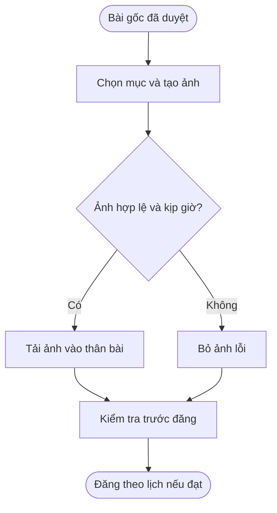
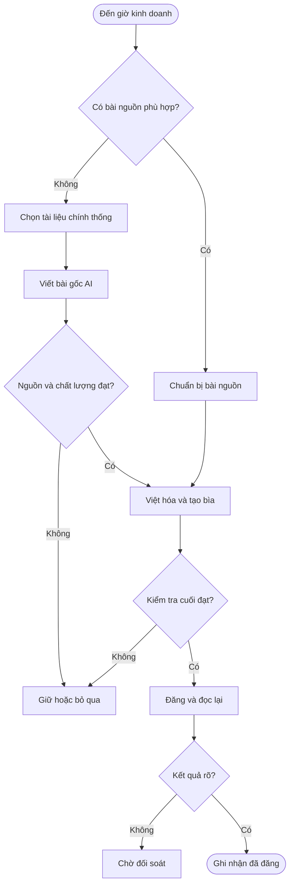
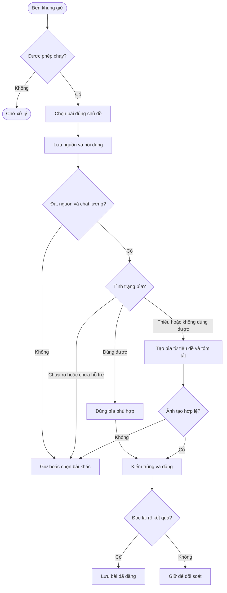
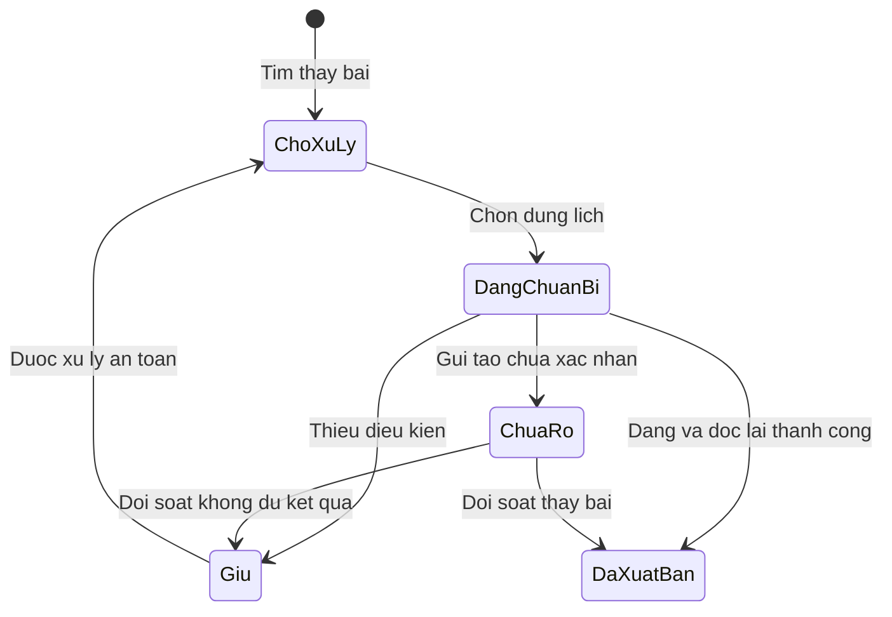
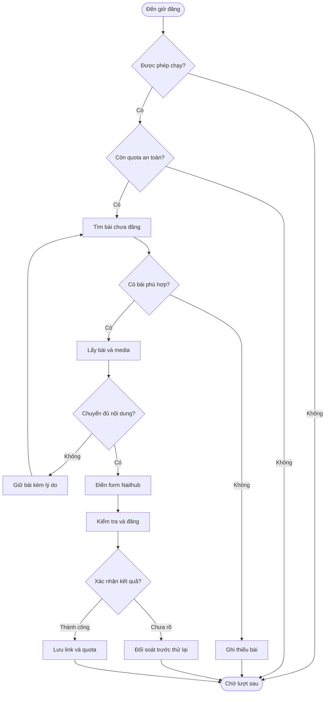
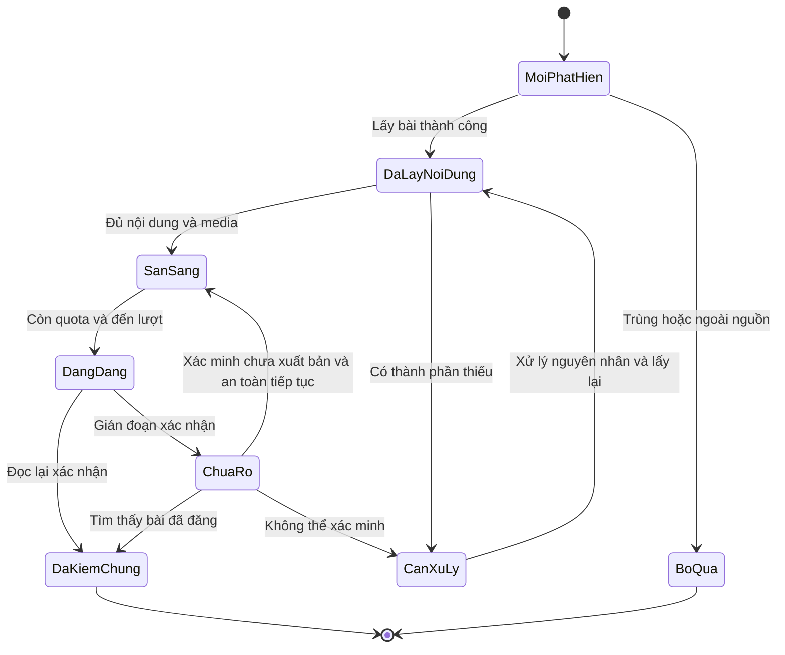

# Tự động đăng lại bài nguồn lên Nailhub PROD

## Cập nhật 04/11/2026, 12:45 ICT — Sửa vòng factual HOLD

- Đã sửa `original_business.py` để một factual review **HOLD hợp lệ, có issue** được để `source_quote` rỗng cho câu chưa tìm thấy bằng chứng và đi vào tối đa một vòng sửa. Mọi quote không rỗng vẫn phải là đoạn nguyên văn trong nguồn; kết quả **PASS** vẫn bắt buộc đủ quote hợp lệ cho từng câu và qua adjudication độc lập. Không chuyển HOLD thành PASS.
- Sau triển khai có backup, giữ worker lock trong lúc dừng/khởi động worker, không có attempt `intent`/`unknown`; 6 kiểm thử tổng hợp đạt trước và sau cài. Bản thực về nhận diện đề nghị tài trợ giả danh đã vào correction, nhưng vẫn **HOLD** vì review tiếp theo báo PASS với hai quote không có nguyên văn trong nguồn. Không stage hoặc gán slot bài đó; đây không phải bằng chứng có bài business sẵn sàng đăng.

## Cập nhật 04/11/2026 — Đăng bù 12:00 và dự phòng

- **12:00 đã đăng bù:** [Hướng dẫn vẽ móng sọc negative space với bộ sưu tập Gellux Festival Edit](https://nailhub.ai/blog/huong-dan-ve-mong-soc-negative-space-voi-bo-suu-tap-gellux-festival-edit), attempt 32, trạng thái `published`; kiểm độc lập trang khách HTTP 200, có bốn ảnh trong thân và một liên kết Scratch. Bản dịch giữ tên màu và thời gian theo nguồn. Bản kiểm MQM mới PASS sau khi xác thực lại source và provenance của generation envelope; không dùng audit cũ như PASS.
- **Vì sao cần đăng bù:** bài Abstract được gắn 12:00 bị giữ vì chính nguồn có bước 1–5 rồi đánh số 5 lần nữa; snapshot nguồn không bị sửa. Bài Autumn được thử và giữ do MQM; bài Stripe ban đầu bị giữ sai do mạo từ tiếng Anh bị coi là phần tên sản phẩm. Validator được sửa hẹp, test và review trước khi chạy MQM mới. `slot_runs` 12:00 được đối soát từ `held` thành `published` theo attempt 32 trong transaction dưới worker lock; lịch sử attempt và notice event được giữ nguyên, không gửi thông báo thủ công. Evidence đối soát nằm trong báo cáo vận hành.
- **Dự phòng bốn khung:** luồng gốc của khung chưa gắn bài vẫn chạy trước, bao gồm official và AI original. Nếu chỉ bị `QualityHold` trước khi tạo attempt, còn thời gian và không có slot đã reserve hoặc `intent`/`unknown`, hệ thống có thể thử tối đa ba ứng viên hợp khung chưa thử, không lấy bài đã gắn lịch. Mỗi lần vẫn qua quota, nguồn, trùng lặp và gate hiện hữu; dừng trước giờ kế tiếp 5 phút. Dự phòng không áp dụng khi kết quả đăng có thể chưa rõ và không bảo đảm mọi slot có bài. Candidate có 29 test đạt; chưa xác nhận fallback tự động đi hết publish trong slot thực.
- **Tên màu và mùa:** phân loại bài Tartan nay không coi riêng cụm tên sản phẩm chứa “Pumpkin Juice” trong nội dung là Halloween; từ khóa mùa trong tiêu đề, URL, alt hoặc chỗ khác vẫn được kiểm. Sáu test candidate đạt; snapshot Tartan thực được kiểm lại thành `other`, hợp 12:00, vẫn `ready`; không đăng thử bài này. Khung 16:00 vẫn cần kiểm trạng thái thực tế sau khi chạy, không giả định đã đăng.


## Lịch hiện hành — 04/11/2026

Theo giờ Việt Nam, **08:00, 16:00 và 20:00** dành cho kinh doanh, vận hành và marketing; **12:00** dành cho mẫu nail. Đây là chính sách chọn chủ đề, không bảo đảm mỗi slot có bài được đăng: ứng viên vẫn phải đạt kiểm tra nội dung, nguồn, trùng lặp, quota và thời hạn. Các mốc phân bổ khác trong những cập nhật cũ bên dưới là lịch sử tại thời điểm ghi, không phải lịch hiện hành.


## Cập nhật 04/11/2026, 10:50 ICT — Ảnh trong bài gốc

- **Phạm vi:** với bài gốc do AI tạo và đã được duyệt nội dung, hệ thống lập kế hoạch **3–5 ảnh minh họa** từ tiêu đề bài, tiêu đề từng mục H2 và nội dung liên quan. Prompt hướng ảnh phù hợp bối cảnh tiệm nail, không đưa số liệu tài chính, kết luận pháp lý, điều trị y khoa, logo hoặc chữ giả. Đây là mục tiêu theo điều kiện chạy; không cam kết đủ 3 ảnh. Bản cũ không đủ cấu trúc mục phù hợp có thể đăng không có ảnh bổ sung.
- **Thời gian và lỗi:** nếu slot còn đủ thời gian, ảnh có tối đa **360 giây tổng**, không quá **65 giây cho mỗi lượt**; hệ thống dành tiếp 80 giây cho tải ảnh và 450 giây cho đường xuất bản. Ảnh tạo hoặc tải lỗi được ghi nhận, bỏ riêng và bài có thể tiếp tục với số ảnh hợp lệ ít hơn hoặc không có ảnh. Những kiểm tra nội dung, nguồn, trùng lặp, quota và thời hạn đăng vẫn áp dụng. Việc mở lại form sau lỗi ảnh có thể phải tải lại ảnh bìa bắt buộc; nếu bìa đó lỗi, bài vẫn có thể bị giữ trước Create.
- **Nguồn và hiển thị:** liên kết tới nguồn của nội dung vẫn giữ; ảnh minh họa không hàm ý nguồn đã cung cấp hoặc chứng thực ảnh. Dấu vết tạo ảnh và kiểm chứng lưu nội bộ, không thêm nhãn AI công khai; policy ảnh bìa và credit nguồn không đổi.
- **Đã triển khai, còn giới hạn:** reviewer độc lập đã duyệt rollout có điều kiện. Sau cài, worker và hai socket ảnh hoạt động, không có attempt `intent`/`unknown`; 15/15 file cài đặt khớp candidate, 60 lượt kiểm thử tự động đạt (có bài kiểm thử kế thừa trùng). Canary dùng snapshot và cơ sở dữ liệu bản sao tạo và tải được **1 ảnh thật**, xác thực bìa và hiển thị 1 ảnh trong mỗi bản VI/EN trước khi dừng có chủ đích trước Create. Vì fixture là bản sao bài đã đăng, canary bỏ qua kiểm trùng chỉ trong script thử; không xem đó là kết quả kiểm trùng thực. Canary tạo media thử trên CDN nhưng không tạo bài; chưa xác nhận bài scheduled thật được lưu hoặc đọc lại công khai cùng ảnh. Bản sao profile và khóa thử đã được xóa. Backup khôi phục: `/var/backups/nailhub-body-rollout-20261104T035001Z`.




## Cập nhật 03/11/2026, khoảng 15:45 ICT

- **Sửa bản bảo mật đang HOLD:** không sửa snapshot hay evidence đã ký của `190ea45c…`. Một bản nháp thay thế đã được tạo trong thư mục báo cáo riêng, giữ nguồn SBA cùng hash; model factual và adjudicator PASS, reviewer đối chiếu 33/33 quote với nguồn. Tuy vậy, reviewer vẫn giữ bài để sửa: câu về EMV có thể bị hiểu là bảo đảm trách nhiệm pháp lý; ẩn SSID có thể tạo cảm giác đủ an toàn; và nhận định nhân viên là đường dẫn chính cần quy rõ nguồn hoặc bỏ. PASS của model không tự giải quyết các điểm này; chưa có bản Việt, ảnh bìa hay bài đăng được xác nhận cho revision này.
- Đã triển khai prompt yêu cầu giữ điều kiện của nguồn, không biến biện pháp giảm rủi ro thành bảo đảm tuyệt đối; hướng dẫn Việt hóa phân biệt mạng Wi‑Fi ẩn và ẩn danh, yêu cầu hashtag có nghĩa và liên quan. Đây là chỉ dẫn model, không thay cho kiểm tra nguồn/MQM. Có 17 test hồi quy và 2 test prompt đạt; backup `/opt/nailhub-source-mirror/backups/accuracy-prompt-20261103`. Worker, broker và timer đã được hậu kiểm.
- Một lượt sửa thêm đã tự dừng trước gọi model/ghi DB vì còn dưới 5 phút tới cutoff 15:50; không reserve/Create. Đến 15:45, bài bù 12:00 vẫn chưa đăng và `190ea45c…` vẫn held. Khung 16:00 giữ lịch cũ; phải kiểm tra trạng thái thực tế sau giờ chạy, không giả định đã đăng.


## Cập nhật 03/11/2026, khoảng 15:20 ICT

- **Bố cục bài mới:** luồng tạo bài gốc yêu cầu các mục với tiêu đề, đoạn văn ngắn và ít nhất một danh sách có ích; hệ thống tạo HTML `h2`, `p`, `ul`, `li`. Mỗi tiêu đề, câu và ý danh sách vẫn phải được đối chiếu nguồn và qua MQM; bản cũ vẫn được xác minh bằng schema cũ. Prompt Việt hóa yêu cầu tiêu đề, mô tả và hashtag phù hợp nội dung, tự nhiên, tránh nhồi từ khóa hay hứa thứ hạng. Prompt mới yêu cầu nêu bối cảnh nguồn một lần, văn phong trực tiếp, hạn chế lặp disclaimer/câu hỏi chung chung; link nguồn vẫn giữ, provenance AI tiếp tục lưu nội bộ.
- **Kiểm chứng và giới hạn:** 17 test chọn lọc đạt; canary trên trình soạn thảo thật chặn mọi request ghi cho thấy H2/P/UL/LI sau paste khớp cấu trúc trước paste. Chưa chứng minh bài gốc có cấu trúc mới đi hết Create → published → đọc lại công khai. Prompt là chỉ dẫn cho model, không bảo đảm mọi bài đều hay hay đúng. Backup deploy gần nhất: `/opt/nailhub-source-mirror/backups/layout-wording-20261103` (backup bố cục trước đó: `layout-20261103`).
- **Bài bù 12:00 chưa đăng:** slot 12 có 3 claim HOLD; các ứng viên location/marketing cũ bị kiểm tra trùng ngữ nghĩa giữ lại. Một draft continuity bị giữ vì các gợi ý không có quote hỗ trợ; draft cyber đầu bị dừng trước reserve khi reviewer phát hiện bỏ điều kiện “nếu có thể” của nguồn SBA. Đã lập proof đối soát riêng `reports/catchup-20261103-1200-cyber-reconciliation.json`: workflow đó không reserve/Create theo bằng chứng DB, khóa và journal; không suy ra hành vi của writer độc lập.
- Một bản cyber khác được chuẩn bị **held** trong transaction để không lộ `ready` khi process lỗi. Review độc lập chỉ ra nhiều câu diễn đạt quá tuyệt đối; MQM bản Việt HOLD do dịch “hidden” thành “ẩn danh” và một hashtag không liên quan. Chưa có candidate được phép đăng bù, chưa reserve/Create. Không nới kiểm tra nguồn, trùng, quota, unknown hoặc deadline để ép đăng.
- **Trạng thái 15:20:** ngày 03/11 có một bài 08:00 published; không có `intent`/`unknown`, worker, hai broker và hai timer đang hoạt động. Lịch 16:00 không đổi; chưa thể cam kết bài sẽ đăng. Hàng đợi và kết quả phải được kiểm tra lại tại thời điểm chạy.


## Cập nhật vận hành ngày 02/11/2026, khoảng 08:15 ICT

- **Hiển thị công khai:** bản chạy mới đã bỏ nhãn cho biết bài hoặc ảnh bìa do AI/Antigravity tạo khỏi footer và nội dung công khai. Link nguồn thực tế vẫn giữ; không gán sai tác giả con người. Provenance, credit, policy và evidence ảnh vẫn lưu nội bộ. Các bài đã đăng trước khi thay đổi không được sửa. Nội dung do mô hình tự sinh vẫn phải được kiểm tra; thay đổi này không chứng minh mọi bài về sau chắc chắn không có chữ AI.
- Với bài nguồn chính thức, payload đã staging theo cách hiển thị cũ được kiểm tra tương thích **trước khi reserve**; nếu không khớp builder mới thì bỏ qua để staging lại, giữ nguyên evidence cũ. Không sửa trực tiếp payload/evidence đã ký.
- **08:00, 02/11:** attempt 20 đã `published`: [Mẫu móng milky glitter ombré lấp lánh](https://nailhub.ai/blog/mau-mong-milky-glitter-ombre-lap-lanh). Kiểm tra browser chỉ đọc trên trang công khai trả HTTP 200, không thấy các chuỗi nhãn AI/Antigravity đã kiểm, và link **Scratch Magazine** dẫn đến nguồn gốc. Lượt chuẩn bị trước đó HOLD do bản dịch lặp từ; worker sáng đã tạo bản mới và đăng thành công.
- **12:00 / 16:00 / 20:00:** ba lượt chuẩn bị nguồn kinh doanh riêng trước giờ đăng đều HOLD, chưa có bài nào được xác nhận sẵn sàng qua toàn bộ bước kiểm tra. SBA Manage: review cuối HOLD 2 major do trích dẫn chưa hỗ trợ hai nhận định; SBA Grow: replay với nguồn fetch sau đó báo một quote không khớp nguyên văn, có ký tự thay thế; California: review cuối HOLD 3 major/8 minor về hỗ trợ và phạm vi. Kết quả này không có nghĩa là ba khung giờ đã đăng hoặc chắc chắn sẽ thất bại; worker vẫn thử theo lịch và kiểm tra lại nguồn, MQM, trùng lặp, quota trước Create.
- Lần hậu kiểm có worker, hai broker ảnh và timer hoạt động, không có attempt `intent`/`unknown`. Triển khai có backup `/opt/nailhub-source-mirror/backups/public-attribution-20261101`; test stage gồm 13 kiểm tra payload/footer và một kiểm tra payload cũ bị dừng trước reserve. Chưa kiểm chứng đầu-cuối bài official có ảnh sinh mới sau thay đổi. Các dòng cũ bên dưới mô tả lịch sử và được cập nhật này ưu tiên khi khác nhau.


## Metadata

- Version: v1.0.77 (giữ tên file gốc để không làm gãy liên kết).
- Created: 2026-10-28 17:40; Updated: 2026-11-01 22:20, giờ Việt Nam.
- Document status: **Approved / Active — Owner yêu cầu proceed đến Published PROD ngày 28/10/2026**.
- Audience: Owner, Marketing, vận hành, Development, QA.
- Harness / data / state owner: AlexChu.
- Executor được Owner chọn: Codex · gpt-6.1-terra · high.
- Branch: `codex/nailhub-source-mirror-docs`.
- Task: `T-261028-nailhub-source-article-mirror-on-thinkpa` trong checkout chính AgentBuilder.
- Không có issue/PR; chưa commit. Product, Engineering, QA và Tasks Doc đã tạo theo chuỗi sau khi Owner yêu cầu proceed; xem §12.
- Đồng bộ tài liệu: Owner yêu cầu ngày 29/10/2026 chép bộ 5 DOCS mới nhất từ worktree về `C:/Users/AD/Documents/GitHub/AgentBuilder/Docs/`, chưa commit. Bản repo chính là điểm đọc chung sau đồng bộ; giữ bản worktree trùng nội dung tại thời điểm bàn giao.
- Phần bổ sung ngày 29/10: đặc tả business `nailblog <URL>` tại §10.1, do Owner yêu cầu; chưa triển khai parser, điểm nhận lệnh hoặc kiểm thử lệnh này trên THINKPAD. Kết quả PROD tại §11.3 là bằng chứng ngày 28/10, không phải kiểm tra vận hành mới ngày 29/10.

## 0. Trạng thái vận hành hiện tại — 01/11/2026, 22:20 VN

Phần này là mốc hiện hành sau yêu cầu và triển khai mới nhất; các phần sau ghi cả quyết định, đề xuất và kết quả **tại thời điểm lịch sử**. Nếu nội dung cũ nói chưa có Việt hóa, ảnh AI, Telegram hoặc nguồn chính thống, hãy đọc theo ngày của mục đó, không coi là trạng thái mới nhất.

### Hoàn tất khảo sát các ranh giới còn lại — 01/11 khoảng 22:20 VN

`strict_json`, `model_response` và `validate_review` đã được nhiều consumer dùng chung; phạm vi fence được truyền rõ ở consumer. Tách tiếp toàn bộ `localization.py` lúc này có nhiều call site và binding evidence, chưa chứng minh được lợi ích hay tính tương thích nên chưa thay đổi. AST của 81 module, chuẩn hóa tên hàm, chỉ còn hai hàm `main` entrypoint giống nhau từ ba dòng trở lên; chúng nạp hai broker/policy khác nhau, không gộp chỉ để giảm vài dòng. Đây là kiểm tra AST tĩnh, không khẳng định không có đoạn trùng một phần hoặc import động.

Guard có contract khác nhau: đường publish official `official_scratch_publish.verify_media` dùng kiểm HTTP 200 qua `scratch_cdn_readback`; `official_native_guard.readback` trả bytes và còn được dùng bởi `official_visual_evidence.inspect` cho prototype/review. Không thay chúng bằng một contract hoặc khôi phục so sánh CDN vào guard publish. Kiểm kê service/socket/timer của 9 module không có import tĩnh được ghi trong [tham chiếu agent](research/nailhub-source-mirror-noissue_agent-reference_261101_v1.0.0.md); không xóa module nào. Ảnh nguồn quá 10 media chưa được tự cắt. Các tối ưu khác chưa xác minh vẫn để sau; chưa có bài original được quan sát đi trọn Create/Published/readback sau các lát mới.

### Thống nhất chọn chủ đề theo slot — 01/11 khoảng 22:16 VN

Đã dùng cùng `slot_policy` khi chọn ứng viên scheduled và kiểm lại trước chuẩn bị: 08 nail, 12/16/20 business. Chỉ ứng viên hợp slot mới tham gia ưu tiên bài không theo mùa/Halloween; do đó bài sai giờ không còn che một bài Halloween hợp 08. Thứ tự ứng viên scheduled hợp lệ theo queue ổn định; `topics.priority_slots` business/luxury cũ vẫn được chấp nhận để tương thích, nhưng **không xếp lại scheduled**; đường manual không gắn slot giữ thứ tự cũ với fallback luxury. Giới hạn Halloween, tax, quota và UNKNOWN được giữ. Thay đổi này có chủ ý về thứ tự lựa chọn, không bảo đảm phân loại heuristic luôn đúng.

Stage đạt **326 test, 26 skipped**; probe DB/snapshot live chỉ đọc cho cùng tập hợp hợp slot trước/sau tại thời điểm kiểm (08: 10; mỗi giờ business: 1), không ghi DB. Reviewer độc lập PASS logic/installer/hậu kiểm; sau cài 81 file khớp bundle, DB integrity OK, không unresolved, worker/broker/timer active/enabled. Backup `/opt/nailhub-source-mirror/backups/slot-unify-20261101`; không restore DB. Không có Create/publish thử, và kết quả scheduled thực tế sau thay đổi chưa được xác nhận.

Kiểm kê AST ghi nhận 9 module không có import tĩnh đi vào, gồm `__init__`, `isolated_media_validator`, `official_auto_gate`, `official_autostage`, `official_cover_entry`, `official_review_worker`, `publication_gate`, `scratch_cover_entry`, `telegram_command_ipc`. Nhiều module là entrypoint/hành vi động: **không kết luận unused, không xóa** nếu chưa kiểm mọi service/CLI/call site và evidence. Bài nguồn có hơn 10 media vẫn bị giữ trước tải theo hành vi cũ; không tự cắt ảnh tải được. Các lát refactor khác còn chờ khảo sát, không coi toàn bộ kế hoạch đã hoàn thành.

### Đơn giản hóa scanner kiểm trùng — 01/11 khoảng 22:11 VN

Đã dùng chung hai phép giống nhau: tính timeout và giải mã response admin. Nhánh official vẫn kiểm nguồn URL theo từng trang; nhánh bài gốc vẫn kiểm title/summary và semantic riêng, với kiểu lỗi và lý do riêng. Không gộp kết luận trùng, không thay pagination, quota, guard hay policy. Lưu ý khi instrumentation: alias helper của nhánh original phải được patch ở đúng namespace dùng nó.

Stage đạt **324 test, 26 skipped**. Reviewer độc lập xác nhận hợp đồng đọc giữ nguyên; probe GET-only thật dưới khóa quét ổn định 147 ID/15 trang hai lượt cho mỗi nhánh, không gọi model và không Create. Cài xong 81 file khớp bundle, worker/broker/timer active/enabled, integrity OK, không unresolved; backup `/opt/nailhub-source-mirror/backups/scan-unify-20261101`. Không restore DB. Kiểm trùng vẫn không nguyên tử với writer độc lập; probe không chứng minh một bài đã Published. Những phần đơn giản hóa khác chỉ tiếp tục theo từng lát sau review, không coi toàn bộ plan đã xong.

### Cập nhật bộ lọc — triển khai 01/11 lúc khoảng 22:05 VN

- Consumer kiểm factual/adjudicator của bài gốc và kiểm trùng giờ nhận JSON thô hoặc một hàng rào Markdown bao trọn JSON, vẫn strict schema, cấm duplicate keys/NaN và giữ verdict HOLD; generation đầu không được nới. Replay evidence thật: SBA Grow 16:00 fenced PASS đọc được, California 16:00 vẫn HOLD 7 issue, SBA Grow 20:00 vẫn HOLD 1 issue. Đây là replay, không phải bài đã đăng.
- Bộ lọc SBA phân biệt mua doanh nghiệp/cơ sở với mua thiết bị/dịch vụ theo ngữ cảnh; vẫn chặn các chủ đề pháp lý/thuế và technical như trước. `Build a luxury nail salon` nhận business, ví dụ build gel/acrylic nails được đánh dấu không rõ thay vì business. Hai quy tắc là heuristic, không bảo đảm nhận mọi cách nói; giữ nguồn, glossary và MQM.
- Duplicate precheck và kiểm trước Create ghi audit bền vững theo article/phase, outcome và reason code an toàn, không lưu raw payload hoặc exception text tùy ý; nếu không ghi được audit, bước đăng không tự đi tiếp. Quét admin chỉ đọc lúc khoảng 22:04 trả khác biệt trên 147 bài và ghi audit canary; **không chứng minh lý do HOLD 20:12**. Cạnh tranh với tác giả độc lập vẫn không nguyên tử.
- Stage đạt 321 test, 26 skipped; reviewer độc lập kiểm các ví dụ đối nghịch và installer. Cài bốn module, backup `/opt/nailhub-source-mirror/backups/filters-20261101`; hậu kiểm 81 file khớp bundle, worker/broker/timer active/enabled, integrity OK, không unresolved. Không đổi HTTP 200-only, policy, quota, guard, không tạo/publish bài thử. Lịch và kết quả thật ở slot sau vẫn cần theo dõi.

### Kế hoạch đơn giản hóa Python — Owner yêu cầu 01/11

**Kết quả lát đầu — 21:52 VN:** đã tách sáu hàm framing/socket/kiểm ảnh có AST và source giống nhau của hai broker vào `cover_ipc_common.py`; request, serve, policy, đối chiếu UID/GID và source scope vẫn riêng; helper peer/socket dùng chung. Đây là giảm mã trùng, **chưa giảm số module**: từ 80 lên 81 do thêm helper, vẫn 44 `official_*.py`. Các pha tiếp theo trong plan chưa thực hiện. Không thay bộ lọc, lịch, quota, DB hay policy; không Create/publish bài thử.

Stage đạt 314 test, 26 skipped; một test cũ được cố định budget slot trong stage để không phụ thuộc giờ. Reviewer độc lập xác nhận logic trước cài. Probe IPC tách biệt từ chối đúng source sai ở cả hai broker; một lần tạo ảnh thật `ai_original` PASS (SHA ảnh bắt đầu `a08fcc8c`). Mô phỏng SIGKILL/khôi phục cây cũ và mới dùng service giả lập, không phải thử mất điện thật. Sau cài: 81 file khớp bundle, worker và hai broker/timer active/enabled, peer socket PASS, DB integrity OK, không có intent/unknown; IPC Scratch giữ hash policy cũ. Backup `/opt/nailhub-source-mirror/backups/simplify-cover-20261101`; không restore DB khi rollback. Chưa chứng minh bài được Published hay chạy tất cả nguồn qua model sau thay đổi.

- **Mốc kiểm kê live 21:44 VN:** package Python trên THINKPAD có 80 module cấp đầu, trong đó 44 tên `official_*.py`; worker và hai broker bìa đang active. Số lượng mô tả cấu trúc, không tự chứng minh module nào thừa hoặc an toàn để xóa.
- **Pha 1 — lát cắt nhỏ:** từ bản live có hash, xác định phần xử lý lặp giữa broker ảnh nguồn chính thống và broker Scratch/bài gốc; chỉ tách helper khi so sánh chứng minh cùng hành vi. Giữ riêng đối chiếu UID/GID, policy, nguồn, request và quyền sử dụng; helper peer/socket có thể dùng chung; không hợp nhất scope hay thay contract. Kiểm thử dương/âm và nhờ reviewer độc lập trước deploy.
- **Pha 2 — review tiếp:** thống kê call site, test và đường chạy thật; tiếp tục gộp từng phần thực sự trùng, tránh viết lại hàng loạt, không xóa module/chuyển chức năng chỉ dựa trên tên. Các thay đổi bộ lọc trong guide vẫn là đề xuất riêng, không mặc định được thực hiện trong refactor.
- **Pha 3 — triển khai theo từng lát:** snapshot DB và mã, đối chiếu baseline, giữ khóa dùng chung, kiểm không có intent/unknown và không đụng lịch đang chạy; thay đổi có backup/rollback, kiểm worker, broker, socket và policy sau cài. Không restore DB cũ, không tạo/publish bài thử, không commit.
- **Bất biến:** 08 nail, 12/16/20 business; nguồn/attribution chính xác, glossary/MQM, 4 bài/ngày của workflow, duplicate/unknown, một vòng sửa giới hạn, kiểm CDN HTTP 200-only và thông báo hiện có. Chỉ ghi kết quả được kiểm chứng; chưa coi plan là thay đổi hoàn thành.

### Tài liệu bộ lọc và kết quả 16:00 / 20:00 — 01/11

[Bộ lọc và cách xử lý](research/nailhub-source-mirror-noissue_filter-guide_261101_v1.0.0.md) ghi chi tiết từng điều kiện đang cài, đầu vào, kết quả, reason và ví dụ; các điều chỉnh trong đó chỉ là đề xuất, chưa triển khai. Ba lượt 16:00 và ba lượt 20:00 đã HOLD trước Create, không có attempt mới trong DB workflow. Riêng một bài gốc 20:00 đã qua nội dung và Việt hóa nhưng dừng ở duplicate precheck; log không đủ chi tiết để kết luận có trùng thật. Worker/broker vẫn active tại mốc kiểm, official autostage có lần `ScheduleUnavailable`; xem tài liệu bộ lọc để phân biệt lỗi JSON bọc Markdown, regex quá rộng và factual HOLD thực chất.

### Bài gốc khi thiếu nguồn phù hợp — triển khai 01/11

- Khoảng 13:28 VN, đã cài trên THINKPAD luồng dự phòng cho ba khung **12:00, 16:00 và 20:00**: khi không chọn được ứng viên nguồn thông thường, AGY có thể viết bài gốc về kinh doanh tiệm nail dựa trên tài liệu chính thống. 08:00 vẫn dành cho nội dung nail; luồng bài gốc này không tự chạy ở 08:00. Quota bốn bài/ngày, khóa chung và xử lý lượt chưa rõ vẫn được giữ.
- Các nguồn tham khảo cố định gồm SBA [khởi sự](https://www.sba.gov/counseling/launch-your-business/), [quản lý](https://www.sba.gov/counseling/manage-your-business/), [phát triển](https://www.sba.gov/counseling/grow-your-business/) và [FAQ California Board of Barbering and Cosmetology](https://www.barbercosmo.ca.gov/forms_pubs/publications/faqs). Thứ tự ưu tiên xoay theo ngày và khung giờ; đây chưa phải khám phá toàn bộ nguồn. Sau cài đã tải được cả bốn trang; 16:00 ngày 01/11 ưu tiên SBA quản lý nếu cần dùng dự phòng. Nội dung giấy phép/tín chỉ từ California chỉ có phạm vi California, không suy ra quy định bang khác.
- Tại thời điểm triển khai 01/11, bài gốc ghi rõ do AI tạo; từ 02/11, thông tin này được giữ nội bộ và bài công khai kèm nguồn tham khảo thật, không ghi Scratch hay cơ quan nguồn là tác giả. Tiêu đề và từng câu được đối chiếu với trích đoạn nguồn, rồi rà soát bằng lượt AI khác; Việt hóa, glossary và MQM vẫn áp dụng. Một lần sửa có giới hạn được phép khi phản hồi kiểm tra đủ điều kiện; bài không xác minh được bị giữ. Các bước tự động có tính xác suất, không phải chứng nhận chuyên môn hay bảo đảm mọi thông tin đúng.
- Mỗi bài giữ nội dung, nguồn, bằng chứng và bìa AI trong cùng thư mục; bìa dựa trên tiêu đề và tóm tắt cuối. Kiểm trùng rà danh sách quản trị và tương đồng ngữ nghĩa, nhưng không khóa được tác giả độc lập hay bảo đảm tuyệt đối. Nguồn thiếu/thay đổi, nội dung mơ hồ, lỗi chất lượng, thiếu thời gian hoặc tạo bài chưa rõ có thể khiến bài bị giữ hoặc bỏ qua.
- Bằng chứng: 311 test stage đạt, 26 skipped; reviewer độc lập đã rà mẫu SBA tiếng Anh theo từng trích đoạn và không thấy sai lệch thực tế. Việt hóa/MQM vượt khi phát lại đúng hai phản hồi AGY đã lưu; quét trùng thật trên 144 bài trả kết quả khác biệt; canary tạo bìa thật cho bài gốc và Scratch đều thành công. Hậu kiểm độc lập: package khớp bản cài, worker, hai broker bìa và timer active/enabled, DB integrity OK, không có lượt chưa rõ. Backup: `/opt/nailhub-source-mirror/backups/original-v2-20261101`; không khôi phục ngược DB chỉ để rollback mã.
- **Chưa có bằng chứng bài gốc tự động đi hết Create → Published → đọc lại trên PROD sau triển khai.** Kiểm thử và canary không phải bài đã đăng. Slot 12:00 ngày 01/11 thử ba ứng viên nhưng đều bị giữ vì chủ đề không phù hợp, không tạo lượt đăng; không cam kết slot 16:00 thành công.



### Cập nhật kiểm tra ảnh và xử lý slot 08:00 — 01/11

- **Chính sách hiện hành theo yêu cầu Owner:** sau khi tải ảnh lên, kiểm tra URL CDN bằng HTTPS và yêu cầu **HTTP 200** cho ảnh và thumbnail nếu có. Giữ giới hạn thời gian, kiểm tra domain/địa chỉ mạng và đối chiếu thông tin nguồn, file gốc, receipt upload với dữ liệu bài. Không tải/giải mã hoặc so sánh nội dung ảnh CDN trong kiểm tra này. Vì vậy HTTP 200 chỉ cho biết URL phản hồi thành công, **không chứng minh nội dung trả về là ảnh đúng hoặc giống ảnh gốc**. Chính sách áp dụng cho đường đăng Scratch và đường đăng nguồn chính thống; các kiểm tra nguồn, glossary, MQM và chống trùng khác vẫn được giữ.
- Lượt 08:00 cho bài nguồn [Rainbow daisy nails](https://www.scratchmagazine.co.uk/nail_art/rainbow-daisy-nails/) đã tải thành công sáu ảnh nhưng bị giữ trước khi Create: bước đọc CDN gặp `OSError` do socket đã đóng, sau đó giao diện chờ phản hồi Create 30 giây. Guard ghi `allowed: false`, phase lưu bền vững là `pre_create`; hai tìm kiếm admin GET-only theo tên VI/EN đều không có kết quả. Đây là bằng chứng hỗ trợ kết luận lượt này chưa tạo bài; tìm kiếm theo tên không loại trừ mọi bài do người khác tự tạo với tên khác.
- Theo yêu cầu Owner, attempt 18 đã được đối soát thành `released` lúc khoảng 10:01; ảnh/receipt và bản bằng chứng được giữ tại `/var/lib/nailhub-source-mirror/reports/attempt-18/reconciliation-http200-20261101.json`. Slot 08:00 vẫn được đánh dấu đã xử lý, không tạo lượt đăng bù; bài có thể được xem xét ở một khung 08:00 phù hợp sau này, không chọn cho 12:00 kinh doanh.
- Bản kiểm tra HTTP 200 được triển khai sau review độc lập, sao lưu DB/mã và thay đổi package nguyên khối. Cả sáu URL thật của attempt 18 trả HTTP 200 qua mã mới; 286 test của bản stage đạt, 26 skipped, cùng 24 test tập trung cho nhánh ảnh/guard đạt. Worker đã restart và active, không còn intent/unknown và DB integrity OK. Backup: `/opt/nailhub-source-mirror/backups/http200-20261101-v2` trên THINKPAD.
- Tại mốc 10:02, khung **12:00 ngày 01/11** còn mở, dành cho bài kinh doanh; worker không tạm dừng và các dịch vụ/timer gốc đang active khi hậu kiểm. Chưa có bài thành công từ luồng mới trong ngày tại thời điểm ghi; việc đăng 12:00 vẫn phụ thuộc ứng viên phù hợp và các cổng chất lượng, không phải kết quả đã xác nhận.

### Mục tiêu, lịch và phạm vi

| Giờ Việt Nam | Chủ đề được chọn tự động | Ngày bắt đầu áp dụng |
|---|---|---|
| 08:00 | Một bài nội dung nail phù hợp. | Sau triển khai 22:17 ngày 31/10. |
| 12:00 | Nội dung kinh doanh hữu ích cho tiệm nail. | Như trên. |
| 16:00 | Nội dung kinh doanh hữu ích cho tiệm nail. | Như trên. |
| 20:00 | Nội dung kinh doanh hữu ích cho tiệm nail. | Như trên. |

Ba khung kinh doanh phục vụ vận hành, tăng trưởng, thanh toán, thuế hoặc quy định có liên quan; không chọn bài hướng dẫn kỹ thuật nail thuần túy cho các khung này. Nội dung kinh doanh tổng quát của IRS/SBA vẫn có thể phù hợp cho chủ tiệm dù nguồn không nhắc chữ nail: cần biên tập đúng bối cảnh, không thêm dữ kiện mà nguồn không có. Đây là phân loại bằng quy tắc, không bảo đảm hiểu đúng mọi bài; bài mơ hồ có thể bị giữ hoặc bỏ qua. Không mặc định giới hạn loại chủ đề theo một domain. Danh mục thu thập nguồn chính thống hiện là danh sách URL cố định; phạm vi publish đã bật CDC/NIOSH, IRS và SBA, không đồng nghĩa đã có khám phá liên tục mọi bài mới trên các website này.

Mục tiêu và trần là **bốn bài xuất bản của riêng workflow mỗi ngày theo giờ Việt Nam**; bài của người/luồng khác trên PROD không tự động được cộng vào quota này. Mỗi slot tối đa một bài; thiếu ứng viên phù hợp có thể thiếu bài, không đăng nội dung sai chủ đề chỉ để đủ số. Lệnh URL thủ công và quota/chống trùng dùng cùng dữ liệu vận hành, không tạo cơ sở dữ liệu riêng.

### Luồng hiện hành

| Bước | Hành động và điều kiện |
|---|---|
| 1 | Đến giờ, kiểm tra tạm dừng, quota của workflow, lượt chưa rõ kết quả và khóa dùng chung trước khi chọn bài. |
| 2 | Chọn ứng viên phù hợp khung giờ; giữ bản nguồn và thông tin dẫn nguồn trong thư mục riêng của bài. Kiểm tra trùng trước khi tạo. |
| 3 | Chuẩn bị nội dung EN/VI, tiêu đề, tóm tắt, SEO và phân loại phù hợp; đối chiếu glossary, dữ kiện, nguồn và MQM. Bài chưa đạt được giữ để kiểm tra. |
| 4 | Dùng ảnh bìa nguồn hợp lệ khi đường xử lý hỗ trợ. Nếu bìa Scratch thiếu hoặc tải/giải mã thất bại, tạo ảnh AI từ **tiêu đề và tóm tắt cuối cùng**; đường nguồn chính thống chỉ tạo AI khi bìa được xác định thiếu hoặc không dùng được. Ảnh và bằng chứng gắn với bài/payload; ghi nhận là ảnh AI. |
| 5 | Ảnh trong thân không bắt buộc: nếu tải thất bại hoặc chưa xác minh được quyền sử dụng thì có thể bỏ ảnh và chú thích đi kèm, giữ nội dung chữ và trích dẫn chính xác. Nguồn chính thống có bìa gốc sẵn dùng nhưng chưa được đường xử lý này hỗ trợ sẽ được bỏ qua/giữ, không tự coi ảnh đó đã được cấp quyền. |
| 6 | Qua các kiểm tra còn áp dụng, thao tác bằng trình soạn Nailhub; lưu ý định trước khi tạo, kiểm tra lại trùng và đọc lại admin/public. Scratch đối chiếu tiêu đề, đường chính thống rà nguồn; kiểm tra không khóa được tác giả độc lập trên PROD nên vẫn có khoảng thời gian có thể phát sinh trùng. Chỉ tính thành công sau khi có kết quả Published xác nhận được. |
| 7 | Lỗi trước tạo có thể bỏ ứng viên hoặc giữ để xử lý; nếu kết quả sau tạo chưa rõ, giữ trạng thái chưa rõ và đối soát trước khi thử lại. Không tự gửi lại mù. |



### Trạng thái và ngoại lệ

| Trạng thái nghiệp vụ | Khi nào | Hành động |
|---|---|---|
| Chờ xử lý | Đã tìm thấy nguồn, chưa đủ điều kiện đăng. | Chọn theo lịch và quota. |
| Đang chuẩn bị | Đang lưu, biên tập hoặc kiểm chứng nội dung. | Không tạo bài song song từ cùng bản ghi. |
| Giữ | Lỗi nguồn, ảnh bìa, chất lượng, chính sách, thời hạn hoặc không rõ chủ đề. | Ghi lý do; thử ứng viên khác khi an toàn. Một số bản đã hết hạn chưa được tự chuẩn bị lại. |
| Chưa rõ | Đã có khả năng gửi thao tác tạo nhưng chưa xác nhận kết quả. | Đối soát; chặn tạo lại khi chưa rõ. |
| Đã xuất bản | Admin/public đã được đọc lại và xác nhận. | Lưu URL; tính vào quota workflow theo ngày xuất bản. |



### Nguồn, thông báo và giới hạn

- Các nội dung thuế/quy định/an toàn cần nguồn chính thức phù hợp, trích dẫn chính xác và phản ánh phạm vi, thời điểm áp dụng; không gán IRS/SBA/CDC khẳng định họ không đưa ra. Giữ đúng nội dung và trích dẫn là yêu cầu chất lượng, không phải bằng chứng mọi nguồn đã được nghiệm thu. MQM và kiểm tra tự động không phải xác nhận đã có chuyên gia hay cố vấn thuế duyệt.
- Telegram dùng transport Nailhub hiện có theo lựa chọn Owner; workflow giữ lịch, state và quota riêng. Owner đã thử `/mirror status` ngày 30/10; thông báo slot đã được cài, nhưng không suy diễn mọi thông báo mới đã được gửi thành công. Lệnh URL hiện được ghi nhận cho phạm vi Scratch hỗ trợ; không khẳng định mọi domain được nhận qua lệnh này.
- Khi kiểm tra lúc 22:19 ngày 31/10, worker, hai dịch vụ tạo bìa AI, hai broker Việt hóa/nguồn và các timer gốc đều active; dịch vụ cần thiết enabled. Timer chuẩn bị kế tiếp 22:30, intake nguồn chính thống kế tiếp 04:30 ngày 01/11. Máy THINKPAD là runtime; Windows không cần chạy thường trực.
- Hai yêu cầu tạo ảnh thật qua các dịch vụ đã cài thành công sau triển khai; kiểm thử toàn bộ bản tích hợp 286 test, 26 skipped, cùng kiểm tra toàn vẹn DB và review độc lập. Đây là bằng chứng thành phần và cấu hình; **chưa quan sát được một lượt tự động Create → đọc lại bài công khai sau triển khai mới**. Không cam kết cả bốn slot ngày mai sẽ đăng thành công.
- Ngày 31/10 workflow có bốn bài Published đã xác nhận, gồm hai bài đăng bù cho 08/12 trước thay đổi chủ đề và [bài 20:00](https://nailhub.ai/blog/cach-su-dung-he-thong-jellie-soft-gel-tips-cua-pure-nails) theo luồng cũ. Quy tắc ba slot kinh doanh áp dụng cho các lượt sau khi triển khai, không thay đổi lịch sử. Lần triển khai trước đó đã rollback do quota tạo ảnh của nhà cung cấp; lần triển khai 22:17 đã hoàn thành sau khi quota được khôi phục.
- Bản sao lưu trước triển khai trên THINKPAD: `/opt/nailhub-source-mirror/backups/release-20261031-business-ai-tomorrow-final`; báo cáo kiểm ảnh: `runtime-validation.txt` trong thư mục này. Không khôi phục ngược DB chỉ để rollback mã. Policy cấp nguồn/ảnh hiện có hạn đến 31/10/2027 và cần được rà soát trước hạn.

## 1. Overview

**Goal được Owner xác nhận:** crawl được một bài thực từ website nguồn, lưu đủ nội dung/media trên THINKPAD, rồi dùng Playwright đăng bài đó ở trạng thái **Published trên Nailhub PROD**. Bài phải có URL công khai và mở đọc được bằng phiên khách. Đây là mốc nghiệm thu end-to-end đầu tiên; crawl local, chạy test hoặc tạo Draft riêng lẻ chưa đạt goal.

**Mục tiêu vận hành tiếp theo:** tự động duy trì 4 bài/ngày theo lịch đã chốt, với cơ chế chống trùng và phục hồi lỗi. Mốc một bài Published không thay thế hoặc loại bỏ yêu cầu 4 bài/ngày.

**Đầu vào Owner đã xác nhận:** một automation độc lập chạy trên THINKPAD, máy khác kết nối với AgentBuilder, lấy bài viết từ website chuyên về nail rồi đăng lại tương tự lên Nailhub PROD bằng Playwright thao tác trên giao diện. Sản lượng yêu cầu là **4 bài/ngày**. Owner yêu cầu làm rõ business DOCS trước khi thực hiện.

Automation phục vụ việc đưa nội dung phù hợp từ nguồn đã chọn lên Nailhub mà không cần người vận hành nhập lại từng bài. Trạng thái Việt hóa, phân loại chủ đề và ảnh AI đang chạy được cập nhật tại §0; các phương án ban đầu tại §10.3 là lịch sử.

Đây là yêu cầu mới, **độc lập hoàn toàn với hệ thống NailBlog**. Các tài liệu, cổng duyệt, trạng thái, quota và luồng AI của NailBlog không phải yêu cầu đầu vào của automation này.

Đích được cung cấp: [Nailhub PROD Admin](https://nailhub.ai/admin/dashboard). Tài khoản đăng nhập do Owner cung cấp riêng; **không ghi credential trong tài liệu, task hoặc mã nguồn**. Màn tạo bài thực đã xác minh tại `/admin/blogs`: Create Blog, Published và Public. Playwright thao tác qua form, upload native và clipboard HTML; đọc lại qua admin và phiên khách.

## 2. Key Concepts

| Khái niệm | Ý nghĩa trong flow này |
|---|---|
| Nguồn | Website/chuyên mục nail đã được Owner chọn để theo dõi và xác nhận phạm vi được đăng lại. |
| Bài nguồn | Một bài viết riêng có URL, nội dung và các media thuộc bài. |
| Bản chụp nội dung | Nội dung và danh sách media của bài nguồn tại thời điểm lấy; dùng để đối chiếu trước/sau khi đăng. |
| Bài đủ điều kiện | Thuộc nguồn được bật, chưa đăng, lấy đủ nội dung/media bắt buộc và có thể chuyển sang Nailhub. |
| Một bài thành công | Một bài Nailhub đã xuất bản, có URL đọc lại được, nội dung/media được đối chiếu với bản chụp nguồn. Bấm Đăng hoặc lưu Draft chưa tính thành công. |
| Kết quả chưa rõ | Đã bắt đầu gửi thao tác đăng nhưng chưa xác nhận được bài có được tạo/xuất bản hay không. |
| Quota ngày | Giới hạn bài xuất bản của riêng automation này trong một ngày theo giờ Việt Nam. |

## 3. Scope và User Roles

### Đã xác nhận

- Chạy automation trên THINKPAD, quản lý trong bối cảnh AgentBuilder.
- Đích là Nailhub PROD; lấy bài từ website bên ngoài chuyên về nail.
- Đăng tương tự bài nguồn, dùng Playwright thao tác như người dùng.
- Tần suất/sản lượng: 4 bài/ngày.
- Flow độc lập hoàn toàn với NailBlog.
- Làm rõ và duyệt business trước khi build/triển khai.

### Đề xuất phạm vi bản đầu

- Theo dõi danh sách website/chuyên mục được cấu hình; nguồn đầu tiên được chọn ở D-01.
- Chạy tự động, tự đăng bài đủ điều kiện; **không yêu cầu duyệt từng bài trong luồng bình thường**.
- Mỗi bài nguồn tạo tối đa một bài đích trong flow này.
- Chạy lần lượt; có lịch, hàng đợi, chống trùng, ghi kết quả và phục hồi sau gián đoạn.
- Không đồng bộ bình luận, lượt thích, lượt xem; không sửa/xóa bài Nailhub khi nguồn thay đổi hoặc biến mất.
- Baseline ban đầu chưa có AI/chuyển ngữ; trạng thái triển khai hiện tại và phạm vi ảnh AI xem §0.

| Vai trò | Trách nhiệm |
|---|---|
| Owner | Chọn nguồn, phạm vi đăng lại, lịch và quy tắc ngày; duyệt business; xử lý ngoại lệ cần quyết định. |
| Marketing / vận hành | Theo dõi kết quả, bổ sung nguồn và kiểm tra bài bị giữ khi được Owner phân quyền. Không tự giả định đã có role này trên Nailhub. |
| Automation trên THINKPAD | Tìm bài, lấy nội dung, thao tác đăng, kiểm chứng kết quả và lưu tiến trình. |
| AgentBuilder | Điểm quản lý/quan sát mong muốn. Màn điều khiển và cơ chế kết nối cụ thể chưa được kiểm chứng trong task này. |

## 4. End-to-End Workflows

### Workflow: Tự động lấy và đăng một bài

**User story:** Là Owner, tôi muốn THINKPAD tự lấy bài nail từ nguồn đã bật và đăng tương tự lên Nailhub, để không phải thao tác nhập lại từng bài.

**Trigger đề xuất:** đến một khung giờ đăng trong lịch ngày.

**Outcome:** bài công khai đã được đọc lại và đối chiếu; lưu liên kết nguồn ↔ đích; tăng bộ đếm thành công trong ngày.

| Bước | Thực hiện | Kết quả / điều kiện |
|---|---|---|
| 1 | Kiểm tra automation được bật và không có lượt khác đang chạy. | Nếu tạm dừng hoặc đang chạy thì không tạo lượt chồng. |
| 2 | Kiểm tra quota ngày và các thao tác đăng còn chưa rõ kết quả. | Không tạo thêm bài nếu có nguy cơ vượt quota. |
| 3 | Mở nguồn đã cấu hình, tìm URL bài và loại bài đã đăng. | Có danh sách ứng viên chưa xử lý. |
| 4 | Chọn bài theo thứ tự được duyệt ở D-03. | Không tự chọn website khác ngoài danh sách. |
| 5 | Mở bài, cuộn/tải đủ nội dung và media thuộc bài. | Lưu bản chụp nội dung và thứ tự media. |
| 6 | Kiểm tra đủ dữ liệu và khả năng chuyển nội dung. | Thiếu thành phần bắt buộc thì giữ bài, có lý do; thử ứng viên khác nếu còn thời gian. |
| 7 | Mở form tạo bài Nailhub bằng phiên riêng của flow. | Xác nhận đúng tài khoản và màn đăng; không giả định dashboard là form tạo bài. |
| 8 | Điền nội dung, chọn/upload media, kiểm tra form. | Đủ thành phần trước khi bấm Đăng. |
| 9 | Bấm Đăng qua giao diện. | Ghi nhận thao tác đang chờ xác nhận để không gửi trùng khi mất kết nối. |
| 10 | Mở bài đích và đối chiếu nội dung/media, trạng thái công khai. | Chỉ ghi thành công khi kết quả được chứng minh; chưa rõ thì chuyển sang đối soát. |
| 11 | Lưu URL đích, ngày đăng, kết quả; kết thúc lượt. | Lượt tiếp theo tiếp tục từ tiến trình đã lưu. |



### Workflow: Phục hồi sau mất mạng hoặc khởi động lại

**User story:** Là Owner, tôi muốn tiến trình được giữ lại sau gián đoạn, để automation không bỏ bài hoặc đăng trùng.

| Trường hợp | Cách phục hồi đề xuất |
|---|---|
| Chưa gửi thao tác tạo/đăng | Tiếp tục từ bước an toàn với nội dung đã lưu hoặc lấy lại bài nếu bản chụp không còn dùng được. |
| Đã bấm tạo/đăng, chưa xác nhận | Tìm và đọc lại bài Nailhub trước; không gửi lại thao tác chỉ vì timeout. |
| Đã có bài Draft | Giữ và yêu cầu đối soát thủ công đúng bài; bản đầu chưa có chức năng tự mở/sửa/tiếp tục Draft. Không tạo bài thứ hai. |
| Đã đăng nhưng chưa lưu kết quả cục bộ | Đối soát bài hiện có, ghi nhận kết quả và tính đúng ngày bài thực sự xuất bản. |
| Không xác định chắc chắn được | Giữ trạng thái chưa rõ và báo vận hành; không tính là thất bại an toàn để đăng bù tùy ý. |


## 5. Business Rules — phạm vi thi hành theo yêu cầu proceed

| ID | Quy tắc |
|---|---|
| BR-01 | Giữ bản nguồn để đối chiếu; bản EN/VI được biên tập theo ngôn ngữ, giữ ý nghĩa, dữ kiện và trình tự cần thiết. Kiểm glossary và MQM trước đăng; chi tiết hiện hành xem §0. |
| BR-02 | Giữ media và credit phù hợp khi dùng được; ảnh thân tải lỗi hoặc chưa rõ quyền có thể bỏ cùng chú thích, giữ phần chữ và trích dẫn. Bìa thiếu/không dùng được có thể tạo AI theo §0. Không mặc định hotlink. |
| BR-03 | Video, embed, bảng hoặc định dạng đặc biệt chỉ được đăng khi Nailhub có cách thể hiện tương đương đã được xác minh. Nếu không đáp ứng, giữ bài và báo thành phần thiếu; không tự cắt bỏ. |
| BR-04 | Không yêu cầu giao diện Nailhub giống từng pixel website nguồn. Mức tương tự được nghiệm thu bằng nội dung, cấu trúc và media. |
| BR-05 | Bài được xuất bản dưới tài khoản Nailhub được cấp. Tác giả và ngày của nguồn chỉ là thông tin dẫn nguồn, không giả lập danh tính hoặc ngày xuất bản của tài khoản Nailhub. Đề xuất thêm tên website và link bài gốc cuối bài. |
| BR-06 | Mục tiêu 4 bài thành công/ngày và trần 4 bài/ngày của riêng flow này. Không coi thao tác bấm Đăng, Draft hoặc kết quả chưa rõ là một thành công đã kiểm chứng. |
| BR-07 | Mỗi lượt dự kiến một bài; lỗi trước thao tác đăng có thể thử ứng viên khác. Không thử lại vô hạn hoặc tạo hơn một bài chỉ vì lượt trước chưa đọc lại được. |
| BR-08 | Lưu nhận diện bài nguồn và bài đích bền vững qua lần chạy/khởi động lại; chuẩn hóa URL để giảm trùng. Phải kiểm tra lại trước khi gửi thao tác đăng. |
| BR-09 | Không đủ 4 bài phù hợp thì báo thiếu và lý do; không tự sinh nội dung, lấy lại bài đã đăng hoặc thêm nguồn để bù. |
| BR-10 | Khi nguồn thay đổi sau lần lấy, đề xuất dùng bản chụp đã ghi nhận cho lượt đó. Bài đã xuất bản không tự đồng bộ lại trong bản đầu. |
| BR-11 | Đăng nhập hết hạn, CAPTCHA, thiếu quyền hoặc thay đổi màn hình không nhận diện được thì giữ công việc và yêu cầu xử lý; không vượt qua bước kiểm tra truy cập. |
| BR-12 | Worker, lịch, hàng đợi, quota, phiên đăng nhập, dữ liệu và log riêng; pause/resume hoặc triển khai flow này không điều khiển NailBlog hay worker khác. Không triển khai bằng cách đổi chế độ worker NailBlog. |
| BR-13 | Chỉ bài có bộ nội dung local hoàn tất và kiểm tra được mới được đưa vào hàng đợi đăng. Không tải được ảnh bắt buộc thì không đánh dấu sẵn sàng. |
| BR-14 | Nội dung đã chốt cho một lượt đăng là bản chụp cố định. File đang tải nằm ở vùng tạm; không ghi đè bộ bài đã chốt hoặc thay media trong lúc đăng. |
| BR-15 | Thao tác trên website nguồn/đích đi qua trình duyệt và giao diện thật. Không gọi API tạo/sửa/xuất bản bài hoặc chèn state ứng dụng để thay thế thao tác người dùng. Việc tải byte media được phép dùng phiên của trình duyệt cho URL media đã quan sát. |

## 6. System Configuration & Administration

**Cấu hình cần có:** nguồn được bật, thứ tự ưu tiên, khung giờ đăng, múi giờ, giới hạn ngày, màn tạo bài/danh mục đích, tài khoản đăng và nơi nhận thông báo vận hành.

**Lịch đang cấu hình:** 08:00, 12:00, 16:00, 20:00 theo `Asia/Ho_Chi_Minh`, dùng mặc định đã đề xuất khi Owner giao proceed (§13). Ngày nghiệp vụ từ 00:00 đến trước 00:00 ngày kế tiếp; không dùng múi giờ hệ điều hành để tự quyết ngày quota.

**Khi lỡ lịch:** worker thử các slot đã đến trong ngày nếu còn quota và không còn kết quả đăng chưa rõ; xử lý từng bài, tối đa 3 lần thử mỗi slot, không dồn lượt ngày trước sang quota ngày mới. Slot đã giữ chỗ hoặc đã hết lượt thử không tự reset khi reconcile; cần lệnh phục hồi có kiểm soát nếu muốn bù thêm trong quota.

**Điều khiển hiện có:** CLI status/pause/resume/reconcile, báo cáo local và Telegram dùng transport Nailhub theo phạm vi đã xác minh tại §0 và §11.38–11.40. Chưa xác minh màn điều khiển AgentBuilder.

**Thông báo đề xuất:** báo khi cần can thiệp hoặc không đạt sản lượng; lưu kết quả từng bài để xem lại. Kênh/người nhận chưa được cung cấp; chưa có ủy quyền gửi thông báo ra ngoài.

### 6.1. Cách crawl một website nguồn

Quy trình này đã chạy với nguồn Scratch Step-by-steps và các bài thật ghi tại §11.3. **Mỗi website có bộ quy tắc nhận diện riêng**: URL chuyên mục, link bài, vùng nội dung, tiêu đề, tác giả, ngày nguồn, phân trang và media. Adapter hiện chỉ hỗ trợ một layout đã khảo sát; bảng dưới là hợp đồng xử lý, không chứng minh hỗ trợ mọi nguồn hoặc mọi định dạng.

| Giai đoạn | Thao tác và dữ liệu lưu | Điều kiện chuyển bước |
|---|---|---|
| Khám phá bài | Playwright mở chuyên mục được bật, đọc các link bài và href phân trang thực đã quan sát, rồi mở href hợp lệ bằng trình duyệt. Thu tiêu đề và ngày nếu trang có. | Chỉ nhận URL thuộc nguồn đã cấu hình; số trang/bài mỗi lượt có giới hạn, không quét vòng vô hạn. |
| Chuẩn hóa và chống trùng | Bỏ fragment và tham số theo dõi được xác định rõ; giữ tham số ảnh hưởng nội dung. Kiểm tra redirect/canonical thuộc nguồn và danh sách URL tương đương đã ghi nhận. | Bài đã thành công, đang đăng hoặc chưa rõ kết quả không được tạo job đăng mới. Không gộp bài chỉ vì tiêu đề giống nhau. |
| Đọc bài | Mở URL bài, chờ đúng vùng bài; đọc `data-src` thực của ảnh lazy-load trong layout đã khảo sát. Đọc nội dung theo thứ tự DOM; không lấy menu, quảng cáo, gợi ý bài khác hoặc bình luận. | Nhận diện được đúng bài, không phải trang login, CAPTCHA, paywall, lỗi hoặc trang trống. Không vượt qua hạn chế truy cập. |
| Tạo bản chụp | Lưu metadata, HTML vùng bài đã render và ảnh đối chiếu; trích các khối văn bản/media theo thứ tự. | Tiêu đề và nội dung bắt buộc có giá trị; tác giả/ngày không có thì để trống và ghi rõ, không suy đoán. |
| Lập danh sách media | Mỗi ảnh xuất hiện có tham chiếu vị trí và alt gốc. Ghi URL `data-src`/ảnh thực quan sát, tránh lấy SVG placeholder; không khẳng định đây là độ phân giải cao nhất có thể có. Video chưa được adapter hiện tại hỗ trợ. | Phân biệt được media thuộc bài với logo, avatar, quảng cáo; không tự bỏ ảnh vì nằm ngoài viewport ban đầu. |
| Tải file | Ghi file vào `tmp/<attempt-id>/`; theo dõi media nào tải xong, lỗi hoặc không hỗ trợ. Dùng phiên trình duyệt nguồn khi URL media cần session; không chuyển cookie Nailhub sang nguồn. | Mã phản hồi và file thực tế hợp lệ, giải mã/đọc được; nội dung HTML lỗi mang đuôi JPG không tính là ảnh. |
| Kiểm tra đủ | Đối chiếu khối nội dung với media-manifest, số file, thứ tự, caption, link và định dạng. Loại script, event handler, iframe thực thi hoặc URL nguy hiểm khỏi nội dung dùng để đăng; lưu lý do khi không thể chuyển thành phần. | Không có media bắt buộc còn lỗi; không cắt bỏ thành phần để làm bài vượt kiểm tra. |
| Chốt bộ bài | Tính checksum các file và bản chụp, chuyển bộ hoàn tất vào `articles/<article-id>/`; sau đó mới ghi trạng thái sẵn sàng vào database. | Database chỉ tham chiếu bộ bài đã tồn tại và kiểm tra đủ. Lỗi ở giữa được khôi phục theo §6.4. |

**Video/nhúng:** chỉ tải file trực tiếp hoặc chuyển thành dạng nhúng mà nguồn và Nailhub hỗ trợ trong phạm vi đã cho phép. Không ghi màn hình video hoặc phá cơ chế bảo vệ nội dung để thay thế việc tải. Không chuyển được thì giữ bài, ghi rõ thành phần thiếu.

**Giới hạn lượt crawl:** cấu hình trần trang danh sách, ứng viên, thời gian chờ và số lần thử; retry có giới hạn cho bước chỉ đọc/tải. Trước khi tạo bản ghi đăng, kiểm tra trùng lần nữa trong cùng cơ chế khóa của worker. Con số cụ thể được chốt khi khảo sát nguồn, không bịa ngưỡng đã kiểm chứng trong business.

### 6.2. Cấu trúc dữ liệu riêng trên THINKPAD

`/var/lib/nailhub-source-mirror/` đã được tạo trên THINKPAD và chứa state, snapshot, media, profile, báo cáo thật. Root thuộc user riêng và có quyền 0700. Không đặt dưới thư mục dữ liệu NailBlog, không dùng symlink/junction hoặc mount trỏ sang dữ liệu của flow khác.

```text
/var/lib/nailhub-source-mirror/
├── state.sqlite3
├── locks/
│   └── worker.lock
├── browser/
│   ├── source-profile/
│   └── nailhub-profile/
├── articles/
│   └── <article-id>/
│       ├── metadata.json
│       ├── content.json
│       ├── content.html
│       ├── media-manifest.json
│       ├── snapshot-manifest.json
│       ├── source/
│       │   ├── article.html
│       │   └── screenshot.png
│       ├── media/
│       │   ├── 001.jpg
│       │   ├── 002.webp
│       │   └── 003.mp4
│       └── publication/
│           ├── attempts/
│           │   └── <attempt-id>.json
│           ├── result.json
│           ├── readback.json
│           └── screenshot.png
├── tmp/
│   └── <attempt-id>/
└── reports/
    └── <YYYY-MM-DD>.json
```

Các tên media trong cây chỉ là ví dụ; bài không có video không phải tạo file video. `publication/` được bổ sung khi thao tác đăng, không bắt buộc tồn tại khi hoàn tất crawl. SQLite có thể tạo file phụ cạnh database trong lúc chạy; backup phải dùng cơ chế nhất quán của SQLite, không chỉ chép riêng file chính đang mở.

| Thành phần | Nội dung và vai trò |
|---|---|
| `state.sqlite3` | Nguồn được bật; URL chuẩn hóa và alias; bài/đường dẫn snapshot; trạng thái; lần thử; lịch; giữ chỗ quota; bài đích và đối soát; sự kiện pause/resume. Là nguồn chính cho trạng thái vận hành. |
| `locks/worker.lock` | Khóa của riêng flow, ngăn hai tiến trình điều phối cùng lúc. Database vẫn phải có ràng buộc chống trùng; có lock file không thay thế kiểm tra trùng. |
| `browser/source-profile/` | Dữ liệu phiên đọc nguồn khi cần. Bộ nhận diện/cấu hình mỗi nguồn quy định cách dùng phiên; không nhập cookie từ worker khác. |
| `browser/nailhub-profile/` | Phiên Nailhub riêng của flow, không copy profile NailBlog/NailHub worker. Có thể đăng nhập cùng tài khoản được Owner cấp nhưng phiên và storage riêng. |
| `articles/<article-id>/` | Một bộ bài nguồn đã chốt. ID đề xuất là SHA-256 đầy đủ của URL chuẩn hóa, đồng thời có ràng buộc duy nhất trong DB; không dùng tiêu đề hoặc chuỗi URL làm đường dẫn. |
| `metadata.json` | Phiên bản schema, mã bài/nguồn, URL đầu vào/chuẩn hóa/đích sau redirect, tiêu đề, tác giả/ngày nguồn nếu có, thời điểm lấy và dấu kiểm tra nội dung. Không lưu cookie, token hoặc mật khẩu. |
| `content.json` | Các khối nội dung theo thứ tự; liên kết, in đậm/in nghiêng và danh sách được biểu diễn có cấu trúc. Media tham chiếu bằng mã sang manifest, không chỉ lưu một chuỗi văn bản phẳng. |
| `content.html` | Nội dung được dựng từ các khối đã kiểm tra để xem lại và đưa vào editor qua thao tác được hỗ trợ. Chưa chứa URL upload Nailhub thì dùng tham chiếu local; không gọi đây là HTML cuối đã đăng. |
| `source/article.html` | HTML vùng bài tại thời điểm crawl, không phải bản sao toàn website có đủ tài nguyên. Giữ như dữ liệu nguồn để đối chiếu; không chạy script hoặc mở bằng một web server công khai. |
| `source/screenshot.png` | Chứng cứ trực quan của vùng bài sau khi tải đủ; ảnh quá dài có thể tách thành nhiều ảnh và ghi danh sách vào manifest. Không phải bằng chứng bài đích đã đúng. |
| `media/` | Byte media gốc tải về, giữ đúng loại file. Nếu Nailhub bắt buộc chuyển định dạng, giữ bản gốc và bản dùng upload riêng cùng thông tin chuyển đổi; không ghi đè bản gốc. |
| `media-manifest.json` | Mã media, URL gốc, loại nội dung khai báo và nhận diện thực tế, tên file local, dung lượng, checksum, kích thước/thời lượng khi đọc được; các vị trí/caption trong bài và kết quả tải. |
| `snapshot-manifest.json` | Phiên bản schema, mã snapshot, danh sách file thuộc bộ nguồn, checksum và thời điểm chốt. Không đưa `publication/` đang thay đổi vào hash của bộ nguồn bất biến. |
| `publication/attempts/` | Ghi nhận từng lần thao tác, bước đã bắt đầu và kết quả; tham chiếu snapshot, không chép credential hay toàn bộ header mạng. |
| `publication/result.json` | Bản xuất kết quả cuối: ID/URL Nailhub, thời điểm xuất bản/kiểm chứng, mã snapshot, mapping media nguồn → media đích. Chỉ ghi thành công khi đã đọc lại. |
| `publication/readback.json` | Nội dung/trạng thái thực tế đọc lại trên Nailhub, kết quả so từng thành phần, thành phần thiếu/lệch nếu có. |
| `publication/screenshot.png` | Ảnh bài đích thực tế sau khi mở lại; kèm nhận diện bài và thời điểm. |
| `tmp/<attempt-id>/` | File tải dở và bộ bài chưa chốt; không được lấy để đăng chỉ vì thấy có file. |
| `reports/<YYYY-MM-DD>.json` | Bản tổng hợp theo ngày Việt Nam từ database: mục tiêu, số thành công, chưa rõ, giữ, thiếu bài, các URL kết quả và lý do. Có thể dựng lại từ DB, không là bộ đếm quota thứ hai. |

### 6.3. Hợp đồng nội dung lưu local — ví dụ minh họa

Ví dụ dưới đây không phải bài thực, schema đã code hay dữ liệu đã crawl. Giá trị checksum rút gọn chỉ để dễ đọc; implementation phải dùng checksum đầy đủ.

`metadata.json`:

```json
{
  "schema_version": 1,
  "article_id": "sha256-day-du-cua-url",
  "source_id": "nguon-da-cau-hinh",
  "source_url": "https://source.example/nail-art/tutorial",
  "canonical_url": "https://source.example/nail-art/tutorial",
  "title": "Tieu de nguyen ban",
  "author": null,
  "source_published_at": null,
  "crawled_at": "2026-10-28T18:00:00+07:00",
  "snapshot_id": "sha256-day-du-cua-ban-chup",
  "snapshot_complete": true
}
```

`content.json`:

```json
{
  "schema_version": 1,
  "blocks": [
    {"type": "paragraph", "inlines": [{"text": "Doan mo dau nguyen ban."}]},
    {"type": "heading", "level": 2, "inlines": [{"text": "Buoc 1"}]},
    {"type": "image", "media_id": "image-001", "caption": "Chu thich goc", "alt": "Mo ta anh tu nguon"},
    {"type": "paragraph", "inlines": [{"text": "Noi dung tiep theo.", "marks": ["bold"]}]}
  ]
}
```

Thiếu `alt`, tác giả hoặc ngày nguồn thì giữ trạng thái thiếu; không gọi AI điền vào. Metadata thiếu tùy chọn khác với việc mất ảnh/đoạn nội dung bắt buộc. Một ảnh xuất hiện nhiều lần có thể dùng chung file nhưng phải giữ đủ tham chiếu ở đúng vị trí. Alt gốc được lưu local; Quill bỏ alt khi paste trên đích, nên bản đầu không cam kết giữ alt tại Nailhub.

### 6.4. Chốt dữ liệu, phục hồi và dung lượng

1. Crawl vào thư mục tạm riêng của lần thử; kiểm tra file, nội dung và checksum ở đó.
2. Khi đủ, chốt manifest và chuyển bộ bài sang đường dẫn cuối trên cùng filesystem; không thay thế âm thầm thư mục đã có. Trạng thái DB chỉ chuyển sẵn sàng sau khi bộ bài cuối được xác nhận.
3. Nếu crash sau chuyển file nhưng trước cập nhật DB: khởi động lại đối chiếu bộ bài với manifest/URL trong DB rồi ghi nhận tiếp; không tự suy thành bài đã đăng.
4. Nếu DB tham chiếu bộ thiếu/hỏng hoặc checksum sai: giữ bài, không đăng; không tự lấy bộ tạm gần nhất để thay vào.
5. Bản chụp đã chốt không ghi đè. Nếu phải crawl lại sau khi Owner xử lý ngoại lệ, giữ phiên bản cũ và tạo bản mới có mã snapshot/path riêng; job đăng phải bind rõ phiên bản dùng. Cách bố trí bản bổ sung được khóa trong Engineering, không đổi lẫn root bài đầu và snapshot mới.
6. Trước mọi thao tác tạo/lưu/xuất bản, lưu intent trong DB gồm mã lần thử, snapshot và giữ chỗ quota; sau thao tác thì đối soát kết quả. File `result.json`/báo cáo là bản xuất có thể dựng lại, không thay DB trong phục hồi trạng thái.
7. Nếu DB chưa xác định một thao tác đã xuất bản hay chưa, giữ reservation và đối soát cả bài trước/ngày sau khi qua nửa đêm; không coi reset ngày là lý do giải phóng trạng thái chưa rõ để đăng thêm.
8. Dung lượng đã được khảo sát khi cài; download có trần kích thước mỗi ảnh/tổng bộ. Kiểm tra ngưỡng dung lượng trống tự động trước mỗi crawl/upload chưa được triển khai; không mô tả thành tính năng hiện có. Lỗi ghi file không được biến thành snapshot sẵn sàng. Không tự xóa media/profile của flow khác; chưa bật tự xóa snapshot/evidence/backup khi D-07 chưa chốt thời hạn.

### 6.5. Ranh giới độc lập hoàn toàn với NailBlog

Các tài nguyên sau đã provision riêng; AgentBuilder entry vẫn là lựa chọn tương lai:

| Tài nguyên | Source Mirror sở hữu riêng | Ràng buộc độc lập |
|---|---|---|
| Mã chạy / môi trường | `/opt/nailhub-source-mirror/` và môi trường dependency riêng | Không import package NailBlog, không sửa worker hoặc unit NailBlog. |
| Cấu hình | `/etc/nailhub-source-mirror/config.json` | Schema riêng; không nạp TOML/env NailBlog, không kế thừa chính sách AI hoặc duyệt của nó. |
| Secret | Credential dùng trong bộ nhớ khi login; phiên browser nằm dưới root riêng được bảo vệ | Không lưu mật khẩu trong config/DOCS/log; không đọc secret của worker khác. |
| OS service account | `nailhub-source-mirror` | Chỉ có quyền cần thiết với thư mục của flow; không cấp quyền đọc/ghi state NailBlog. |
| Tiến trình / lịch | `nailhub-source-mirror.service`, một scheduler nội bộ | Không chạy bằng `tg-nailblog`; start/stop/restart riêng. Không thêm scheduler thứ hai gây chạy trùng. |
| State / hàng đợi / quota | `/var/lib/nailhub-source-mirror/state.sqlite3` | Không attach/migrate DB NailBlog, không import queue hoặc dùng chung hạn mức của nó. |
| Browser | Profile nguồn và Nailhub dưới root riêng | Không chia sẻ user-data-dir, cookie hoặc khóa profile với worker khác. |
| Điều khiển | Status/pause/resume/reconcile riêng | Lệnh flow này không gọi pause/resume hoặc thay lịch NailBlog; không mượn Telegram session của nó. |
| Log / báo cáo | Journal theo unit riêng; báo cáo dưới root riêng | Không ghi vào log/thư mục báo cáo NailBlog. Không lộ cookie, token, mật khẩu. |
| Backup / rollback | Bộ code/config/DB/profile riêng | Rollback chỉ flow này. Sau khi đã có intent ghi website, không khôi phục DB cũ làm mất lịch sử đăng. |
| AgentBuilder | Một worker entry/định danh riêng, nếu tích hợp được chọn | Không đổi entry NailBlog thành Source Mirror; chi tiết UI/connector phải khảo sát riêng. |

**Tài nguyên thực tế vẫn cùng dùng:** máy THINKPAD, CPU/RAM/đĩa/mạng và website Nailhub PROD. Độc lập logic không có nghĩa là không tranh tài nguyên; cần đo và giới hạn tài nguyên khi triển khai. Nếu cùng tài khoản Nailhub gây xung đột phiên/rate limit, phải kiểm chứng và xử lý trước khi bật lịch, không tự dừng NailBlog để nhường chỗ.

**Bằng chứng bắt buộc trước kết luận độc lập:** kiểm tra dependency/import; quyền truy cập thư mục; unit/process/config/profile/DB thực tế; so checksum config và trạng thái unit của worker hiện có trước/sau rollout. Không so hash toàn bộ DB NailBlog đang ghi vì dữ liệu có thể tự thay đổi; không cần đọc nội dung DB đó để chứng minh độc lập. Nếu không đủ quyền kiểm tra thì ghi phần chưa kiểm chứng, không tự cấp quyền.

## 7. State Lifecycle

| Trạng thái | Ý nghĩa / bước tiếp |
|---|---|
| Mới phát hiện | Có URL nguồn chưa xử lý. |
| Đã lấy nội dung | Có bản chụp bài và danh sách media. |
| Sẵn sàng | Đủ điều kiện để đưa lên Nailhub. |
| Đang đăng | Đã bắt đầu tạo/lưu/đăng bài đích; cần ghi kết quả. |
| Chưa rõ kết quả | Đối soát trước mọi lần gửi lại thao tác. |
| Đã đăng và kiểm chứng | Lưu URL và thời điểm xuất bản; không xử lý lại bài nguồn đó. |
| Cần xử lý | Thiếu dữ liệu, định dạng không hỗ trợ hoặc lỗi cần người xử lý. |
| Bỏ qua | Trùng, ngoài phạm vi hoặc Owner chủ động loại; giữ lý do. |



## 8. Edge Cases & Exception Handling

| Tình huống | Hành vi đề xuất | Người xử lý |
|---|---|---|
| Không có bài mới | Dùng bài cũ chưa đăng nếu D-03 cho phép; nếu không có bài phù hợp thì báo thiếu. | Automation / Owner chọn nguồn bổ sung. |
| Nguồn chặn truy cập hoặc yêu cầu đăng nhập | Không coi trang lỗi/login là bài viết; ghi nguồn tạm không đọc được. | Owner cung cấp cách truy cập được phép. |
| Ảnh chưa tải hoặc upload thiếu | Không đăng bài thiếu media; thử lại bước an toàn hoặc giữ bài. | Automation / vận hành. |
| Nguồn có nhiều ảnh hơn giới hạn Nailhub | Giữ bài và báo giới hạn; không tự cắt album. | Owner quyết định cách xử lý. |
| Editor làm mất nội dung/định dạng cần giữ | Đối chiếu form không đạt thì không bấm Đăng; ghi phần sai. | Development / Owner chốt mức chấp nhận. |
| Mất kết nối ngay sau Đăng | Đối soát bài đích; giữ quota an toàn cho kết quả chưa rõ. | Automation; vận hành nếu không thể kết luận. |
| Máy tắt hoặc sleep | Không có lượt chạy trong thời gian máy không hoạt động; phục hồi theo D-02 khi hoạt động lại. | Vận hành THINKPAD. |
| Bài nguồn bị xóa sau khi đã đăng | Không tự xóa bài Nailhub; Owner xử lý nếu có yêu cầu. | Owner. |
| Đã có bài tương tự do người hoặc flow khác đăng | Đề xuất kiểm tra trùng URL nguồn nếu có, sau đó tiêu đề/nội dung; không giả định có quyền đọc DB flow khác. | Automation / vận hành khi chưa rõ. |

## 9. Success Metrics và nghiệm thu dự kiến

Các tiêu chí dưới đây tách mốc Published thực và vận hành dài ngày. Mốc 1 đã đạt; trạng thái từng phần của mốc 2 và giới hạn bằng chứng ghi tại §11.3, QA Doc và Tasks Doc.

### Mốc 1 — Đạt goal crawl → Published trên PROD

- Có URL nguồn thực và bộ nội dung/media hoàn tất được lưu trong root riêng trên THINKPAD.
- Playwright thao tác form Nailhub PROD để tạo và xuất bản đúng bài từ bộ đã lưu; không dùng API ghi thay giao diện.
- Mở lại admin xác nhận đúng bài, trạng thái Published và URL đích; không suy trạng thái từ thông báo toast hoặc nút bấm.
- Mở URL bằng phiên khách không đăng nhập, xác nhận đọc được nội dung và media bắt buộc tải/hiển thị đúng thứ tự.
- Lưu cặp URL nguồn ↔ PROD, mã snapshot, thời điểm xuất bản, kết quả đối chiếu và evidence. Chưa đủ một trong các bước trên thì báo mốc chưa đạt.
- Worker và dữ liệu thuộc Source Mirror; việc hoàn thành mốc không thay đổi trạng thái/lịch/config NailBlog.

### Mốc 2 — Vận hành tự động 4 bài/ngày

- Khi có đủ bài hợp lệ và hệ thống hoạt động bình thường: 4 bài/ngày, không vượt 4 bài của flow này.
- Không có bài bị tạo trùng khi chạy lại hoặc khởi động lại; mọi bài thành công có cặp URL nguồn ↔ đích.
- Bài thành công giữ đủ nội dung và media bắt buộc theo BR-01 đến BR-05; bài thiếu không được báo thành công.
- Có chứng cứ Playwright đi qua giao diện thật để tạo/đăng và đọc lại; kiểm tra công khai bằng phiên khách.
- Một lần thử lỗi sau khi bấm Đăng chứng minh cơ chế đối soát, không gửi lại mù.
- Một ngày đầy đủ theo lịch đã duyệt chứng minh 4 bài thực tế và quota theo giờ Việt Nam; test giả lập không thay bằng chứng vận hành này.
- Bật/tắt hoặc triển khai flow mới không thay đổi lịch, config, phiên hay dữ liệu của NailBlog và các worker khác.
- Bộ bài local khôi phục được sau crash ở giai đoạn đang tải/chuyển file/cập nhật DB; checksum lệch hoặc thiếu file đều không được đưa lên hàng đợi sẵn sàng.
- Bài mẫu nguồn có văn bản xen kẽ nhiều ảnh phải giữ đúng thứ tự, caption và media sau khi upload; không coi chỉ khớp số ảnh là đủ.
- Màn nguồn được tải bằng Playwright và thao tác đăng dùng form thật; không có đường gọi API ghi hoặc chèn state để thay flow.

## 10. Nguồn đề xuất và các quyết định còn mở

### Nguồn tham khảo đã tìm

| Nguồn đề xuất | Phạm vi nội dung | Trạng thái |
|---|---|---|
| [Scratch — Step-by-steps](https://www.scratchmagazine.co.uk/step-by-step) | Hướng dẫn nail art theo bước. | Nguồn đang chạy theo mặc định thi hành khi Owner giao proceed; không có bằng chứng giấy phép publisher trong task. |
| [NAILS Magazine](https://www.nailsmag.com/) | Nail design, kỹ thuật và kinh doanh salon. | Nguồn thay thế/bổ sung đề xuất. |
| [Beauty Launchpad — Nails](https://www.beautylaunchpad.com/nails) | Nail art, kỹ thuật, sản phẩm và tin ngành. | Nguồn thay thế/bổ sung đề xuất. |

Đây là danh sách phù hợp về chủ đề, không phải bằng chứng các nguồn đã cho phép đăng lại toàn văn hoặc media. Điều kiện vận hành là Owner chọn và xác nhận phạm vi nội dung được sử dụng; có thể thay bằng nguồn Owner sở hữu/đã có thỏa thuận. Không tự thay yêu cầu đăng lại bằng tóm tắt.

### 10.1. Lệnh theo URL được chỉ định: `nailblog <URL>`

**Yêu cầu business bổ sung của Owner ngày 29/10/2026:** nhập `nailblog <URL>` để Source Mirror crawl bài viết từ URL đó, lưu nội dung/media trên THINKPAD rồi dùng Playwright đăng **Published/Public lên Nailhub PROD**. Đây là đầu vào theo yêu cầu, bổ sung cho lịch tự động hiện có.

**Trạng thái:** đã ghi nhận đặc tả; **chưa có lệnh chạy được** trong worker đang triển khai. Nơi nhập lệnh và adapter kết nối AgentBuilder/CLI hoặc kênh khác cần được xác định khi thực hiện. Tài liệu này không xác nhận đã có bot hoặc kênh gửi mới.

```text
nailblog <URL-bài-viết-hoặc-chuyên-mục>

Ví dụ cú pháp với chuyên mục nguồn hiện có:
nailblog https://www.scratchmagazine.co.uk/step-by-step/
```

Ví dụ là cú pháp mục tiêu, không phải bằng chứng lệnh đã được thực thi. Các URL NAILS Magazine và Beauty Launchpad trong bảng trên vẫn là nguồn đề xuất; phải có adapter được kiểm chứng trước khi nhận lệnh với nguồn đó.

| Đầu vào / tình huống | Hành vi business yêu cầu |
|---|---|
| URL bài viết cụ thể | Crawl đúng bài được chỉ định, tạo một bộ snapshot/media hoàn chỉnh và một yêu cầu đăng; không tự thay bằng bài khác. |
| URL chuyên mục/danh sách bài | Khám phá các link bài thuộc phạm vi nguồn được hỗ trợ, chống trùng rồi đưa bài đủ điều kiện vào hàng đợi có giới hạn; không đăng lại chính trang danh sách như một bài viết. Không mặc định mọi trang chủ đều là chuyên mục có thể crawl. |
| Đủ điều kiện và còn quota | Xử lý sớm khi worker rảnh, không cần đợi slot lịch tiếp theo. Chỉ báo thành công khi admin, URL khách và card danh sách đều được đối soát. |
| Đã đủ 4 bài trong ngày | Ghi nhận yêu cầu chờ trong hàng đợi riêng; tiếp tục ở ngày/slot còn quota theo giờ Việt Nam. Lệnh không vượt trần 4 bài và không tạo scheduler thứ hai. |
| URL đã đăng hoặc đang xử lý | Trả trạng thái hiện có và URL Nailhub nếu có; không tạo bài trùng. Kết quả chưa rõ phải đối soát trước mọi lần gửi lại. |
| URL không hợp lệ, nguồn chưa hỗ trợ hoặc không lấy đủ nội dung/media | Báo rõ lỗi hoặc giữ yêu cầu kèm lý do; không xuất bản bài thiếu và không tự chuyển sang nguồn khác. |

**Luồng mục tiêu:** nhận URL → kiểm tra nguồn/phạm vi và chống trùng → crawl bằng trình duyệt → lưu bộ bài dưới `/var/lib/nailhub-source-mirror/articles/` → kiểm tra quota/khóa worker → điền form và Summary thuần văn bản → Published → đọc lại admin, trang chi tiết và card desktop/mobile → trả mã yêu cầu, trạng thái và cặp URL nguồn ↔ Nailhub. Khi chưa hoàn tất phải trả trạng thái chờ/giữ/lỗi, không trả thông báo Published giả.


**Ranh giới độc lập:** `nailblog` là tên lệnh theo yêu cầu Owner dành cho Source Mirror; không có nghĩa là dùng lại worker hoặc hệ thống NailBlog hiện có. Lệnh và lịch dùng chung queue, state, khóa, reservation, quota 4 bài/ngày và profile riêng của Source Mirror. Không đọc/ghi DB, đổi cấu hình hay chiếm command handler của NailBlog. Nếu điểm nhận lệnh đang có cùng tên, cần tạo route riêng rõ ràng trước khi bật tính năng, không ghi đè handler hiện hữu.

Lệnh chỉ thêm yêu cầu theo URL cho lần nhận đó; không tự bổ sung nguồn vào lịch theo dõi lâu dài. Giữ các quy tắc nội dung, ảnh/credit, Summary không chứa HTML/ảnh, giới hạn media, chống trùng và đối soát hiện hành. Không gọi API ghi thay thao tác UI. Phần chi tiết Engineering/QA và implementation cho đầu vào mới là công việc tiếp theo, chưa thuộc kết quả triển khai ngày 28/10.

### 10.2. SEO công khai và nguồn bổ sung — khảo sát ngày 29/10/2026

Owner yêu cầu phân tích SEO công khai của ba nguồn và tìm thêm URL. Báo cáo [SEO công khai và lựa chọn nguồn](research/nailhub-source-mirror-noissue_seo-audit_261029_v1.0.0.md) ghi 15 seed URL, 14 URL bài mẫu được chọn, 12 lượt đọc robots.txt và 7 lượt Chromium. Không có số traffic, DA/DR, backlink, volume từ khóa hoặc kết quả xếp hạng được đo; thứ tự dưới đây là đề xuất khảo sát nội dung/tích hợp, không phải điểm SEO.

- Giữ Scratch theo phạm vi layout đã kiểm chứng; ưu tiên dùng NAILS Nail Design/How-To thay vì mọi bài trên trang chủ.
- Nguồn bổ sung nên khảo sát trước: Professional Beauty Nail Art, Young Nails Blog và Kiara Sky Learn.
- Nguồn bổ sung theo chủ đề: OPI Nail Art/Blog, The GelBottle Blog, Glitterbels Blog và NailKnowledge Blog.
- Beauty Launchpad bị challenge HTTP 403 trong lượt kiểm tra trực tiếp và Chromium; chưa đủ dữ liệu để chấm metadata. Nailpro đã chuyển về Beauty Launchpad, không tính thêm một nguồn độc lập. Daily Charme blog được đọc có bài mới nhất hiển thị ngày 09/05/2015, không ưu tiên làm feed tin mới.
- Danh sách đầy đủ gồm 12 URL trên 10 domain tại §5 của báo cáo. Các nguồn mới chưa có adapter/E2E và chưa được bật trên THINKPAD. `nailblog <URL>` vẫn là đặc tả chưa triển khai. Không tự thay flow mirror thành AI viết lại hoặc mặc định rằng đăng lại sẽ tạo hiệu quả SEO.

### 10.3. Việt hóa và biên tập theo ngôn ngữ — phân tích bổ sung

**Yêu cầu của Owner ngày 29/10/2026:** bổ sung phân tích viết lại/Việt hóa bài để đáp ứng ngôn ngữ người đọc. Phạm vi lượt này là business analysis; chưa sinh bản dịch để đăng, chưa gọi dịch vụ AI ngoài, chưa sửa 4 bài cũ hoặc thay worker PROD.

**Vấn đề hiện tại:** publisher điền cùng nguyên văn tiếng Anh vào cả hai tab Vietnamese/English. Có hai bản ghi ngôn ngữ trong admin chưa có nghĩa bài đã được Việt hóa. Đồng thời, Meta Title/Meta Description/Hashtag chưa nằm trong pipeline hiện tại. Phân loại chủ đề cho từng slot cũng chưa được triển khai; bổ sung ngôn ngữ không tự giải quyết phân bổ chủ đề.

#### 10.3.1. Phương án nội dung được đề xuất

| Chế độ | Hành vi | Đánh giá |
|---|---|---|
| Giữ nguyên văn | Hai tab nhận cùng nội dung nguồn như runtime hiện tại. | Giữ làm baseline và bằng chứng lịch sử; chưa đáp ứng trải nghiệm tiếng Việt. |
| Dịch sát câu | Chuyển từng câu, giữ cấu trúc nguồn. | Dễ đối chiếu nhưng có thể cứng, khó hiểu thuật ngữ nghề nail. |
| Việt hóa có biên tập | Viết tiếng Việt tự nhiên, đúng ngữ cảnh thợ/chủ tiệm nail, giữ đầy đủ dữ kiện, bước, ảnh, credit và dẫn nguồn. | Phương án khuyến nghị. Không tự thêm kiến thức, kết quả, công dụng hoặc số liệu ngoài nguồn. |
| Viết bài mới từ nhiều nguồn | Tổng hợp nhiều bài và bổ sung góc nhìn/nội dung mới. | Không nằm trong yêu cầu mở rộng này; cần scope và quy trình biên tập khác. |

Mặc định đề xuất: bản VI được Việt hóa có biên tập; bản EN giữ nội dung tiếng Anh nguồn sau chuyển định dạng an toàn. Không tự viết lại EN để tránh trùng lặp hoặc hứa tăng thứ hạng SEO. Nếu nguồn đã là tiếng Việt thì ưu tiên giữ/chuẩn hóa bản VI; chỉ tạo EN khi đã có yêu cầu xuất bản hai ngôn ngữ và bản EN được kiểm chất lượng.

Ngôn ngữ khác tiếng Việt/Anh phải có quy tắc mapping và ngôn ngữ đích được hỗ trợ trước khi xử lý; không tự gán nội dung chưa nhận diện là EN. Ngôn ngữ người đọc không đồng nghĩa quốc gia: không tự đổi bối cảnh Anh/Mỹ thành Việt Nam, tiền GBP/USD thành VND hoặc khẳng định sản phẩm có bán tại Việt Nam.

#### 10.3.2. Mapping nội dung theo ngôn ngữ

| Thành phần | Bản VI đề xuất | Bản EN đề xuất |
|---|---|---|
| Title | Tiêu đề tiếng Việt tự nhiên, giữ chủ đề, số bước và ý nghĩa. | Tiêu đề nguồn tiếng Anh, chuẩn hóa khoảng trắng/định dạng. |
| Summary | Đoạn trích tiếng Việt ngắn, text thuần, không có ảnh/HTML. | Đoạn trích tiếng Anh tương ứng; tách riêng với Meta Description. |
| Content | Nội dung được Việt hóa đầy đủ theo từng khối/bước; không chỉ dịch tiêu đề hoặc đoạn đầu. | Nội dung nguồn; giữ các dữ kiện và credit gốc. |
| Meta Title | Tiếng Việt phù hợp chủ đề, theo giới hạn form 70 ký tự; quy tắc rút gọn rõ. | Tiếng Anh phù hợp bài, theo giới hạn form 70 ký tự. |
| Meta Description | Mô tả tiếng Việt phản ánh đúng bài, text thuần, tối đa 160 ký tự theo form. | Mô tả tiếng Anh tương ứng, tối đa 160 ký tự theo form. |
| Ảnh/credit | Dùng đúng media nguồn, đúng thứ tự, không tạo ảnh mới/xóa watermark. Caption được chuyển ngữ nếu có, credit/tên riêng giữ nguyên. | Dùng cùng bộ media nguồn và credit. |
| Hashtag | Hiện là một bộ dùng chung cấp bài, chưa có trường theo từng tab ngôn ngữ. | Dùng cùng bộ tag của bài. Muốn hiển thị tag VI/EN riêng cần khảo sát và thay đổi thêm. |

Đề xuất bộ tag dùng khóa chủ đề thống nhất, có thể dùng các nhãn ngành phổ biến như `NailArt`, `ChromeNails`; gắn nhãn nào phải dựa vào bài. Không hứa Hashtag tự chuyển ngữ khi đổi tab. Số lượng/chuẩn hóa tag và việc có nhãn hiển thị tiếng Việt là quyết định business cần chốt khi triển khai.

Ví dụ minh họa tiêu đề VI: **“Hướng dẫn 5 bước vẽ nail ma và mạng nhện hiệu ứng chrome cho Halloween”**. Đây là minh họa Việt hóa, không phải bản dịch đã đăng. Một số thuật ngữ có thể thống nhất trong glossary: `cure` → “hơ đèn”, `gel paint` → “gel vẽ”, `glossy top coat` → “sơn phủ bóng”; giữ nhãn hiệu/tên màu và không tự thay bằng sản phẩm khác.

#### 10.3.3. Luồng đề xuất và kiểm chất lượng


Các điều kiện cần kiểm:

- VI phải là tiếng Việt ở Title/Summary/Content/Meta, không để nguyên các đoạn tiếng Anh ngoài glossary, tên riêng, mã/tên sản phẩm hoặc trích dẫn được đánh dấu.
- Giữ số bước/thứ tự, số liệu, đơn vị, thời gian hơ đèn, danh sách vật liệu và ý nghĩa cảnh báo. Không tự sửa thông số của nguồn, bịa công dụng hoặc biến lời quảng bá thành bảo đảm an toàn.
- Mỗi đoạn/bước bản đích có mapping về khối nguồn; đủ ảnh và đúng vị trí. Nội dung chữ quan trọng nằm trong ảnh phải được đánh giá, không tự vẽ lại hoặc suy đoán.
- Không lấy menu/quảng cáo/gợi ý bài khác làm phần Việt hóa. Giữ tác giả, link nguồn và phạm vi sử dụng đã được xác nhận.
- Chốt riêng payload VI và EN trước khi upload. Bộ đăng đối chiếu chính xác với payload của từng ngôn ngữ; không dùng phép so byte VI với văn bản EN để kết luận sai.
- Kiểm tra ý nghĩa VI so với nguồn là bước riêng, gồm glossary, dữ kiện, bước/media và kiểm tra ngôn ngữ. Một lần AI tự đánh giá không được coi là bằng chứng đầy đủ cho độ đúng của mọi bài.
- AI lỗi/timeout, ngôn ngữ sai hoặc thiếu Meta không được âm thầm đưa EN vào tab VI rồi vẫn báo Việt hóa thành công. Giữ bài, retry có giới hạn hoặc yêu cầu xử lý.
- Đọc lại admin từng tab, trang chi tiết và card theo ngôn ngữ người đọc; Summary không chứa HTML/ảnh. Lỗi sau thao tác lưu phải đối soát, không tạo bài thứ hai.

#### 10.3.4. Lưu trữ, quota và bài đã xuất bản

Bản nguồn đã chốt giữ bất biến. Khi triển khai mở rộng, tạo revision/ngữ liệu biên tập riêng có mã ngôn ngữ, nội dung, nguồn gốc Meta/tag, glossary/prompt/model version nếu dùng AI, checksum và kết quả kiểm tra. Đây là schema được đề xuất, chưa phải cấu trúc đã có trên THINKPAD; không sửa ngầm snapshot hoặc manifest cũ để bổ sung bản dịch.

Một bài nguồn tương ứng **một bài Nailhub có VI/EN**, tính một lượt vào quota 4 bài/ngày; không tạo bốn bài VI cộng bốn bài EN. Bài chỉ đạt tiêu chí song ngữ khi các ngôn ngữ yêu cầu đã đúng; việc đếm quota vẫn phải giữ an toàn nếu một thao tác ghi có kết quả chưa rõ.

Nếu triển khai backfill 4 bài đã Published, cập nhật bản dịch/SEO trên đúng blog ID và giữ slug, Published At, media, credit, bản EN gốc. Không tạo lại bài hoặc tính thành bốn bài mới. Chưa có backfill nào được thực hiện trong lượt phân tích này.

Tài nguyên AI, cấu hình, job biên tập và log phải thuộc Source Mirror, tiếp tục độc lập NailBlog. Model/effort executor đã chọn để build không mặc nhiên là model tạo nội dung lúc runtime. Provider/model, giới hạn chi phí, chế độ review canary và cách xử lý lỗi cần chốt trước khi gọi dịch vụ hoặc bật tính năng; không lưu credential trong DOCS.

#### 10.3.5. Kiểm chứng ngôn ngữ công khai và SEO

Admin có tab VI/EN chưa chứng minh khách đọc được từng bản. Cần khảo sát cách chọn ngôn ngữ của Nailhub, fallback, URL và cache; không tự đặt giả định `/vi/` hoặc `/en/` đã tồn tại. Metadata công khai phải theo đúng bài/ngôn ngữ đang hiển thị, không dùng thông tin chung trang chủ.

Nếu mục tiêu là SEO riêng cho từng ngôn ngữ, Google khuyến nghị URL khác nhau cho từng phiên bản và mô tả cách dùng hreflang. Khả năng này thuộc phần website cần khảo sát riêng; crawler không tự bảo đảm chỉ bằng điền hai tab admin. Nguồn chính thức: [quản lý website đa ngôn ngữ](https://developers.google.com/search/docs/specialty/international/managing-multi-regional-sites), [khai báo các phiên bản ngôn ngữ](https://developers.google.com/search/docs/specialty/international/localized-versions).

Việt hóa không tự xác nhận quyền tái bản hoặc bảo đảm tăng trưởng SEO. Bước triển khai tiếp theo cần Product/Engineering/QA cho chế độ mới và E2E một bài thật trước khi bật lịch; các kết quả triển khai mirror ngày 28/10 không được dùng thay bằng chứng Việt hóa.

### Decision Register

| ID | Cần chốt | Đề xuất / lựa chọn | Trạng thái |
|---|---|---|---|
| D-01 | Nguồn và phạm vi nội dung được đăng lại | Scratch Step-by-steps theo yêu cầu proceed và mặc định §13; chưa có bằng chứng quyền tái sử dụng từ publisher. | IMPLEMENTED DEFAULT |
| D-02 | Khung giờ và xử lý lỡ lịch | 08/12/16/20 VN, catch-up trong ngày, trần 4 gồm canary/phục hồi; tối đa 3 thử mỗi slot. | IMPLEMENTED DEFAULT |
| D-03 | Lần đầu chạy / thiếu bài mới | Cho bài cũ chưa đăng; theo thứ tự listing quan sát, không cam kết sort theo ngày nguồn khi nguồn không có ngày. | IMPLEMENTED DEFAULT |
| D-04 | Vị trí đăng và phân loại trên Nailhub | `/admin/blogs`, Hot Trend, Published, Public; link nguồn; giữ nguyên ngôn ngữ nguồn ở hai tab bắt buộc. | VERIFIED LIVE UI |
| D-05 | Bộ quy tắc business | Thi hành scope theo Owner proceed; giới hạn định dạng, alt, dung lượng và phục hồi Draft được ghi rõ, không coi khả năng dự kiến là đã có. | ACTIVE |
| D-06 | Quản lý và thông báo | CLI + báo cáo local; không thêm kênh gửi hoặc UI AgentBuilder. Tích hợp thêm là scope tương lai. | IMPLEMENTED / INTEGRATION DEFERRED |
| D-07 | Giữ dữ liệu, dung lượng và backup | Giữ dữ liệu, chưa tự xóa; backup riêng `/var/backups/nailhub-source-mirror`, quyền 0700. Thời hạn giữ và ngưỡng dung lượng tự động chưa chốt/triển khai. | PARTIAL / RETENTION OPEN |
| D-08 | Nhận URL trực tiếp qua `nailblog <URL>` | Owner yêu cầu bổ sung vào business ngày 29/10; flow và quy tắc tại §10.1. Parser/điểm nhập, adapter cho nguồn bổ sung và kiểm thử thực tế chưa triển khai. | BUSINESS REQUEST RECORDED / NOT IMPLEMENTED |
| D-09 | Việt hóa theo ngôn ngữ người đọc | Owner yêu cầu bổ sung phân tích; khuyến nghị VI biên tập có đối chiếu, EN giữ nguồn, một blog hai bản ngôn ngữ; quy tắc tại §10.3. Provider/model, glossary, tag chung và review canary cần chốt trước triển khai. | ANALYSIS RECORDED / NOT IMPLEMENTED |

## 10.4. Thử Việt hóa bằng AGY trên THINKPAD — 2026-10-29

Owner chọn **AGY / Gemini 3.8 Flash / medium** cho một bài thử độc lập trước tích hợp. [Báo cáo glossary, MQM và bằng chứng](research/nailhub-source-mirror-noissue_localization-trial_261029_v1.0.0.md); [bản Việt đọc thử](research/nailhub-source-mirror-noissue_translation-preview_261029_v1.0.0.md).

- Lần đầu CLI 1.4.7 dừng ở xác thực, 0 lượt/0 token. Sau Owner đăng nhập, CLI 1.4.9 lấy được catalog có model yêu cầu và chạy **SUCCESS, 1 lượt, 38.714 giây, 12576 total token theo CLI** trên hostname gw-01/user startechai.
- Bài ghost giữ 14 block/4 bước/5 tham chiếu ảnh. 16 kiểm tra cấu trúc/từ khóa đạt; Summary 165/180, Meta Title 51/70, Meta Description 147/160, 4 hashtag hợp giới hạn.
- Codex đối chiếu toàn bài và 8 mục glossary: **MQM 0 Critical / 0 Major / 2 Minor, điểm phạt 2**. Cần sửa câu chơi chữ tiếng Anh trong tiêu đề và cụm lặp ý ở bước 3. **1 source hold về thời điểm hơ ở bước 1** được model ghi uncertainties; chưa có chuyên gia xác minh.
- Kết luận: **công cụ chạy được với bài mẫu; bản dịch cần hiệu đính/xác minh kỹ thuật, chưa đủ điều kiện PROD**. Không suy diễn 1 bài thành chất lượng chung hoặc điểm chính xác phần trăm.
- Chưa tích hợp/publish/thay worker trong thử nghiệm này; độc lập NailBlog. Auth user startechai chưa chứng minh chạy unattended dưới service account hoặc giữ auth sau reboot. Snapshot nguồn bất biến đã kiểm SHA256 metadata/content.

## 10.5. Tích hợp Việt hóa vào các slot tiếp theo — Owner đã yêu cầu

Trạng thái: v19 đã triển khai và bật; chờ kết quả slot thật. Owner chốt runtime AGY Gemini 3.8 Flash / medium; mọi bài không đạt hoặc có mơ hồ kỹ thuật phải giữ lại. Worker cũ đã dừng trong lúc nâng cấp; worker v19 đã bật lại. Slot 08:00 ngày 29/10 đã đăng theo flow cũ và không tự động sửa hồi tố.

Luồng được duyệt: immutable snapshot → tạo revision VI/SEO/tag → kiểm máy → lượt đánh giá nghĩa/MQM mới với nguồn và glossary → chỉ chấp nhận khi không có lỗi/mơ hồ → freeze revision/gate → reserve quota/slot → nhập UI → kiểm request và admin readback VI/EN, Meta/tag → guest/card verification.

Cổng chặn: bất kỳ lỗi Minor/Major/Critical chưa xử lý, uncertainty nguồn hoặc bản dịch, report/schema thiếu/sai, đổi số/bước/media/link, hết auth/timeout/broker hỏng đều không được Create. Không dùng bản gốc thay thế khi Việt hóa lỗi. Bài QC held có lý do bền vững và không được recrawl tự mở lại; chọn bài hợp lệ kế tiếp trong giới hạn scan. QC trước reservation không tạo unknown hay ăn quota. Khi đã Create mà kết quả không rõ, vẫn giữ quy tắc unknown chặn toàn cục.

AGY generation và đánh giá nội dung dùng hai lượt độc lập của model do Owner chọn. Lượt đánh giá không nhận điểm tự chấm của lượt sinh; kiểm máy giữ quyền phủ quyết. Đây là kiểm nội dung bằng AI theo MQM, không phải chứng nhận chuyên gia hoặc formal harness reviewer. Bất kỳ điểm kỹ thuật chưa rõ đều HOLD dù model ghi PASS.

Worker vẫn UID riêng nailhub-source-mirror. Một sidecar AGY chạy user riêng nailhub-source-mirror-agy, dùng phiên subscription đã được chủ tài khoản đăng nhập, nhận public source/candidate qua Unix socket chỉ cho UID worker; không cấp token/cookie/mật khẩu cho worker hoặc prompt. Sidecar dùng cwd/state riêng và hạn chế OS; không dùng chung queue/database/browser với NailBlog. Không chỉnh NailBlog hoặc quota/ngày/4 lịch hiện có.

Done chỉ khi: tests thật và review độc lập đạt; broker chạy trong systemd thực; thử gate đạt/held không ghi PROD; form mapping và locale readback xác minh; deploy version/hash và service runtime xác nhận. Nếu chưa có bài qua gate thì slot được phép thiếu bài, không hạ chuẩn để đạt 4/ngày.

## Localization deployment — 2026-10-29

Bản v19 đã cài và worker cùng AGY broker active, unpaused. Cấu hình bắt buộc Gemini 3.8 Flash / medium và kiểm glossary/MQM; lỗi hoặc bất định kỹ thuật giữ bài trước reservation. Linux 38 tests PASS; review độc lập APPROVED. Form thật trên fixture đã qua guard VI/EN, Meta, hashtag; request cố ý chặn trước mạng nên không có bài thử PROD. Hai bài nguồn thật trên bản sao thử bị HOLD: thiếu thuật ngữ và JSON model không hợp lệ. Slot 12:00 chưa chạy ở thời điểm triển khai; chưa có bằng chứng bài Việt hóa publish hay public readback VI/EN. Đánh giá MQM tự động bằng model chỉ là heuristic. Không commit.

## 10.6. Điều chỉnh chủ đề — yêu cầu Owner ngày 29/10

Owner yêu cầu giảm Halloween và hướng các bài mới tới **luxury nail, xây dựng/vận hành tiệm, thuế Mỹ và nội dung liên quan sản phẩm Nexora**. Thuế ưu tiên thị trường Mỹ theo xác nhận trong chat. Lịch vẫn tối đa bốn bài/ngày; thiếu bài đủ điều kiện thì bỏ slot thay vì lấp bằng Halloween.

Ưu tiên nội dung: mẫu nail cao cấp không theo mùa; quản lý chi phí/giá dịch vụ, vận hành và trải nghiệm khách; ghi nhận tiền tip và dữ liệu vận hành có liên hệ trực tiếp tới năng lực Nexora được xác thực. Halloween chỉ là ngoại lệ có giới hạn; không coi các mùa khác là Halloween. Nội dung thuế cần nguồn Mỹ có thẩm quyền, ghi rõ năm/phạm vi liên bang hoặc bang và được người có chuyên môn thuế duyệt trước publish. Không khẳng định Nexora tự khai thuế khi chưa có bằng chứng.

Nguồn khảo sát: [Scratch — Baccarat crystal](https://www.scratchmagazine.co.uk/nail_art/crystal-nail-tutorial/); [Salon Today — định giá](https://www.salontoday.com/articles/the-price-of-progress-profitability-a-salon-professionals-guide-to-strategic-pricing); [IRS — ghi nhận và báo cáo tip](https://www.irs.gov/businesses/small-businesses-self-employed/tip-recordkeeping-and-reporting); [Nexora Touch](https://play.google.com/store/apps/details?id=net.vlinkgroup.nexora). Chỉ Scratch layout cụ thể đang được kiểm tra; các nguồn khác chưa được tích hợp hoặc chứng minh quyền tái sử dụng nội dung/ảnh.

Slot 12:00 ngày 29/10 đăng bài Halloween đã Việt hóa; kiểm admin xác nhận 2 ngôn ngữ/Meta/hashtag và public 200, đủ 8 ảnh. Attempt 7 đã đối soát published, không đăng lại; lỗi readback ban đầu do ảnh trong admin chưa tải kịp. Worker đã bật lại sau thay đổi và kiểm thử v20.

Kế hoạch: (1) gate chọn bài theo chủ đề, giới hạn Halloween và giữ bài thuế chưa duyệt; (2) kiểm thử mở rộng adapter luxury với dữ liệu nguồn thực; (3) review độc lập và regression; (4) triển khai trên THINKPAD; (5) xác nhận bài mới thực tế hoặc báo rõ bị giữ/thiếu nguồn. Không thay thế cổng Việt hóa, glossary, MQM, quota hoặc unknown.

### Kết quả triển khai chủ đề — 29/10

- v20 đã cài trên THINKPAD; service Source Mirror và AGY broker active, unpaused. Linux **49 test** đạt; review độc lập APPROVED. Ảnh admin được chờ tối đa 30 giây trước khi kết luận lỗi, không bỏ qua ảnh hỏng.
- Bộ lọc phân tích tiêu đề/URL/nội dung/alt: ưu tiên business 08/16 và luxury 12/20, ưu tiên bài không Halloween và giới hạn Halloween tối đa 1 bài trong 7 ngày lịch Việt Nam. Phân loại là heuristic, không bảo đảm phát hiện mọi biến thể; không dùng một mình để xác nhận an toàn thuế.
- Thuế Mỹ/payroll nhận diện được giữ bền vững trước reservation để chuyên gia duyệt. Adapter thuế mới khi bổ sung phải mặc định giữ, không dựa riêng keyword. Nguồn kinh doanh/thuế ngoài Scratch chưa tích hợp.
- Đã thêm đúng một URL Scratch được chọn cho luxury và taxonomy “Step by Step” khi vượt các kiểm cấu trúc hiện có. [Bài luxury pha lê Baccarat đã publish](https://nailhub.ai/blog/huong-dan-ve-mong-nghe-thuat-7-buoc-tao-mau-mong-pha-le-baccarat): Việt hóa/đánh giá MQM tự động PASS, public HTTP 200, 8 ảnh hiển thị desktop 1440 và mobile 390. Đây là đăng thủ công qua CLI `once`, không coi là slot lịch.
- Hôm nay có 3 bài Published bao gồm bài manual; còn tối đa 1 bài trong quota 4. Slot tiếp theo có thể bỏ qua nếu không có bài phù hợp/đủ điều kiện; không đảm bảo lúc nào cũng đủ 4 bài.
- Khảo sát Salon Today: bài định giá có layout 11 khối xen quảng cáo, ảnh/credit riêng; ảnh trả 403 và trang ghi All rights reserved. Chưa ingest/vượt chặn/re-publish; cần xác minh quyền nội dung và ảnh cùng adapter riêng. [Kênh liên hệ cấp phép](https://www.salontoday.com/pages/contact-us).

## 10.7. Nguồn chính thống và duyệt Owner — 29/10

Owner yêu cầu tích hợp nội dung xây dựng/vận hành tiệm và thuế Mỹ liên quan Nexora, có kiểm duyệt trước PROD; Owner chọn nhận bài qua Telegram để tự duyệt. Cần định danh bot/kênh và cấu hình độc lập Source Mirror; chưa nhận thông tin bot. Không dùng phiên/queue NailBlog. Phê duyệt Owner là quyết định biên tập của con người; chưa có bằng chứng CPA hay chuyên gia kỹ thuật đã xác nhận nội dung. Bài về thuế/thông gió phải nêu nguồn, phạm vi áp dụng và điểm cần kiểm chuyên môn.

Đã triển khai **intake chỉ HOLD** đối với nguồn IRS, OSHA, SBA, lưu nguồn/hash/thời gian/địa bàn vào hàng chờ riêng bằng timer; không ghi vào danh sách bài ready, không tạo post, không tự approve. Đây chỉ là chuẩn bị nguồn cho biên tập, chưa phải bản dịch/preview, chưa có Telegram hay cơ chế duyệt ràng buộc hash và chưa có đường publish. Lỗi fetch, quyền ảnh, tính thời sự, khác biệt quy định theo bang đều cần được xử lý trước triển khai đầy đủ.

Ảnh do Owner gửi là kế hoạch NailBlog **15:00 ngày 30/10/2026, Asia/Ho_Chi_Minh** cho chủ đề thông gió. Dữ liệu NailBlog ghi chủ đề đã chọn nhưng lượt viết `auto-20261030-1500-t13` ở trạng thái `held`, lý do `text_held_by_worker`; receipt worker `cli_text_held_nonidentical_json`, không có post trong ledger. Không sửa hoặc tự retry NailBlog; Source Mirror vẫn độc lập và không có slot 15:00.

### Kết quả thực tế — intake nguồn chính thống

- Service `nailhub-source-mirror-official.service` và timer riêng `nailhub-source-mirror-official.timer` chỉ thu thập nguồn vào `/var/lib/nailhub-source-mirror/official-review-queue/`, chạy 04:30 Asia/Ho_Chi_Minh; lần tiếp theo 30/10/2026 04:30. Không ghi vào hàng đợi `articles` và không gọi publisher.
- Lần chạy trên THINKPAD lưu 2 nguồn IRS và 1 nguồn SBA, tất cả `expert_review_required`; OSHA chemical-hazards trả HTTP 403, không vượt chặn. Service exit 1 do nguồn lỗi một phần; timer vẫn active, không được báo toàn bộ nguồn thành công. Nguồn đã lưu có HTML, văn bản trích để tham khảo, hash, URL, scope và thời gian; văn bản trích không phải bài hoàn chỉnh hay bản dịch.
- Independent review APPROVED cho phạm vi intake; 57 test Windows và 8 test mục tiêu trên Linux đạt. Chưa có bài nháp VI/EN, hình hợp lệ, nút duyệt Telegram, xác thực Owner, duyệt ràng buộc hash hay cơ chế chuyển sang publisher. Không có bài thuế/an toàn nào từ queue này được phép đăng hiện tại.
- Bước chưa hoàn tất: xác định bot/cấu hình Telegram độc lập và ID Owner; tạo bản reviewable, gửi Owner theo yêu cầu, ràng buộc quyết định với nguồn + payload + phiên bản; kiểm nội dung thuế/luật theo năm/bang và ghi nhận kiểm duyệt chuyên môn thực tế trước khi enable publish. Không kết luận Owner là CPA nếu chưa có xác nhận.

## 11. High-Level Timeline và trách nhiệm

Không cam kết ngày go-live trước khi xác nhận nguồn, màn tạo bài và business.

### 11.1. Plan triển khai để tiến hành

Plan ban đầu được bổ sung theo yêu cầu Owner ngày 28/10 và đã được triển khai sau yêu cầu proceed. Bảng P0–P7 giữ estimate lịch sử; không phải thời gian thực hiện đã đo. Tasks Doc và §11.3 ghi kết quả hiện tại, không tự chuyển phần còn mở thành đã đạt.

| Giai đoạn | Công việc | Output / điều kiện hoàn tất | Phụ thuộc | Estimate |
|---|---|---|---|---|
| P0 — Business | Chốt D-01…D-07; tách điều đã xác nhận khỏi đề xuất. | Master Approved, có nguồn, lịch, chính sách bài cũ, cách quản lý và nơi đăng. Có thể giữ quyết định retention chưa tự xóa, nhưng phải ghi rõ. | Owner quyết nghiệp vụ. | 0.5h |
| P1 — Khảo sát | Kiểm tra kết nối THINKPAD, OS/dung lượng và resource baseline; đọc nguồn mẫu và form Nailhub thật bằng browser, chưa bấm lưu/đăng. | Bản đồ vùng bài/media/editor, giới hạn định dạng, quyền tài khoản, phương án profile riêng. Không dựa vào kết quả NailBlog. | P0; credential riêng đã được cấp. | 2h |
| P2a — Product | Mô tả luồng trạng thái và vận hành; không thêm UI mới khi chưa có nhu cầu. | Product Doc liên kết Master; xác định UI cần có hoặc chỉ dùng công cụ vận hành sẵn. Nếu đổi UI, xác định Visual Gate trước code. | P1. | 1h |
| P2b — Engineering | Khóa source adapter, schema/ID/manifest, giới hạn media, ranh giới file/DB, quota/reconcile và các tài nguyên riêng. | Engineering Doc có hợp đồng dùng chung giữa crawler/store/publisher, scope file và kế hoạch rollout/rollback. | P2a. | 2h |
| P2c — QA | Viết case cho nguồn thật, lỗi media, crash, timeout đăng, quota qua ngày và độc lập NailBlog. | QA Doc với cách chạy và loại bằng chứng thật cần thu, không coi fixture là nghiệm thu PROD. | P2b. | 1.5h |
| P2d — Tasks | Kiểm đủ Master → Product → Engineering → QA; lập Tasks Doc và giao executor/reviewer. | Bộ docs liên kết đủ, thứ tự thực hiện và vùng file rõ. | P2c, phê duyệt trước implementation. | 0.5h |
| P3a — Lưu trữ | Build schema, article identity, manifest, vùng tạm, chốt snapshot và phục hồi crash. | Bộ bài mẫu đọc lại được; file hỏng/thiếu không chuyển ready; kiểm tra đường dẫn và checksum. | P2d. | 3h |
| P3b — Crawl | Build adapter cho nguồn đầu tiên: listing, phân trang có trần, nội dung/media theo thứ tự, tải file. | Crawl mẫu thực vào root riêng, đủ block/media/caption; bài không hỗ trợ có lý do giữ. | P3a. | 4h |
| P3c — Đăng qua UI | Build publisher đọc snapshot cố định, upload/điền form, lưu intent và đối soát. | Form đúng nội dung trước ghi; fixture kiểm lỗi; canary website thật thực hiện tại P6. Không có API ghi thay UI. | P3a; hợp đồng editor P1/P2b. | 4h |
| P3d — Lịch/vận hành | Build lịch 4 bài/ngày, quota/reservation, khóa worker, status/pause/resume và báo cáo. | Không chạy chồng, không vượt quota khi restart/qua ngày; status không lộ secret. | P3b, P3c. | 3h |
| P4 — Test và review | Chạy test liên quan, kiểm tra lỗi/resume; reviewer khác người viết so scope và chính sách ghi PROD. | Output máy và finding đã xử lý; chỉ tuyên bố loại kiểm thử thực sự đã chạy. | P3d. | 3h |
| P5 — Cài riêng | Chuẩn bị user/env/config/state/profile/unit và backup riêng trên THINKPAD; cài worker trong trạng thái tạm dừng. | Chứng cứ đường dẫn/owner/quyền/unit không dùng tài nguyên NailBlog; config chưa bật lịch xuất bản. | P4; kiểm chứng kết nối và artifact. | 2h |
| P6 — Goal PROD | Crawl một bài thực được chọn trên THINKPAD; xem bộ local, đăng Published lên Nailhub PROD và đọc lại qua admin + phiên khách. | Đạt đầy đủ mốc 1 tại §9: cặp URL nguồn ↔ PROD, nội dung/media đúng và URL công khai truy cập được; tính bài này vào quota ngày. Draft không đạt mốc. | P5; nguồn/đích đủ điều kiện, cổng ghi PROD đạt. | 2h |
| P7 — Bật lịch | Bật lịch đã duyệt, theo dõi ngày đầu và kiểm tra độc lập sau restart flow. | Một ngày thực có 4 bài khi đủ nguồn; không trùng/vượt quota; các worker cũ không bị thay đổi bởi rollout. | P6. | 1h thao tác + thời gian chờ lịch thật |

Không cộng thời gian chờ Owner/lịch ngày vào effort thao tác. Không coi P7 hoàn tất ngay sau khi unit chuyển active. Nếu P1 phát hiện nguồn hoặc editor không hỗ trợ media bắt buộc, cập nhật business và phương án trước khi code phần phụ thuộc.

### 11.2. Trình tự và scope được phép ở giai đoạn hiện tại

- [x] Ghi rõ business độc lập và mục tiêu 4 bài/ngày.
- [x] Bổ sung cách crawl, cấu trúc local, hợp đồng nội dung và phục hồi crash.
- [x] Bổ sung ranh giới tài nguyên riêng và tiêu chí kiểm chứng độc lập.
- [x] Lập plan triển khai theo P0–P7, có output và phụ thuộc.
- [x] Owner yêu cầu proceed tự chủ; các mặc định thi hành đã ghi tại §13.
- [x] Tiến hành P1–P2 sau business; tạo Product → Engineering → QA → Tasks.
- [x] Build P3, review độc lập và test P4; cài riêng P5; đạt Published PROD tại P6.
- [x] P7: lịch đã bật, có 4 bài thật trong ngày triển khai; lần thứ 5 bị chặn đúng quota, không tạo attempt mới. Hai bài do lịch chạy (gồm lượt bù), hai bài là canary/phục hồi có kiểm soát.
- Theo dõi một ngày trọn vẹn không can thiệp là kiểm chứng vận hành tiếp theo; chưa có bằng chứng cho cả bốn lượt timer trong một ngày như vậy.

Đã cài worker riêng trên THINKPAD, chạy bằng user `nailhub-source-mirror`, code `/opt/nailhub-source-mirror`, config `/etc/nailhub-source-mirror/config.json`, data `/var/lib/nailhub-source-mirror`, browser cache `/var/cache/nailhub-source-mirror/browsers` và unit `nailhub-source-mirror.service`. Không cần AgentBuilder hoặc máy điều phối giữ phiên mở để lịch chạy. Chưa bổ sung màn quản lý riêng trong AgentBuilder.

Owner quyết business và phê duyệt. AlexChu giữ ownership điều phối/dữ liệu; Codex là executor tạm thời. Reviewer khác executor đã kiểm bản sửa; bản v15 có 22 test Python chạy đạt trên THINKPAD, gồm test trình duyệt cho Quill tách thẻ in đậm quanh liên kết và context khách riêng. Gate harness Node không hỗ trợ repo Python (không có package.json), nên không tuyên bố gate đó PASS.

### 11.3. Kết quả thực tế và giới hạn đã xác minh

**Cập nhật sau phản hồi thumbnail:** Owner phát hiện card phình do Summary trống khiến trang chủ fallback sang toàn bộ HTML nội dung. Worker đã được stop/paused để sửa Summary cả hai ngôn ngữ của 3 bài bằng UI, giữ nguyên body/title/media/cover/status/date; reviewer so raw before/payload/after độc lập ghi không có khác biệt các trường này. Bản v15 bắt buộc Summary thuần văn bản từ nguồn, đọc lại giá trị đã lưu và kiểm tra hai biến thể card theo trạng thái hiển thị thực. Chờ ảnh bằng đúng context khách, có timeout 30 giây. Đã chạy đạt 22 test trên THINKPAD, gồm regression hai context trình duyệt; worker resume lúc 20:19:45 VN rồi xuất bản bài thứ 4 qua slot bù. Kiểm tra độc lập cả 4 card trên desktop 1440 và mobile 390 đạt: trích dẫn text thuần, tối đa 3 dòng, không tràn ngang; card ảnh desktop có đúng 1 cover tải được. Daily report ghi 4/4, không còn intent/unknown; CLI lần thứ 5 báo `ValueError: daily quota reached` và không tạo attempt mới. Unit enabled/active, paused=false, PID 2885645, NRestarts=0 tại thời điểm bàn giao.

- Bốn bài đã Published và có đối soát admin + phiên khách: [4-step ghost tutorial](https://nailhub.ai/blog/blooming-boo-tiful-simple-4-step-ghost-nail-art-tutorial), [5-step cobweb & chrome ghost](https://nailhub.ai/blog/5-step-cobweb-chrome-ghost-nail-design-for-halloween), [5-step cat-eye pumpkin claws](https://nailhub.ai/blog/5-step-nail-art-guide-to-cat-eye-pumpkin-claws), [8-step cat-eye ombré](https://nailhub.ai/blog/create-spooktacular-cat-eye-ombre-nails-in-8-steps). Kiểm độc lập bằng phiên khách mới ghi HTTP 200, đủ 5/6/6/9 ảnh inline và liên kết nguồn. Reviewer đã mở ảnh thật card sau sửa và so raw record của 3 lượt sửa; trạng thái cuối không còn intent/unknown.
- Attempt 3 bị giữ trước Create do Quill đổi cách lồng STRONG/A. Exact-title search trên PROD trả 0 item; đã dùng CLI reconcile để xác nhận chưa tạo bài. Bản sửa so sánh nội dung và phạm vi định dạng/liên kết theo từng ký tự; form thật đã đạt kiểm tra và được chủ động dừng trước Create trong lượt thử. Hai bản ghi Published được giữ nguyên khi cập nhật.
- Lịch 08:00/12:00/16:00/20:00 VN đã resume. Ngày triển khai có canary và lượt phục hồi có kiểm soát; không mô tả các lượt này là bốn lần timer tự chạy.
- Adapter chỉ hỗ trợ layout nguồn đã quan sát. Bài không tương thích hoặc quá 10 ảnh bị giữ; không cắt bớt ảnh để đăng. Listing order chưa phải thứ tự ngày nguồn được chứng minh; crawl archive có giới hạn, không khẳng định lấy hết lịch sử.
- Nailhub tái mã hóa JPEG và bỏ alt khi paste Quill; giữ metadata gốc local, không tuyên bố byte ảnh hoặc alt trên đích giống hoàn toàn. Hai tab ngôn ngữ bắt buộc đều nhận nguyên văn nguồn, không dịch.
- Chỉ triển khai/chỉnh unit riêng của Source Mirror. Hai worker NailBlog và Triage giữ PID quan sát ban đầu; worker Nailhub cũ có thay PID trong thời gian theo dõi mà không có thao tác restart từ rollout này, nên không tuyên bố tất cả PID cũ giữ nguyên.
- Evidence máy và ảnh thật nằm tại `C:/Users/AD/.codex/visualizations/2026/10/28/01a1820c-13c8-7641-9460-51a0f19a5d77`; báo cáo runtime nằm dưới `/var/lib/nailhub-source-mirror/reports/`.

## 11.1. Điều chỉnh phạm vi ngày 29/10: loại chủ đề thuế

- Owner yêu cầu bỏ các chủ đề nhạy cảm về thuế; chỉ đạo này thay thế định hướng thuế Mỹ/Nexora trong các ghi chép trước. Không thu thập mới từ IRS; hai snapshot IRS cũ giữ lại để kiểm toán, không đưa vào luồng đăng hoặc gửi duyệt.
- Bộ lọc chủ đề thuế chặn ở đầu vào và khi kiểm payload Việt/Anh trước reservation và submit. Đây là bộ lọc từ khóa bảo thủ, không bảo đảm nhận diện mọi cách diễn đạt. Các nội dung pháp lý/quy định, bao gồm thông gió, vẫn phải giữ chờ Owner duyệt; không suy ra Owner đã duyệt chuyên môn.
- Nguồn SBA và OSHA chỉ thu thập vào hàng chờ HOLD riêng, chưa có pipeline Việt hóa, gửi Telegram, nhận quyết định hoặc đăng tự động từ hàng chờ. Kiểm tra thực tế: SBA được lưu; OSHA trả HTTP 403, lượt intake báo lỗi một phần. Timer được bật lại.
- Telegram trên THINKPAD có dịch vụ NailHub và NailBlog riêng, cấu hình cùng Owner `@SotaThao`, session riêng; dịch vụ NailHub dùng đăng nhập Telegram người dùng. Source Mirror chưa có kênh duyệt riêng; chưa gửi tin hay dùng session NailBlog. Không lưu token, ID hay thông tin đăng nhập trong tài liệu.
- Thay đổi kiểm thử độc lập 60/60 trên THINKPAD, đã cài Source Mirror; worker và AI broker active. Ảnh slot 15:00 là NailBlog ngày 30/10, trạng thái viết held; chưa có bằng chứng bài được đăng.

## 11.2. SBA, duyệt Telegram và nguồn an toàn — đang chuẩn bị

- Owner yêu cầu đưa nội dung SBA qua Việt hóa rồi gửi Telegram cho Owner duyệt trước khi đăng PROD. Không sử dụng chủ đề thuế. Trang SBA đã lưu có cả nội dung thuế nên chỉ được chọn phần độc lập không chứa thuế, kiểm tra lại nguồn lẫn bản dịch; không giới thiệu là nguồn chuyên biệt về nail khi nguồn không nói vậy.
- Phải phân biệt MQM tự động với quyết định Owner. Bản gửi duyệt cần chứa toàn bộ bản VI/EN, metadata, ảnh và nguồn; quyết định chỉ hợp lệ cho đúng bản nội dung, ảnh, nguồn và chính sách đã duyệt. Tin nhắn sai người, phát lại, cũ, sửa nội dung hoặc lỗi kết nối phải HOLD; kiểm tại reservation và ngay trước submit. An toàn/quy định cần sự thẩm định chuyên môn phù hợp, không suy diễn Owner có chứng chỉ chuyên gia.
- Khảo sát thấy publisher đang ghi nhãn nguồn Scratch Magazine cố định; cần sửa theo nguồn thật trước khi đưa SBA vào đăng. Cơ chế Telegram NailHub hiện có xác thực Owner, nhưng chưa có cổng riêng cho Source Mirror; thiết kế kết nối phải giữ an toàn session và hoàn toàn độc lập NailBlog.
- THINKPAD thử lại [CDC/NIOSH](https://www.cdc.gov/niosh/nail-technicians/about/index.html): HTTP 200, 51.929 byte, bộ đọc trích 5.221 ký tự. Đây là nguồn thay thế, không gọi là OSHA hay diễn đạt khuyến nghị thành quy định bắt buộc. OSHA hiện 403; nguyên nhân chưa xác định. Quyền dùng ảnh phải kiểm riêng.
- **Trạng thái:** mới điều tra, chưa có triển khai SBA/Telegram/CDC, chưa gửi bài duyệt, chưa publish. Trình tự dự kiến: hoàn thiện adapter nguồn và quyền ảnh → Việt hóa/MQM → gửi bản gắn hash cho Owner → kiểm quyết định tại cả hai cổng → kiểm thử độc lập → triển khai.

## 11.3. Owner loại SBA ngày 29/10

- Owner yêu cầu bỏ SBA do nhạy cảm về luật; yêu cầu này thay thế phương án SBA trong §11.2. Không Việt hóa, gửi Owner duyệt hoặc đăng bài từ SBA. Bản SBA đã lưu chỉ giữ để kiểm toán, không xóa.
- Trên THINKPAD đã stop và disable `nailhub-source-mirror-official.timer`, vì timer hiện chứa SBA và OSHA. Worker đăng hiện hữu và AGY broker vẫn active. `official.service` đã có trạng thái failed do OSHA 403 trước đó; thử mask không thành công vì file unit tồn tại. Source SBA vẫn còn trong code; không bật lại intake đến khi đã loại SBA và kiểm thử. Đã thêm systemd ConditionPathExists cho service với marker chưa tồn tại; chạy thử systemd cho ConditionResult=no, không khởi động thu thập. Chốt này không chặn lệnh Python chạy trực tiếp.
- CDC/NIOSH mới chỉ được khảo sát, chưa tích hợp hay chạy định kỳ. Quy trình Telegram duyệt và kết nối nguồn phù hợp khác vẫn chưa triển khai; không tự khẳng định đã hoàn tất.

## 11.4. Owner yêu cầu nguồn CDC/NIOSH

- Owner yêu cầu xóa SBA khỏi mã và tích hợp [CDC/NIOSH: Nail Technicians](https://www.cdc.gov/niosh/nail-technicians/about/index.html). CDC là cơ quan y tế công cộng Mỹ; NIOSH là viện thuộc CDC nghiên cứu và khuyến nghị an toàn, sức khỏe nghề nghiệp. Hướng dẫn NIOSH không mặc nhiên là quy định bắt buộc.
- Kế hoạch chờ thực hiện: xóa SBA khỏi danh mục và allowlist; thay nguồn OSHA lỗi 403 bằng CDC/NIOSH với nhãn nguồn đúng; giữ snapshot cũ để kiểm toán; kiểm thử allowlist/SSRF, lỗi mạng, tính toàn vẹn và HOLD. Duyệt độc lập, test trên THINKPAD rồi mới mở chốt systemd và lịch. Intake là HOLD-only: chưa có Việt hóa, duyệt Telegram hay publish bài CDC.
- Nội dung CDC liên quan sức khỏe/an toàn phải được kiểm chuyên môn phù hợp, chỉ gửi Owner duyệt khi có luồng duyệt, và giữ nếu chưa rõ. Không suy diễn Owner là chuyên gia. Loại chủ đề thuế. Publisher phải sửa attribution cố định Scratch trước khi đăng từ nguồn khác.
- Tại thời điểm ghi: timer vẫn disabled, điều kiện service không đạt, worker và AGY active. Chưa sửa mã hoặc triển khai; đang chờ lựa chọn executor theo quy tắc dispatch.

## 11.5. Bám chủ đề thực tế trên NailHub ngày 29/10

- Owner yêu cầu khảo sát https://nailhub.ai/blog/all-blog, bỏ các nội dung quảng bá/tổng hợp do project tạo, bám chủ đề để tìm bài bên ngoài. Đã đọc trang tổng và các mục “Việc làm nail” và “Bạn có biết” (ba trang). Trang có các bài về an toàn, thông gió, tư thế, vệ sinh, vật liệu, công nghệ làm nail, lịch sử cộng đồng và bằng nghề. Không coi bài quảng bá NEXORA/du lịch là nguồn crawl hoặc tự đưa thành chủ đề.
- Danh sách tham khảo chưa tích hợp: [CDC/NIOSH — an toàn nghề nail](https://www.cdc.gov/niosh/nail-technicians/about/index.html); [Scratch — nhận diện khách hàng phù hợp](https://www.scratchmagazine.co.uk/feature/good-nail-client-pro-guide/); [Modern Salon — mở rộng menu dịch vụ](https://www.modernsalon.com/articles/how-beauty-professionals-can-evaluate-and-expand-their-service-menus); [Modern Salon — câu chuyện Essential Nail Bar](https://www.modernsalon.com/articles/on-the-road-essential-nail-bar); [Scratch — giữ khách quanh năm](https://www.scratchmagazine.co.uk/feature/keeping-clients-how-to-keep-your-nail-business-busy-all-year-long/). Nội dung lịch sử Tippi Hedren trên NailHub đã có, không đề xuất đăng trùng.
- Ưu tiên nguồn phù hợp với thợ/chủ tiệm nail, thông tin thực tế, ít trùng bài đã đăng; giữ ưu tiên luxury/vận hành, giảm Halloween. Loại thuế, IRS, SBA; bài pháp lý/bằng cấp không tự đăng và chờ xác minh thẩm quyền trước khi xem xét. Nội dung sức khỏe/an toàn cần chuyên gia phù hợp và Owner duyệt. Tôn trọng quyền sử dụng lại văn bản/ảnh; link nguồn không tự xác lập quyền đăng lại.
- Các gợi ý trên là khảo sát, chưa được thêm vào allowlist/crawler, chưa bật CDC/NIOSH, chưa sửa mã SBA, chưa có kết nối gửi duyệt Telegram; không báo như đã triển khai. Nguồn giới thiệu có bài tổng quát về salon, cần biên tập phù hợp và không tự bịa thông tin.

## 11.6. Owner cập nhật chủ đề doanh nghiệp và thuế — ngày 29/10

- Owner yêu cầu cập nhật lại các chủ đề doanh nghiệp và thuế với nguyên tắc dẫn nguồn chính thống. Chỉ đạo này thay thế việc loại toàn bộ chủ đề thuế trước đó: thuế được xem xét trong biên tập, nhưng không tự đăng. Loại trừ SBA theo chỉ đạo riêng vẫn giữ nguyên; không suy diễn đã cho phép thu thập SBA trở lại.
- Phạm vi ưu tiên là doanh nghiệp và thuế Mỹ cho chủ tiệm/thợ nail. Mỗi khẳng định pháp lý hoặc thuế quan trọng cần link trực tiếp nguồn có thẩm quyền phù hợp (IRS cho liên bang; cơ quan thuế hoặc cấp phép tiểu bang/địa phương cho phạm vi tương ứng), tên cơ quan/tài liệu, thời điểm kiểm tra, năm thuế/ngày hiệu lực, đối tượng và địa bàn. Dùng nguồn gốc hiện hành, không lấy bài NailHub/tạp chí làm căn cứ pháp lý duy nhất; làm rõ trường hợp, ngoại lệ và thay đổi. Nguồn nền: https://www.irs.gov/businesses/small-businesses-self-employed .
- Bản Việt và Anh giữ đúng dữ kiện, phủ định, điều kiện, số liệu và văn cảnh. Kiểm tra glossary/MQM; nếu mâu thuẫn nguồn, chưa rõ năm, địa bàn, đối tượng hay thiếu căn cứ thì HOLD. Cần chuyên gia thuế/pháp lý phù hợp thẩm định trước khi gửi Owner duyệt; ghi nhận danh tính/vai trò, phiên bản, ngày và kết quả duyệt; Owner duyệt không tự chứng minh trình độ chuyên môn. Chỉ đưa bài vào PROD sau khi cả hai bước duyệt thực tế hoàn tất. Trước publish và theo lịch rà soát, xác minh nguồn/hạn hiệu lực; có thay đổi thì HOLD hoặc đưa bài đã đăng vào quy trình cập nhật, không sửa lén.
- Mẫu thông báo chung đề xuất cho mỗi bài: “Bài viết chỉ cung cấp thông tin chung, dựa trên các nguồn được dẫn tại thời điểm kiểm tra; không phải tư vấn thuế, pháp lý hoặc tài chính cho trường hợp cụ thể. Quy định có thể thay đổi và khác nhau theo địa bàn. Vui lòng đối chiếu cơ quan có thẩm quyền và tham khảo chuyên gia đủ năng lực trước khi quyết định.” Dẫn nguồn và thông báo này không bảo đảm miễn trừ trách nhiệm; văn bản cần luật sư phù hợp đánh giá trước khi dùng như chính sách pháp lý.
- **Trạng thái thực tế:** thay đổi này chỉ ghi chính sách biên tập, chưa đổi mã, chưa mở lại IRS, chưa bỏ bộ lọc thuế đang hoạt động, chưa có pipeline thẩm định/gửi Telegram/đăng. Service official timer vẫn disabled; SBA vẫn ở mã cũ chờ xóa. Giữ gate HOLD hiện tại cho đến khi có implementation, review và kiểm thử; không báo đã tự đăng được bài thuế.

## 11.7. Owner cho phép lại SBA — ngày 29/10

- Owner xác nhận chủ đề SBA cũng được sử dụng và phải ghi rõ nguồn chính thống. Chỉ đạo này thay thế việc loại SBA ở §11.3–§11.6. Dẫn trực tiếp trang cụ thể của U.S. Small Business Administration, tên cơ quan, ngày kiểm tra và phạm vi; ví dụ https://www.sba.gov/counseling/plan-your-business/ . Không mặc định mọi hướng dẫn SBA là quy định pháp lý hoặc hướng dẫn riêng cho tiệm nail.
- SBA và CDC/NIOSH được đưa vào hàng chờ tài liệu chính thức HOLD-only; trước khi xuất bản bài về thuế, pháp lý hoặc an toàn vẫn cần thẩm định chuyên môn phù hợp và Owner duyệt nội dung chính xác qua Telegram như §11.6. Bài chưa được thẩm định/duyệt phải giữ lại; các nội dung pháp lý và thuế phân biệt liên bang và tiểu bang, năm hiệu lực và đối tượng; link nguồn/đoạn miễn trừ không bảo đảm miễn trách nhiệm.
- Đang thực hiện thay danh mục nguồn OSHA lỗi bằng CDC/NIOSH và giữ SBA; chưa mở lại service cho đến khi kiểm thử, review độc lập và triển khai. Tax gate cũ vẫn giữ, không coi chủ đề đã được cho phép biên tập là cho phép tự đăng.

## 11.8. CDC/NIOSH và SBA: trạng thái triển khai 29/10

- Theo quyết định Owner tại §11.7, danh sách thu thập hiện hành trên THINKPAD gồm https://www.cdc.gov/niosh/nail-technicians/about/index.html và https://www.sba.gov/counseling/plan-your-business/ . Cả hai snapshot có metadata `source_url`, tên tài liệu, hash và `expert_review_required`; CDC là nghiên cứu/khuyến nghị an toàn, không gán nhầm thành quy định OSHA.
- Review độc lập và 63 test đạt trên THINKPAD; SHA256 mã cài đặt `b26df70355b10bd482ec5d8a0f0da9ea8ba3b021fd34505deb09d3bbaba66d18`. Smoke thật exit 0: CDC lưu bản mới, SBA nhận diện bản cũ không thay đổi. Timer active/enabled, lượt tới 30/10 04:30 VN. Hồ sơ cũ không xóa.
- Chỉ intake vào hàng chờ. Chưa kết nối Việt hóa, duyệt chuyên môn, Telegram hoặc xuất bản; bài thuế vẫn bị giữ bởi gate runtime cũ. Không suy diễn Owner đã duyệt. Publisher còn attribution Scratch cố định nên không được đưa hai nguồn này qua đường đăng hiện tại. Kiểm tra DNS hiện tại không ghim IP, chưa chứng minh chống DNS rebinding; chỉ cho phép URL cố định và cần cải thiện riêng.

## 11.9. Việt hóa và Telegram review: đang triển khai, chưa bật

- Owner chọn executor Codex gpt-6.1-terra high. Đã viết module tạo bản nháp official với AGY, evidence MQM và HOLD; thêm transport Telegram dùng session NailHub hiện tại, kiểm Owner riêng tư và ràng buộc tin nhắn/file/nonce/hash; worker riêng và timer 05:30 không chạy bù. Thêm gate HOLD-only cho nguồn .gov và thuế trong mã chờ triển khai. Chưa có đường chuyển quyết định duyệt chuyên môn/Owner thành quyền publish, chưa có xử lý gallery/attribution official hoàn chỉnh.
- CDC thử AGY thật trên THINKPAD: HOLD do ba điểm chưa chắc, gồm cách biểu diễn phạm vi, lỗi/footnote tài liệu tham chiếu và thuật ngữ bình nhấn. Không coi MQM tự động là chuyên gia, không nới gate. Snapshot SBA chứa nội dung thuế nên HOLD trước inference. Không có bài nào được gửi Telegram hoặc đăng từ hai nguồn.
- Kiểm thử: bản Source Mirror 77 test trên Linux trước gate publisher mới, 82 test trên Windows cho bản gate; review độc lập HOLD-only PASS. Socket fixture Linux 7 test, thử thực hai UID Source Mirror được kết nối và nobody bị từ chối. `systemd-analyze verify` service/timer đạt. Cài 3 module Source Mirror cùng service/timer lên THINKPAD **disabled**; không thay config. Gate publisher và adapter Telegram vẫn chỉ nằm worktree, chưa cài/live.
- Dịch vụ `tg-nailhub` có 4 hồ sơ uncertain cũ; đã rà: restart không tự retry 4 hồ sơ, nhưng scheduler lập tức quét mới và có thể gửi thông báo thủ công đến hạn. Không restart vì chưa xác nhận tác động tới workflow sẵn có; không sửa/reconcile hồ sơ của dịch vụ đó. Chưa có bằng chứng Telegram thực hoặc Owner approval.
- Cần xác nhận ai kiểm chuyên môn (Owner hay chuyên gia trước Owner), hoàn thành hợp đồng publish và attribution/media, kiểm review/gate trên Linux, sắp xếp restart an toàn và test end-to-end thực trước bật. Source official intake timer vẫn hoạt động, timer review chưa bật; worker 4 slot không bị sửa bởi thay đổi này.

## 11.10. Nguồn tham khảo chuyên môn và ảnh CDC/NIOSH

- [Báo cáo NIOSH 2019 về tư thế, hóa chất và thông gió tại bốn tiệm nail](https://www.cdc.gov/niosh/hhe/reports/pdfs/2015-0139-3338.pdf) có Figure B1 (trang PDF 24) về bình nhấn; đưa cho người thẩm định đối chiếu thuật ngữ đang làm bản dịch HOLD. Không tự dùng tài liệu để tuyên bố đã xử lý hết mơ hồ.
- Trang PDF 2 nói báo cáo có thể tái bản; Figure 1 trang PDF 6 ghi ảnh NIOSH và mô tả tư thế nguy cơ. Ảnh là ứng viên, phải ghi nguồn/tên báo cáo/năm/số hình, giữ đúng chú thích, xác minh quyền cá nhân và phạm vi sử dụng trước dùng; không mặc nhiên áp quyền đó cho mọi ảnh trên trang CDC. Chưa trích ảnh, chưa đưa vào gallery hoặc bài đăng.
- Tình trạng xử lý tiếp theo không thay đổi: bản CDC HOLD, Telegram adapter chưa bật, người thẩm định chuyên môn chưa được xác nhận và official publisher chưa hoàn chỉnh.

## 11.11. Kết nối Telegram review trên THINKPAD — 29/10

- Đã triển khai adapter opt-in vào process `tg-nailhub` hiện có và worker review riêng. Trước restart đã kiểm `running=0`, không có notice cũ đến hạn; 4 hồ sơ `uncertain` cũ không tự requeue. Không sửa các hồ sơ đó. Sau restart service active, socket chỉ khởi tạo sau xác minh Owner; IPC thật cho UID Source Mirror trả HOLD với request cố tình không hợp lệ, UID nobody bị PermissionError. Không gửi tin thử; bảng review ban đầu 0 record.
- `nailhub-source-mirror-official.timer` active: lượt tiếp theo 30/10 04:30 VN. `nailhub-source-mirror-review.timer` active: lượt đầu 30/10 05:30 VN, không chạy bù (`Persistent=false`), không khởi động review sau 05:40 và không bắt đầu inference sau 05:50. Nếu máy tắt vào lượt 05:30, ngày đó bị bỏ qua. Worker chặn kết quả gửi không rõ để tránh gửi trùng; lỗi draft HOLD có status/requeue thủ công.
- Gói gửi chỉ tạo sau quality gate, có nguồn, bản dịch, MQM, hash, file gốc và nonce; Owner reply đúng tin nhắn ghi nhận quyết định, KHÔNG cấp quyền đăng. Bản CDC thử thật vẫn HOLD vì 3 điểm model chưa chắc; SBA đang HOLD trước inference do nội dung thuế. Chưa có gói thực đạt để gửi; chưa chứng minh Telegram end-to-end với bài thực.
- Gate publisher mới chỉ trong worktree, chưa deploy; official queue không nối vào article/publisher. Còn thiếu xác thực chuyên gia, nguồn ảnh/quyền, source freshness, attribution đúng và hợp đồng publish gắn chính xác nội dung được duyệt. Không tuyên bố tự đăng official hoặc bài thuế. Owner đã được hỏi ai thẩm định chuyên môn; chờ phản hồi.
- 77 test Source Mirror trên Linux trước gate publisher mới, 82 test Windows với gate mới, 7 test adapter Linux và review độc lập; kiểm UID thực trên service live, systemd verify đạt. Kiểm ngôn ngữ/MQM/thuế vẫn heuristic, không thể thay chuyên môn. Backup trước thay đổi `/var/backups/nailhub-source-mirror/before-review-bridge-20261029-161456`; không lưu credential trong tài liệu.

## 11.12. Bản Telegram dễ đọc và ranh giới duyệt

- Adapter live được cập nhật: file review UTF-8 hiển thị bản Việt, nội dung tham khảo tiếng Anh, tên nguồn, URL, phạm vi và MQM; không gửi HTML base64 hoặc model envelope. Caption gắn hash bản đọc, artifact và nonce; trước khi ghi quyết định phải xác minh lại file/tin nhắn và Owner. Artifact đầy đủ giữ trong DB riêng; không đồng nghĩa Owner đã duyệt media hay payload xuất bản.
- Review độc lập PASS trong phạm vi bản đọc. THINKPAD: 7/7 test adapter Linux, service hoạt động và IPC request không hợp lệ trả HOLD; không gửi tin thật. Các bài CDC và SBA vẫn HOLD. Backup adapter `/var/backups/nailhub-source-mirror/before-readable-review-20261029-161819`.
- Prototype contract hash/policy chỉ trả HOLD, chưa nối publisher; còn thiếu đối chiếu quan hệ nguồn→bản dịch→payload, chuyên gia được xác thực, quyền media và freshness/revocation. Người thẩm định chuyên môn vẫn đang chờ Owner xác nhận. Không được coi Owner reply trên bản đọc là đồng ý cho payload/ảnh chưa nhìn thấy.

## 11.13. Owner cho phép tự đăng bài có nguồn chính thống

- Owner trả lời “Nếu có nguồn chính thống thì không cần duyệt trực tiếp cho đăng” đối với bài thuế và an toàn. Điều này thay thế yêu cầu phải chờ thẩm định chuyên gia hoặc Owner trực tiếp trong các mục lịch sử trước: bài có nguồn chính thống, đáp ứng mọi gate có thể tự đăng. Không đánh dấu đã có chuyên gia/Owner duyệt nếu không có; những bài không đủ điều kiện vẫn HOLD.
- Gate bắt buộc: nguồn/cơ quan và URL cụ thể trong allowlist; snapshot bất biến và dấu thời gian, kiểm nguồn hiện hành, phạm vi liên bang/bang, năm và ngoại lệ; đối chiếu toàn bộ dữ kiện, số, phủ định và liên kết; Việt hóa/glossary/MQM đạt, không mơ hồ; nguồn, hình ảnh và quyền sử dụng có bằng chứng; metadata, attribution và nội dung phù hợp; kiểm lại payload/media/source trước reservation và Create. Khi không thể kiểm chứng hoặc còn mơ hồ, HOLD, không tự suy diễn.
- Bài thuế/pháp lý dùng thông báo thông tin chung như §11.6, nhưng không cam kết rằng dẫn nguồn hay disclaimer tạo miễn trách nhiệm. SBA và CDC/NIOSH được phép làm nguồn; IRS được xem xét theo policy thuế mới, nhưng chưa bật trong mã hiện tại. Tin cậy nguồn chính thống không bảo đảm mọi bản tóm tắt hay bản dịch chính xác.
- Thay đổi chính sách này chưa triển khai: Telegram adapter còn sẵn, nhưng review timer đã dừng/disable theo quyết định mới; current tax/.gov gate vẫn HOLD, publisher official chưa có đường an toàn và chưa đăng. Executor được điều hướng lại sang implement/review/test gate tự động trước bất kỳ thay đổi PROD.

## 11.14. IRS intake trở lại — 29/10

- Đã cài collector gồm CDC/NIOSH, SBA và hai nguồn IRS: [tip recordkeeping](https://www.irs.gov/businesses/small-businesses-self-employed/tip-recordkeeping-and-reporting), [independent contractor or employee](https://www.irs.gov/businesses/small-businesses-self-employed/independent-contractor-self-employed-or-employee). Nguồn URL cụ thể lưu metadata; smoke thật exit 0, hai snapshot IRS mới, CDC/SBA giữ nguyên. Không xóa dữ liệu cũ.
- Review độc lập intake, 96 test Source Mirror trên THINKPAD đạt; hash mã cài `3139ab592d25f3b725ceef12a848dd4b5092cc8b09f6e07e34f74936959adfab`. Timer intake vẫn active; timer Telegram review inactive/disabled theo §11.13.
- Nhãn kỹ thuật snapshot `expert_review_required` là di sản schema, không phải chính sách buộc Owner duyệt hiện hành. Bài vẫn HOLD vì gate tự động cho nguồn/tính mới, tính chính xác, phạm vi, quyền media và native Create chưa hoàn tất. Khi HTML không đổi, collector chưa lưu timestamp lần xác minh mới; diagnostic freshness 24h hiện có thể HOLD dù nguồn được refetch, không được bỏ qua. Không tuyên bố đã tự đăng.

## 11.15. Thử nghiệm auto gate nguồn chính thống

- Đã dựng trong worktree prototype eligibility kiểm URL/snapshot/refetch, phạm vi/ngày, factual MQM cho content+SEO, media validator tách UID và policy quyền ảnh root-owned, lưu evidence và native request mock. Chưa nối vào Store/Create PROD; .gov/tax vẫn HOLD trong runtime. Review độc lập có phát hiện và đã xử lý một số lỗi TOCTOU/binding; bản mock không chứng minh native Create hoặc quyền ảnh. Không dùng test mock làm bằng chứng xuất bản.
- Thử AGY thật trong scratch trên THINKPAD: nguồn CDC/NIOSH 2026 HOLD 3 uncertainty; bulletin NIOSH 2015 HOLD 4, sau prompt fidelity sửa tiếp tục HOLD 5 (terminology, lịch sử); IRS employee classification HOLD 4 (thuật ngữ pháp lý và phạm vi). Không tự xóa uncertainty, không gửi bài hay publish; log HOLD riêng tư. Cho phép tax chính thống không đồng nghĩa mặc định chất lượng PASS.
- Report NIOSH 2019 chính thức [HHE 2015-0139-3338](https://www.cdc.gov/niosh/hhe/reports/pdfs/2015-0139-3338.pdf) ghi report không copyright và có thể tái bản, Figure B1 ghi Photo by NIOSH. Đã trích ảnh bình nhấn không thấy người để làm ứng viên, lưu scratch; chưa cấu hình media policy, chưa upload và chưa kết luận quyền mọi phạm vi. Bulletin 2015 yêu cầu ghi năm trong title/summary/meta/body; phải tránh trình bày số liệu 2008–2009 như hiện hành.
- Bộ test worktree 115 test Windows; bản trước đó 114 test Linux trên THINKPAD. Chưa chạy bản mới nhất Linux; chưa deploy auto gate/publisher. Official intake 4 nguồn CDC/SBA/IRS vẫn active; Telegram review timer disabled theo quyết định Owner, worker hiện hữu active. Chưa có bài official publish.

## 11.16. Kết quả thử nguồn thực, policy không duyệt trực tiếp

- Thử riêng trên THINKPAD, không đụng PROD: bulletin NIOSH 2015 lần đầu HOLD 4 uncertainty, sau đổi prompt fidelity HOLD 5; IRS worker classification HOLD 4 uncertainty về thuật ngữ pháp lý và phạm vi; IRS tip reporting HOLD vì output model không phải JSON hợp lệ. Không nới gate, không đăng hay gửi duyệt. Bằng chứng HOLD nằm trong scratch riêng, không đính dữ liệu model vào doc.
- Bản bulletin 2015 chưa đưa vào runtime; phải giữ ngày trong title/summary/meta/body và không biến số liệu cũ thành hiện hành. CDC/NIOSH 2026 vẫn HOLD. Owner cho phép auto khi nguồn chính thống đủ gate, không yêu cầu chuyên gia/Owner duyệt trực tiếp; thiếu bằng chứng/chưa rõ vẫn HOLD.
- Trích thử Figure B1 (bình nhấn, không thấy người) từ [báo cáo NIOSH 2019](https://www.cdc.gov/niosh/hhe/reports/pdfs/2015-0139-3338.pdf) vào scratch: ảnh gốc SHA `cc8564a2e4de59ed8013c0c7b3475eea79879b19382d31cb58cba0482d0e5cc3`; report ghi Photo by NIOSH và có thể tái bản. Chưa upload, chưa gắn vào bài; cần policy về phạm vi/quyền và đối chiếu nội dung CDN sau upload.
- Thử network cũ đã chặn Create cho thấy categoryId/coverImage/images/translations và thumbnail có shape xác định; upload bìa và gallery là hai object khác nhau. Bytes CDN trước đây re-encode khác nguồn; mock exact SHA có thể HOLD. Không dùng dHash/RMS làm chứng minh quyền hay fidelity đầy đủ. Native guard và auto gate còn trong worktree, chưa nối PROD.

## 11.17. Đối soát tiếp chính sách tự đăng — 29/10

- Worker chính đang active; lượt 16:00 giữ bài vì bản Việt hóa còn mơ hồ kỹ thuật, không publish. Official intake timer active, lần kế tiếp 04:30 ngày 30/10; review timer disabled. Việc thu thập nguồn không đồng nghĩa đã nối xuất bản nguồn chính thống.
- Thử lại IRS tip reporting đã có JSON hợp lệ nhưng HOLD 3 điểm chưa rõ; thử bài vệ sinh móng CDC cũng HOLD 4 điểm. Bản dịch không được làm nhẹ nghĩa “sterilize” thành chỉ “vệ sinh”; các liên kết nguồn cần giữ nguyên và kiểm đúng.
- Test tích hợp offline mới xác nhận mock/evidence qua boundary nhưng Store thật vẫn chặn `.gov` trước khi chiếm slot; evidence bị sửa bị từ chối và bài thông thường vẫn lấy được slot. 76 test official trên worktree PASS. Publisher thực vẫn chưa nhận payload official bất biến, chưa xác minh serialization native và ảnh CDN; chưa bật tự đăng official.
- [Ảnh minh họa Pexels](https://www.pexels.com/photo/cosmetics-for-manicure-4677843/) được trang nguồn ghi free, tác giả Leeloo The First; là ứng viên, chưa tải lên hoặc áp dụng policy media. Quyền, nội dung ảnh và biểu đạt không gây hiểu nhầm cần kiểm riêng trước sử dụng.

## 11.18. Đối soát slot 08:00 ngày 30/10

- Slot 08:00 thử ba lần, chưa tạo intent hoặc chiếm quota; bài nguồn OPI đánh số Step 2 hai lần, bị giữ vì bất định. Worker và AGY broker active. Slot 12:00 theo lịch Asia/Ho_Chi_Minh không bị chặn bởi bộ đếm slot 08:00; test Store kiểm riêng điều này, không bảo đảm có bài đạt.
- Xác định lỗi chặn nhầm anchor chung trong bản dịch, sau review độc lập đã triển khai whitelist rất hẹp; tên riêng, URL và cấu trúc vẫn kiểm như cũ. Bổ sung glossary `top coat` → `lớp phủ` vào prompt, không nới validator. Bản cài SHA256 `1886a9b86dab9ef5452356077d63204f80cd9749a8509d7f1b0f755642b5946c`; 19 test localization đạt trên Linux và Windows, reviewer độc lập chấp thuận. Bản cũ lưu tại `/var/backups/nailhub-source-mirror/anchor-fix-20261030/`.
- Chỉ bài b844 từng bị chặn nhầm được đưa lại vào hàng chờ bằng CAS dưới worker lock, kiểm quota/intent, rồi tạo bản dịch và MQM mới; MQM tiếp tục HOLD vì nguồn chưa rõ thông số đèn và thứ tự thao tác. Những bài khác còn lỗi thuật ngữ hoặc kỹ thuật mơ hồ cũng HOLD; không xóa bằng chứng.
- Đã thử các đợt crawl và đăng bù, chưa có bài pass vào thời điểm ghi. Đề xuất retry response sai JSON chưa triển khai: review phát hiện nguy cơ bỏ qua uncertainty trong response và thời gian giữ lock dài; phải sửa và kiểm lại độc lập trước khi dùng. Ưu tiên duy trì worker và cổng chất lượng cho slot 12:00.

## 11.19. Đăng bù và chính sách chất lượng mới — 30/10

- Owner yêu cầu ưu tiên chất lượng Việt hóa và nguồn xác định, không kiểm kỹ thuật trong bài nail-art quá chặt. Đã cài prompt mới: không HOLD chỉ vì nguồn thiếu thông số đèn/thời gian, không bịa thông số; vẫn giữ khi sai nghĩa, số liệu, mâu thuẫn hoặc không thể chuyển ngữ trung thực. Bộ nguồn thuế/chính phủ chưa mở đường publish, không thay gate nguồn chính thống. Retry response rỗng ở code mặc định tắt; không tự retry nội dung lỗi hoặc cảnh báo.
- Đã publish bù [5 bước tạo kiểu móng French acrylic L&P hồng và trắng](https://nailhub.ai/blog/5-buoc-tao-kieu-mong-french-acrylic-lp-hong-va-trang), nguồn Scratch Magazine, ngày 30/10. Gate Việt hóa/MQM PASS; admin xác nhận 1 record Published id `eae77333-ac85-46af-bfe9-2890d591bb83`; public có năm bước, 6 ảnh tải và dẫn nguồn. Attempt 10 được reconcile published sau lỗi hậu kiểm selector; attempt 9 trước đó bị guard chặn và xác nhận không tạo, đã release. Quota hiện 1/4, không có unknown.
- Đã sửa guard chỉ chuẩn hóa class editor `blog-standalone-image` khi serializer bỏ class; giữ kiểm URL/thứ tự ảnh và chặn thuộc tính lạ. Sau đó sửa selector admin/guest sang `.blog-article-content.ql-editor` duy nhất, vẫn giữ kiểm nội dung/ảnh. Linux 27 test PASS; review độc lập PASS; kiểm read-only thực admin VI/EN và guest thấy đúng selector và 6 ảnh tải. SHA256 publisher cài `40ec52b0540d6976cb1500ec4ac9fe4c7262e7a116704121c00a290e147c5853`; localization `e295baa7720be3dfec0b3499fddf2ea434ab31e2fbb1759993b5b0f9653daf18`.
- Worker active, không paused; slot 12:00 chưa diễn ra, không thể xác nhận trước sẽ publish. Đã crawl thêm ứng viên để tăng lựa chọn; bài vẫn phải qua quality gate. Việc hậu kiểm selector trên bài thật không thay thế nghiệm thu một lần đăng mới hoàn toàn qua code vừa cài.

## 11.20. Tiếp tục nguồn chính thống và kiểm slot — 30/10

- Owner yêu cầu hoàn tất đường tự đăng nguồn CDC, SBA và IRS và kiểm slot 12:00. Đến 09:20 VN, intake timer, worker và AGY active; có 1 bài Source Mirror published hôm nay và không có intent/unknown. Đã đặt kiểm tra trong chat sau 12:00; tại thời điểm này slot chưa diễn ra.
- Review độc lập phát hiện extraction bỏ hyperlink quan trọng, policy media scope US không đủ chứng minh quyền phân phối toàn cầu, và native guard prototype nhận kết quả kiểm từ caller chưa đáng tin. Source `.gov` vẫn HOLD khi đang sửa; chưa đưa prototype lên PROD. CDC yêu cầu attribution, không ngụ ý chứng thực, giữ nội dung, ghi nguồn miễn phí và link mở cửa sổ mới ([CDC](https://www.cdc.gov/other/agencymaterials.html)); nguồn SBA cũng không cấp quyền cho nội dung từ site liên kết ([SBA](https://www.sba.gov/about-sba/open-government/about-the-sba-gov-website/)).
- Ảnh ứng viên [Pexels](https://www.pexels.com/photo/cosmetics-for-manicure-4677843/) SHA `7dd7145d4f4f5104b918eae4a8b55d96130e6501fa1184d5135f11bd751a6f36`, credit Leeloo The First; là ảnh stock minh họa chung, không minh họa kỹ thuật an toàn CDC. [License](https://www.pexels.com/license/) cho sử dụng trên blog theo các điều kiện của nguồn. Canary native upload (không Create) cho JPEG CDN SHA `d015af9ab11bad99f20801e2291b7b418e4647900933c00d6d9f271b28a7f34e`, khác gốc; việc pin output chỉ chứng minh tính không đổi từ lúc lấy, không tự chứng minh provenance hay semantic fidelity. Chưa áp dụng policy hoặc đăng nguồn official.

## 11.21. Đối soát kỹ thuật official — 30/10

- Link contract prototype đã parse/roundtrip năm trang CDC/NIOSH, SBA, IRS thật; review độc lập 24 test và 5.000 fixture, nhưng chưa xác nhận semantics của bản dịch hay Create thật. NCEZID vẫn HOLD riêng. Content và media phải bind tới trusted boundary, không dùng mock/caller tự khai làm quyền đăng.
- Native canary chọn ảnh Pexels qua file chooser: multipart có một part `file`, SHA bytes khớp gốc; response ảnh CDN khác SHA sau chuyển mã, thumbnail không phải URL tuyệt đối. Chưa nối request-response thật vào controller hay chứng minh fidelity; không nhấn Create. Root-policy `WORLDWIDE` chỉ là điều kiện kỹ thuật, không tự chứng minh quyền thực tế.
- Source fetch ghim IP/TLS trong scratch trên THINKPAD: SBA và hai IRS tải thành công, cả ba CDC trả HTTP 403; không thay collector hiện tại. AGY thử bản IRS worker classification với link contract trả response rỗng, HOLD; chưa có draft để đăng.
- 171 test worktree đạt theo executor; review cho thấy canary browser vẫn cần chứng minh cô lập startup/profile trước khi kết luận an toàn, và native guard có khoảng trống thay đổi CDN giữa lần kiểm và POST. Không enable `.gov` hay tuyên bố đã publish. Slot 12:00 đã đặt lịch đối soát một lần trong chat; cần xác nhận kết quả thật sau giờ chạy.

## 11.22. Kiểm thử nối nguồn official — 30/10

- Trên THINKPAD, 204 test full worktree đạt trong thư mục thử đủ cấu trúc (skip 1 dành riêng Windows); 7 test scanner Chromium đạt, review độc lập 25 test. Source Mirror production chưa cài nhánh official mới; scheduler/publisher `.gov` trong worktree còn cờ tắt.
- AGY thử IRS sau bổ sung chỉ dẫn text-only đã trả JSON nhưng HOLD 5 uncertainty; SBA trả JSON và HOLD, trong đó source hướng dẫn chi phí hàng quý chia 4 để tính theo tháng có mâu thuẫn. Chưa xóa uncertainty hay đăng bài. Chỉ dẫn no-tools không phải sandbox hay bảo đảm model luôn đúng.
- Quét admin thật hai lượt qua UI, 132 bài/14 trang, không thấy URL SBA được kiểm, kết quả `SOURCE_ABSENT_NONATOMIC`: không có bảo đảm nguyên tử khi luồng khác ghi đồng thời. URL cũ `even.vlinkpay.com` không có scheme được xử lý hẹp trong bản thử; nguồn/đường dẫn mơ hồ vẫn HOLD.
- Upload thử ảnh Pexels native có multipart bytes khớp nguồn; CDN resize 3802×5695 → 1281×1920, SHA `d015af9ab11bad99f20801e2291b7b418e4647900933c00d6d9f271b28a7f34e`. Đã xem cả hai ảnh, bố cục giữ nguyên; comparator chạy `nobody` tại 512 MiB/10 s đạt theo policy thử riêng cặp hash. Bộ kiểm là heuristic, chưa chứng minh provenance/backend hay quyền ảnh; chưa cài socket/policy production.
- Phần còn lại: nối controller upload/đăng/hậu kiểm thực và scanner/quota vào runtime sau review, chứng minh service so ảnh và timeout, xử lý CDC 403 trong fetch ghim IP, có ít nhất một draft đạt từ nguồn chính thống, rồi mới xem xét enable. Không dùng fixture làm bằng chứng đã đăng. Slot 12:00 được đặt kiểm tra sau 12:15 trong chat.


## 11.23. Thử bản dịch IRS và đối chiếu độc lập — 30/10

- IRS Tip Recordkeeping and Reporting được AGY tạo nháp thật trên THINKPAD; MQM tự động báo PASS, không uncertainty, nhưng review độc lập phát hiện vẫn có cụm và cả câu tiếng Anh trong liên kết, cách viết ngày như `10 th`/`10th` và `8 percent` chưa Việt hóa. Nháp vẫn HOLD; kết quả MQM PASS không đồng nghĩa đủ chất lượng đăng. Không sửa trực tiếp nội dung nháp hay publish; cần sửa khâu tạo/kiểm tra và chạy lại từ nguồn.
- Thử trước đó HOLD do so khớp token số nhận `0.9%` → `0,9%`, các tháng và `zero` viết bằng chữ được chuyển thành số. Prompt thử yêu cầu giữ chữ số và dịch số/tháng viết bằng chữ, không nới gate số; review 18 test đạt nhưng kiểm đếm số không chứng minh số gắn đúng ngữ cảnh. MQM thực đã bỏ sót lỗi ngôn ngữ, do đó phải đánh giá độc lập tiếp.
- Official runtime vẫn chưa bật: thiếu runner tạo editorial VI/EN, metadata/hashtag, ràng buộc ảnh/quyền và policy thực, kiểm nguồn/factual và hậu kiểm Create thực. CDC fetch prototype còn 403. Worker hiện tại vẫn chạy các nguồn cũ; kiểm slot 12:00 đã đặt lịch một lần lúc 12:15, không thể xác nhận kết quả trước khi diễn ra.


## 11.24. Thử kiểm Việt hóa và tự chuẩn bị nguồn — 30/10

- Bổ sung tại worktree kiểm cách viết ngày, `percent`, `tip credit` và một số anchor mô tả tiếng Anh chưa dịch; giữ tên cơ quan/văn bản phù hợp, không thay nội dung draft. Review độc lập 22 test PASS; full suite Windows 254 test PASS, skip 4 tại thời điểm đóng băng localization. Đây là heuristic, không chứng minh toàn bộ bản dịch chính xác. Lượt AGY thật sau thay đổi trả `QualityHold: invalid model JSON`, chưa có bản mới đạt; không publish.
- Prototype worker tự chuẩn bị đã nối nguồn được cấu hình → draft → editorial → media policy → staging, có timer riêng nhưng flags còn tắt, chưa cài. Trên THINKPAD trong thư mục thử độc lập, 13 test Linux PASS gồm kill một child và nhả lock; `systemd-analyze verify` service/timer exit 0. Chưa chạy service thật; chưa chứng minh xử lý descendants hoặc AGY broker độc lập khi client bị kill. Kiểm thử rights/runner dùng mock, không coi là nghiệm thu quyền ảnh.
- Audit phát hiện worker cần ghi trạng thái HOLD bền vững, tránh lặp inference, và chỉ chạy một URL cấu hình không đủ cấp 4 bài khác nhau; cần hoàn thiện lựa chọn nguồn, factual/rights policy, test trên môi trường thật và hậu kiểm Create. Runtime official chưa bật. Lịch thật trong config THINKPAD là 08:00, 12:00, 16:00, 20:00 Asia/Ho_Chi_Minh.


## 11.25. Trạng thái và giới hạn worker thử — 30/10

- Trong worktree đã thêm trạng thái bền vững theo snapshot và luân phiên tối đa một nguồn mỗi lượt trong danh mục sáu URL cố định. Cả phase có lỗi thì HOLD, không tự retry: audit phát hiện retry riêng lỗi kết nối bước sau có thể chạy lại prompt bước trước đã hoàn thành. Test regression bổ sung; Windows full 269 PASS, 6 skip trước review Linux lại.
- Chưa tự phục hồi bài staged lỡ slot; HOLD hiện ngăn tự dò snapshot nguồn mới. Sáu URL cố định không phải cơ chế khám phá bài mới hàng ngày. Cần nghiệm thu rights/source policy, broker và service thực, đăng thử và hậu kiểm; chưa deploy/enable. AGY trial mới `invalid model JSON`, không có draft mới được thông qua.


## 11.26. Rà soát phiên bản nguồn và lịch — 30/10

- Worktree có refetch-only khi hết nguồn có thể chạy: giữ HOLD cũ, chỉ xét SHA mới ở lượt sau; policy nhiều nguồn yêu cầu category từng nguồn. Windows full 272 test PASS/6 skip; Linux isolated 28 test PASS/0 skip (các test dùng mock). Audit phát hiện SHA toàn HTML có thể thay do analytics/menu dù nội dung bài không đổi, dẫn đến gọi lại AGY cho cùng bài: chưa bật, cần khóa theo fingerprint nội dung có ý nghĩa hoặc giữ fail-closed. Lượt fetch lỗi không tạo snapshot mới.
- Bài đã staged lỡ slot chưa được tự đưa sang slot khác; cần đối soát tránh trùng giữa state và attempts trước khi thiết kế phục hồi. Chưa có policy ảnh/category thực đã được kiểm, bằng chứng dịch IRS mới hoặc đăng nguồn chính thống thật. Worker đăng hiện tại active; kết quả slot 12:00 chưa xảy ra và đã đặt kiểm một lần lúc 12:15 VN.


## 11.27. Đối chiếu nội dung nguồn đã HOLD — 30/10

- Worktree thêm fingerprint title, text, link theo thứ tự và metadata nguồn, đối chiếu lại trước inference. Review Linux isolated 33 test PASS/0 skip; Windows full 277 PASS/6 skip. Bộ này không chứng minh mọi thay đổi ngữ nghĩa; `HELD_CONTENT_CHANGE_VERIFIED=False`, vì vậy bản nguồn đã HOLD vẫn không tự mở dù nội dung khác. Probe B rồi fetch C không bind SHA B; cần test B→A/B→C nếu sau này mở cờ.
- Chưa triển khai hay bật đường official: cần hoàn thiện phục hồi slot lỡ, rights/category policy thực, xử lý CDC 403 và kiểm thử Create/readback thật. IRS trial mới lỗi JSON, draft MQM PASS trước đó bị review phát hiện chưa Việt hóa đầy đủ. Worker cũ và lịch kiểm slot 12:15 tiếp tục như trước.


## 11.28. Tiếp tục hoàn tất và bật official — 30/10

Owner yêu cầu tiếp tục hoàn tất và bật đường tự đăng CDC/SBA/IRS, dẫn nguồn chính thống và báo cáo lỗi AGY thường gặp. Không yêu cầu Owner duyệt từng bài khi nguồn chính thống và bài vượt kiểm chất lượng.

- [ ] Rà trạng thái THINKPAD, nhật ký AGY và nguồn CDC thực; giữ worker hiện tại hoạt động.
- [ ] Hoàn thiện staging, phục hồi slot và publisher; test/review độc lập policy nguồn, quyền ảnh, chống trùng, nguồn dẫn cụ thể.
- [ ] Thử AGY và chất lượng Việt hóa trên bản nguồn thật; giữ lại bản lỗi và trường hợp không xác minh được.
- [ ] Triển khai/bật khi vượt kiểm thử cần thiết; nghiệm thu kết quả thật và ghi rõ nếu còn chặn.
- [ ] Báo lỗi AGY theo bằng chứng, phân biệt lỗi công cụ, kết nối, chất lượng nội dung.


## 11.29. Điều tra nguồn và AGY — 30/10

- Prototype pinned HTTPS thêm `Connection: close` sau thử nghiệm có đối chứng CDC 403/200; trên THINKPAD cả 6 URL CDC/SBA/IRS trả 200 và trích xuất, Windows 17 test PASS và independent Linux 17 PASS. Sửa chỉ trong worktree, collector PROD cũ vẫn active và chưa thay.
- Nhật ký broker chỉ có 6 dòng lifecycle nên không suy ra tần suất lỗi AGY; 5 generation HOLD được lưu tại trial gồm 4 uncertainty và 1 invalid envelope/JSON, chưa đại diện mọi lượt. Một draft MQM PASS bị audit phát hiện còn tiếng Anh. Latest review invalid JSON được xác định AGY bọc Markdown fence; thử `--json-schema` generic thực báo SUCCESS nhưng `structured_output={}` và response vẫn fenced, không coi là sửa. Lượt generation mới JSON hợp lệ nhưng HOLD vì cụm thuế chưa Việt hóa. Không bỏ HOLD hay sửa bản nháp.
- IRS HTML cũ và mới khác, nhưng title/reference/ordered links bằng. Tìm thấy một giá trị `ajaxPageState.theme_token` trong JSON Drupal thay đổi; đang thử comparator hẹp, chưa thay freshness gate. Không in/lưu token.
- Restage prototype dùng `official_preparing` và finalize trong Store transaction; independent Linux 31 PASS gồm SIGKILL sau commit không cho reserve. Vẫn chưa enable, cần review toàn luồng/policy thực/hậu kiểm; bài crash có thể cần đối soát.


## 11.30. Khắc phục định dạng AGY và media — 30/10

- Lượt AGY 1.4.9 dùng schema MQM đầy đủ trả `structured_output` đủ trường, nhưng response lặp hai JSON tương đương; schema object tổng quát trước đó trả `{}` rỗng dù SUCCESS. Codec thử giữ toàn bộ phản hồi gốc, từ chối schema thiếu, xung đột/cảnh báo lạ và giữ HOLD; review Linux 34 test codec+localization PASS. Không coi codec là kiểm chất lượng hoặc factual; chưa nối broker PROD. Một bản generation thật vẫn HOLD vì cụm `tip credit` chưa dịch.
- Đã tách validator ảnh Source Mirror thành module/socket/service riêng, không import NailBlog hoặc Telegram. Sửa unit sau audit systemd warning; verify trên THINKPAD không warning, activation thử socket riêng nhận worker/từ chối UID khác, test validator Linux 3/3, test EOF 15 giây. Chưa cài account hay service thật; phải kiểm account/group thực và policy media trước dùng.
- Comparator IRS thử chỉ bỏ qua đúng `ajaxPageState.theme_token` 43 ký tự, mọi byte khác phải khớp; nội dung/31 liên kết trên Chromium chặn mạng giống nhau. Audit scoped và 4 test Linux PASS; chưa chứng minh AJAX online và chưa nối freshness gate.


## 11.31. Slot 12:00 và thành phần official — 30/10

- Slot 12:00 đã published lúc 12:06:13 [Hướng dẫn vẽ móng hoạt hình Mickey và Minnie Mouse](https://nailhub.ai/blog/huong-dan-ve-mong-hoat-hinh-mickey-va-minnie-mouse), Scratch Magazine; guest HTTP 200, 9/9 ảnh tải khi cuộn, link nguồn có thật. Trước khi chọn bài thành công, ba ứng viên HOLD: invalid model JSON, glossary thiếu, MQM/uncertainty. Các lượt đó chưa tạo intent; worker/AGY vẫn active.
- Đã cài validator media độc lập trên THINKPAD sau slot: tài khoản không login UID 985, không groups phụ; socket active/enabled, worker UID 991 được phép, root peer bị từ chối, policy sandbox hiển thị active; validator digest ảnh thật + rights evidence đúng. Independent audit xác nhận. Worker PROD chưa cài client hoặc nối service; validation chỉ kiểm file/digest, không chứng nhận quyền ảnh.
- Broker AGY structured v2 trong scratch qua thử thật: draft ngắn thành công, MQM độc lập PASS; mẫu sai số HOLD major1; peer sai UID bị từ chối, broker thử đã dừng và live broker không restart. Codec giữ envelope gốc; chưa tích hợp/bật PROD, không chứng minh bản IRS dài đạt.
- Category Nail Salon UUID được auditor đối chiếu API/UI thực qua profile copy read-only. Evidence Pexels là tóm tắt có nguồn chính thức, không giả raw snapshot; THINKPAD fetch Pexels 403. Policy media IRS 24h là hạn rà soát nội bộ, không phải hạn license. Việc bật official còn chờ hoàn chỉnh và kiểm publisher, rights, freshness, AGY thực trên bài dài.


## 11.32. Dịch vụ AGY riêng và policy ba nguồn — 30/10

- Đã cài broker official riêng active/enabled, socket và process riêng, runtime v2 root-owned; worker legacy và 5 file cấu hình/binary đã đối chiếu không đổi. Dùng cùng UID 990 và tài khoản AGY nên không phải isolation về principal/quota. HOME riêng, `useG1Credits=false`, `useAiCredits=false`, hai file cấu hình read-only; AGY models thực mở hai file này. Không suy ra chứng minh thanh toán/facturation. Smoke thực qua peer UID 991 schema MQM PASS, response gốc được giữ; root peer bị từ chối. Không bật publisher.
- Media policy live SHA `f76818f669e223de83fdb545e27a1507a59906850c4e49c05523682647d40721` gồm IRS tip, CDC/NIOSH nail technicians, SBA business plan; IRS giữ nguyên, backup có sẵn; hết hạn rà soát nội bộ 31/10/2026 12:10 VN. Auditor kiểm quyền và validator thực theo digest. Là ảnh stock minh họa, không hàm ý cơ quan cung cấp hay chứng thực.
- Source Mirror live vẫn chưa có official scheduler/publisher, client media chưa nối. Bắt đầu thử CDC/NIOSH thật tại scratch, source SHA `68ee11e813244d9d8202bdfbfba2ae48d0eb760ba1e1df440f0efcb33a581b1b`; kết quả chờ kiểm chất lượng. Các bản demo/schema ngắn không chứng minh bản dài đạt. IRS freshness exact-byte đang HOLD khi chỉ Drupal token đổi; comparator chưa nối gate.


## 11.33. Việt hóa CDC và ranh giới trích dẫn — 30/10

- CDC trial v1 qua AGY structured HOLD: giữ thuật ngữ pressure-sensitive dispenser, ba URL citation và lỗi chữ có trong nguồn; review độc lập không thấy suy diễn cơ chế, cần dịch N95 respirator rõ hơn. Kiểm số còn phát hiện extractor cũ ghép hai citation riêng `1` và `2` thành `12`; không nới gate số hoặc sửa draft cũ.
- Worktree thêm extractor versioned: snapshot v1 cũ vẫn đọc/kiểm nguyên vẹn, nếu khác cách đọc mới thì HOLD trước inference; bản v2 tạo root riêng giữ ranh giới citation. Review độc lập 52 test Linux PASS, kiểm snapshot live v1 không đổi và v2 36 links. Root v2 chưa nối scheduler/Store/publisher production; hiện chỉ dùng trial scratch. Windows full 318 PASS/8 skip ở freeze tương ứng.
- Prompt mới giữ URL hiển thị gốc trong marker, tên nguồn nguyên bản và diễn đạt N95; đang thử AGY CDC v2 thật, chưa có kết quả. Official publisher và autostage vẫn chưa deploy/bật, policy media 3 nguồn đã cài hạn rà soát nội bộ 31/10 12:10 VN.


## 11.34. CDC draft thực qua AGY structured — 30/10

- Trial structured đầu thiếu response do broker trả lỗi; session dữ liệu cho thấy text và native có 2 parenthetical khác nhau, codec sẽ reject; class gốc không được lưu nên không khẳng định nguyên nhân duy nhất. Prompt structured tách khỏi legacy, yêu cầu một native finalization; whitelist error code, không retry. Review 48 test Linux PASS.
- Trial mới một generation + MQM thật: CDC draft SHA `b99302a0c54774b8d4ee2720dd8a9932d6dadc720f7acb97637cee32d586c092`, MQM PASS/0 uncertainty, status vẫn HOLD. Audit độc lập đối chiếu nội dung chính, N95, số liệu, 36 marker/link/paragraph PASS trong phạm vi đối chiếu; 400,000 trích dẫn tài liệu ngành 2017–2018, phải giữ references để tránh hiểu là số mới. Câu lọc/thoát khí có thể viết rõ hơn; chưa có chứng nhận chuyên môn hay hậu kiểm publish.
- Thử staging thật trong scratch root v2: refetch CDC exact SHA khớp, validator thật kiểm ảnh/rights digest, bản SQLite backup live read-only qua quiet-slot. Chuẩn bị slot 16:00 chỉ trong scratch; chưa có evidence stage/publish thật hoặc deploy scheduler official.


## 11.35. Staging CDC thực trong môi trường thử — 30/10

- Sau hai lỗi metadata vượt 500 ký tự hoặc thay dấu phân cách số, prompt được bổ sung soft targets/giữ số; các gate không nới. Bản thứ tư đạt độ dài và numeric, factual lần đầu HOLD vì lẫn trạng thái intake với planned publish, factual lần hai JSON có Markdown fence; các HOLD vẫn giữ.
- Đã tách nội dung nguồn khỏi platform wrapper trong prompt factual, giữ các kiểm stale numbers/scope/causation/endorsement; factual v2 dùng AGY structured schema MQM, native envelope được lưu và xác thực. Audit 30 test Linux PASS. Lượt CDC sau đó factual + boundary thực PASS và STAGED_NOT_PUBLISHABLE trong scratch; record SHA `89f1e33c462c3727a553d5c4c8a25615ebd370abd31b227aeda12e6737deea9d`, payload `d77e1f89356933f642797cce00dd7d9e5a5c73a6afc3c08e2abe1c40a2f00bb8`.
- Audit record: bản thử Published dự kiến 16:00 gồm 2 locale, 36 links nguồn + 1 footer mỗi ngôn ngữ, stock credit/disclosure không endorsement; policy hash và evidence khớp. Scratch có 0 intent/unknown và không dựa vào quota scratch để tuyên bố quota PROD. Chưa có create/readback hay publish; chuẩn bị canary profile copy và chặn Create trong UI.


## 11.36. Owner điều chỉnh vận hành — 30/10

- THINKPAD là máy vận hành tự động; Windows chỉ hỗ trợ phát triển/kiểm thử và không được là điều kiện chạy hàng ngày. Owner yêu cầu nhận lệnh và phản hồi qua Telegram; Source Mirror phải độc lập state/worker/logic NailBlog, có thể dùng transport Telegram hiện có qua ranh giới riêng nếu xác thực owner và không xung đột session.
- Audit THINKPAD: `tg-nailhub` và `tg-triage` active; `/nailhub` hiện điều khiển service khác, còn review transport Source Mirror cũ chỉ phục vụ approve/reject và timer tắt. Chưa có lệnh `nailblog <URL>` hoặc phản hồi kết quả tự động cho Source Mirror. Cần implement + test owner-only, idempotence, queue, pause/resume rõ nghĩa, output status/HOLD/URL và chống trùng/quota; không tự nhận đã tích hợp.
- Owner yêu cầu **bỏ qua bài/lượt vướng CORS, không tiếp tục sửa CORS, tìm bài khác**. Canary v9 dừng và kiểm PID0; không tạo bài/intent mới; v7 đã upload một ảnh nhưng không Create và không xác định receipt, lưu dấu vết không xóa. Không tuyên bố bài CDC đã đăng. Tìm bài khác qua nguồn và flow hiện đang được phép; không nới kiểm dịch/nguồn.


## 11.37. Bài thay thế và Telegram độc lập — 30/10

- Đã capture và đưa ba URL Scratch không Halloween vào queue thật trên THINKPAD lúc 14:53: [How to perfect a French tip](https://www.scratchmagazine.co.uk/nail_art/how-to-perfect-a-french-tip/) (8 ảnh), [The double French](https://www.scratchmagazine.co.uk/nail_art/the-double-french/) (7 ảnh), [Chrome nails](https://www.scratchmagazine.co.uk/nail_art/chrome-nails-2/) (7 ảnh). Hai lượt scan admin 133 bài/14 trang không thấy trùng URL nguồn hoặc title EN; check không nguyên tử với writer khác. Cả ba `ready`, snapshot hash khớp, chưa có attempt; intent/unknown tổng 0. Chưa Việt hóa hoặc đăng, worker quyết định theo ưu tiên/chất lượng ở slot.
- User hỏi Source Mirror là gì: đây là tên kỹ thuật của workflow độc lập trên THINKPAD lấy/lưu/Việt hóa/đăng nguồn; Windows là máy điều phối triển khai, không phải runtime dự kiến. Telegram Source Mirror độc lập chưa có credential riêng; `/nailblog` do NailBlog sử dụng. Đã hỏi Owner chọn bot/session riêng hoặc cho phép dùng gateway chung, chưa nhận lựa chọn. Không sao chép session hoặc gửi Telegram.
- Prototype Telegram standalone trong worktree có queue, owner-only, status/pause/resume, text `nailblog <URL>` cho Scratch; Linux 14 test mock PASS trong audit, xử lý processing mồ côi sang unknown để tránh retry. Chưa deploy, chưa kiểm Bot API thật/DNS isolation/reconciliation; chưa nói nhận lệnh hoạt động. Đường chính thống vẫn chưa bật và bài CDC lỗi CORS đã skip theo yêu cầu.


## 11.38. Owner chọn Telegram dùng chung — 30/10

- Owner chọn dùng chung dịch vụ Telegram hiện có; Source Mirror giữ worker, DB, scheduler và queue riêng, nhưng khả năng nhận/gửi Telegram phụ thuộc `tg-nailhub.service`. Không dùng thêm bot token hay copy session. Lệnh `/mirror status|pause|resume` và text `nailblog <URL>` nối riêng vào handler, không nhận `/nailblog` của NailBlog; URL prototype hiện chỉ Scratch `/nail_art/`.
- Đã triển khai stage tối thiểu sau review trên THINKPAD: `nailhub-source-mirror.service`, `tg-nailhub.service`, command socket active/enabled; UID peer & Owner mapping đối chiếu, worker command flag true, paused=0, 0 intent/unknown, 2 published hôm nay. Independent review 49 current-policy tests, 14 Telegram tests và 7 navigation/dispatch tests PASS. Probe IPC sai từ chối; chưa gửi lệnh Telegram thực hoặc nghiệm thu URL→published thực. Ghi rõ shared transport phụ thuộc availability của tg-nailhub, không claim độc lập hoàn toàn.
- Trạng thái mới nhất ngày 31/10: xem §11.43–§11.44; các mô tả vận hành ở mục cũ là lịch sử tại thời điểm kiểm tra.


## 11.39. Telegram được Owner thử — 30/10

- Owner gửi `/mirror status` và báo nhận `Source Mirror: đã tiếp tục Hàng đợi: {}`: xác nhận đường nhận/trả Telegram thực hoạt động. Status chỉ đọc, không resume; wording gây hiểu nhầm được sửa thành `đang hoạt động`/`đang tạm dừng`, Linux 6/6 test và review, đã triển khai adapter tối thiểu.
- Status hiện phân biệt hàng đợi lệnh với số bài `ready`, `held` và số bài Source Mirror published hôm nay; code+tests review Linux 13/13, đã deploy. Dữ liệu thô không bảo đảm ready sẽ vượt gate. Lúc kiểm có 9 ready, 174 held, 2 published, 0 intent/unknown; không đồng nghĩa số bài toàn PROD.
- Notifications hiện có cho yêu cầu URL; thông báo tự động cho slot định kỳ đang là prototype chưa triển khai. Trước rollout cần xử lý atomically claim + journal, giữ outcome và không spam/retry mù; Source Mirror dùng chung transport Telegram theo lựa chọn Owner.


## 11.40. Bật thông báo slot — 30/10

- Sau review và 13 test Linux, đã deploy thông báo slot qua Telegram trên THINKPAD: claim+journal atomic, event thứ tự, supersede pending cũ, giữ unknown nếu gửi đang mơ hồ; chỉ restart Source Mirror. Auditor xác nhận worker/tg/socket active, journal/outbox ban đầu rỗng, owner IPC khớp, worker có group comparator sau restart.
- 15:38:51 ba bài thay thế ready, tổng DB 9 ready, không intent/unknown, slot 16 chưa chạy. Chưa có bằng chứng thông báo Telegram slot thật hay bài publish slot 16; không hứa chắc thành công. Telegram text lệnh URL chỉ hỗ trợ Scratch `/nail_art/`, CDC/SBA/IRS publisher vẫn chưa bật. Thông báo có thể unknown nếu kết nối hỏng khi gửi, không tự retry mù.


## 11.41. Dùng thao tác tải ảnh Scratch cho nguồn chính thống — 30/10

- Owner yêu cầu kiểm và triển khai dùng cùng cách upload ảnh Scratch cho CDC/SBA/IRS trên THINKPAD; không tiếp tục nhánh xử lý CORS prototype trước đó. Audit live: thao tác Playwright dùng cùng các nút upload, nhưng Scratch publisher gắn cứng attribution `Scratch Magazine`; không thể đưa bài official qua nguyên đường này vì sẽ sai nguồn và disclosure.
- Plan: tách/chia sẻ thao tác chooser upload đã chạy của Scratch, adapter official giữ nguồn/link, ảnh stock/credit/không endorsement, chất lượng, quota và đối soát trùng; kiểm native UI/create và guest readback trước khi bật. Giữ slot 16:00 worker hiện tại hoạt động; chưa tuyên bố official đã publish. Theo dõi Telegram như cấu hình Owner chọn.

## 11.42. Đường đăng nguồn chính thống và ảnh — 30/10

- THINKPAD dùng lại thao tác chọn và tải ảnh của Scratch trong trình duyệt, với adapter riêng cho nguồn chính thống để không gắn nhầm tên Scratch. Bài giữ liên kết cơ quan phát hành, thông tin ảnh và ghi công phù hợp; kiểm tra Việt hóa, glossary/MQM, nội dung, nguồn, quyền ảnh, trùng bài và hạn mức trước khi đăng.
- Đã bật luồng CDC và IRS trên THINKPAD; worker, lịch chuẩn bị và dịch vụ Telegram đang hoạt động khi kiểm tra. Thử nghiệm trình duyệt đã tải ảnh và kiểm tra yêu cầu tạo bài nhưng chặn trước khi gửi tạo bài: đây là bằng chứng thao tác, **chưa phải** bằng chứng bài official đã đăng PROD.
- Sau khi khắc phục lỗi khóa lồng nhau khi chuẩn bị, bài CDC/NIOSH đã sẵn sàng cho slot 20:00 ngày 30/10 theo giờ Việt Nam; bản Việt hóa và kiểm tra nội dung tự động đạt, nguồn CDC và ảnh Pexels có ghi công. Đến giờ đăng, hệ thống vẫn kiểm tra lại các điều kiện; trạng thái sẵn sàng không bảo đảm chắc chắn sẽ publish. Thông báo kết quả qua dịch vụ Telegram dùng chung.
- IRS đã tạo bản Việt hóa và kiểm tra nội dung tự động đạt; bản ghi đang `official_ready` nhưng chứng cứ ảnh chưa khớp snapshot nguồn nên chưa đủ điều kiện đăng. Hai bài CDC và IRS cùng target 20:00; CDC được xét trước, quota còn một lượt và bài không được chọn chưa tự dời lịch vì restaging đang tắt. SBA chưa bật: trang SBA cũ có phép tính chi phí hàng tháng không nhất quán; trang SBA khác về kế hoạch kinh doanh đã qua MQM và factual tự động trong môi trường thử, có dẫn nguồn, ngày 13/11/2025 và liên kết đến ba trang mẫu. Record chỉ cho phép kiểm tra giao diện tiếp, chưa được phép publish hay triển khai; quyền đăng lại các tệp mẫu chưa được kiểm chứng. Không sửa chính sách ảnh đang ràng buộc với bài CDC khi chưa xác minh tác động.
- Đã sửa thêm lỗi khóa lồng nhau tại bước kiểm tra admin trước khi đăng, cài trên THINKPAD sau review độc lập và 22 kiểm thử; thử nghiệm dùng browser/network mô phỏng, chưa chứng minh publish PROD. Worker và timer đã bật lại sau cài.
- Bằng chứng quyền ảnh/chính sách hiện tại hết hạn lúc 12:10 ngày 31/10/2026 (giờ Việt Nam); chưa có cơ chế tự gia hạn được xác nhận. Sau hạn phải kiểm tra và cập nhật chứng cứ trước khi đăng nguồn áp dụng.
- Bài Scratch slot 16:00 đã publish thành công; Owner xác nhận tự chuyển bài về Draft để QA. Không tự thay đổi trạng thái Draft đó.
- Kiểm thử tại thời điểm triển khai: 171 kiểm thử đạt; canary upload và đối chiếu màn hình, yêu cầu cùng nguồn ảnh được kiểm tra độc lập. Chưa có bài CDC, SBA hoặc IRS nào được xác nhận publish bằng đường mới ở thời điểm ghi.

## 11.43. Đối soát slot CDC và chẩn đoán ảnh — 31/10

- Lượt CDC 20:00 ngày 30/10 dừng trong bước tải ảnh bìa với timeout; log và trình tự code cho thấy bước tạo bài chưa đến. Tra quản trị PROD theo tiêu đề Anh và Việt ở mọi trạng thái không thấy bài tương ứng. Attempt 13 đã được đối soát `released` vào ngày 31/10; giữ nguyên upload intent vì tệp ảnh có thể đã được tải lên, không xóa dữ liệu.
- Slot 08:00 và 12:00 ngày 31/10 bị giữ khi attempt chưa rõ. Sau đối soát không còn attempt `unknown`/`intent`; worker, AGY, lịch chuẩn bị và Telegram active tại thời điểm kiểm tra. Không xem là đã đăng bù hoặc tự động thành công.
- Thử trên THINKPAD với phiên đăng nhập riêng được sao chép an toàn, chặn các thao tác ghi trừ upload: tải ảnh bìa nhận HTTP 200, không bấm Create. Đây là một lượt thử ảnh, không chứng minh nguyên nhân timeout tối hôm trước; ảnh thử có thể tồn tại trên hệ thống.
- Đã kiểm độc lập 6 test và triển khai bản sửa chẩn đoán để HTTP lỗi không bị biến thành timeout; worker/timer khởi động lại thành công, có backup. Bản này chưa triển khai chuyển sang bài khác tự động sau upload lỗi hoặc mơ hồ; cần transition có lịch sử, chặn Create và kiểm crash/trùng/quota.
- Bằng chứng policy ảnh hết hạn 12:10 ngày 31/10: chưa gia hạn. Ảnh Pexels tải lại trên THINKPAD khớp hash cũ và được mở xem; còn kiểm visual rendition/CDN trước khi dùng làm căn cứ mới. Trang ảnh nguồn trả 403 trên THINKPAD nhưng đọc được từ nguồn web công khai.
- IRS có snapshot nguồn mới khác các bản đã lưu, cần tạo lại bản Việt hóa và chứng cứ; SBA legacy mới chỉ qua thử nghiệm tách biệt và chưa bật PROD. Bản chuẩn bị tại `/tmp/source-mirror-prep-20261031-codex` đã lưu bản backup `/var/backups/nailhub-source-mirror/prep-20261031-diagnostic.tar.gz`; không ghi credentials.

- Kiểm tra bổ sung: IRS tải HTTP 200 nhưng cần tạo bản dịch/chứng cứ mới. CDC và trang Pexels/license trả 403 trực tiếp từ THINKPAD tại lượt kiểm; cần bỏ qua nguồn không tải được, không suy ra lỗi CORS. Bài SBA legacy có bốn liên kết nguồn HTTP 404 và một 403, ba trang mẫu HTTP 200; chưa đủ điều kiện bật. Một trang SBA về [vận hành doanh nghiệp](https://www.sba.gov/counseling/manage-your-business/) tải HTTP 200 từ THINKPAD và có thể được đánh giá thêm, chưa tích hợp.
- Checkpoint kiểm nguồn lưu `/var/backups/nailhub-source-mirror/prep-20261031-source-review.tar.gz`. Ghi nhận 4/4 test SBA và 8 test chẩn đoán/Chromium cục bộ; chưa có thử nghiệm tự chuyển bài, crash/concurrency hoặc publish official mới. Cần tiếp tục tạo evidence và kiểm định độc lập trước khi áp dụng policy mới.

## 11.44. Ảnh bìa AI khi nguồn thiếu ảnh — 31/10

- Owner cho phép dùng AI tạo ảnh bìa khi bài thiếu ảnh bìa dùng được; prompt phải mô tả sát tiêu đề và tóm tắt. Ảnh bên trong không có tại nguồn thì có thể bỏ qua. Nếu ảnh nguồn hợp lệ vẫn giữ; không mặc định trường thumbnail trong response rỗng đồng nghĩa ảnh bìa hiển thị thiếu.
- Thiết kế dự kiến: tạo ảnh trên THINKPAD, lưu provenance/hash, kiểm định dạng, kích thước, chất lượng và quyền; không dùng logo/chân dung giả mạo hay hàm ý cơ quan nguồn chứng thực. Tải ảnh bìa qua giao diện, kiểm hiển thị; lỗi tạo/tải ảnh phải giữ hoặc chuyển bài khác theo cơ chế an toàn đã được kiểm thử. Không tự gắn nhãn ảnh nguồn cho ảnh AI.
- **Đính chính probe 15:04:** ảnh không nằm ở thư mục làm việc mà được AGY lưu trong `brain/<conversation-id>`. Transcript con ghi tool call `generate_image`, result có MIME `image/jpeg` và đường dẫn thực; tệp 711.749 byte, 1376×768 đã được mở xem. Kết luận cũ “không tạo ra tệp ảnh” là sai; không suy luận thiếu subscription từ MCP/plugin rỗng.
- **Probe theo title + summary, 15:10 VN:** chạy `/opt/nailhub-source-mirror-agy/agy` 1.2.11 dưới UID `nailhub-source-mirror-agy`, HOME/XDG riêng, sandbox, `gemini-3.8-flash-medium`; yêu cầu `image-generator` tạo 16:9 cho “Healthy ventilation in nail salons” và summary về phơi nhiễm hóa chất. Conversation `0c86d1cc-aeb0-4d89-93a0-e39db9f1ee74`, subagent `c78f50ce-c5c6-4b37-86a9-dc86be4d7c13`; transcript subagent ghi `generate_image` và media trả về trong brain của conversation cha. File JPEG 792.952 byte, 1376×768, SHA-256 `108dcdb53b294c9d52584e0de128a01009cdc266d1deac0e2b735a5d9baea264`; đã mở và thấy bàn manicure với hệ thống hút khí, không thấy chữ/logo. Bản evidence: ảnh probe được lưu ngoài Git. Thư mục probe riêng trên THINKPAD `/var/lib/nailhub-source-mirror-agy/source-mirror-thumb-probe-z5eczouu`; artifact gốc trong brain conversation trên. Không tạo bài, không sửa live DB/service/policy.
- `agy agent`, `mcp list`, `plugin list` rỗng không chứng minh thiếu tool; stream `init` có `generate_image` và `invoke_subagent`, nhưng quyền/tool hiện với root agent có thể khác subagent. CLI `SUCCESS` hoặc lời model không chứng minh tạo ảnh: phải ghép conversation cha, subagent và `generate_image` media với file thật. Lượt `startechai` cấm subagent nên không tạo ảnh; không kết luận entitlement riêng tài khoản đó. Broker hiện chỉ nhận prompt và trả envelope text, không xuất binary/nguồn gốc ảnh.
- **Chưa triển khai integration:** `official_draft_stager.py` và `official_auto_eligibility.py` hiện yêu cầu stock và policy quyền được tin cậy theo hash, không thể xem record ảnh AI như stock hoặc bỏ qua gate. Cần stage riêng opt-in, prompt từ title+summary, bind ID phiên/subagent + tool output + hash/MIME/kích thước, kiểm tính toàn vẹn/quyền, giữ nguồn hợp lệ, bỏ ảnh thân thiếu, HOLD khi lỗi hoặc quyền chưa được chứng minh; `thumbnail` response rỗng không tự chứng minh thiếu cover. Cần test giả lập lỗi/path traversal/phiên lẫn, chạy probe worker độc lập, controller review và rollback trước rollout. Chưa có test integration, chưa kết nối pipeline, chưa rollout.
- Đã chọn AGY subscription hiện có; đang nối pipeline trong stage và kiểm quyền trước khi triển khai. Không chọn API trả phí thay Owner.

## 12. Related Documents

- Master / Business: tài liệu hiện tại.
- Dành cho agent: [Tham chiếu vận hành và điều tra](research/nailhub-source-mirror-noissue_agent-reference_261101_v1.0.0.md) — snapshot có đường dẫn runtime, SQL chỉ đọc và guard đối soát.
- Hướng dẫn vận hành: [Bộ lọc và cách xử lý](research/nailhub-source-mirror-noissue_filter-guide_261101_v1.0.0.md) — snapshot code/config và sự cố 01/11.
- Nghiên cứu nguồn: [SEO công khai và lựa chọn nguồn](research/nailhub-source-mirror-noissue_seo-audit_261029_v1.0.0.md), snapshot ngày 29/10/2026; đề xuất chưa tự bật trên PROD.
- Task vận hành: `.agent-tasks/T-261028-nailhub-source-article-mirror-on-thinkpa.md` trong checkout chính AgentBuilder.
- Product: [Product Doc](../01-product/nailhub-source-mirror-noissue_product_261028_v1.0.0.md).
- Engineering: [Engineering Doc](../02-engineering/nailhub-source-mirror-noissue_engineering_261028_v1.0.0.md).
- QA: [QA Doc](../03-qa/nailhub-source-mirror-noissue_qa_261028_v1.0.0.md).
- Tasks: [Tasks Doc](../04-tasks/nailhub-source-mirror-noissue_tasks_261028_v1.0.0.md).
- Issue / PR: chưa tạo, không tự commit/push.
- NailBlog: không là tài liệu phụ thuộc hoặc nguồn quy tắc của feature này.
- Plan tiến hành: §11 trong Master này và Tasks Doc; chi tiết crawl và lưu dữ liệu: §6.1–§6.5.

## 13. Approval & Sign-off

- [x] Owner yêu cầu proceed tự chủ đến goal Published PROD trong chat ngày 28/10/2026. Chọn mặc định đã đề xuất để thực hiện; D-04 về màn đích phải xác minh bằng UI, D-06 dùng CLI/status và báo cáo local, chưa thêm kênh gửi ra ngoài. Không hỏi lại permission cho việc đã được yêu cầu.
- [x] Nguồn khởi đầu Scratch Step-by-steps, 4 slot 08/12/16/20 VN, cho bài cũ chưa đăng và chưa tự xóa; đây là mặc định thi hành theo yêu cầu proceed, không khẳng định có bằng chứng cấp phép của publisher.
- [x] Owner bổ sung business lệnh theo URL, nghiên cứu nguồn/SEO và phân tích Việt hóa ngày 29/10/2026; ghi tại §10.1–§10.3. Chưa triển khai lệnh, nguồn mới hoặc chuyển ngữ; giữ nguyên scope độc lập NailBlog.

`plan_status`, `approved_on`, `approved_by` chỉ được ghi sau phê duyệt thực tế; không tự gắn Approved cho bản nháp.

## 14. Notes & Assumptions

- Quyền tạo/xuất bản bài đã được chứng minh qua UI và URL công khai thật. Không sửa code website Nailhub.
- Kết nối THINKPAD đã kiểm chứng qua SSH tới host Owner cung cấp; không lưu mật khẩu trong doc hoặc source.
- Worker Linux chạy độc lập; quản lý bằng systemd và CLI status/pause/resume. Tích hợp màn quản lý AgentBuilder chưa thuộc kết quả đã thực hiện.

## 15. Changelog

| Version | Date | Time (VN) | Author | Nội dung | Status |
|---|---|---|---|---|---|
| v1.0.77 | 2026-11-01 | 22:20 | AlexChu / Codex | Ghi khảo sát parser, guard và entrypoint; không xóa. | Assessed / no deletion |
| v1.0.76 | 2026-11-01 | 22:16 | AlexChu / Codex | Ghi thống nhất slot, probe và kiểm kê không xóa. | Live / slot slice |
| v1.0.75 | 2026-11-01 | 22:11 | AlexChu / Codex | Ghi scanner helper và probe admin chỉ đọc sau triển khai. | Live / scan slice |
| v1.0.74 | 2026-11-01 | 22:05 | AlexChu / Codex | Triển khai filter slice theo evidence, audit trùng và xác minh an toàn. | Live / filter slice |
| v1.0.73 | 2026-11-01 | 21:52 | AlexChu / Codex | Ghi kết quả refactor helper IPC đã cài, test và giới hạn canary. | Live / first slice |
| v1.0.72 | 2026-11-01 | 21:44 | AlexChu / Codex | Ghi kế hoạch đơn giản hóa Python từng lát, kiểm kê và bất biến. | Plan / implementation starting |
| v1.0.71 | 2026-11-01 | 21:16 | AlexChu / Codex | Liên kết tham chiếu agent chỉ đọc, điều tra sự cố và đối soát UNKNOWN. | Docs / no runtime change |
| v1.0.70 | 2026-11-01 | 21:00 | AlexChu / Codex | Liên kết hướng dẫn bộ lọc, bổ sung kết quả 16:00/20:00 và giới hạn chứng cứ. | Current / no new filter changes |
| v1.0.69 | 2026-11-01 | 13:30 | AlexChu / Codex | Ghi triển khai bài gốc AI dự phòng, nguồn, canary và giới hạn chưa có Publish E2E. | Live / E2E pending |
| v1.0.68 | 2026-11-01 | 10:02 | AlexChu / Codex | Ghi sự cố 08:00, đối soát attempt 18 và thay kiểm ảnh CDN bằng HTTP 200 theo yêu cầu Owner. | Live / 12:00 pending |
| v1.0.67 | 2026-10-31 | 22:19 | AlexChu / Codex | Ghi trạng thái mới: lịch chủ đề, bìa AI, nguồn, chất lượng, Telegram, kiểm thử và giới hạn sau triển khai. | Live / first unattended publication pending |
| v1.0.66 | 2026-10-31 | 15:10 | AlexChu / Codex | Đính chính probe, xác minh ảnh AGY thật từ subscription và ghi giới hạn tích hợp. | Probe passed / integration pending |
| v1.0.65 | 2026-10-31 | 15:06 | AlexChu / Codex | Ghi quyết định ảnh bìa AI, cách dùng title/summary và kết quả probe AGY chưa có công cụ ảnh. | Blocked / provider needed |
| v1.0.64 | 2026-10-31 | 14:26 | AlexChu / Codex | Ghi kết quả kiểm nguồn IRS/CDC/SBA và checkpoint tiếp tục. | Partial / official auto-publish pending |
| v1.0.63 | 2026-10-31 | 14:20 | AlexChu / Codex | Đối soát CDC, thử upload HTTP 200 và cài chẩn đoán; IRS/SBA và policy còn dở. | Partial / official auto-publish pending |
| v1.0.62 | 2026-10-30 | 17:51 | AlexChu / Codex | Ghi thử SBA qua MQM/factual, vẫn chờ kiểm giao diện và policy. | Trial / publication disabled |
| v1.0.61 | 2026-10-30 | 17:48 | AlexChu / Codex | Ghi IRS chưa đủ bằng chứng ảnh và sửa khóa ở bước kiểm tra trước khi đăng. | Live / official publish pending |
| v1.0.60 | 2026-10-30 | 17:37 | AlexChu / Codex | Ghi triển khai CDC/IRS, canary ảnh, CDC sẵn sàng 20:00, SBA và hạn chứng cứ. | Live / official publish pending |
| v1.0.59 | 2026-10-30 | 15:57 | AlexChu / Codex | Owner yêu cầu dùng upload Scratch cho nguồn official, ghi plan và phân biệt attribution. | Work in progress |
| v1.0.58 | 2026-10-30 | 15:39 | AlexChu / Codex | Bật thông báo slot trên THINKPAD và ghi hậu kiểm trước 16:00. | Live / first slot pending |
| v1.0.57 | 2026-10-30 | 15:33 | AlexChu / Codex | Owner thử status Telegram, sửa wording và thống kê trạng thái. | Telegram verified / slot notifications pending |
| v1.0.56 | 2026-10-30 | 15:24 | AlexChu / Codex | Owner chọn Telegram chung; triển khai tối thiểu và xác minh services/IPC. | Telegram installed / E2E pending |
| v1.0.55 | 2026-10-30 | 14:56 | AlexChu / Codex | Thêm ba bài non-Halloween vào queue và ghi Telegram độc lập chờ cấu hình. | Work in progress |
| v1.0.54 | 2026-10-30 | 14:42 | AlexChu / Codex | Owner yêu cầu THINKPAD tự vận hành qua Telegram; skip CORS, tìm bài khác. | Work in progress |
| v1.0.53 | 2026-10-30 | 13:34 | AlexChu / Codex | CDC staging scratch qua factual thật; audit record và chuẩn bị native canary. | Work in progress |
| v1.0.52 | 2026-10-30 | 13:00 | AlexChu / Codex | Ghi CDC draft thật MQM PASS/audit và thử staging scratch. | Work in progress |
| v1.0.51 | 2026-10-30 | 12:40 | AlexChu / Codex | Ghi CDC HOLD, lỗi citation extractor, versioning và thử lại; official chưa bật. | Work in progress |
| v1.0.50 | 2026-10-30 | 12:27 | AlexChu / Codex | Cài AGY official riêng và policy media ba nguồn; thử CDC thật, publisher chưa bật. | Work in progress |
| v1.0.49 | 2026-10-30 | 12:15 | AlexChu / Codex | Kiểm slot 12, cài validator riêng và smoke broker structured, tiếp tục official. | Work in progress |
| v1.0.48 | 2026-10-30 | 11:56 | AlexChu / Codex | Ghi chẩn đoán AGY, codec, validator riêng và comparator IRS thử nghiệm. | Work in progress |
| v1.0.47 | 2026-10-30 | 11:44 | AlexChu / Codex | Ghi thử CDC 200, chẩn đoán AGY JSON, IRS token và restage; chưa triển khai official. | Work in progress |
| v1.0.46 | 2026-10-30 | 11:34 | AlexChu / Codex | Owner yêu cầu hoàn tất, bật official và báo lỗi AGY; ghi plan tiếp tục. | Work in progress |
| v1.0.45 | 2026-10-30 | 11:32 | AlexChu / Codex | Ghi fingerprint, review Linux và fail-closed; luồng official chưa deploy. | Work in progress |
| v1.0.44 | 2026-10-30 | 11:29 | AlexChu / Codex | Rà refetch-only, 28 test Linux và rủi ro HTML động; official chưa deploy. | Work in progress |
| v1.0.43 | 2026-10-30 | 11:26 | AlexChu / Codex | Ghi worker thử luân phiên và fail-closed, giới hạn phục hồi và catalogue cố định. | Work in progress |
| v1.0.42 | 2026-10-30 | 11:19 | AlexChu / Codex | Thử lại IRS bị lỗi JSON, kiểm Linux prototype tự chuẩn bị và ghi blockers còn lại; chưa deploy official. | Work in progress |
| v1.0.41 | 2026-10-30 | 11:10 | AlexChu / Codex | Ghi MQM PASS nháp IRS nhưng review độc lập phát hiện lỗi Việt hóa; tiếp tục HOLD, chưa bật nguồn official. | Work in progress |
| v1.0.40 | 2026-10-30 | 10:49 | AlexChu / Codex | Đối soát AGY thật, scanner admin và ảnh CDN, ghi rõ luồng official còn chưa bật. | Work in progress |
| v1.0.39 | 2026-10-30 | 09:36 | AlexChu / Codex | Ghi link contract, canary upload, CDC 403 và AGY IRS HOLD; source official chưa publish. | Verification in progress |
| v1.0.38 | 2026-10-30 | 09:23 | AlexChu / Codex | Owner yêu cầu hoàn tất official và kiểm 12:00; ghi review blockers và canary ảnh, không bật publish official. | Work in progress |
| v1.0.37 | 2026-10-30 | 09:16 | AlexChu / Codex | Owner nới kiểm kỹ thuật nail-art; publish bù và đối soát; sửa guard ảnh và hậu kiểm selector, chuẩn bị 12:00. | Published / next slot pending |
| v1.0.36 | 2026-10-30 | 09:02 | AlexChu / Codex | Điều tra 08:00 HOLD, sửa liên kết và glossary, thử đăng bù; retry JSON chưa triển khai. | Worker active / publication pending |
| v1.0.35 | 2026-10-29 | 17:30 | AlexChu / Codex | Đối soát slot 16:00 HOLD, thử lại CDC/IRS, bổ sung test boundary và giới hạn đường publish official. | Worker active / official publish pending |
| v1.0.34 | 2026-10-29 | 17:03 | AlexChu / Codex | Thử IRS và NIOSH thực đều HOLD; ghi bằng chứng ảnh NIOSH và giới hạn native/CDN. | Real drafts held / publish pending |
| v1.0.33 | 2026-10-29 | 17:02 | AlexChu / Codex | Thử AGY CDC/IRS thật đều HOLD; xây gate tự động prototype, ghi nguồn ảnh; chưa triển khai/publish. | Auto gate prototype / live drafts held |
| v1.0.32 | 2026-10-29 | 16:37 | AlexChu / Codex | Khôi phục IRS intake có nguồn và kiểm smoke thật, review/96 test; auto publish chưa có. | Four sources HOLD / auto gate pending |
| v1.0.31 | 2026-10-29 | 16:33 | AlexChu / Codex | Dừng/disable lịch gửi duyệt trực tiếp; giữ intake và các slot cũ; tự đăng official chưa triển khai. | Review timer disabled |
| v1.0.30 | 2026-10-29 | 16:32 | AlexChu / Codex | Owner cho phép tự đăng bài có nguồn chính thống khi qua gate; điều chỉnh phạm vi, runtime chưa đổi. | Policy updated / implementation pending |
| v1.0.29 | 2026-10-29 | 16:18 | AlexChu / Codex | Cài adapter Telegram bản dễ đọc, review và Linux socket tests; contract publish vẫn HOLD. | Readable review live / publish pending |
| v1.0.28 | 2026-10-29 | 16:14 | AlexChu / Codex | Bật adapter và timer review, kiểm IPC/Owner service thật không gửi; CDC/SBA vẫn HOLD, publisher official chưa hoàn chỉnh. | Review transport live / end-to-end pending |
| v1.0.27 | 2026-10-29 | 16:12 | AlexChu / Codex | Xác minh báo cáo NIOSH để người thẩm định đối chiếu thuật ngữ và đánh giá ảnh; chưa sử dụng ảnh. | Source evidence / pending review |
| v1.0.26 | 2026-10-29 | 16:11 | AlexChu / Codex | Tạo và kiểm thử nháp/adapter HOLD-only, thử CDC thật HOLD; cài module review nhưng chưa bật, chờ chuyên môn/đường publish/restart Telegram. | Partial / not enabled |
| v1.0.25 | 2026-10-29 | 15:51 | AlexChu / Codex | Cài CDC/NIOSH + SBA HOLD-only trên THINKPAD, review độc lập, 63 test, smoke thật và bật timer. | Intake active / approval integration pending |
| v1.0.24 | 2026-10-29 | 15:49 | AlexChu / Codex | Owner cho phép lại SBA, bắt buộc dẫn nguồn chính thống; cập nhật hướng executor CDC/SBA HOLD-only. | Implementation in progress |
| v1.0.23 | 2026-10-29 | 15:47 | AlexChu / Codex | Owner mở lại hướng doanh nghiệp/thuế dưới điều kiện nguồn chính thống, thẩm định chuyên môn và Owner duyệt; giữ SBA loại trừ, chưa đổi runtime. | Editorial policy / implementation pending |
| v1.0.22 | 2026-10-29 | 15:43 | AlexChu / Codex | Khảo sát chủ đề blog NailHub và đề xuất nguồn độc lập; chưa triển khai runtime. | Research / candidate sources |
| v1.0.21 | 2026-10-29 | 15:38 | AlexChu / Codex | Owner yêu cầu xóa SBA trong mã, thay bằng CDC/NIOSH; ghi plan và giới hạn HOLD, chưa triển khai. | Executor selection pending |
| v1.0.20 | 2026-10-29 | 15:34 | AlexChu / Codex | Thêm chốt systemd ConditionResult=no cho official service; vẫn cần xóa SBA khỏi mã trước khi bật lại. | Official intake guarded |
| v1.0.19 | 2026-10-29 | 15:33 | AlexChu / Codex | Owner loại SBA; dừng và disable official timer; giữ hồ sơ cũ, ghi rõ unit thủ công chưa bị chặn và CDC chưa tích hợp. | SBA auto-intake stopped |
| v1.0.18 | 2026-10-29 | 15:24 | AlexChu / Codex | Ghi yêu cầu SBA qua Owner Telegram, rủi ro attribution, CDC thay thế OSHA và kế hoạch gate; chưa triển khai. | Investigation / executor selection pending |
| v1.0.17 | 2026-10-29 | 15:20 | AlexChu / Codex | Owner bỏ chủ đề thuế; loại IRS, thêm gate, kiểm 60 test, áp dụng THINKPAD; xác định Owner Telegram; SBA HOLD, OSHA 403. | Deployed / Telegram approval pending |
| v1.0.16 | 2026-10-29 | 15:14 | AlexChu / Codex | Cài intake timer HOLD-only; IRS/SBA 3 nguồn lưu, OSHA 403, Telegram/approval/publish còn chờ. | Partial / owner review integration pending |
| v1.0.15 | 2026-10-29 | 15:11 | AlexChu / Codex | Ghi Owner chọn Telegram duyệt; chuẩn bị intake IRS/OSHA/SBA HOLD-only; đối chiếu 15:00 NailBlog là ngày 30/10 và đang held. | Implementation in progress |
| v1.0.14 | 2026-10-29 | 12:22 | AlexChu / Codex | Cài topic gate, kiểm 49 tests, publish bài luxury và xác nhận ảnh desktop/mobile; nguồn salon/thuế mới còn chờ adapter và kiểm duyệt. | v20 active / 3 published today |
| v1.0.13 | 2026-10-29 | 12:14 | AlexChu / Codex | Owner ưu tiên luxury, vận hành tiệm, thuế Mỹ/Nexora; đối soát slot 12 đã publish; chuẩn bị topic gate và nguồn luxury. | Implementation in progress |
| v1.0.12 | 2026-10-29 | 10:40 | AlexChu / Codex | Triển khai v19, 38 test, native Create guard fixture đạt và chặn mạng; hai dịch vụ active, chờ slot thật. | Deployed / first localized publish pending |
| v1.0.11 | 2026-10-29 | 10:15 | AlexChu / Codex | Owner authorized integration AGY Flash medium + strict glossary/MQM/ambiguity HOLD; stopped old worker, implementation/review/runtime checks in progress. | Integration active / not yet deployed |
| v1.0.10 | 2026-10-29 | 10:06 | AlexChu / Codex | Chạy AGY Flash medium thành công sau đăng nhập; lưu bản Việt và MQM 2 Minor, 1 source hold; 16 check đạt, chưa tích hợp PROD. | Trial completed / revision required |
| v1.0.9 | 2026-10-29 | 09:54 | AlexChu / Codex | Thử AGY Flash medium trên THINKPAD; ghi glossary/MQM và bằng chứng authentication required, 0 lượt/0 token; chưa có bản dịch, chưa tích hợp PROD. | BLOCKED_AUTH / evaluation pending |
| v1.0.8 | 2026-10-29 | 09:22 | AlexChu / Codex | Bổ sung phân tích Việt hóa VI/EN, mapping Meta/Hashtag, glossary/dữ kiện/media, payload theo ngôn ngữ, quota và kiểm chứng public locale; phân biệt baseline với đề xuất chưa triển khai. | Localization analysis / runtime unchanged |
| v1.0.7 | 2026-10-29 | 09:05 | AlexChu / Codex | Bổ sung báo cáo SEO công khai, dữ liệu kỹ thuật và shortlist 12 URL/10 domain; phân biệt đề xuất với nguồn đang chạy, không đổi runtime hoặc commit. | Research recorded / sources proposed |
| v1.0.6 | 2026-10-29 | 08:35 | AlexChu / Codex | Đồng bộ bộ 5 DOCS về repo chính theo yêu cầu Owner; bổ sung business lệnh `nailblog <URL>`, quota/chống trùng/độc lập NailBlog và phân biệt đặc tả chưa triển khai. Chưa commit. | Docs synchronized / command pending |
| v1.0.5 | 2026-10-28 | 20:25 | AlexChu / Codex | Sửa Summary/card 3 bài bằng UI và kiểm 4 card desktop/mobile; v15 đạt 22 test trên THINKPAD; Published thật 4 bài, chặn lượt 5 đúng quota; bàn giao lịch enabled/active. | Implemented / monitoring |
| v1.0.4 | 2026-10-28 | 19:48 | AlexChu / Codex | Cập nhật triển khai độc lập, 2 Published thật, đối soát lỗi pre-Create, 17 test và giới hạn thực tế; liên kết đủ doc con; tiếp tục nghiệm thu 4 bài/ngày. | Active / P7 |
| v1.0.3 | 2026-10-28 | 17:57 | AlexChu / Codex | Owner yêu cầu tự chủ proceed đến Published PROD; bắt đầu executor gpt-6.1-terra/high, docs chi tiết và khảo sát UI/THINKPAD; giữ workflow độc lập. | Approved / Active |
| v1.0.2 | 2026-10-28 | 17:53 | AlexChu / Codex | Owner xác nhận goal: crawl và đăng được bài Published trên PROD; bổ sung mốc nghiệm thu một bài thực trước mốc vận hành 4 bài/ngày, sửa output P6. | Draft |
| v1.0.1 | 2026-10-28 | 17:48 | AlexChu / Codex | Bổ sung crawl bằng Playwright, cây lưu bài/manifest, hợp đồng nội dung, phục hồi file/DB/quota, cô lập tài nguyên NailBlog và plan P0–P7 theo yêu cầu Owner. | Draft |
| v1.0.0 | 2026-10-28 | 17:40 | AlexChu / Codex | Khởi tạo Master / Business theo yêu cầu flow độc lập; phân biệt yêu cầu đã xác nhận và lựa chọn cần duyệt. | Draft |


### Cập nhật vận hành 03/11/2026 — kiểm tra trùng và bài bù

- Hai lượt kiểm tra đọc PROD sau sự cố cho thấy bản nháp về địa điểm và bản về marketing có góc nội dung trùng đáng kể với các bài đã đăng; việc giữ hai bản đó có cơ sở. Nhật ký lịch sử không lưu ID/lý do khớp nên không thể khẳng định các kết quả kiểm tra sau chính là kết quả của lượt 12:00.
- Đã triển khai audit kiểm tra trùng bản 2: lưu mã định danh phù hợp hoặc hash, hash bằng chứng và các nhãn suy luận thuộc tập cố định; không lưu nguyên văn lý do model. Các nhãn không phải lời giải thích đầy đủ cho quyết định. Giữ nguyên verdict trùng/không chắc chắn và các gate xuất bản. Chưa xác minh mọi hệ thống ngoài có đọc định dạng audit cũ hay không.
- Phân loại chủ đề đã nhận thêm thuật ngữ an ninh mạng/an ninh số khi có ngữ cảnh kinh doanh phù hợp; đây là heuristic, không thay kiểm nguồn hoặc factual.
- Khung 12:00 và 16:00 ngày 03/11 đều kết thúc HOLD, chưa có bài từ hai khung đó. Bài cybersecurity `fc0038...` đã có bản dịch MQM PASS, một lần precheck trùng PASS và ảnh bìa sinh thành công, nhưng vẫn HELD: câu khóa thiết bị có thể nhầm khóa màn hình với bảo vệ vật lý. Bản sửa sau giữ nguồn và điều kiện sao lưu nhưng thêm khẳng định không có nguồn về tần suất vendor phát hành; bản thử cuối còn diễn đạt MFA gây hiểu nhầm. Không coi model PASS là chứng minh factual. Các bản này chưa được đăng.
- Verifier hiện yêu cầu bản nội dung khớp envelope sinh thực tế; không sửa một câu trong proof cũ hoặc tạo envelope giả. Để hỗ trợ biên tập trực tiếp cần thiết kế provenance revision, kiểm nguồn/MQM độc lập và kiểm tương thích trước khi dùng. Chưa có cơ chế này trong production.


### Kết quả đăng bù 03/11/2026 — cập nhật 18:21 ICT

Sau trạng thái HOLD ở mục trên, theo yêu cầu trực tiếp của người dùng, hai bài bù đã được đăng một lần qua editor thực; cả hai đã được kiểm tra lại trên admin và trang khách:

- Bù 12:00: [Biện pháp an ninh kỹ thuật số và bảo vệ hệ thống dành cho tiệm nail](https://nailhub.ai/blog/bien-phap-an-ninh-ky-thuat-so-va-bao-ve-he-thong-danh-cho-tiem-nail), attempt 25. Trước khi đăng, đoạn khóa thiết bị dễ gây hiểu nhầm được xóa ở cả hai ngôn ngữ; audit lưu hash nội dung gốc và nội dung biên tập.
- Bù 16:00: [Kế hoạch quản lý tài chính cho tiệm nail chuyên nghiệp](https://nailhub.ai/blog/ke-hoach-quan-ly-tai-chinh-cho-tiem-nail-chuyen-nghiep), attempt 26. Theo phạm vi nới lọc một lần được yêu cầu, bỏ block có khẳng định dễ gây hiểu sai về dự báo dòng tiền và sửa summary tiếng Việt cho khớp phần giữ lại. Hai bài dẫn [SBA Manage Your Business](https://www.sba.gov/counseling/manage-your-business/).

MQM PASS thuộc revision trước biên tập; phần xóa/sửa được ghi audit riêng, không mô tả là MQM đã đánh giá lại. Mỗi bài qua kiểm trùng và có ảnh bìa được ràng buộc với payload thực tế. Kiểm trùng không atomic với người viết độc lập. Attempt 24 trước đó dừng trước Create, đã đối soát bằng phase, journal và tìm kiếm admin rồi chuyển released, article held trong cùng transaction; evidence nằm tại `/var/lib/nailhub-source-mirror/reports/attempt-24-reconciliation-20261103.json` trên THINKPAD.

Comparator và ngoại lệ biên tập dùng stage một lần, không thay code/timer production. Lúc 18:21 DB integrity OK, không intent/unknown; ba bài workflow đã đăng trong ngày, còn một vị trí theo quota bốn bài. Hai khung lịch sử vẫn ghi HOLD và đã hết số lượt; khung 20:00 vẫn theo lịch bình thường, không bảo đảm sẽ đăng nếu gate giữ bài.
