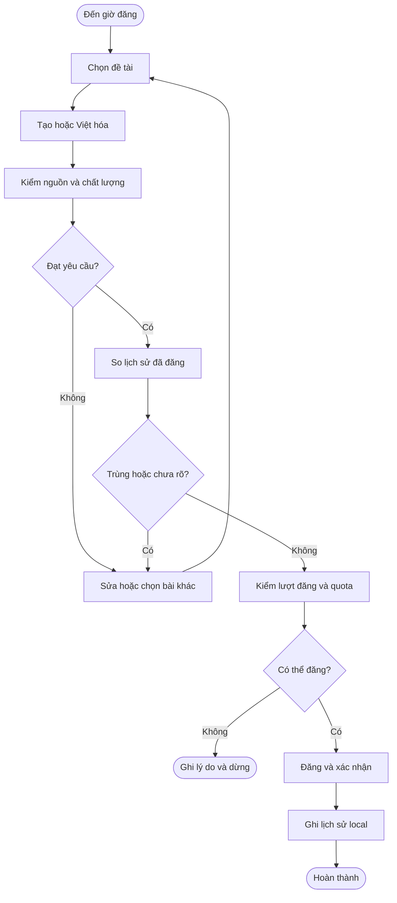

# Template quy tắc tạo bài và tiêu chuẩn bài viết NailHub

**Cập nhật:** 06/11/2026  
**Người sử dụng:** Owner, người biên tập, AI tạo bài và QA  
**Trạng thái:** Tài liệu mẫu nghiệp vụ; việc tạo tài liệu không thay đổi prompt, bộ lọc hay worker đang chạy.

**Bản trên THINKPAD:** `/var/lib/nailhub-source-mirror/Template/article-standard.md`; quy tắc tóm tắt tại `/var/lib/nailhub-source-mirror/Rule/editorial.md`. Đã xác nhận tài khoản service đọc được hai file. Worker đã nạp hai file vào prompt qua article_guidance; thay Markdown không tự bổ sung khả năng chọn nguồn 1099 trong pipeline.

## Chính sách đăng bù mới — chờ triển khai kỹ thuật

Chỉ bài đăng bù được phép là bài gốc độc lập về kinh doanh, vận hành, marketing hoặc tăng trưởng dựa trên gợi ý thực hành chung và không bắt buộc có nguồn. Nguồn đã có phải được giữ và quy thuộc trung thực. Khi bài đề cập sự kiện bên ngoài cụ thể, luật, thuế hoặc hướng dẫn chính thức, dẫn nguồn có thẩm quyền phù hợp; không bịa dữ liệu, trích dẫn hoặc gán gợi ý chung cho cơ quan. Bài dựa trên nguồn và lịch thường giữ chính sách nguồn hiện hành. Quy tắc slot, chống trùng, tiếng Việt, quota và Create chưa rõ không đổi. Ngoại lệ này ưu tiên hơn các câu yêu cầu nguồn chung ở dưới **chỉ cho bài đăng bù**; worker chưa được xác nhận hỗ trợ ngoại lệ.

## Cập nhật 1099 — 10/11/2026

Owner quy định khung 12:00 giờ Việt Nam dành cho bài nail hoặc thuế liên bang Mỹ phù hợp ngành nail, đặc biệt 1099 khi nguồn hỗ trợ; giữ bài đã ghim và áp dụng quy trình dự phòng hiện hành. Đây là định hướng nghiệp vụ và biên tập. **Bổ sung chọn nguồn 1099 trong pipeline chưa deploy**: worker hiện chưa được xác nhận tự chọn hoặc tự đăng bài 1099, và thay Markdown không thay thế thay đổi code.

Với từng nhận định thuế, dùng đúng URL trang IRS gốc hỗ trợ nhận định và nêu năm thuế, đối tượng, điều kiện, ngoại lệ và phạm vi liên bang tương ứng. Đối chiếu ấn bản và hiệu lực; ngày truy cập, ngày sửa trang hoặc một năm xuất hiện trong tài liệu không tự chứng minh năm áp dụng. Không mặc định ngưỡng cũ hay đồng nhất 1099-NEC, 1099-MISC và 1099-K. Khi thiếu chứng cứ, bỏ nhận định hoặc giữ bài theo quy trình hiện hành; không bịa số liệu. Trang tham khảo: [Form 1099-NEC](https://www.irs.gov/forms-pubs/about-form-1099-nec), [information returns](https://www.irs.gov/businesses/small-businesses-self-employed/am-i-required-to-file-a-form-1099-or-other-information-return), [instructions](https://www.irs.gov/instructions/i1099mec); chỉ dẫn trang thực sự hỗ trợ nhận định.

Đã cập nhật Rule và Template trên THINKPAD dưới worker lock, có backup; loader `article_guidance.prepare()` dưới tài khoản service đã nạp cả hai file vào prompt thử. Worker active, lịch ghim không đổi tại lần kiểm tra. Không tạo bài hoặc triển khai code.

## 1. Mục đích và phạm vi

Tạo hoặc Việt hóa bài cho chủ tiệm, người quản lý và thợ nail, chủ yếu tại Mỹ. Bài cần dễ đọc, có thông tin cụ thể, dẫn đúng nguồn và giúp người đọc biết nên làm gì tiếp theo. Mẫu áp dụng cho cả bài dựa trên bài nguồn và bài do AGY biên soạn từ tài liệu tham khảo.

**Cách hiểu:** “Bắt buộc” là yêu cầu nghiệp vụ đối với bài được coi là đạt; “khuyến nghị” là hướng dẫn biên tập, không tự tạo thêm một điều kiện chặn tự động. Mẫu này không chứng minh hệ thống hiện đã tự kiểm được mọi điều kiện.

## 2. Đầu vào cho mỗi bài

```text
Ngày và slot: [ngày] [08:00 / 12:00 / 16:00 / 20:00], giờ Việt Nam
Chủ đề: [ví dụ: Kinh doanh]
Đề tài: [ví dụ: Quản lý lịch hẹn để giảm thời gian chờ]
Đối tượng: [chủ tiệm / quản lý / thợ nail / nhóm cụ thể]
Mục tiêu: Sau khi đọc, người đọc có thể [hành động cụ thể].
Hình thức: [Việt hóa bài nguồn / bài mới từ tài liệu tham khảo]
Nguồn và URL cụ thể: [tên cơ quan hoặc ấn phẩm + URL từng trang được sử dụng]
Ý chính từ nguồn: [1] ... [2] ... [3] ...
Thông tin cần giữ chính xác: [con số, phạm vi, ngày, điều kiện, thuật ngữ]
Giới hạn nguồn: [nguồn nói gì / không nói gì / cần kiểm tra thêm]
Yêu cầu riêng: [nếu có]
```

Nếu thiếu nguồn hoặc nguồn không đủ để khẳng định một chi tiết, tìm nguồn phù hợp hoặc bỏ/diễn đạt lại chi tiết đó. Không tự tạo số liệu, trích dẫn hay khẳng định thay cho nguồn.

## 3. Quy tắc tạo bài

### 3.1 Chọn chủ đề theo giờ

| Giờ Việt Nam | Nhóm ưu tiên | Ví dụ |
|---|---|---|
| 08:00 | Vận hành tiệm nail | Lịch hẹn, quản lý vật tư, trải nghiệm khách hàng |
| 12:00 | Nail hoặc thuế liên bang Mỹ | Mẫu nail, kỹ thuật; chú trọng 1099 khi nguồn hỗ trợ |
| 16:00 | Kinh doanh và vận hành, gồm marketing, AI, SI và POS | Giữ chân khách, ứng dụng AI/SI, hệ thống POS, quản lý hoạt động tiệm |
| 20:00 | Phát triển kinh doanh | Mở rộng dịch vụ, kế hoạch phát triển, quản trị tiệm |

Ưu tiên đúng nhóm. Nếu thiếu bài kinh doanh phù hợp ở 08:00, 16:00 hoặc 20:00, có thể chọn bài kinh doanh thuộc một trong hai nhóm còn lại. Chủ đề mùa vụ như Halloween không phải nhóm cố định cả năm. Giới hạn lịch hiện hành: bốn bài mỗi ngày.

### 3.2 Nội dung và Việt hóa

- **Bắt buộc:** Viết tiếng Việt tự nhiên, đúng chính tả và thuật ngữ ngành nail. Với bài dịch, giữ nguyên ý, điều kiện, đơn vị, số liệu và giới hạn của nguồn; không dịch một nhận định có điều kiện thành khẳng định chắc chắn.
- **Bắt buộc:** Xét thuật ngữ theo ngữ cảnh câu và ý nghĩa thực tế; không giữ bài chỉ vì thiếu đúng một từ khóa hoặc một cụm dịch cố định nếu cách diễn đạt khác vẫn chính xác. Ví dụ, `curing lamps` có thể là “đèn hơ để gel đóng rắn”, không bắt buộc chuỗi “hơ đèn”. Vẫn phải phát hiện sai ý, sai phủ định và sai số liệu; khi không chắc thì sửa/kiểm tra lại hoặc chọn bài khác.
- **Bắt buộc:** Mỗi phần phải phục vụ mục tiêu bài: giải thích vấn đề, đưa các bước hoặc tiêu chí áp dụng, và nêu kết quả người đọc cần kiểm tra. Dùng ví dụ rõ là minh họa khi không lấy từ nguồn.
- **Bắt buộc:** Dùng câu ngắn, từ ngữ cụ thể; tránh lặp lại “hướng dẫn chung” và các câu hỏi liên tiếp mà không đưa cách thực hiện. Không khẳng định chắc chắn kết quả như “đảm bảo tăng doanh thu”.
- **Bắt buộc:** Với SBA, IRS, CDC/NIOSH hoặc cơ quan chính thống khác, dẫn tên cơ quan và **đúng URL trang hỗ trợ thông tin**. Không gán lời khuyên riêng cho tiệm nail vào nguồn nếu nguồn chỉ đưa hướng dẫn chung. Không chặn bài chỉ vì có từ khóa thuế hoặc SBA.
- **Bắt buộc:** Thông tin thuế, pháp lý hoặc an toàn phải đúng phạm vi, địa điểm, thời điểm và điều kiện được nguồn hỗ trợ. Nêu cần kiểm tra với cơ quan hoặc chuyên gia phù hợp khi việc áp dụng phụ thuộc hoàn cảnh. Dẫn nguồn hoặc thêm lưu ý không tự tạo miễn trừ trách nhiệm pháp lý.
- **Bắt buộc:** Với chủ đề AI, SI (super intelligence — siêu trí tuệ) và POS (hệ thống bán hàng/điểm bán), giải thích mối liên hệ với việc kinh doanh hoặc vận hành tiệm; chỉ nêu tính năng, chi phí, kết quả hay khả năng của sản phẩm khi có nguồn phù hợp.
- **Khuyến nghị:** Giới thiệu bối cảnh nguồn một lần, sau đó đi thẳng vào nội dung; giải thích thuật ngữ tiếng Anh ở lần xuất hiện đầu tiên nếu cần.

### 3.3 Chống trùng

- Chỉ đối chiếu **tiêu đề và tóm tắt ý chính** với lịch sử local các bài đã đăng thành công trên THINKPAD; không dùng bài chưa đăng trong kho làm đối tượng đối chiếu.
- Cùng chủ đề hoặc cùng nguồn được phép. Nếu tiêu đề có mức tương đồng **từ 70/100 về ý nghĩa**, hoặc phần tóm tắt cho thấy ý chính trùng bài đã đăng, chọn bài khác. Điểm mô hình là ước lượng, không phải thước đo khách quan tuyệt đối.
- Không kiểm trạng thái hiện tại của bài cũ qua URL, không quét toàn bộ thân bài, không so ảnh để chống trùng. Sau khi xác nhận đăng thành công, lưu tiêu đề, tóm tắt, chủ đề, đề tài và thông tin lượt đăng vào lịch sử local.
- Nếu kết quả so trùng không xác định được, ghi rõ lý do và không tự coi là đạt; thử ứng viên khác khi có thể. Nếu kết quả của một lượt tạo bài trên PROD chưa rõ, đối soát lượt đó trước khi tạo lại để tránh đăng hai lần.

## 4. Template bài viết

```markdown
# [Tiêu đề rõ lợi ích hoặc vấn đề; phản ánh đúng nội dung]

> [Tóm tắt: bài dành cho ai, giải quyết vấn đề gì và người đọc sẽ nhận được gì.]

[Mở bài: bối cảnh thực tế và lý do nên quan tâm.]

## [Mục 1: Hiểu vấn đề hoặc chuẩn bị]

[Giải thích cụ thể. Nêu điều kiện áp dụng nếu có.]

## [Mục 2: Các bước thực hiện]

1. [Bước cụ thể: ai làm gì, dùng thông tin nào.]
2. [Bước cụ thể tiếp theo.]
3. [Cách kiểm tra kết quả hoặc điều chỉnh.]

## [Mục 3: Ví dụ hoặc checklist áp dụng]

- [Việc cần kiểm tra 1.]
- [Việc cần kiểm tra 2.]
- [Lưu ý hoặc sai sót thường gặp, nếu nguồn hỗ trợ.]

## [Mục bổ sung nếu cần]

[Giải thích hoặc ví dụ mang giá trị mới; không thêm phần chỉ để kéo dài bài.]

**Nguồn tham khảo:** [Tên cơ quan/ấn phẩm — Tên tài liệu](URL-trang-cu-the)
```

Số mục và hình thức danh sách tùy đề tài; cần có phân cấp tiêu đề rõ ràng, đoạn ngắn và ít nhất một danh sách hữu ích khi phù hợp. Không biến nội dung nguồn thành các câu hỏi chung chung.

### Ví dụ phân biệt nội dung

- **Chưa đạt:** “Chủ tiệm cần quản lý vật tư hiệu quả. Bạn đã xem xét nhu cầu của tiệm chưa?”
- **Đạt về cách trình bày:** “Lập danh sách vật tư sử dụng hằng ngày, ghi số lượng còn lại và phân công người kiểm tra trước khi đặt thêm. Cuối tuần, đối chiếu danh sách với dịch vụ đã thực hiện để nhận biết món nào cần theo dõi thường xuyên hơn.”

Ví dụ sau chỉ minh họa cách viết; trước khi dùng trong bài thực tế phải kiểm tra các gợi ý và mọi thông tin liên quan với nguồn phù hợp.

## 5. SEO, hashtag và hình ảnh

| Thành phần | Tiêu chí |
|---|---|
| Tiêu đề | Bắt buộc phản ánh đúng bài, tự nhiên, có ý định tìm kiếm phù hợp; tránh giật tít, nhồi từ khóa và trùng ý nghĩa theo mục 3.3. |
| Meta title | Viết riêng, liên quan nội dung; giao diện hiện cho phép tối đa 70 ký tự và gợi ý 50–70 ký tự. Đây là gợi ý, không bắt buộc kéo dài cho đủ. |
| Meta description | Tóm tắt đúng lợi ích/nội dung, tối đa 160 ký tự theo giao diện; gợi ý 120–160 ký tự, không nhồi từ khóa. |
| Hashtag | Chọn hashtag đúng chủ đề, có nghĩa và đúng chính tả; mỗi hashtag theo giao diện dài 2–50 ký tự. Không tự đặt số lượng bắt buộc nếu chưa có cấu hình được xác nhận. |
| Ảnh bìa | Dùng ảnh phù hợp và có quyền sử dụng; nếu thiếu ảnh bìa có thể tạo ảnh AI. Prompt mô tả đúng tiêu đề và tóm tắt, tránh ảnh gây hiểu sai nội dung. |
| Ảnh trong bài | Với bài AGY, ưu tiên 3–5 ảnh minh họa theo nội dung các mục khi khả thi. Nếu ảnh nguồn tải lỗi hoặc không có ảnh phù hợp, có thể bỏ ảnh đó và tiếp tục; không thêm ảnh trang trí gây hiểu sai. |
| Nhãn AI | Không chèn vào nội dung công khai các dòng như “Cover Generate AI (Antigravity)”. Giữ nguồn chính thống và thông tin xuất xứ cần thiết trong hồ sơ nội bộ. |

## 6. Prompt mẫu cho AGY

```text
Bạn là biên tập viên nội dung tiếng Việt cho NailHub, viết cho chủ tiệm và cộng đồng nail tại Mỹ.

Đầu vào:
- Slot và nhóm chủ đề: [điền]
- Đề tài: [điền]
- Đối tượng và mục tiêu người đọc: [điền]
- Nguồn cụ thể và URL: [điền]
- Ý chính và điều kiện từ nguồn: [điền]
- Hình thức: [Việt hóa bài nguồn / viết bài mới dựa trên tài liệu]

Yêu cầu:
1. Viết tiếng Việt tự nhiên, chính xác; giữ nguyên điều kiện, số liệu, đơn vị và phạm vi của nguồn. Không tự tạo dữ liệu hoặc trích dẫn.
2. Tạo tiêu đề rõ nội dung, phần tóm tắt, mở bài, các mục có tiêu đề và đoạn ngắn; có danh sách hoặc các bước hữu ích khi phù hợp.
3. Mỗi mục phải giúp người đọc hiểu hoặc thực hiện một việc cụ thể. Tránh lặp disclaimer, đặt câu hỏi chung chung, khẳng định tuyệt đối và nhồi từ khóa.
4. Dẫn tên và URL trang nguồn cụ thể. Phân biệt nội dung nguồn nói với ví dụ ứng dụng cho tiệm nail; đánh dấu ví dụ giả định.
5. Tạo meta title tối đa 70 ký tự, meta description tối đa 160 ký tự và hashtag liên quan, đúng chính tả.
6. Đề xuất ảnh bìa thể hiện tiêu đề và tóm tắt; đề xuất 3–5 ảnh trong bài gắn với các mục khi phù hợp. Không đưa nhãn tạo ảnh AI vào bài công khai.
7. Nếu nguồn không hỗ trợ một thông tin, bỏ hoặc nêu rõ chưa xác định; không biến giả định thành sự thật.

Trả về: chủ đề; đề tài; tiêu đề; tóm tắt ý chính; bài viết có cấu trúc; meta title; meta description; hashtag; danh sách nguồn; đề xuất ảnh; các điểm chưa xác định.
```

Prompt không thay thế việc đối chiếu lịch sử, xác nhận nguồn hoặc kiểm tra chất lượng bản dịch.

## 7. Checklist bài đạt chuẩn

Trước khi xuất bản, người kiểm tra hoặc hệ thống cần ghi kết quả cho từng mục:

- [ ] Đúng nhóm slot hoặc thuộc nhóm kinh doanh dự phòng được phép.
- [ ] Tiêu đề và tóm tắt khác biệt với lịch sử đã đăng theo quy tắc 70/100 và ý chính.
- [ ] Tiếng Việt tự nhiên; glossary và MQM không phát hiện lỗi làm sai ý hoặc gây hiểu nhầm.
- [ ] Bố cục rõ ràng; mỗi mục cung cấp thông tin hoặc hướng dẫn cụ thể, không chỉ đặt câu hỏi.
- [ ] Các số liệu, điều kiện và nhận định thực tế có nguồn hỗ trợ; link dẫn tới trang cụ thể.
- [ ] Nội dung thuế/pháp lý/an toàn, nếu có, nêu đúng phạm vi và điều kiện của nguồn.
- [ ] Meta title, meta description và hashtag liên quan, đúng giới hạn giao diện.
- [ ] Ảnh bìa phù hợp; ảnh trong bài nếu dùng phù hợp nội dung và quyền sử dụng.
- [ ] Không có nhãn tạo ảnh AI không mong muốn trong nội dung công khai.
- [ ] Trước Create, còn quota và không có lượt đăng chưa rõ cần đối soát; sau thành công ghi lịch sử local.

**Xử lý:** Bài chưa đạt một yêu cầu bắt buộc cần sửa và kiểm tra lại phần bị ảnh hưởng; nếu không thể sửa kịp, chọn ứng viên khác. Nếu model hoặc hệ thống không kết luận được, ghi rõ lỗi thay vì gắn nhãn đạt. Các tiêu chí khuyến nghị không mặc định là lý do chặn tự động.



Sơ đồ thể hiện quy trình nghiệp vụ mong muốn; không phải bằng chứng mọi nhánh đã chạy tự động trên môi trường thực tế.

## 8. Phiếu kiểm duyệt một bài

```text
Ngày / slot:
Chủ đề / đề tài:
Tiêu đề / tóm tắt:
Nguồn cụ thể:
Đối chiếu trùng: [đạt / trùng / chưa xác định] — bài đối chiếu và lý do:
Việt hóa / glossary / MQM: [đạt / cần sửa / chưa xác định] — ghi chú:
Nguồn, số liệu và điều kiện: [đạt / cần sửa / chưa xác định] — ghi chú:
Bố cục và tính hữu ích: [đạt / cần sửa] — ghi chú:
Meta / hashtag / ảnh: [đạt / cần sửa] — ghi chú:
Kết luận: [đạt / sửa rồi kiểm lại / chuyển bài khác / chờ đối soát]
URL đã đăng và thời điểm xác nhận: [chỉ điền sau khi đăng thành công]
```

## 9. Tài liệu liên quan

- [Business DOCS — Source Mirror](../nailhub-source-mirror-noissue_master_261028_v1.0.0.md)
- [Hướng dẫn bộ lọc](nailhub-source-mirror-noissue_filter-guide_261101_v1.0.0.md)

Các tài liệu liên quan có thể chứa lịch sử và trạng thái tại thời điểm cũ; đối chiếu thực tế trên THINKPAD trước khi kết luận điều gì đang được tự động áp dụng.

Changelog | v1.0.1 | 2026-11-10 10:36 ICT | AlexChu / Codex | Cập nhật quy định 12:00, nguồn IRS và trạng thái pipeline 1099 chưa deploy.
