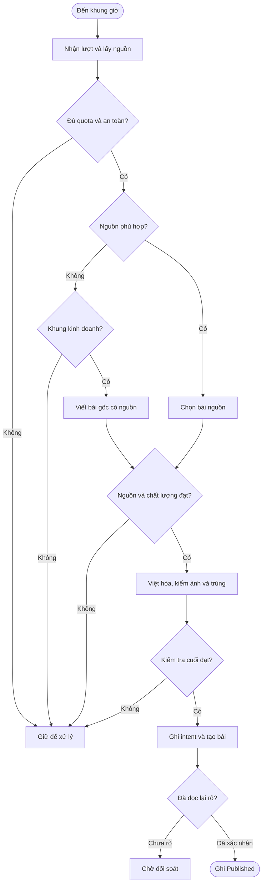
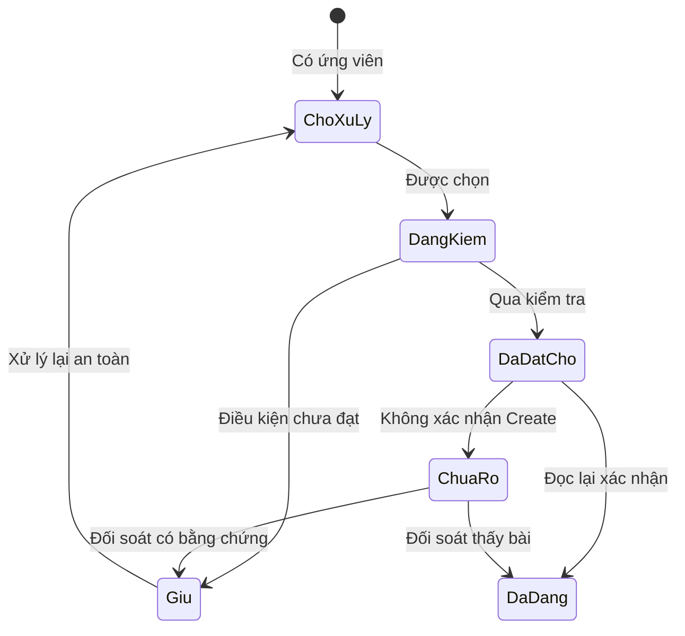

# Source Mirror: Bộ lọc và cách xử lý

## Cập nhật 05/11/2026, 09:29 ICT

- Đã bỏ phân loại riêng, ưu tiên thấp và giới hạn bảy ngày cho bài Halloween trên THINKPAD. Bài được xét như các bài khác theo đúng khung giờ và các điều kiện còn áp dụng; không tự động coi mọi bài Halloween đã sẵn sàng hoặc bảo đảm được đăng.
- Cấu hình cũ `halloween_max_per_7_days` vẫn được chấp nhận để tương thích, nhưng không còn ảnh hưởng việc chọn bài. Không thay đổi chính sách thuế hay nội dung kho.
- Lịch đang chạy: 08:00, 16:00 và 20:00 cho kinh doanh; 12:00 cho mẫu nail. Hai dòng lịch cũ trong phần 3.1 bên dưới đã được sửa theo mã thực tế. Định nghĩa chi tiết từng chủ đề vẫn chờ Owner thống nhất.
- Kiểm tra trên THINKPAD: 8/8 test bộ lọc đạt, worker active, không có lượt `intent`/`unknown`; không tạo bài trong lúc triển khai. Có bản dự phòng mã trước khi cập nhật.

## Cập nhật 03/11/2026, khoảng 15:45 ICT

- **Sửa bản bảo mật đang HOLD:** không sửa snapshot hay evidence đã ký của `190ea45c…`. Một bản nháp thay thế đã được tạo trong thư mục báo cáo riêng, giữ nguồn SBA cùng hash; model factual và adjudicator PASS, reviewer đối chiếu 33/33 quote với nguồn. Tuy vậy, reviewer vẫn giữ bài để sửa: câu về EMV có thể bị hiểu là bảo đảm trách nhiệm pháp lý; ẩn SSID có thể tạo cảm giác đủ an toàn; và nhận định nhân viên là đường dẫn chính cần quy rõ nguồn hoặc bỏ. PASS của model không tự giải quyết các điểm này; chưa có bản Việt, ảnh bìa hay bài đăng được xác nhận cho revision này.
- Đã triển khai prompt yêu cầu giữ điều kiện của nguồn, không biến biện pháp giảm rủi ro thành bảo đảm tuyệt đối; hướng dẫn Việt hóa phân biệt mạng Wi‑Fi ẩn và ẩn danh, yêu cầu hashtag có nghĩa và liên quan. Đây là chỉ dẫn model, không thay cho kiểm tra nguồn/MQM. Có 17 test hồi quy và 2 test prompt đạt; backup `/opt/nailhub-source-mirror/backups/accuracy-prompt-20261103`. Worker, broker và timer đã được hậu kiểm.
- Một lượt sửa thêm đã tự dừng trước gọi model/ghi DB vì còn dưới 5 phút tới cutoff 15:50; không reserve/Create. Đến 15:45, bài bù 12:00 vẫn chưa đăng và `190ea45c…` vẫn held. Khung 16:00 giữ lịch cũ; phải kiểm tra trạng thái thực tế sau giờ chạy, không giả định đã đăng.

## Cập nhật 03/11/2026, khoảng 15:20 ICT

- **Bố cục bài mới:** luồng tạo bài gốc yêu cầu các mục với tiêu đề, đoạn văn ngắn và ít nhất một danh sách có ích; hệ thống tạo HTML `h2`, `p`, `ul`, `li`. Mỗi tiêu đề, câu và ý danh sách vẫn phải được đối chiếu nguồn và qua MQM; bản cũ vẫn được xác minh bằng schema cũ. Prompt Việt hóa yêu cầu tiêu đề, mô tả và hashtag phù hợp nội dung, tự nhiên, tránh nhồi từ khóa hay hứa thứ hạng. Prompt mới yêu cầu nêu bối cảnh nguồn một lần, văn phong trực tiếp, hạn chế lặp disclaimer/câu hỏi chung chung; link nguồn vẫn giữ, provenance AI tiếp tục lưu nội bộ.
- **Kiểm chứng và giới hạn:** 17 test chọn lọc đạt; canary trên trình soạn thảo thật chặn mọi request ghi cho thấy H2/P/UL/LI sau paste khớp cấu trúc trước paste. Chưa chứng minh bài gốc có cấu trúc mới đi hết Create → published → đọc lại công khai. Prompt là chỉ dẫn cho model, không bảo đảm mọi bài đều hay hay đúng. Backup deploy gần nhất: `/opt/nailhub-source-mirror/backups/layout-wording-20261103` (backup bố cục trước đó: `layout-20261103`).
- **Bài bù 12:00 chưa đăng:** slot 12 có 3 claim HOLD; các ứng viên location/marketing cũ bị kiểm tra trùng ngữ nghĩa giữ lại. Một draft continuity bị giữ vì các gợi ý không có quote hỗ trợ; draft cyber đầu bị dừng trước reserve khi reviewer phát hiện bỏ điều kiện “nếu có thể” của nguồn SBA. Đã lập proof đối soát riêng `reports/catchup-20261103-1200-cyber-reconciliation.json`: workflow đó không reserve/Create theo bằng chứng DB, khóa và journal; không suy ra hành vi của writer độc lập.
- Một bản cyber khác được chuẩn bị **held** trong transaction để không lộ `ready` khi process lỗi. Review độc lập chỉ ra nhiều câu diễn đạt quá tuyệt đối; MQM bản Việt HOLD do dịch “hidden” thành “ẩn danh” và một hashtag không liên quan. Chưa có candidate được phép đăng bù, chưa reserve/Create. Không nới kiểm tra nguồn, trùng, quota, unknown hoặc deadline để ép đăng.
- **Trạng thái 15:20:** ngày 03/11 có một bài 08:00 published; không có `intent`/`unknown`, worker, hai broker và hai timer đang hoạt động. Lịch 16:00 không đổi; chưa thể cam kết bài sẽ đăng. Hàng đợi và kết quả phải được kiểm tra lại tại thời điểm chạy.

## Cập nhật vận hành ngày 02/11/2026, khoảng 08:15 ICT

- **Hiển thị công khai:** bản chạy mới đã bỏ nhãn cho biết bài hoặc ảnh bìa do AI/Antigravity tạo khỏi footer và nội dung công khai. Link nguồn thực tế vẫn giữ; không gán sai tác giả con người. Provenance, credit, policy và evidence ảnh vẫn lưu nội bộ. Các bài đã đăng trước khi thay đổi không được sửa. Nội dung do mô hình tự sinh vẫn phải được kiểm tra; thay đổi này không chứng minh mọi bài về sau chắc chắn không có chữ AI.
- Với bài nguồn chính thức, payload đã staging theo cách hiển thị cũ được kiểm tra tương thích **trước khi reserve**; nếu không khớp builder mới thì bỏ qua để staging lại, giữ nguyên evidence cũ. Không sửa trực tiếp payload/evidence đã ký.
- **08:00, 02/11:** attempt 20 đã `published`: [Mẫu móng milky glitter ombré lấp lánh](https://nailhub.ai/blog/mau-mong-milky-glitter-ombre-lap-lanh). Kiểm tra browser chỉ đọc trên trang công khai trả HTTP 200, không thấy các chuỗi nhãn AI/Antigravity đã kiểm, và link **Scratch Magazine** dẫn đến nguồn gốc. Lượt chuẩn bị trước đó HOLD do bản dịch lặp từ; worker sáng đã tạo bản mới và đăng thành công.
- **12:00 / 16:00 / 20:00:** ba lượt chuẩn bị nguồn kinh doanh riêng trước giờ đăng đều HOLD, chưa có bài nào được xác nhận sẵn sàng qua toàn bộ bước kiểm tra. SBA Manage: review cuối HOLD 2 major do trích dẫn chưa hỗ trợ hai nhận định; SBA Grow: replay với nguồn fetch sau đó báo một quote không khớp nguyên văn, có ký tự thay thế; California: review cuối HOLD 3 major/8 minor về hỗ trợ và phạm vi. Kết quả này không có nghĩa là ba khung giờ đã đăng hoặc chắc chắn sẽ thất bại; worker vẫn thử theo lịch và kiểm tra lại nguồn, MQM, trùng lặp, quota trước Create.
- Lần hậu kiểm có worker, hai broker ảnh và timer hoạt động, không có attempt `intent`/`unknown`. Triển khai có backup `/opt/nailhub-source-mirror/backups/public-attribution-20261101`; test stage gồm 13 kiểm tra payload/footer và một kiểm tra payload cũ bị dừng trước reserve. Chưa kiểm chứng đầu-cuối bài official có ảnh sinh mới sau thay đổi. Các dòng cũ bên dưới mô tả lịch sử và được cập nhật này ưu tiên khi khác nhau.

**Cập nhật:** 01/11/2026, khoảng 22:20 giờ Việt Nam. **Đối tượng:** Owner, Marketing, vận hành, QA. **Phạm vi:** hành vi quan sát và mã/config đang chạy trên THINKPAD; không phải đề xuất đã được cài. [Master Doc](../nailhub-source-mirror-noissue_master_261028_v1.0.0.md).

Agent tiếp nhận dùng thêm [tham chiếu vận hành và điều tra](nailhub-source-mirror-noissue_agent-reference_261101_v1.0.0.md).

Tài liệu này giải thích vì sao một ứng viên được chọn, bị giữ, bị bỏ qua hoặc chưa rõ kết quả. Một bước HOLD có thể là bảo vệ đúng, giới hạn định dạng hoặc bộ lọc nhận nhầm; chỉ xem reason code không đủ để kết luận. Quy trình tự động có giới hạn, không bảo đảm đủ bốn bài hay thông tin AI hoàn toàn chính xác.

## 1. Vai trò và kết quả

| Vai trò | Việc cần làm |
|---|---|
| Owner | Chốt chủ đề, nguồn, lịch và các thay đổi chính sách; quyết định xử lý khi cần. |
| Marketing/vận hành | Xem trạng thái slot và nguồn, kiểm nội dung, ảnh, lý do giữ và bằng chứng trước khi yêu cầu xử lý. |
| QA/development | Đối chiếu mã đang chạy, log và trạng thái bền vững; xác minh có gửi Create hay chưa; sửa và kiểm thử theo phạm vi được duyệt. |

Các mốc giờ là **08:00, 12:00, 16:00, 20:00 theo Asia/Ho_Chi_Minh**. Quota là tối đa bốn bài Published của workflow mỗi ngày; bài độc lập của người khác không tự cộng vào quota. Một slot tối đa một bài; khóa chung và trạng thái chưa rõ được dùng chung cho các nhánh.

## 2. Luồng lựa chọn và đăng

| Bước | Đầu vào | Điều kiện đang chạy và kết quả |
|---|---|---|
| 1. Khởi động | Slot, thời gian, trạng thái vận hành | Khi không paused, giữ khóa worker và claim tối đa ba lần theo ngày/slot; crawler có thể chạy trước. Sau đó `once` chặn đăng khi có intent/unknown chưa giải quyết hoặc đạt quota. |
| 2. Nguồn chính thống | Ứng viên official đã chuẩn bị, policy còn hiệu lực | Được xét trước nếu policy, slot, nguồn, bằng chứng và duplicate preflight cho phép; không có ứng viên phù hợp thì đi tiếp. |
| 3. Bài nguồn thường | Trang nguồn/các bài đã lưu | Thu thập giới hạn, kiểm URL và ảnh; lọc theo slot trước ưu tiên seasonal rồi kiểm lại cùng slot policy trước chuẩn bị. Bài không qua có thể HOLD hoặc bỏ qua. |
| 4. Bài gốc AI dự phòng | Ba khung kinh doanh, không phải URL thủ công | Khi hết ứng viên thường, nếu đủ thời gian, chọn nguồn chính thống trong catalog; viết bài gốc, kiểm câu/nguồn và lưu nguồn thật. Không tự chạy nhánh này ở 08:00. |
| 5. Việt hóa, ảnh, trùng | Nội dung và snapshot đã khóa | Bản VI/EN phải qua cấu trúc, glossary, MQM; bài gốc kiểm trùng trước reservation; ảnh và binding được kiểm trước Create. |
| 6. Reservation và Create | Bài đạt và còn thời gian | Ghi intent vào cùng DB, thao tác editor, kiểm tra ngay trước Create và đọc lại. Chỉ xác nhận Published sau khi có kết quả kiểm chứng. |
| 7. Báo kết quả | Published, held hoặc unknown | Ghi kết quả slot và event thông báo; khi kết quả tạo chưa rõ phải đối soát trước khi thử lại. |

## 3. Danh mục bộ lọc đang hoạt động

### 3.1 Lịch, ưu tiên và chủ đề

| Đầu vào | Kiểm tra và kết quả | Giới hạn quan sát |
|---|---|---|
| 08:00, 16:00, 20:00 | `slot_policy` chỉ cho loại kinh doanh; bài nail art tutorial hoặc nội dung pha kỹ thuật rõ bị loại/đánh dấu không rõ. | Nhận diện bằng tiêu đề và nội dung có thể phân loại sai hoặc giữ bài phù hợp. |
| 12:00 | Chỉ chọn loại mẫu nail; bài kinh doanh hoặc không rõ bị bỏ qua ở slot. | Quy tắc từ khóa không phải mô hình hiểu chủ đề hoàn hảo. |
| Lệnh URL không gắn slot | Bộ lọc slot cho phép đường thủ công không gắn giờ; nguồn và các cổng khác vẫn áp dụng. | Không hiểu là mọi domain đều được hỗ trợ. |
| Xếp thứ tự | Scheduled dùng `slot_policy` để chọn ứng viên hợp giờ; queue hợp lệ giữ thứ tự ổn định. `topics.priority_slots` cũ vẫn được validate nhưng không quyết định thứ tự scheduled; đường không gắn slot dùng fallback luxury. | Không ưu tiên thấp hoặc đặt trần riêng cho Halloween. Phân loại vẫn có thể không chắc. |
| Thuế | Ứng viên nguồn thường bị `tax_review` thì giữ; bài gốc có chứng cứ được kiểm riêng, nhưng payload còn bị rà từ khóa thuế trước đăng. | Không khẳng định mọi bài thuế gốc sẽ được đăng; hiện trạng này cần Owner xem xét riêng. |

**Ví dụ:** “Nail art tutorial” phù hợp hướng nail 12:00; “Nail salon business pricing” phù hợp hướng kinh doanh 08:00, 16:00 hoặc 20:00. Bài hướng dẫn kỹ thuật nail thuần không nên được dùng để lấp slot kinh doanh. Phân loại không chắc không đồng nghĩa bài xấu.

### 3.2 Phát hiện nguồn và nguyên vẹn bản lưu

| Nhánh | Điều kiện thực tế | Khi không đạt |
|---|---|---|
| Scratch / lệnh nguồn | Chỉ host và đường dẫn article được hỗ trợ; GET/HTTPS, DNS công khai, kiểm chuyển hướng/canonical, giới hạn nội dung và số trang danh sách. Trang bị biết trước không tự tạo bản trùng. | Bỏ qua/giữ; `Error` chung không đủ nêu nguyên nhân. |
| Bài Scratch và media | Tiêu đề 5–200 ký tự; kiểm **tổng media nguồn không quá 10** trước tải, gồm cover nếu có. Sau đó chỉ nhận ảnh định dạng, kích thước và nội dung giải mã hợp lệ. | `media count outside destination limits` chặn từ trước bước bỏ ảnh lỗi. Ảnh thân tải lỗi có thể bỏ, ghi omission và ánh xạ lại; cover lỗi có thể chuyển sang tạo AI. |
| Official intake | Danh mục cố định 6 URL CDC/NIOSH, IRS và SBA; chỉ HTTPS hợp lệ, DNS công khai, 200 HTML, giới hạn kích thước/cấu trúc và bảo toàn nguồn. | HOLD khi nguồn đổi, không parse hoặc không chứng minh được phần cần thiết. Không phải khám phá liên tục mọi bài chính thống. |
| Official auto/publish | Policy đang bật cho đúng 3 ID: CDC nail technicians, IRS tip reporting, SBA business plan; phải có candidate/bằng chứng/policy/slot còn hợp lệ. | Những nguồn khác dù nằm trong intake không mặc nhiên được auto-publish. `ScheduleUnavailable` có thể khiến autostage dừng. |
| Snapshot | Mỗi bài có thư mục nội dung, metadata, media và manifest; kiểm SHA, đường dẫn và định danh trước các bước tiếp theo. | Không dùng snapshot thay đổi, thiếu file hoặc symlink không an toàn. |

### 3.3 Bài viết gốc bằng AI

- Catalog cố định: [SBA Launch](https://www.sba.gov/counseling/launch-your-business/), [SBA Manage](https://www.sba.gov/counseling/manage-your-business/), [SBA Grow](https://www.sba.gov/counseling/grow-your-business/), [FAQ California Board](https://www.barbercosmo.ca.gov/forms_pubs/publications/faqs). Thứ tự ưu tiên xoay theo ngày/slot; source được tải lại và so hash trước khi dùng. Đây là nguồn tham khảo, không phải tác giả bài gốc. FAQ California có nội dung licensing và continuing education; không áp nó cho bang khác.
- Bản viết đầu phải có đúng schema, title 5–180 ký tự, 3–8 đoạn 50–1.500 ký tự, không có uncertainties, URL/HTML trong đoạn; số phải xuất hiện trong tài liệu nguồn, bài phải được nhận loại business. Điều này là lọc hình thức, **không chứng minh số được dùng đúng ngữ cảnh**.
- Với nguồn SBA tổng quát, mã chặn các từ liên quan pháp lý/quy định/thuế/giấy phép, bảo hiểm/đăng ký/lương/BOI, ventilation và staffing; acquire/buy/purchase/take over được xét theo ngữ cảnh đối tượng doanh nghiệp/cơ sở. Đây là heuristic, không bao phủ mọi diễn đạt. Nguồn California yêu cầu chữ California và kiểm nội dung nguồn; không suy rộng phạm vi.
- Review thứ nhất so title và từng câu với **một trích đoạn nguyên văn có trong nguồn**; MQM phải PASS và evidence khớp thứ tự/câu. Lượt AI mới rà sự hỗ trợ của từng cặp claim/quote, sau đó kiểm lại source và hash. Khi phản hồi HOLD đúng schema và đủ bằng chứng có thể có **một vòng sửa**, không lặp vô hạn. Bằng chứng/response được ghi ở `reports/original-generation/<ngày>/...`.
- AGY là công cụ rà tự động, có thể nhầm hoặc bỏ sót. Trích đoạn khớp ký tự không tự chứng minh suy luận, tình trạng luật hay tính đúng của từng kết luận; không thay thế chuyên gia. Factual/adjudicator original, duplicate và localization reviewer nhận JSON thô hoặc một hàng rào Markdown hợp lệ bao toàn bộ; generation original đầu vẫn yêu cầu JSON thô.

### 3.4 Việt hóa, glossary và MQM

| Kiểm tra | Quy tắc hiện tại | Ví dụ/ảnh hưởng |
|---|---|---|
| Schema và SEO | Title VI 5–200; summary tối đa 180; meta title tối đa 70; meta description tối đa 160 ký tự; 3–5 hashtag duy nhất; không uncertainty. | Sai hình dạng hoặc vượt giới hạn → HOLD. |
| Nội dung/markup | Số block, loại, thứ tự, ảnh, cấu trúc HTML, link và số phải bảo toàn; tên liên kết bảo vệ; bản dịch phải có dấu tiếng Việt. | Thay số/nghĩa, thiếu block hoặc sửa media reference bị giữ. |
| Thuật ngữ | Kiểm blooming gel/gel loang, gel polish/sơn gel, top coat/phủ, cọ nét, tên ngón; cure/hơ đèn; tránh các dịch sai được liệt kê. | Có ngoại lệ hẹp đã review cho tên sản phẩm Top Coat/Gel Polish được giữ nguyên khi động từ áp dụng khớp; không tự bỏ qua phủ định hay mất tên. |
| Phủ định và số chữ | Có kiểm nguồn `do not/never` và từ phủ định VI, kiểm số chữ 1–10 và các điều kiện cure phủ định. | Có thể nhận nhầm synonym/ngữ cảnh; chỉ kiểm tự động không thay thế đọc nghĩa. |
| MQM | Schema, số lượng/độ nặng issue nhất quán; PASS yêu cầu zero critical/major/minor, không uncertainty và các cờ chất lượng đúng. | Một minor cũng HOLD; review của model không phải chuyên gia độc lập. |
| Định dạng review | Localization reviewer, factual/adjudicator original và duplicate chấp nhận JSON thô hoặc một hàng rào Markdown bao trọn JSON; các cổng vẫn kiểm schema/verdict. | Generation original đầu vẫn strict; lưu response gốc khi có evidence. |

### 3.5 Ảnh, upload và CDN

- Ảnh bìa gốc dùng khi nhánh đó hỗ trợ và chứng cứ cho phép. Bìa thiếu/không dùng được có thể tạo bằng Antigravity từ **title và summary VI cuối**; AI original dùng `source_id=ai_original`, Scratch dùng `scratch`. Policy, request, ảnh và payload phải khớp; ảnh tạo được ghi nhận là AI. Official cover có tình huống chưa hỗ trợ/không rõ quyền phải giữ hoặc bỏ qua.
- Upload và native editor kiểm file gốc, receipt, định danh media, URL/host và binding. Sau upload, CDN/thumbnail nếu có chỉ cần **HTTPS HTTP 200** theo yêu cầu Owner; vẫn kiểm host, DNS công khai và timeout. HTTP 200 **không chứng minh response là ảnh, đúng ảnh hay giống file gốc**. Các kiểm tra bytes ảnh gốc và binding là bước khác, không thay bằng kết luận về CDN.
- Ảnh thân có thể bỏ khi tải không thành công theo nhánh hỗ trợ, cùng caption đi kèm; text và dẫn nguồn phải được giữ. Giới hạn 10 media nguồn trước tải hiện có thể giữ bài ngay cả trước bước bỏ ảnh.

### 3.6 Kiểm trùng, reservation, deadline và thông báo

| Cổng | Điều kiện đang chạy | Phản ứng |
|---|---|---|
| Kiểm trùng bài gốc | Quét danh sách admin hai lượt ổn định, kiểm trùng title VI/EN chuẩn hóa, sau đó model phân biệt trùng/cùng ý/không chắc; lặp ngay trước Create. | Trùng, uncertain, response sai schema, danh sách thay đổi, quá lớn hoặc không truy cập được → HOLD. Không phải khóa nguyên tử với tác giả độc lập. |
| Bài official/Scratch | Nhánh official có scan nguồn/eligibility; Scratch có title search và guard của editor. | Không tuyên bố mọi nhánh dùng cùng một thuật toán hoặc loại trừ mọi cuộc đua. |
| Giới hạn thời gian | Original chỉ bắt đầu fallback khi còn ít nhất 2.400 giây; trước reservation tối thiểu 450 giây, trước check cuối 350 giây, sau check 30 giây, guard kiểm lại thời hạn. Inference original giới hạn từng lượt và còn chừa thời gian. | Không đủ thời gian → bỏ qua/giữ; timeout không tự cho phép gửi Create. Các con số là điều kiện kỹ thuật tại thời điểm kiểm tra, không cam kết thời lượng thực tế. |
| Chống đăng lại | Trạng thái intent/unknown chặn lần đăng tiếp; reservation kiểm quota cùng DB và slot. | Nếu Create có thể đã gửi mà chưa rõ kết quả → UNKNOWN, đối soát trước khi thử lại. |
| Telegram | Slot ghi outcome `published`, `held`, `unknown` vào event/outbox; thông báo held dùng lý do chung. | Event ghi nhận/trạng thái gửi không tự chứng minh chi tiết lý do hoặc Published; không gửi lại thủ công mù. |

## 4. Trạng thái và thao tác an toàn

| Trạng thái nhìn thấy | Ý nghĩa | Việc nên làm |
|---|---|---|
| Chưa chọn / bị bỏ qua | Không qua nguồn, topic, ưu tiên hoặc thời hạn; không nhất thiết là lỗi nội dung. | Xem input và cổng tương ứng, không đoán từ thông báo chung. |
| HOLD | Một điều kiện chất lượng, policy, trùng hoặc kết nối chưa đạt. Có thể trước reservation. | Đọc reason và evidence; sửa lỗi được xác nhận, giữ điều kiện dữ kiện đúng. |
| Intent / UNKNOWN | Đã dự định tạo hoặc không xác nhận được kết quả tạo. | Đối chiếu phase, receipt, guard và admin/public; không gửi Create lần nữa khi chưa rõ. |
| Released / pre-create failed | Có bằng chứng và trạng thái nghiệp vụ cho biết lượt chưa hoàn tất; cần đọc chi tiết từng case. | Theo đúng quy trình reconcile và quota/slot, không tự suy slot được mở lại. |
| Published | Có URL và kết quả đọc lại xác nhận theo nhánh. | Ghi nhận quota theo ngày VN; lưu bằng chứng. |

## 5. Tra lỗi thường gặp

| Chuỗi log / reason | Ý nghĩa và bước kiểm tiếp | Không được suy ra |
|---|---|---|
| `media count outside destination limits` | Kiểm số media nguồn, cover và vị trí validate trước download. | Không đồng nghĩa mọi ảnh đều lỗi hoặc không có bài. |
| `excluded acquisition or technical topic` | Đọc câu chứa acquire/buy/purchase và đối chiếu quy tắc SBA hiện tại; có thể là mua thiết bị/dịch vụ. | Không kết luận chắc bài vi phạm pháp luật. |
| `invalid model JSON` | Mở response raw đúng lượt, xác định rỗng, malformed, extra text hay fenced; xem verdict bên trong để chẩn đoán. | Không tự chuyển fenced HOLD sang PASS hay bỏ qua schema. |
| `MQM errors or technical uncertainty remain` | Đọc issues, mức độ và uncertainty cùng source/quote. | Không coi mọi minor là lỗi kỹ thuật giả; gate hiện chặn cả minor. |
| `incomplete factual claims` / `factual source quote missing` | So danh sách title/câu và trích đoạn nguyên văn với nguồn/phiên bản đã lưu. | Không dùng trích đoạn có thật để mặc nhiên chứng minh claim. |
| `original duplicate check held: QualityHold` | Xem admin list, exact title, semantic result, network/schema/timeout nếu có evidence. | Chuỗi hiện tại chỉ ghi loại lỗi; không thể khẳng định bài đã trùng nếu không còn chi tiết. |
| `ScheduleUnavailable` | Xem slot, deadline và tình trạng chuẩn bị official. | Không khẳng định dịch vụ worker chính đã tắt. |
| `no article passed localization or upload quality gate` | Đây là tổng kết slot; xem từng candidate và bước HOLD trước đó. | Không khẳng định mọi candidate thất bại ở upload. |
| `unknown` / `unresolved attempt requires reconciliation` | Xem attempt, phase, guard, receipt, admin/public và nhật ký trước khi quyết định. | Không retry Create hoặc release chỉ dựa trên timeout. |

## 6. Sự cố thực tế 01/11/2026

| Slot/lượt | Bằng chứng | Kết luận có giới hạn |
|---|---|---|
| 08:00 | Attempt 18 có sáu receipt upload, guard `allowed=false`/OSError, phase `pre_create`; tìm kiếm title VI/EN không thấy. Đã reconcile `released`; slot không tự đăng bù. | Lịch sử slot/event có thể còn `unknown`; tại mốc kiểm hiện tại **không có attempt intent/unknown chưa giải quyết**. Xem Master để phân biệt lịch sử và trạng thái attempt. |
| 12:00 | Ba lượt claim `held`; các ứng viên nail-art không phù hợp slot business. | Không có attempt Published cho slot này trong DB workflow. |
| 16:00 lần 1 | SBA Manage, “Managing a Professional Nail Salon Business…” bị `excluded acquisition or technical topic`; text có `Acquiring` tài sản và `purchasing` thiết bị. | Regex lúc 16:00 quá rộng trong ngữ cảnh này; chưa qua review còn lại. |
| 16:00 lần 2 | SBA Grow, “Planning Growth and Expansion…” qua bản viết và factual review; adjudicator trả **PASS trong hàng rào Markdown đánh dấu JSON**, parser original trả `invalid model JSON`. | Lỗi lớp định dạng, chưa chứng minh bài sẽ vượt các bước đăng sau đó. |
| 16:00 lần 3 | California FAQ, bài licensing/continuing education qua factual review; adjudicator fenced JSON chứa **HOLD: 5 major, 2 minor**. | Có vấn đề về claim/quote, ví dụ claim 90 phút không có trong quote tương ứng; không biến nó thành PASS chỉ bằng cách đọc fence. |
| 20:00 | SBA Grow bị fenced JSON ở adjudicator, verdict bên trong HOLD một minor; California bị fenced ở factual review, verdict bên trong PASS nhưng chưa qua adjudicator. SBA Launch sau một vòng sửa qua factual/adjudicator và localization, được lưu ready; sau đó duplicate precheck ghi `QualityHold`. | Không có attempt 20:00 trong DB workflow. Chưa lưu lý do duplicate chi tiết: không biết là trùng thật, định dạng, thay đổi danh sách hay lỗi khác. |

Evidence gốc trên THINKPAD: `/var/lib/nailhub-source-mirror/reports/original-generation/2026-11-01/1600-*` và `2000-*`; bài gốc SBA Launch có ID bắt đầu `0b80b7b276b1` trong thư mục `articles`. Lý do slot gửi Telegram là tổng quát; tra log worker và evidence để xem chi tiết. Không ghi credential vào tài liệu.

## 7. Những điều chưa được xác nhận và đề xuất

**Hiện tại:** worker, AGY broker, broker bìa Scratch và các timer được kiểm active tại thời điểm lập tài liệu; official autostage có lần `ScheduleUnavailable`. Chưa quan sát bài gốc sau triển khai đi trọn Create → Published → đọc lại trên PROD. Tình trạng dịch vụ và nội dung nguồn có thể thay đổi sau thời điểm này.

**Đã triển khai lúc 22:05:** fenced JSON hẹp, regex mua theo ngữ cảnh, audit duplicate và sửa route build như mục cập nhật dưới đây. **Còn đề xuất, chưa triển khai:** cân nhắc source/jurisdiction và nhiều quote cho title/claim; tiếp tục test synonym, phủ định, quota, deadline và phân loại chủ đề. Nếu Owner chấp nhận bỏ ảnh dư, trước hết phải xác minh giới hạn cover/gallery thực tế và lưu omission; không mặc định 10 ảnh thân cộng cover. Mọi thay đổi cần review độc lập, test adversarial và rollout/rollback có backup, khóa và giữ DB/journal. Không tự bật đề xuất chỉ vì tài liệu nêu ra.

### Hoàn tất khảo sát các ranh giới còn lại — 01/11 khoảng 22:20 VN

`strict_json`, `model_response` và `validate_review` đã được nhiều consumer dùng chung; phạm vi fence được truyền rõ ở consumer. Tách tiếp toàn bộ `localization.py` lúc này có nhiều call site và binding evidence, chưa chứng minh được lợi ích hay tính tương thích nên chưa thay đổi. AST của 81 module, chuẩn hóa tên hàm, chỉ còn hai hàm `main` entrypoint giống nhau từ ba dòng trở lên; chúng nạp hai broker/policy khác nhau, không gộp chỉ để giảm vài dòng. Đây là kiểm tra AST tĩnh, không khẳng định không có đoạn trùng một phần hoặc import động.

Guard có contract khác nhau: đường publish official `official_scratch_publish.verify_media` dùng kiểm HTTP 200 qua `scratch_cdn_readback`; `official_native_guard.readback` trả bytes và còn được dùng bởi `official_visual_evidence.inspect` cho prototype/review. Không thay chúng bằng một contract hoặc khôi phục so sánh CDN vào guard publish. Kiểm kê service/socket/timer của 9 module không có import tĩnh được ghi trong [tham chiếu agent](nailhub-source-mirror-noissue_agent-reference_261101_v1.0.0.md); không xóa module nào. Ảnh nguồn quá 10 media chưa được tự cắt. Các tối ưu khác chưa xác minh vẫn để sau; chưa có bài original được quan sát đi trọn Create/Published/readback sau các lát mới.

### Thống nhất chọn chủ đề theo slot — 01/11 khoảng 22:16 VN

Đã dùng cùng `slot_policy` khi chọn ứng viên scheduled và kiểm lại trước chuẩn bị: 08 nail, 12/16/20 business. Chỉ ứng viên hợp slot mới tham gia ưu tiên bài không theo mùa/Halloween; do đó bài sai giờ không còn che một bài Halloween hợp 08. Thứ tự ứng viên scheduled hợp lệ theo queue ổn định; `topics.priority_slots` business/luxury cũ vẫn được chấp nhận để tương thích, nhưng **không xếp lại scheduled**; đường manual không gắn slot giữ thứ tự cũ với fallback luxury. Giới hạn Halloween, tax, quota và UNKNOWN được giữ. Thay đổi này có chủ ý về thứ tự lựa chọn, không bảo đảm phân loại heuristic luôn đúng.

Stage đạt **326 test, 26 skipped**; probe DB/snapshot live chỉ đọc cho cùng tập hợp hợp slot trước/sau tại thời điểm kiểm (08: 10; mỗi giờ business: 1), không ghi DB. Reviewer độc lập PASS logic/installer/hậu kiểm; sau cài 81 file khớp bundle, DB integrity OK, không unresolved, worker/broker/timer active/enabled. Backup `/opt/nailhub-source-mirror/backups/slot-unify-20261101`; không restore DB. Không có Create/publish thử, và kết quả scheduled thực tế sau thay đổi chưa được xác nhận.

Kiểm kê AST ghi nhận 9 module không có import tĩnh đi vào, gồm `__init__`, `isolated_media_validator`, `official_auto_gate`, `official_autostage`, `official_cover_entry`, `official_review_worker`, `publication_gate`, `scratch_cover_entry`, `telegram_command_ipc`. Nhiều module là entrypoint/hành vi động: **không kết luận unused, không xóa** nếu chưa kiểm mọi service/CLI/call site và evidence. Bài nguồn có hơn 10 media vẫn bị giữ trước tải theo hành vi cũ; không tự cắt ảnh tải được. Các lát refactor khác còn chờ khảo sát, không coi toàn bộ kế hoạch đã hoàn thành.

### Đơn giản hóa scanner kiểm trùng — 01/11 khoảng 22:11 VN

Đã dùng chung hai phép giống nhau: tính timeout và giải mã response admin. Nhánh official vẫn kiểm nguồn URL theo từng trang; nhánh bài gốc vẫn kiểm title/summary và semantic riêng, với kiểu lỗi và lý do riêng. Không gộp kết luận trùng, không thay pagination, quota, guard hay policy. Lưu ý khi instrumentation: alias helper của nhánh original phải được patch ở đúng namespace dùng nó.

Stage đạt **324 test, 26 skipped**. Reviewer độc lập xác nhận hợp đồng đọc giữ nguyên; probe GET-only thật dưới khóa quét ổn định 147 ID/15 trang hai lượt cho mỗi nhánh, không gọi model và không Create. Cài xong 81 file khớp bundle, worker/broker/timer active/enabled, integrity OK, không unresolved; backup `/opt/nailhub-source-mirror/backups/scan-unify-20261101`. Không restore DB. Kiểm trùng vẫn không nguyên tử với writer độc lập; probe không chứng minh một bài đã Published. Những phần đơn giản hóa khác chỉ tiếp tục theo từng lát sau review, không coi toàn bộ plan đã xong.

### Cập nhật bộ lọc — triển khai 01/11 lúc khoảng 22:05 VN

- Consumer kiểm factual/adjudicator của bài gốc và kiểm trùng giờ nhận JSON thô hoặc một hàng rào Markdown bao trọn JSON, vẫn strict schema, cấm duplicate keys/NaN và giữ verdict HOLD; generation đầu không được nới. Replay evidence thật: SBA Grow 16:00 fenced PASS đọc được, California 16:00 vẫn HOLD 7 issue, SBA Grow 20:00 vẫn HOLD 1 issue. Đây là replay, không phải bài đã đăng.
- Bộ lọc SBA phân biệt mua doanh nghiệp/cơ sở với mua thiết bị/dịch vụ theo ngữ cảnh; vẫn chặn các chủ đề pháp lý/thuế và technical như trước. `Build a luxury nail salon` nhận business, ví dụ build gel/acrylic nails được đánh dấu không rõ thay vì business. Hai quy tắc là heuristic, không bảo đảm nhận mọi cách nói; giữ nguồn, glossary và MQM.
- Duplicate precheck và kiểm trước Create ghi audit bền vững theo article/phase, outcome và reason code an toàn, không lưu raw payload hoặc exception text tùy ý; nếu không ghi được audit, bước đăng không tự đi tiếp. Quét admin chỉ đọc lúc khoảng 22:04 trả khác biệt trên 147 bài và ghi audit canary; **không chứng minh lý do HOLD 20:12**. Cạnh tranh với tác giả độc lập vẫn không nguyên tử.
- Stage đạt 321 test, 26 skipped; reviewer độc lập kiểm các ví dụ đối nghịch và installer. Cài bốn module, backup `/opt/nailhub-source-mirror/backups/filters-20261101`; hậu kiểm 81 file khớp bundle, worker/broker/timer active/enabled, integrity OK, không unresolved. Không đổi HTTP 200-only, policy, quota, guard, không tạo/publish bài thử. Lịch và kết quả thật ở slot sau vẫn cần theo dõi.

### Kế hoạch đơn giản hóa Python — Owner yêu cầu 01/11

**Kết quả lát đầu — 21:52 VN:** đã tách sáu hàm framing/socket/kiểm ảnh có AST và source giống nhau của hai broker vào `cover_ipc_common.py`; request, serve, policy, đối chiếu UID/GID và source scope vẫn riêng; helper peer/socket dùng chung. Đây là giảm mã trùng, **chưa giảm số module**: từ 80 lên 81 do thêm helper, vẫn 44 `official_*.py`. Các pha tiếp theo trong plan chưa thực hiện. Không thay bộ lọc, lịch, quota, DB hay policy; không Create/publish bài thử.

Stage đạt 314 test, 26 skipped; một test cũ được cố định budget slot trong stage để không phụ thuộc giờ. Reviewer độc lập xác nhận logic trước cài. Probe IPC tách biệt từ chối đúng source sai ở cả hai broker; một lần tạo ảnh thật `ai_original` PASS (SHA ảnh bắt đầu `a08fcc8c`). Mô phỏng SIGKILL/khôi phục cây cũ và mới dùng service giả lập, không phải thử mất điện thật. Sau cài: 81 file khớp bundle, worker và hai broker/timer active/enabled, peer socket PASS, DB integrity OK, không có intent/unknown; IPC Scratch giữ hash policy cũ. Backup `/opt/nailhub-source-mirror/backups/simplify-cover-20261101`; không restore DB khi rollback. Chưa chứng minh bài được Published hay chạy tất cả nguồn qua model sau thay đổi.

- **Mốc kiểm kê live 21:44 VN:** package Python trên THINKPAD có 80 module cấp đầu, trong đó 44 tên `official_*.py`; worker và hai broker bìa đang active. Số lượng mô tả cấu trúc, không tự chứng minh module nào thừa hoặc an toàn để xóa.
- **Pha 1 — lát cắt nhỏ:** từ bản live có hash, xác định phần xử lý lặp giữa broker ảnh nguồn chính thống và broker Scratch/bài gốc; chỉ tách helper khi so sánh chứng minh cùng hành vi. Giữ riêng đối chiếu UID/GID, policy, nguồn, request và quyền sử dụng; helper peer/socket có thể dùng chung; không hợp nhất scope hay thay contract. Kiểm thử dương/âm và nhờ reviewer độc lập trước deploy.
- **Pha 2 — review tiếp:** thống kê call site, test và đường chạy thật; tiếp tục gộp từng phần thực sự trùng, tránh viết lại hàng loạt, không xóa module/chuyển chức năng chỉ dựa trên tên. Các thay đổi bộ lọc trong guide vẫn là đề xuất riêng, không mặc định được thực hiện trong refactor.
- **Pha 3 — triển khai theo từng lát:** snapshot DB và mã, đối chiếu baseline, giữ khóa dùng chung, kiểm không có intent/unknown và không đụng lịch đang chạy; thay đổi có backup/rollback, kiểm worker, broker, socket và policy sau cài. Không restore DB cũ, không tạo/publish bài thử, không commit.
- **Bất biến:** 08 nail, 12/16/20 business; nguồn/attribution chính xác, glossary/MQM, 4 bài/ngày của workflow, duplicate/unknown, một vòng sửa giới hạn, kiểm CDN HTTP 200-only và thông báo hiện có. Chỉ ghi kết quả được kiểm chứng; chưa coi plan là thay đổi hoàn thành.

## 8. Nguồn đối chiếu và changelog

Mã và config runtime được đọc trên THINKPAD ngày 01/11/2026: `/opt/nailhub-source-mirror/source_mirror/` gồm `__main__.py`, `slot_policy.py`, `topics.py`, `crawler.py`, `original_business.py`, `original_duplicate_scan.py`, `localization.py`, `scratch_cover.py`, `scratch_cover_ipc.py`, `cover_ipc_common.py`, `scratch_cdn_readback.py`, `scratch_native_guard.py`, `official_scheduler.py`, `official_autostage.py`, `official_sources.py`, `store.py`, `slot_notifications.py`, `telegram_queue_worker.py`; config/policy dưới `/etc/nailhub-source-mirror/` và `/etc/nailhub-source-mirror-generated/`. Đây là đường dẫn trên máy runtime, không phải link file Windows. Một số exception log chỉ ghi class nên bảng trên chủ động ghi rõ giới hạn chứng cứ.

| Version | Ngày giờ VN | Thay đổi |
|---|---|---|
| v1.0.7 | 01/11/2026 22:20 | Ghi khảo sát parser/guard và inventory entrypoint, không xóa. |
| v1.0.6 | 01/11/2026 22:16 | Thống nhất slot scheduled, giữ manual và ghi kiểm kê không xóa. |
| v1.0.5 | 01/11/2026 22:11 | Ghi helper scanner và probe chỉ đọc, giữ hai hợp đồng trùng riêng. |
| v1.0.4 | 01/11/2026 22:05 | Ghi filter slice đã cài, replay, audit trùng và giới hạn. |
| v1.0.3 | 01/11/2026 21:52 | Ghi kết quả lát refactor broker đầu tiên và giới hạn bằng chứng. |
| v1.0.2 | 01/11/2026 21:44 | Ghi kế hoạch đơn giản hóa theo lát cắt, chưa thay đổi bộ lọc. |
| v1.0.1 | 01/11/2026 21:16 | Liên kết tham chiếu vận hành cho agent; giữ tên file để bảo toàn liên kết. |
| v1.0.0 | 01/11/2026 21:00 | Tạo tài liệu bộ lọc thực tế, nguyên nhân 16/20 và giới hạn chứng cứ; tách đề xuất khỏi hệ thống đã cài. |

### Cập nhật vận hành 03/11/2026 — kiểm tra trùng và bài bù

- Hai lượt kiểm tra đọc PROD sau sự cố cho thấy bản nháp về địa điểm và bản về marketing có góc nội dung trùng đáng kể với các bài đã đăng; việc giữ hai bản đó có cơ sở. Nhật ký lịch sử không lưu ID/lý do khớp nên không thể khẳng định các kết quả kiểm tra sau chính là kết quả của lượt 12:00.
- Đã triển khai audit kiểm tra trùng bản 2: lưu mã định danh phù hợp hoặc hash, hash bằng chứng và các nhãn suy luận thuộc tập cố định; không lưu nguyên văn lý do model. Các nhãn không phải lời giải thích đầy đủ cho quyết định. Giữ nguyên verdict trùng/không chắc chắn và các gate xuất bản. Chưa xác minh mọi hệ thống ngoài có đọc định dạng audit cũ hay không.
- Phân loại chủ đề đã nhận thêm thuật ngữ an ninh mạng/an ninh số khi có ngữ cảnh kinh doanh phù hợp; đây là heuristic, không thay kiểm nguồn hoặc factual.
- Khung 12:00 và 16:00 ngày 03/11 đều kết thúc HOLD, chưa có bài từ hai khung đó. Bài cybersecurity `fc0038...` đã có bản dịch MQM PASS, một lần precheck trùng PASS và ảnh bìa sinh thành công, nhưng vẫn HELD: câu khóa thiết bị có thể nhầm khóa màn hình với bảo vệ vật lý. Bản sửa sau giữ nguồn và điều kiện sao lưu nhưng thêm khẳng định không có nguồn về tần suất vendor phát hành; bản thử cuối còn diễn đạt MFA gây hiểu nhầm. Không coi model PASS là chứng minh factual. Các bản này chưa được đăng.
- Verifier hiện yêu cầu bản nội dung khớp envelope sinh thực tế; không sửa một câu trong proof cũ hoặc tạo envelope giả. Để hỗ trợ biên tập trực tiếp cần thiết kế provenance revision, kiểm nguồn/MQM độc lập và kiểm tương thích trước khi dùng. Chưa có cơ chế này trong production.

### Kết quả đăng bù 03/11/2026 — cập nhật 18:21 ICT

Sau trạng thái HOLD ở mục trên, theo yêu cầu trực tiếp của người dùng, hai bài bù đã được đăng một lần qua editor thực; cả hai đã được kiểm tra lại trên admin và trang khách:

- Bù 12:00: [Biện pháp an ninh kỹ thuật số và bảo vệ hệ thống dành cho tiệm nail](https://nailhub.ai/blog/bien-phap-an-ninh-ky-thuat-so-va-bao-ve-he-thong-danh-cho-tiem-nail), attempt 25. Trước khi đăng, đoạn khóa thiết bị dễ gây hiểu nhầm được xóa ở cả hai ngôn ngữ; audit lưu hash nội dung gốc và nội dung biên tập.
- Bù 16:00: [Kế hoạch quản lý tài chính cho tiệm nail chuyên nghiệp](https://nailhub.ai/blog/ke-hoach-quan-ly-tai-chinh-cho-tiem-nail-chuyen-nghiep), attempt 26. Theo phạm vi nới lọc một lần được yêu cầu, bỏ block có khẳng định dễ gây hiểu sai về dự báo dòng tiền và sửa summary tiếng Việt cho khớp phần giữ lại. Hai bài dẫn [SBA Manage Your Business](https://www.sba.gov/counseling/manage-your-business/).

MQM PASS thuộc revision trước biên tập; phần xóa/sửa được ghi audit riêng, không mô tả là MQM đã đánh giá lại. Mỗi bài qua kiểm trùng và có ảnh bìa được ràng buộc với payload thực tế. Kiểm trùng không atomic với người viết độc lập. Attempt 24 trước đó dừng trước Create, đã đối soát bằng phase, journal và tìm kiếm admin rồi chuyển released, article held trong cùng transaction; evidence nằm tại `/var/lib/nailhub-source-mirror/reports/attempt-24-reconciliation-20261103.json` trên THINKPAD.

Comparator và ngoại lệ biên tập dùng stage một lần, không thay code/timer production. Lúc 18:21 DB integrity OK, không intent/unknown; ba bài workflow đã đăng trong ngày, còn một vị trí theo quota bốn bài. Hai khung lịch sử vẫn ghi HOLD và đã hết số lượt; khung 20:00 vẫn theo lịch bình thường, không bảo đảm sẽ đăng nếu gate giữ bài.
