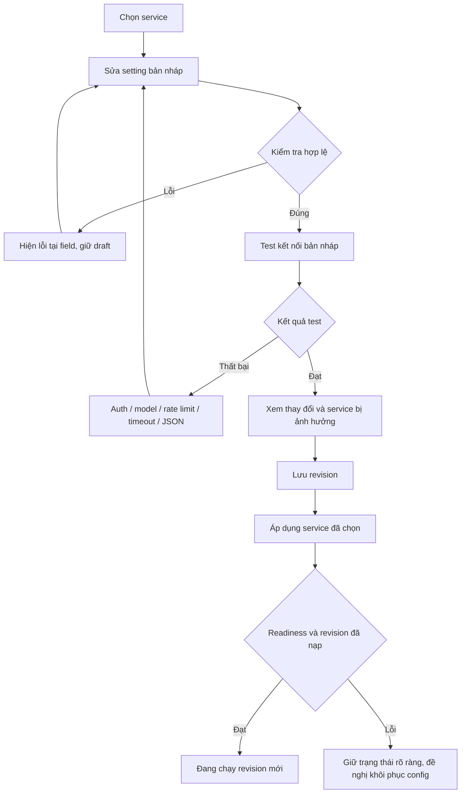

# Product: AgentFleet Settings Console

Version v1.0.0 · 2026-10-14 11:12 Asia/Saigon · Owner approved UI in chat before backend integration.

## Persona
Owner quản lý Telegram Triage và NailHub trên một máy Linux; cần thay setting từ browser và biết chính xác service nào nhận thay đổi. Người bảo trì cần thấy trạng thái/redacted audit, không đọc API key.

## Scenario
Hiện tại: sửa TOML/env qua SSH, tự restart. Mong muốn: chọn service → chỉnh provider/model/key hoặc vận hành → test bản nháp → xem diff → lưu/áp dụng riêng service đó. Khi test lỗi, giữ nguyên bản đang chạy và hướng dẫn sửa tại chỗ.

## Audit
Repo có Python loaders/systemd nhưng chưa có UI, design tokens hay component library. Baseline split là b0f6b0c. Bản prototype không nhập runtime, không sửa TOML/env thật, không gọi cloud API; sample defaults được ghi rõ là dữ liệu minh hoạ. Root cause: cấu hình hiện không có interface quản trị, schema provider chỉ Ollama, NailHub còn khóa model.

## Solution (Product & UX)
- Bố cục Workbench/Cobalt điều chỉnh cho console thực tế: nav trái, vùng form chính, rail trạng thái phải. Không ép landing page/hero marketing vào trang setting.
- Tone technical, tiếng Việt; một mức nhấn cobalt, Space Grotesk cho tiêu đề và IBM Plex Sans cho UI hỗ trợ tiếng Việt. Hai font, không mặc định font thứ ba cho mọi nhãn.
- Tab AI cho cả hai service: provider lựa chọn bằng radio, model ID input có gợi ý định dạng, Base URL, secret input không prefill, timeout, output limit, thinking theo khả năng adapter. Không gợi ý model như thể đã truy vấn danh sách từ tài khoản.
- Đổi provider/model/endpoint/key/timeout/output/thinking làm kết quả test cũ mất hiệu lực. Không dùng key của provider cũ ở endpoint mới. Mỗi service giữ draft riêng, gồm trạng thái secret thay mới; không lưu secret trong browser storage hay diff.
- Key có show/hide, label/helper; cần thay mới khi đổi cloud provider. Test không tự lưu setting; kết quả xác thực khác với xác minh chất lượng nghiệp vụ hoặc VERIFIED NailHub.
- Bản prototype có nhãn cố định “Bản xem trước · chưa kết nối server”. Nút test mở rõ kịch bản mô phỏng; không giả latency hoặc HTTP thật. Nút lưu ghi rõ lưu bản demo. Không cho nhập/giữ key thật; dùng giá trị demo khi thử flow.
- Tổng quan không bịa uptime/PID hay số bài; dùng dấu — và trạng thái “Chưa kết nối”. Lịch sử chỉ hiện thao tác bản demo người dùng thực sự đã thực hiện trong phiên.
- Form validation: HTTP(S) đúng cấu trúc cho URL; HTTPS cho cloud, HTTP loopback cho Ollama; model/key cần có, số nguyên đúng miền. Readiness production, SSRF/redirect và secret storage thuộc backend integration chưa triển khai.
- Modal xem lại có field cũ → mới, secrets chỉ “Thay mới”, không show value. Lưu demo tạo revision, applied vẫn giữ đến khi bấm áp dụng demo; rollback config không hứa đảo tác động bên ngoài.

## User Flow

## Wireframe / Design preview
- `console-ui/index.html`, `tokens.css`, `styles.css`, `app.js`: HTML tương tác độc lập, artifact pre-implementation theo Owner yêu cầu vibe coding; không Pencil.
- Desktop: rail nav 248px, nội dung form co giãn, rail trạng thái 260px ở màn rộng; title chức năng, tab bar, section labels xếp dọc, action bar cuối trang.
- Tablet: nav rút gọn qua menu, summary rail xếp dưới form. Mobile: một cột, menu disclosure, tab wrap thành hàng, button label không xuống dòng; footer actions xếp dọc khi hẹp.
- Viewport kiểm tra: 320/375/414/768px theo Hallmark, thêm tablet landscape và desktop theo evidence rule. Các kích thước UI canonical tham chiếu frontend-code-standards §14, scope web desktop/mobile.
- Tất cả component là mới: nav, provider picker, field, switch, status, native dialog, review diff, history rows. Component dùng cùng token và đầy đủ focus/hover/disabled/loading/error/success.

## Design System Audit
- Primitive/semantic/component tokens: chưa có trước build, tạo trong `console-ui/tokens.css`; không đổi design system có sẵn.
- Không có CSS frontend production trong scope để sửa hardcoded values. CSS prototype chỉ tham chiếu token màu/font, OKLCH tại token block.
- Motion-cut: không thư viện motion, không scroll reveal, không hero imagery, hỗ trợ reduced-motion. Focus ring tức thời.
- Hallmark selection: modern-minimal, Workbench, Cobalt; nav side rail (điều chỉnh cho nhiều destination của admin), Ft2 inline footer. Lần đầu, không history Hallmark để rotate.
- Owner chốt technical qua câu trả lời 14/10 và đã duyệt Visual Gate qua chat. Các mô tả demo phía trên lưu lại giai đoạn thiết kế trước integration.

## Backend integration of approved UI
Các thao tác demo được thay bằng API same-origin. UI bootstrap từ file thật, không dùng defaults giả khi kết nối lỗi. Save/reload giữ cấu hình trên đĩa; key không prefill. Diff/lịch sử ẩn key; provider/endpoint đổi sẽ xoá key nháp, tắt cloud consent và yêu cầu test lại. Local binding và installed host được ghi rõ. Áp dụng chỉ được xác nhận sau receipt revision/PID/mode, trạng thái/PID là lần xác nhận cuối. Loading, conflict và lỗi apply giữ bản nháp; không tự hứa rollback tác động ngoài hệ thống. Chi tiết chạy và quyền OS tại [console README](../../console-ui/README.md).

## Related Documents
- [Master](../00-master/agentfleet-settings-1_master_261014_v1.0.2.md).
- [UI preview](../../console-ui/index.html).
- [Engineering](../02-engineering/agentfleet-settings-1_engineering_261014_v1.0.0.md) · [QA](../03-qa/agentfleet-settings-1_qa_261014_v1.0.0.md) · [Tasks](../04-tasks/agentfleet-settings-1_tasks_261014_v1.0.0.md).
- GitHub issue / PR: chưa có.

## Changelog
| Version | Date | Time | Author | Changes |
|---|---|---|---|---|
| v1.0.0 | 2026-10-14 | 11:12 | AlexChu / Codex | Product scope, Hallmark technical UI, provider/key state, demo honesty, flow và responsive preview |
