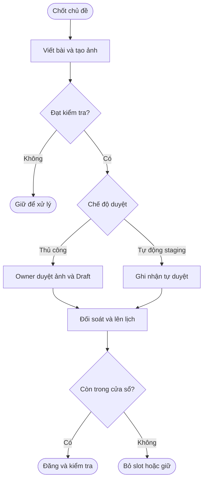
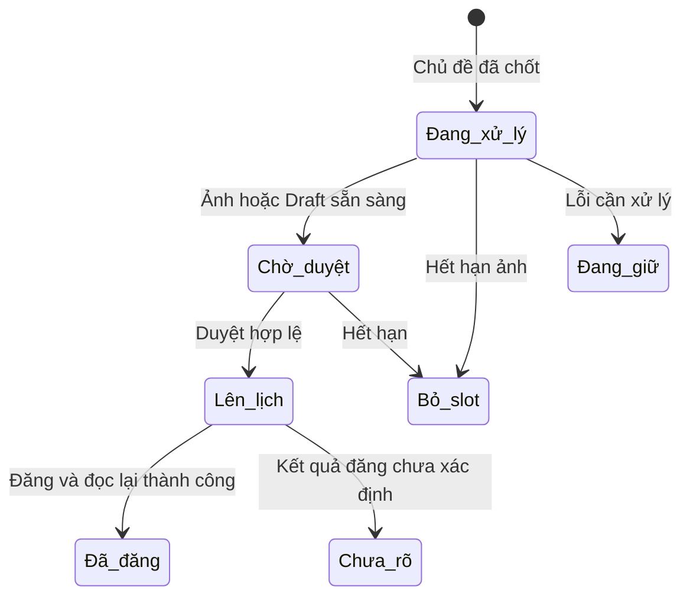
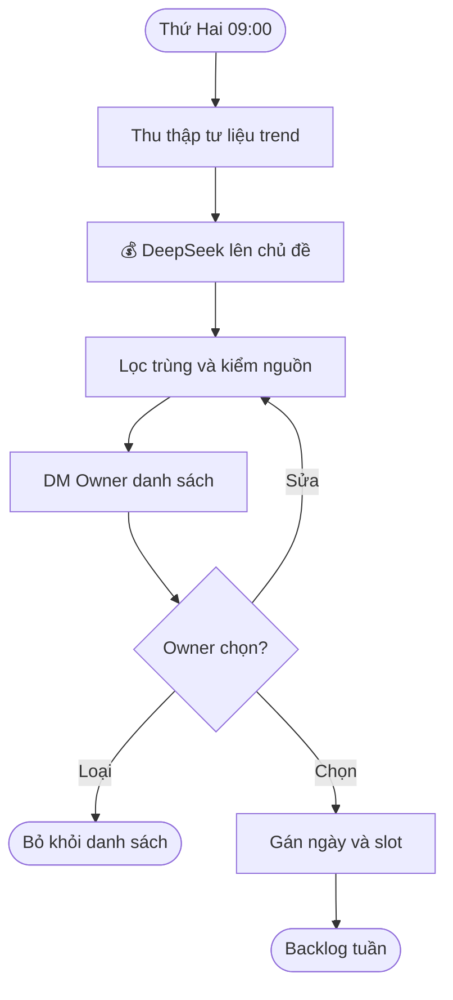
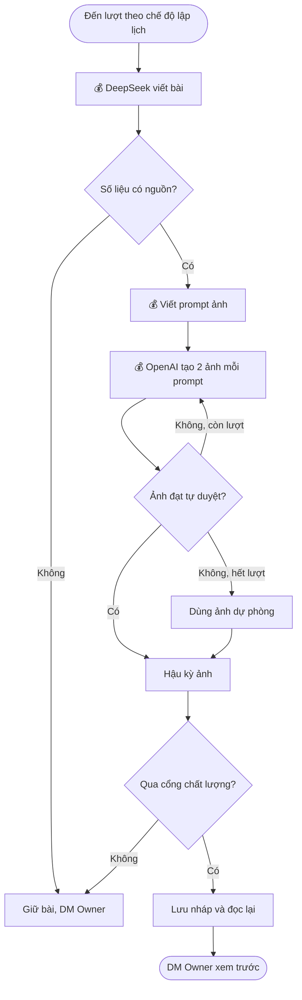
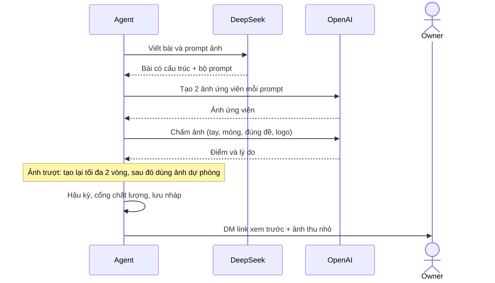
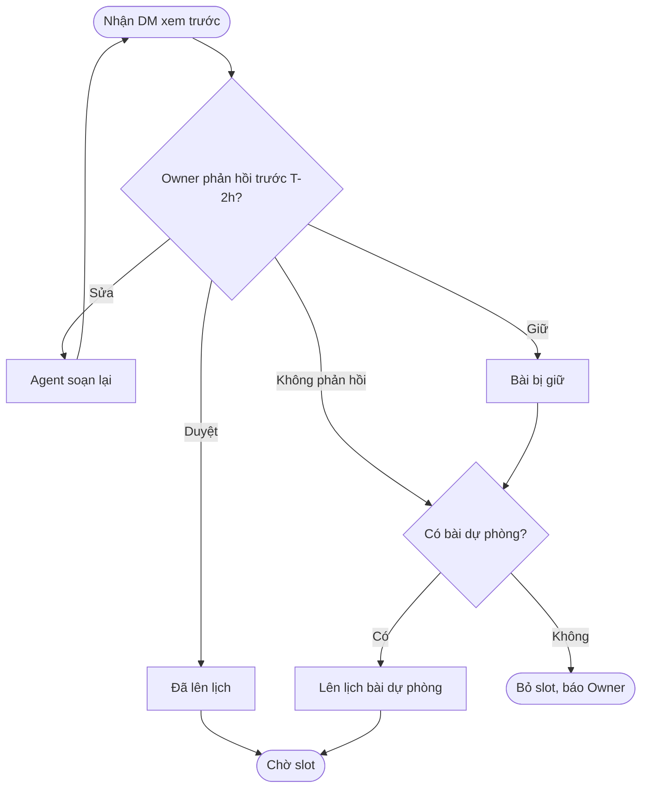
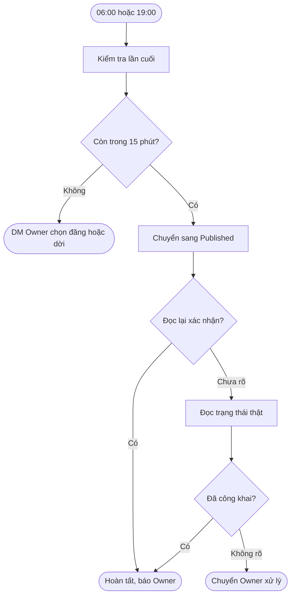
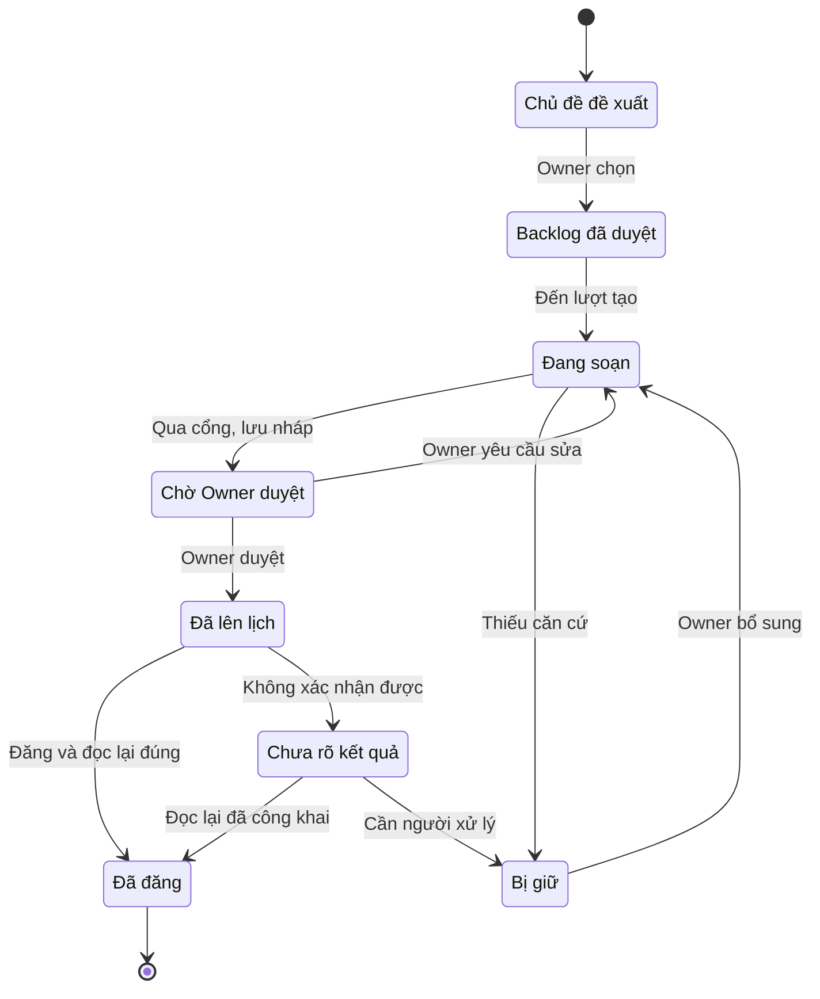

> **Cập nhật đối chiếu v1.0.9 — 2026-10-28 14:17 (Asia/Ho_Chi_Minh).** Tác giả: Codex; trạng thái: chờ review.

**Đối chiếu hiện trạng source:** commit `89a5ac8` trên nhánh `claude/nailblog-automation-review-091e47`. Đây là trạng thái mã nguồn, không khẳng định cấu hình hay phiên bản đang chạy trên THINKPAD. Các mô tả phía dưới có thể thuộc quyết định cũ; khi khác với bản cập nhật này, dùng phần cập nhật và kiểm tra cấu hình thực tế.

## Nghiệp vụ hiện hành — bản đối chiếu

**Đối tượng:** Owner, vận hành, QA. **Trạng thái:** cập nhật để review; chưa xác nhận triển khai thumbnail mới. Chủ đề được chốt theo slot, bài được viết và kiểm chất lượng, tạo ảnh, lưu Draft và đăng đúng lịch. Owner có thể kiểm tra qua tin nhắn riêng Telegram.

| Bước | Kết quả / điều kiện |
|---|---|
| Chủ đề | Một chủ đề đã chốt cho mỗi slot; cấu hình mẫu 06:00, 10:00, 15:00, 19:00 giờ Việt Nam. |
| Nội dung và ảnh | Agy qua worker xử lý chữ và ảnh; kiểm số liệu, nội dung và ảnh. Việc chấm ảnh bằng model có thể được bypass theo cấu hình Owner; kiểm tra ảnh xác định vẫn áp dụng. |
| Duyệt | Chế độ mặc định chờ Owner duyệt ảnh rồi Draft. Nếu cấu hình tự duyệt staging bật, bài phải `pass`, không issue hoặc override; không gửi hai thẻ, ghi nhận duyệt tự động theo đúng bản. |
| Lên lịch và đăng | Kiểm trùng, lưu và đọc lại Draft; chỉ đăng khi điều kiện hợp lệ, trong cửa sổ của slot, tối đa một lần. |
| Ngoại lệ | Quá hạn có thể bỏ slot; trạng thái chưa rõ phải đối soát, không tự đăng lại. |

**Thumbnail:** yêu cầu mới là ảnh sáng, sinh động, bám nội dung, không chữ và không lớp phủ tối. Source `89a5ac8` đã thay đổi luồng tạo ảnh mới; chưa chứng minh deploy, chất lượng ảnh thật hoặc thay thế ảnh của bài đã đăng.

**Vận hành:** `/nailblog flow`, `/nailblog queue`, `/nailblog status` để xem; `/nailblog pause`, `/nailblog resume` để dừng/chạy theo preflight. `autoflow-requeue` là lệnh terminal của operator, chỉ hỗ trợ run `held/text_quality_held` đủ điều kiện; không khôi phục run `skipped/images_deadline_missed`. Không sửa trạng thái trực tiếp trong DB để đăng bù.

**Quan sát đã cung cấp:** ảnh chụp ngày 28/10 cho thấy #1, #3, #5 bị bỏ do hết hạn ảnh, #7 đã lên lịch và người dùng xác nhận bài đã lên. Không suy ra đã nghiệm thu bốn slot.

**Tài liệu liên quan:** [Master](../00-master/nailhub-blog-noissue_master_261014_v1.0.0.md) · [Kỹ thuật](../02-engineering/nailhub-blog-noissue_engineering_261027_v1.0.0.md) · [Vận hành](../02-engineering/nailhub-blog-noissue_cutover-runbook_261027_v1.0.0.md) · [QA](../03-qa/nailhub-blog-noissue_qa_261027_v1.0.0.md).

**Lịch sử thay đổi:** v1.0.9 — 2026-10-28 14:17 — đối chiếu source, vận hành và bằng chứng; không thay đổi trạng thái phê duyệt cũ.

---

> **Nội dung lịch sử bên dưới:** giữ để truy vết; nếu khác với cập nhật phía trên, dùng phần cập nhật và kiểm tra cấu hình thực tế.

# Quy trình nghiệp vụ Agent tạo bài blog NailHub

**Phiên bản:** v1.0.1\
**Cập nhật:** 2026-10-15, múi giờ Asia/Ho_Chi_Minh (GMT+7)\
**Đối tượng:** Owner, người duyệt đề tài, vận hành, QA và agent phát triển\
**Trạng thái tài liệu:** Draft — gửi trình duyệt\
**Căn cứ:** [Master Doc v1.0.1](../00-master/nailhub-blog-noissue_master_261014_v1.0.0.md); nguyên tắc vận hành kế thừa từ [quy trình duyệt tin NailHub v1.0.8](nailhub-postings-noissue_business_261013_v1.0.0.md)\
**Chủ sở hữu quy trình:** AlexChu\
**Mục đích:** Đề tài báo cáo, phi thương mại

---

## Tổng quan

Agent chạy 24/7 trên THINKPAD, mỗi ngày tự soạn và đăng **2 bài blog** lên [NailHub](https://nailhub.ai/blog/all-blog) vào đúng **06:00 và 19:00 GMT+7**. Mỗi bài có **1 thumbnail 16:9 và 3–5 ảnh trong bài** đạt chuẩn SEO, nội dung bám trend và mùa vụ ngành nail. Ảnh được tạo qua **OpenAI API** và tự duyệt chất lượng trước khi dùng. Owner chọn chủ đề và duyệt bài qua tin nhắn riêng Telegram, không cần mở trang quản trị.

Đề tài còn thử nghiệm **3 chế độ lập lịch tạo ảnh** (cố định, ngẫu nhiên trong khung, thích ứng) và ghi số liệu để so sánh trong báo cáo. Giờ **đăng** bài luôn cố định, chỉ giờ **tạo ảnh** thay đổi theo chế độ.

**Hiện trạng cần cải thiện** (audit 33 bài blog qua API công khai ngày 2026-10-14):

| Chỉ số | Hiện trạng | Mục tiêu |
| --- | --- | --- |
| Ảnh trong bài | 31/33 bài không có ảnh nào, 0 ảnh có alt | 3–5 ảnh/bài, 100% có alt |
| Thumbnail | 31/33 là 1200×630 (1.91:1) | 1600×900 (16:9) |
| Lịch đăng | Đăng dồn, có lúc 9 bài trong 4 phút | 2 bài/ngày, đúng 06:00 và 19:00 |
| Hashtag | 20/33 bài không có | 3–5 hashtag/bài |
| Tiêu đề | ~60% dài hơn 60 ký tự | Tiêu đề SEO ≤ 60 ký tự |

---

## Khái niệm chính

| Thuật ngữ | Ý nghĩa |
| --- | --- |
| Slot đăng | Một trong hai mốc đăng cố định mỗi ngày: 06:00 hoặc 19:00 GMT+7 |
| Backlog chủ đề | Danh sách chủ đề Owner đã duyệt, mỗi chủ đề được gán ngày và slot |
| Bài nháp | Bài đã soạn xong, lưu trạng thái Draft trên trang quản trị, chưa công khai |
| Thumbnail | Ảnh bìa 16:9 hiển thị ở danh sách blog và khi chia sẻ bài |
| Ảnh thân bài | 3–5 ảnh xen giữa các mục của bài, mỗi ảnh có alt text và tên file mô tả |
| Ảnh ứng viên | Một trong nhiều ảnh được tạo cho cùng một vị trí; Agent chọn ảnh tốt nhất |
| Tự duyệt ảnh | Bước Agent chấm ảnh ứng viên theo tiêu chí kỹ thuật, tay và móng, đúng đề, an toàn thương hiệu |
| Ảnh dự phòng | Infographic hoặc ảnh template tự dựng, dùng khi ảnh AI không đạt sau số lần tạo lại tối đa |
| Bài dự phòng | Bài evergreen đã được Owner duyệt sẵn, dùng khi bài của slot không kịp duyệt |
| Căn cứ | Nguồn chính thức cho số liệu luật, thuế, phí, số giờ học, hạn license |
| Chưa rõ kết quả | Lệnh đăng có thể đã gửi nhưng chưa xác nhận được; không được bấm đăng lần hai |
| Chế độ lập lịch | Cách Agent chọn thời điểm tạo ảnh trong 24 giờ trước slot |

---

## Vai trò

| Vai trò | Trách nhiệm |
| --- | --- |
| Owner (@SotaThao) | Duyệt chủ đề tuần, duyệt bài, xử lý bài bị giữ, chọn chế độ lập lịch |
| Agent NailBlog (THINKPAD) | Thu thập trend, soạn bài, tạo và tự duyệt ảnh, lưu nháp, đăng đúng slot, đọc lại |
| DeepSeek (API) | Lên chủ đề, viết bài, viết prompt ảnh và alt text, rà câu thiếu căn cứ |
| OpenAI (API) | Tạo ảnh; chấm ảnh bằng model đọc ảnh |
| Listener Telegram hiện có | Nhận lệnh `/nailblog` và gửi DM cho Owner; không tạo session Telegram mới |
| Người đọc | Thợ nail và chủ tiệm người Việt tại Mỹ |

---

## Workflow lên chủ đề tuần

**Tác nhân chính:** Agent, Owner.\
**Kích hoạt:** Thứ Hai 09:00 GMT+7, hoặc lệnh `/nailblog topics`.\
**Kết quả:** Backlog 14 chủ đề cho tuần kế tiếp, mỗi chủ đề có ngày và slot.

**Nhu cầu nghiệp vụ:**
- Là Owner, tôi muốn nhận sẵn danh sách chủ đề có điểm và nguồn, để chỉ cần chọn thay vì tự nghĩ.
- Là Owner, tôi muốn chủ đề không trùng bài đã đăng, để blog không lặp nội dung.
- Là Owner, tôi muốn sửa hoặc loại chủ đề bằng một lệnh, để không phải mở trang quản trị.

| Bước | Ai | Hành động | Kết quả | Ghi chú |
| --- | --- | --- | --- | --- |
| 1 | Agent | Đọc RSS báo làm đẹp, báo ngành, trang cơ quan nhà nước và danh sách bài đã đăng | Gói tư liệu có URL và ngày | Code tự đọc; API DeepSeek không tự tìm kiếm web |
| 2 | Agent | Gửi gói tư liệu cho DeepSeek lên 16–20 chủ đề | Danh sách chủ đề có danh mục, slot gợi ý, điểm, nguồn | 💰 Tốn token DeepSeek |
| 3 | Agent | Loại chủ đề trùng bài 90 ngày, kiểm nguồn có trong gói tư liệu | Danh sách đã lọc | |
| 4 | Agent | DM Owner danh sách chủ đề | Owner nhận tin | |
| 5 | Owner | Trả lời `ok`, `drop`, `edit` | Backlog được cập nhật | |
| 6 | Agent | Gán ngày và slot theo lịch nội dung tuần | Backlog 14 bài | 06:00 cho trend/thợ, 19:00 cho chủ tiệm |

---

## Workflow soạn bài và tạo ảnh

**Tác nhân chính:** Agent.\
**Kích hoạt:** Theo chế độ lập lịch, trong khoảng 24 giờ đến 3 giờ trước slot.\
**Kết quả:** Bài nháp hoàn chỉnh trên trang quản trị, có đủ thumbnail và ảnh thân bài, đã qua cổng chất lượng.

**Nhu cầu nghiệp vụ:**
- Là Owner, tôi muốn mỗi bài có đủ 1 thumbnail 16:9 và 3–5 ảnh đẹp, để bài đạt chuẩn SEO và hấp dẫn người đọc.
- Là Owner, tôi muốn ảnh lỗi tay, lỗi móng bị loại tự động, để không phải tự soát từng ảnh.
- Là Owner, tôi muốn số liệu luật và thuế luôn có nguồn, để blog không đưa thông tin sai.
- Là người làm báo cáo, tôi muốn mỗi lần tạo ảnh được ghi log, để so sánh các chế độ lập lịch.

| Bước | Ai | Hành động | Kết quả | Ghi chú |
| --- | --- | --- | --- | --- |
| 1 | Agent | Lấy chủ đề từ backlog, gửi DeepSeek viết bài theo khung chuẩn | Bài có tiêu đề SEO, summary, 4–7 mục, FAQ, CTA, hashtag, slug | 💰 Tốn token DeepSeek |
| 2 | Agent | Đối chiếu mọi con số với nguồn đã trích | Đạt, hoặc bài bị giữ | Thiếu nguồn thì giữ bài, không bịa |
| 3 | Agent | DeepSeek viết 1 prompt thumbnail và 3–5 prompt ảnh thân bài | Bộ prompt | Prompt không yêu cầu vẽ chữ lên ảnh |
| 4 | Agent | Gọi OpenAI API tạo 2 ảnh ứng viên cho mỗi prompt | Ảnh ứng viên | 💰 Tốn phí tạo ảnh OpenAI |
| 5 | Agent | Tự duyệt ảnh, chọn ảnh tốt nhất mỗi vị trí | Ảnh đạt, hoặc cần tạo lại | 💰 Tốn phí model đọc ảnh |
| 6 | Agent | Ảnh trượt: tạo lại tối đa 2 vòng; vẫn trượt thì dùng ảnh dự phòng | Đủ ảnh cho bài | |
| 7 | Agent | Hậu kỳ: cắt 16:9, ghép tiêu đề bằng template, nén WebP, đặt tên, viết alt | Bộ ảnh hoàn chỉnh | Chữ tiếng Việt do template dựng, không do model vẽ |
| 8 | Agent | Chạy cổng chất lượng toàn bài | Đạt, hoặc sửa 1 lần, hoặc giữ bài | |
| 9 | Agent | Upload ảnh, lưu bài Draft trên trang quản trị, đọc lại | Bài nháp xác nhận | |
| 10 | Agent | DM Owner link xem trước và ảnh thu nhỏ | Owner nhận tin | |

### Tiêu chí tự duyệt ảnh

Ảnh chỉ được dùng khi đạt **tất cả** tiêu chí. Điểm và lý do được lưu kèm từng ảnh.

| Nhóm | Điều kiện đạt | Ai kiểm |
| --- | --- | --- |
| Kỹ thuật | Đúng tỷ lệ, đủ độ phân giải, sau nén ≤ 200 KB (thumbnail) / ≤ 150 KB (thân bài) | Code |
| Tay và móng | Đủ 5 ngón, không ngón dính hay thừa, móng đều, không méo | Model đọc ảnh |
| Đúng đề | Màu và kiểu móng khớp prompt | Model đọc ảnh |
| An toàn thương hiệu | Không chữ lạ, logo hãng, watermark, mặt người nhận ra được | Model đọc ảnh |
| Không trùng | Khác các ảnh khác trong bài và ảnh của bài cũ | Code (so mã băm cảm quan) |

### Chuẩn ảnh SEO

| Loại | Số lượng | Kích thước | Định dạng | Bắt buộc |
| --- | --- | --- | --- | --- |
| Thumbnail | 1 | 1600×900 (16:9); chữ nằm trong vùng giữa 1200×630 | WebP ≤ 200 KB | Tên file mô tả, alt |
| Ảnh thân bài | 3–5 | 1200×675 ngang hoặc 1080×1350 dọc | WebP ≤ 150 KB | Tên file bỏ dấu, alt 5–15 từ, caption khi ảnh có thông tin |

---

## Workflow Owner duyệt bài

**Tác nhân chính:** Owner.\
**Kích hoạt:** Agent gửi DM xem trước.\
**Kết quả:** Bài được duyệt cho slot, được sửa, hoặc bị giữ.

**Nhu cầu nghiệp vụ:**
- Là Owner, tôi muốn duyệt bài bằng một lệnh, để thao tác nhanh trên điện thoại.
- Là Owner, tôi muốn slot vẫn có bài khi tôi bận không duyệt kịp, để lịch đăng không bị trống.

| Bước | Ai | Hành động | Kết quả | Ghi chú |
| --- | --- | --- | --- | --- |
| 1 | Owner | Mở link xem trước | Thấy bài và ảnh | |
| 2a | Owner | `/nailblog approve <id>` | Bài chuyển sang Đã lên lịch | |
| 2b | Owner | Yêu cầu sửa | Agent soạn lại, gửi DM mới | |
| 2c | Owner | `/nailblog hold <id> <lý do>` | Bài bị giữ | Slot dùng bài dự phòng |
| 3 | Agent | Hết hạn T-2h mà chưa có phản hồi | Dùng bài dự phòng, nếu không có thì bỏ slot | Theo quyết định D-06 |

---

## Workflow đăng bài đúng slot

**Tác nhân chính:** Agent.\
**Kích hoạt:** 06:00 hoặc 19:00 GMT+7.\
**Kết quả:** Bài công khai, đã đọc lại xác nhận, Owner được báo.

**Nhu cầu nghiệp vụ:**
- Là Owner, tôi muốn bài lên đúng giờ, để tiếp cận người đọc vào lúc họ hay lướt điện thoại.
- Là Owner, tôi muốn không bao giờ có bài đăng trùng, kể cả khi mạng hoặc trang quản trị lỗi.

| Bước | Ai | Hành động | Kết quả | Ghi chú |
| --- | --- | --- | --- | --- |
| 1 | Agent | T-10 phút: kiểm bài vẫn đúng bản đã duyệt, ảnh còn truy cập được, slot không trùng | Sẵn sàng | |
| 2 | Agent | Đúng slot: chuyển bài từ Draft sang Published | Đã gửi lệnh đăng | |
| 3 | Agent | Đọc lại: trạng thái, giờ đăng (sai số ≤ 15 phút), số ảnh, URL công khai | Xác nhận | |
| 4a | Agent | Đọc lại đúng | Hoàn tất, DM Owner | |
| 4b | Agent | Không xác nhận được | Chưa rõ kết quả, đọc trạng thái thật | Không bấm đăng lần hai |
| 5 | Agent | Trễ quá 15 phút (máy tắt, mất phiên) | Không tự đăng bù, DM Owner chọn | |

| Slot (GMT+7) | Giờ bờ Đông Mỹ (đến 31/10 · từ 01/11) | Nội dung ưu tiên |
| --- | --- | --- |
| 06:00 | 19:00 · 18:00 hôm trước | Trend, tay nghề, việc làm, license |
| 19:00 | 08:00 · 07:00 | Vận hành tiệm, luật, thuế, marketing |

---

## Chế độ lập lịch tạo ảnh (phần thử nghiệm của đề tài)

Chế độ chỉ ảnh hưởng **thời điểm tạo ảnh**. Giờ đăng luôn là 06:00 và 19:00.

| Chế độ | Cách chạy | Ưu điểm | Nhược điểm |
| --- | --- | --- | --- |
| Cố định | Tạo ảnh vào một giờ cấu hình sẵn, ví dụ 01:00 | Dễ dự đoán, dễ theo dõi | Dồn tải vào một thời điểm; lỗi API lúc đó ảnh hưởng cả 2 bài |
| Ngẫu nhiên trong khung | Mỗi bài chọn ngẫu nhiên một thời điểm trong khoảng 24 giờ đến 3 giờ trước slot | Dàn đều tải, giảm rủi ro lỗi đồng loạt | Khó dự đoán lúc bài sẵn sàng để Owner duyệt |
| Thích ứng | Chạy khi máy rảnh; API lỗi hoặc chậm thì lùi lại và thử sau | Tận dụng tài nguyên, chịu lỗi tốt | Logic phức tạp hơn |

**Số liệu ghi cho mỗi lần chạy:** chế độ, thời điểm bắt đầu và kết thúc, số ảnh tạo, số ảnh đạt ngay vòng đầu, số vòng tạo lại, số ảnh dự phòng, chi phí API, bài kịp hạn T-2h hay không.

**Kế hoạch thử nghiệm đề xuất:** chạy mỗi chế độ 1 tuần (14 bài), giữ nguyên model và lịch nội dung, rồi so sánh tỷ lệ kịp hạn, tỷ lệ ảnh đạt và chi phí trên mỗi bài.

---

## Quản trị và cấu hình vận hành

- Là Owner, tôi muốn đổi chế độ lập lịch bằng lệnh `/nailblog mode <cố định|ngẫu nhiên|thích ứng>`, để chuyển đợt thử nghiệm không cần sửa code.
- Là Owner, tôi muốn đặt hạn mức chi phí API mỗi ngày, để vòng tạo lại không làm tràn chi phí.
- Là Owner, tôi muốn tạm dừng và chạy lại toàn bộ Agent bằng `/nailblog pause` và `resume`.

| Lệnh | Tác dụng |
| --- | --- |
| `/nailblog topics` · `topics ok/drop/edit` | Xem, duyệt, loại, sửa chủ đề |
| `/nailblog queue` | Xem 2 ngày tới: slot, bài, trạng thái |
| `/nailblog approve <id>` · `hold <id> <lý do>` · `move <id> <ngày> <06\|19>` | Duyệt, giữ, dời bài |
| `/nailblog mode <chế độ>` | Đổi chế độ lập lịch tạo ảnh |
| `/nailblog pause` · `resume` · `status` | Tạm dừng, chạy lại, xem trạng thái và chi phí trong ngày |

**Khóa API và bảo mật:**
- Khóa OpenAI và DeepSeek lưu trong file trên THINKPAD, nằm ngoài Git, chỉ service đọc được (quyền 0600). Không ghi khóa vào tài liệu, chat hoặc log.
- Chỉ gửi nội dung công khai cho API: tư liệu báo, bài nháp, prompt ảnh. Không gửi mật khẩu quản trị hoặc dữ liệu cá nhân.
- Chỉ nhận lệnh từ DM đúng ID số của Owner, như lệnh `/nailhub`.

**Chi phí ước tính mỗi tháng** (60 bài; giá lấy từ trang tổng hợp, cần đối chiếu bảng giá chính thức trước khi chạy):

| Hạng mục | Khối lượng | Ước tính |
| --- | --- | --- |
| 💰 Tạo ảnh OpenAI | ~4 vị trí AI × 2 ứng viên × 60 bài + ~10% tạo lại ≈ 530 ảnh | ~16–27 USD ở chất lượng medium; ~70 USD nếu dùng high |
| 💰 Model đọc ảnh OpenAI | ~530 lượt chấm | Vài USD |
| 💰 DeepSeek | ~2–3 triệu token | Vài USD |

Đề xuất: tạo ảnh ứng viên ở chất lượng medium, chỉ dùng high cho thumbnail. Hạn mức mặc định 3 USD/ngày; chạm hạn mức thì dùng ảnh dự phòng và báo Owner.

---

## Vòng đời trạng thái bài

| Trạng thái | Sự kiện | Trạng thái tiếp theo | Ghi chú |
| --- | --- | --- | --- |
| Chủ đề đề xuất | Owner chọn | Backlog đã duyệt | |
| Backlog đã duyệt | Đến lượt theo chế độ lập lịch | Đang soạn | |
| Đang soạn | Qua cổng chất lượng, lưu nháp | Chờ Owner duyệt | |
| Đang soạn | Thiếu căn cứ hoặc lỗi không tự sửa được | Bị giữ | DM Owner kèm lý do |
| Chờ Owner duyệt | Owner duyệt | Đã lên lịch | |
| Chờ Owner duyệt | Owner yêu cầu sửa | Đang soạn | |
| Bị giữ | Owner bổ sung căn cứ | Đang soạn | |
| Đã lên lịch | Đăng và đọc lại đúng | Đã đăng | |
| Đã lên lịch | Không xác nhận được | Chưa rõ kết quả | Không đăng lại |
| Chưa rõ kết quả | Đọc lại thấy đã công khai | Đã đăng | |
| Chưa rõ kết quả | Không xác định được | Bị giữ | Owner xử lý |

---

## Quy tắc nghiệp vụ

- **BB-01 — Giờ đăng cố định:** Mỗi ngày đúng 2 bài, 06:00 và 19:00 GMT+7. Cửa sổ trễ tối đa 15 phút; quá hạn thì không tự đăng bù.
- **BB-02 — Ảnh bắt buộc:** Mỗi bài có 1 thumbnail 16:9 và 3–5 ảnh thân bài, mỗi ảnh có alt và tên file mô tả. Thiếu ảnh thì không đăng.
- **BB-03 — Tự duyệt ảnh:** Ảnh AI chỉ được dùng khi đạt tất cả tiêu chí tự duyệt. Tối đa 2 vòng tạo lại, sau đó dùng ảnh dự phòng.
- **BB-04 — Không vẽ chữ bằng AI:** Chữ trên thumbnail do template dựng, model ảnh không vẽ chữ.
- **BB-05 — Căn cứ:** Số liệu luật, thuế, phí, số giờ học, hạn license phải có nguồn chính thức kèm ngày cập nhật. Không bịa trích dẫn, khảo sát, tên tiệm hay lời khách.
- **BB-06 — Không trùng:** Chủ đề trùng ý bài đã đăng trong 90 ngày bị loại hoặc chuyển thành bài cập nhật.
- **BB-07 — Cân bằng nội dung:** Tối đa 1 bài giới thiệu sản phẩm (NEXORA TOUCH) mỗi ngày.
- **BB-08 — Ảnh minh họa:** Ảnh AI là ảnh minh họa, không được giới thiệu là ảnh tiệm thật. Không dùng ảnh lấy từ mạng xã hội hay báo khác.
- **BB-09 — Đăng một lần:** Sau lệnh đăng phải đọc lại. Kết quả chưa rõ thì đọc trạng thái thật, không bấm đăng lần hai.
- **BB-10 — Nguồn ảnh qua API:** Ảnh tạo qua API ảnh bằng khóa riêng: Gemini API trong giai đoạn phát triển, OpenAI API theo kế hoạch vận hành; đổi bằng cấu hình. Không tự động hóa giao diện ChatGPT.
- **BB-11 — Hạn mức chi phí:** Chạm hạn mức ngày thì ngừng gọi API tạo ảnh, dùng ảnh dự phòng, báo Owner.
- **BB-12 — Chế độ lập lịch:** Chế độ chỉ đổi thời điểm tạo ảnh. Mọi chế độ phải hoàn tất trước hạn T-2h.

> 💡 **Quan trọng:** BB-09 và BB-11 bảo vệ tính đúng của blog công khai và chi phí API. Không được tắt hai quy tắc này kể cả khi thử nghiệm.

---

## Ngoại lệ và xử lý

| Tình huống | Cách xử lý | Ai xử lý |
| --- | --- | --- |
| API OpenAI lỗi hoặc quá hạn mức tốc độ | Lùi lại và thử sau; gần hạn T-2h thì dùng ảnh dự phòng | Agent |
| Ảnh trượt tự duyệt sau 2 vòng | Dùng infographic/template | Agent |
| Chạm hạn mức chi phí ngày | Ngừng tạo ảnh, dùng ảnh dự phòng, DM Owner | Agent, Owner |
| Số liệu không có nguồn | Giữ bài, DM chỉ rõ đoạn thiếu | Owner |
| Owner không duyệt trước T-2h | Dùng bài dự phòng; không có thì bỏ slot | Agent |
| Phiên quản trị hết hạn | Đăng nhập lại theo cấu hình; lỗi thì dừng và báo | Agent, Owner |
| THINKPAD tắt qua giờ slot | Không đăng bù; DM Owner chọn đăng ngay hoặc dời | Owner |
| Không xác nhận được lệnh đăng | Chưa rõ kết quả, đọc trạng thái thật, không đăng lại | Agent, Owner |
| Trang quản trị không giữ alt/caption khi lưu | Dừng và báo; cần team nền tảng xử lý | Owner, team FE/BE |

---

## Phụ thuộc nền tảng nailhub.ai

Các việc dưới đây nằm ngoài Agent nhưng ảnh hưởng trực tiếp hiệu quả SEO:

| # | Việc | Lý do |
| --- | --- | --- |
| DEP-1 | Trang chi tiết bài trả về title, description, ảnh chia sẻ riêng của từng bài | Hiện mọi bài dùng chung meta mặc định |
| DEP-2 | Đưa bài blog và ảnh vào sitemap | Sitemap hiện không có bài blog nào |
| DEP-3 | Slug bỏ dấu đúng (“tiệm” → `tiem`) | Hiện ký tự có dấu bị rơi (“tiệm” → `tim`) |
| DEP-4 | Trình soạn thảo giữ alt, caption của ảnh | Cần để ảnh đạt chuẩn SEO |
| DEP-5 | Xác nhận có hẹn giờ đăng hay không | Quyết định cách Agent đăng đúng slot |

---

## Quyết định cần duyệt

| ID | Nội dung | Đề xuất |
| --- | --- | --- |
| D-01 | Thumbnail 16:9 thay cho 1200×630 hiện tại | 1600×900, chữ trong vùng an toàn |
| D-02 | Ý nghĩa field công khai của bài đã đăng | Kiểm trang quản trị trước khi tự động đăng |
| D-04 | Hẹn giờ trên trang quản trị hay Agent tự đăng | Ưu tiên hẹn giờ nếu có; Agent vẫn đọc lại |
| D-06 | Owner không duyệt kịp | Bài dự phòng, giữ sẵn 3 bài |
| D-08 | Duyệt từng bài hay chỉ duyệt chủ đề | Giai đoạn đầu duyệt từng bài |
| D-10 | Hạn mức chi phí API mỗi ngày | 3 USD/ngày |
| D-11 | Thứ tự thử nghiệm 3 chế độ lập lịch | Cố định → Ngẫu nhiên → Thích ứng, mỗi chế độ 1 tuần |

---

## Kế hoạch triển khai

| Giai đoạn | Nội dung | Thời lượng |
| --- | --- | --- |
| 0 | Duyệt tài liệu và quyết định; kiểm form blog trên trang quản trị; cấu hình khóa API | 1–2 ngày |
| 1 | Bán tự động: Agent soạn bài và ảnh, Owner tự bấm đăng | 1 tuần |
| 2 | Tự động đăng 1 slot/ngày có đọc lại, sau đó bật 2 slot | 1 tuần |
| 3 | Thử nghiệm 3 chế độ lập lịch, thu số liệu cho báo cáo | 3 tuần |

**Chỉ số thành công:** ≥ 95% bài đăng đúng slot; 0 bài trùng; 100% bài đủ ảnh có alt; 100% số liệu luật/thuế có nguồn; chi phí trong hạn mức.

---

## Câu hỏi thường gặp

**Hỏi: Vì sao giờ đăng cố định mà giờ tạo ảnh lại thay đổi?**\
Đáp: Giờ đăng phục vụ người đọc nên phải ổn định. Giờ tạo ảnh là việc nội bộ, thay đổi để thử nghiệm và so sánh các chế độ lập lịch trong đề tài.

**Hỏi: Ảnh AI lỗi tay hoặc móng thì sao?**\
Đáp: Agent tự chấm từng ảnh. Ảnh lỗi bị loại và tạo lại tối đa 2 vòng; vẫn lỗi thì dùng infographic hoặc ảnh template.

**Hỏi: Owner có phải mở trang quản trị không?**\
Đáp: Không bắt buộc. Mọi thao tác duyệt chủ đề, duyệt bài, giữ bài và đổi chế độ đều làm qua DM Telegram.

**Hỏi: Nếu Agent đăng lỗi thì có bị đăng trùng không?**\
Đáp: Không. Khi không xác nhận được kết quả, Agent chỉ đọc trạng thái thật, không bao giờ bấm đăng lần hai.

**Hỏi: Chi phí có thể vượt kiểm soát không?**\
Đáp: Có hạn mức theo ngày. Chạm hạn mức thì Agent ngừng tạo ảnh, chuyển sang ảnh dự phòng và báo Owner.

---

## Tài liệu liên quan

- [Master Doc — Flow tạo bài blog](../00-master/nailhub-blog-noissue_master_261014_v1.0.0.md)
- [Quy trình duyệt tin NailHub v1.0.8](nailhub-postings-noissue_business_261013_v1.0.0.md)

## Changelog

| Version | Date | Time | Author | Change |
| --- | --- | --- | --- | --- |
| v1.0.1 | 2026-10-16 | — | AlexChu (Claude executor) | BB-10: Gemini API cho giai đoạn phát triển |
| v1.0.0 | 2026-10-15 | — | AlexChu (Claude executor) | Bản đầu gửi trình: workflow chủ đề, soạn bài và ảnh qua OpenAI API, duyệt, đăng đúng slot, 3 chế độ lập lịch, chi phí, quy tắc BB-01…12 |
