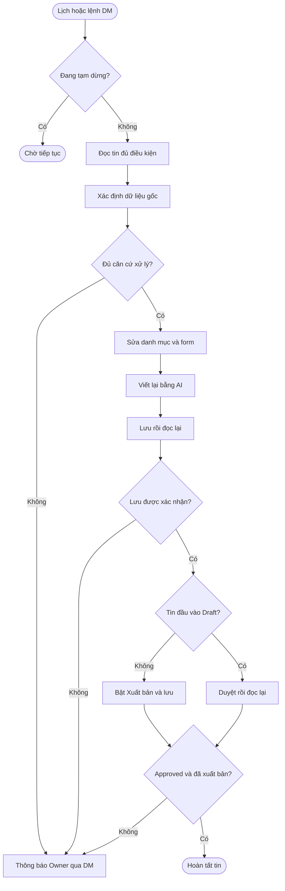
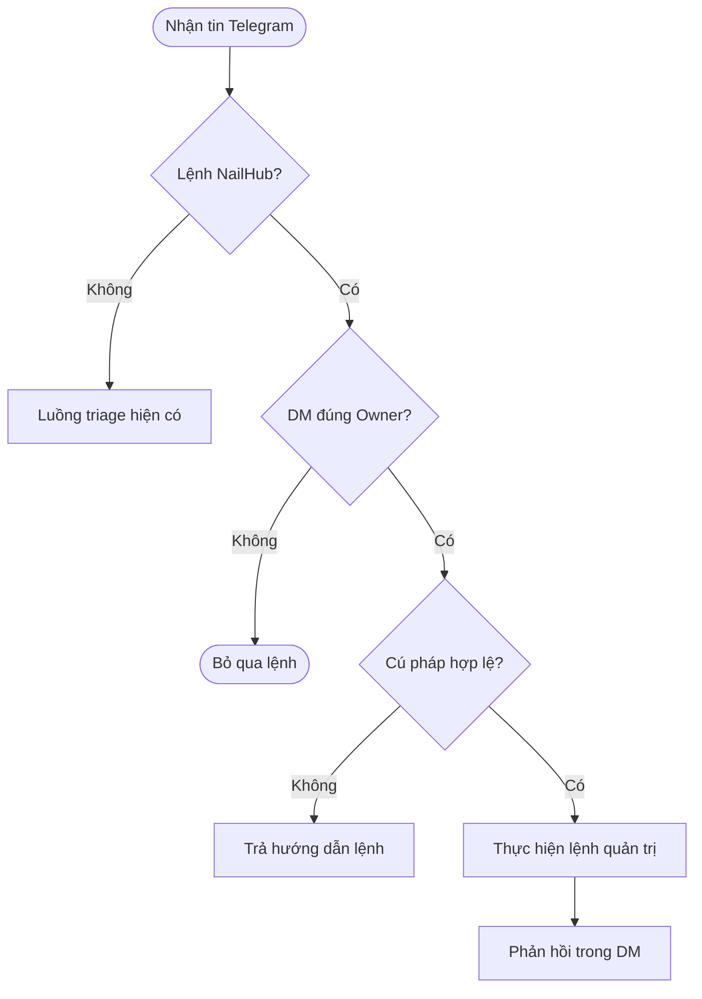
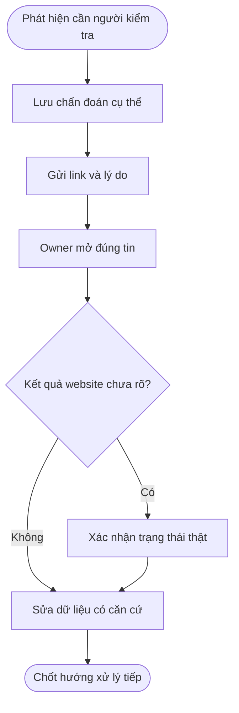
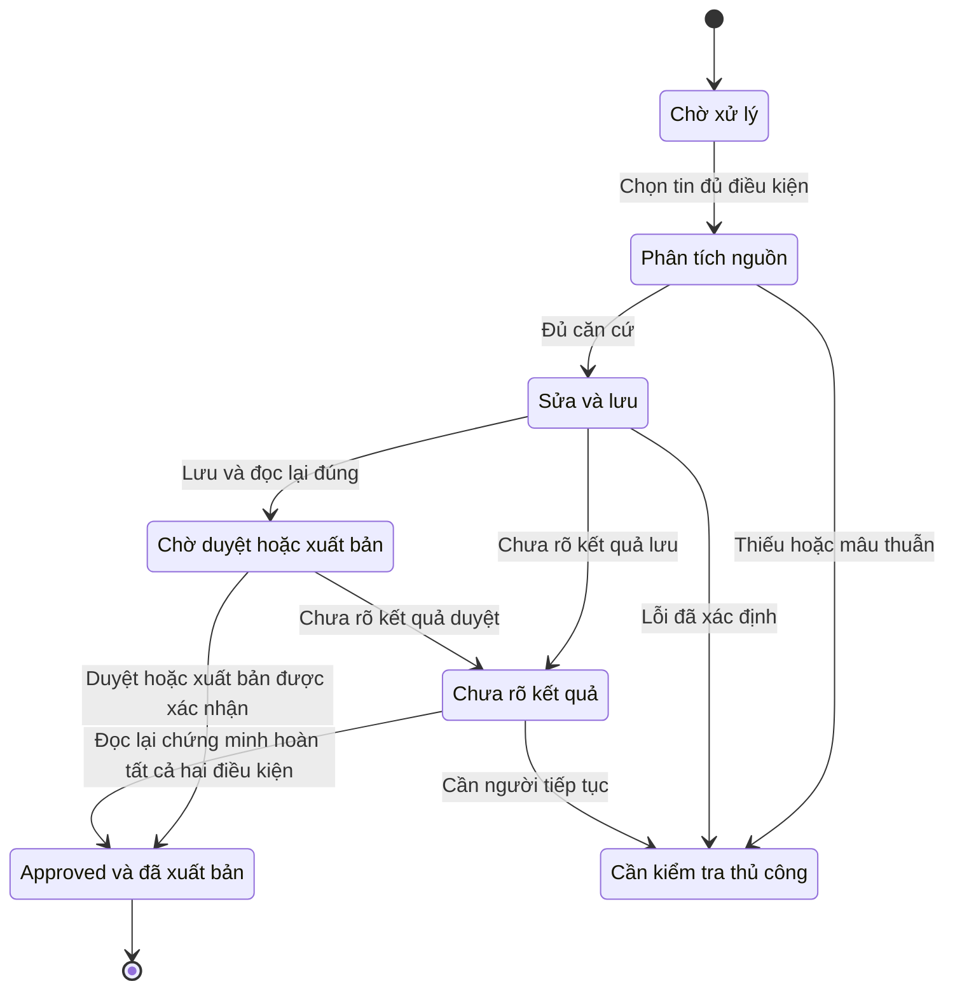

# Quy trình nghiệp vụ tự động duyệt tin NailHub

**Phiên bản:** v1.0.2\
**Cập nhật:** 2026-10-13, múi giờ Asia/Saigon\
**Đối tượng:** Owner, quản trị viên, vận hành và QA\
**Trạng thái tài liệu:** Bản tổng hợp nghiệp vụ để sử dụng và rà soát\
**Căn cứ triển khai:** nhánh `codex/nailhub-automation`, nền commit `32b8460`; bổ sung Approved chưa xuất bản được Owner duyệt ngày 2026-10-13\
**Chủ sở hữu quy trình:** AlexChu

## Tổng quan

THINKPAD tự xử lý tin nháp và tin Approved chưa xuất bản trên [NailHub Admin](https://nailhub.ai/admin/postings): đọc tin, sửa thông tin có căn cứ, chọn đúng danh mục và lương hoặc giá bán, gọi chức năng viết bằng AI có sẵn, lưu rồi duyệt. Owner điều khiển qua tin nhắn riêng Telegram và nhận link kèm lý do khi một tin cần kiểm tra thủ công.

Tài liệu tổng hợp quy tắc hiện hành, gồm các quyết định Owner bổ sung sau bản thiết kế ban đầu. Khi các đoạn lịch sử trong tài liệu cũ khác nhau, áp dụng quyết định mới nhất được mô tả ở đây. Tài liệu không thay đổi cấu hình hay mở rộng quyền của automation.

## Khái niệm chính

| Thuật ngữ | Ý nghĩa |
| --- | --- |
| Tin nháp | Tin có trạng thái Draft, chưa được duyệt trên NailHub |
| Tin đã duyệt | Tin có trạng thái Approved; trạng thái này độc lập với checkbox Xuất bản |
| Tin đã xuất bản | Tin vừa Approved vừa có checkbox Xuất bản được tích, tương ứng isPublic=true |
| Nội dung gốc | Tiêu đề và nội dung được chụp lại trước khi gọi viết bằng AI; nguồn quyết định danh mục, lương và thông tin cần sửa |
| Cần kiểm tra thủ công | Automation dừng vì dữ liệu thiếu hoặc mâu thuẫn, hoặc gặp lỗi kỹ thuật; đây là trạng thái xử lý nội bộ |
| Chưa rõ kết quả | Lệnh lưu hoặc duyệt có thể đã gửi nhưng chưa xác nhận được kết quả thật; không đồng nghĩa tin còn Draft |
| Thương lượng | Không có mức lương hoặc giá bán cụ thể đủ rõ để điền ô số |
| Giá dịch vụ | Tiền khách trả cho dịch vụ; không phải thu nhập thợ hay giá sang tiệm |

## Vai trò

| Vai trò | Trách nhiệm |
| --- | --- |
| Owner | Gửi lệnh quản trị, nhận thông báo, xử lý trường hợp cần xác nhận |
| Worker NailHub trên THINKPAD | Đọc, chuẩn hóa, thao tác form, lưu và xác nhận duyệt theo quy tắc |
| Model trích xuất | Đọc nguồn gốc, đề xuất dữ liệu có cấu trúc và lý do ngắn; chế độ THINKING tắt |
| Chức năng AI của NailHub | Viết lại tiêu đề và nội dung; chất lượng nội dung do flow AI riêng phụ trách |
| Listener Telegram đang chạy | Nhận lệnh và gửi phản hồi qua cùng tài khoản, cùng session hiện có |

## Workflow duyệt tin tự động

**Tác nhân chính:** Worker NailHub.\
**Kích hoạt:** Quét mỗi 10 phút hoặc lệnh `/nailhub scan` hợp lệ.\
**Kết quả:** Tin được lưu và duyệt có xác nhận, hoặc được chuyển Owner kiểm tra với thông tin cụ thể.

**Nhu cầu nghiệp vụ:** Là quản trị viên, tôi muốn tin có dữ liệu đủ căn cứ được xử lý tự động để giảm thao tác lặp lại. Khi dữ liệu hoặc kết quả thao tác chưa rõ, tôi cần biết đúng tin và đúng trường cần xử lý.

| Bước | Hành động | Điều kiện và kết quả |
| --- | --- | --- |
| 1 | Nhận yêu cầu quét | Lịch và lệnh dùng chung hàng đợi; không chạy chồng một tin |
| 2 | Kiểm tra phiên quản trị | Dùng profile riêng; có thể đăng nhập từ thông tin được lưu cục bộ theo quyền Owner |
| 3 | Chọn tin đủ điều kiện | Draft hoặc Approved với Xuất bản chưa tích được xác nhận; ba danh mục được hỗ trợ; bỏ tin đã hoàn tất và tin chưa rõ kết quả |
| 4 | View detail và lưu nguồn gốc | Xác nhận đúng ID; ghi nhận tiêu đề, nội dung, thông tin liên hệ, địa chỉ và giá trị hiện tại |
| 5 | Xác định thay đổi | Phân loại danh mục, kiểm tra điện thoại, địa chỉ và lương hoặc giá bán từ nguồn có căn cứ |
| 6 | Mở Edit và điền form | Chọn danh mục đúng trước, sau đó điền các trường phù hợp với danh mục |
| 7 | Bấm viết bằng AI | Chờ hoàn thành; nhận kết quả từ flow AI có sẵn, không kiểm lại ý nghĩa hay tự biên tập |
| 8 | Lưu và đọc lại | Xác nhận website lưu đúng tin, đúng giá trị đã gửi; nguồn thay đổi ngoài dự kiến thì dừng |
| 9 | Duyệt hoặc xuất bản và đọc lại | Draft: Approve rồi xác nhận Approved và đã xuất bản. Approved chưa public: sau AI/Save thành công mới tích Xuất bản và lưu lại; xác nhận Approved và đã xuất bản |
| 10 | Ghi nhận kết quả | Thành công kết thúc; trường hợp cần người kiểm tra được gửi DM kèm link và chẩn đoán |

## Model diễn giải nguồn trước khi sửa form

Model đọc ý định và ngữ cảnh đa ngôn ngữ, đề xuất danh mục, các khoản tiền và tên tiệm kèm dẫn chứng từ bản gốc. Automation đối chiếu toàn bộ câu gốc, không chỉ đoạn model trích, để tránh lấy giá dịch vụ, tiền thuê hoặc doanh thu làm lương. Các khoảng và nhiều mức thu nhập vẫn lấy mức cao nhất phù hợp, quy đổi kỳ đã nêu và làm tròn theo quy tắc hiện hành; không tự đoán kỳ. Các câu dịch lặp lại cùng thu nhập không tự tạo ra mâu thuẫn.

Khác biệt hoa/thường trong trích dẫn danh mục hoặc cách viết dấu nối trong cùng khoảng tiền chỉ được chuẩn hóa khi tìm thấy một nguồn nguyên văn duy nhất, giữ đúng hai đầu khoảng và đơn vị. Không chấp nhận model ghép các câu rời thành trích dẫn. Câu tuyển thợ rõ ràng như “Now Hiring Nail Techs!” có thể xác định danh mục trực tiếp từ tiêu đề gốc. Thành phố chỉ khác hoa/thường giữ nhãn chuẩn đang lưu khi cặp thành phố/tiểu bang trong nguồn xác nhận đó là cùng nơi. Nguồn không có khoản tiền thực sự dùng Thương lượng dù model sinh ứng viên lương lỗi; việc này vẫn giữ các kiểm tra thông tin liên hệ và địa chỉ.

Với dòng thu nhập tuần Việt/Trung lặp lại, nếu model chỉ trích một dòng thì automation có thể đối chiếu thêm dòng nguồn được nhận diện rõ, đủ khoảng và đơn vị tuần, có cùng mức cao nhất với khoảng lương đã xác thực. Dòng bổ sung được lưu riêng cùng vị trí số tiền trong nguồn. Đây không phải bỏ qua một khoản tiền: mức cao hơn, đơn vị khác, giá dịch vụ, hoa hồng hoặc dòng không rõ nguồn vẫn cần xử lý; không tự dùng quy tắc này cho mọi đoạn dịch.

Tên tiệm hợp lệ đang có được giữ khi nội dung chỉ mô tả tiệm. Tên thật có thể không chứa chữ Nails hoặc Spa. Theo quy ước Owner xác nhận cho BaoNail, URL gốc có stores=Glaze-Nails cho phép chuẩn hóa tên thành Glaze Nails; BaoNail.com là tên nguồn crawl, không phải salon. Không suy tên tiệm từ tham số URL bất kỳ.

Địa chỉ đầy đủ đang lưu là một nguồn có thể dùng để sửa thành phố, tiểu bang và ZIP khi chúng khớp nhau; ví dụ Middleton, WI 53562 cho phép sửa trường tiểu bang IL thành WI. Tên tiểu bang riêng lẻ không xác định thành phố hoặc ZIP.

Khi vẫn cần DM, giá trị hiện tại phải là dữ liệu đang lưu. Giá trị model đề xuất được ghi riêng, cùng nguồn, trường cần sửa và việc cần làm. Lỗi trích xuất được phân biệt với dữ liệu thực sự thiếu hoặc mâu thuẫn.

## Quy tắc chọn danh mục

Danh mục dựa trên ý định của tiêu đề và nội dung gốc, không mặc định giữ danh mục crawl đã điền.

| Nội dung chính | Danh mục cần chọn | Cách xử lý ô tiền |
| --- | --- | --- |
| Tiệm tuyển hoặc cần thợ | Cần thợ nail | Lương theo chính sách thu nhập thợ |
| Bán hoặc sang nhượng salon | Sang nhượng tiệm | Giá bán hoặc Thương lượng |
| Thợ đang tìm nơi làm việc | Tìm việc | Không có ô lương/giá trong form này |
| Vừa bán tiệm vừa tuyển thợ | Sang nhượng tiệm | Ưu tiên giá bán; bỏ lương thợ khi điền giá |
| Ý định không rõ hoặc mâu thuẫn | Cần Owner xác nhận | DM ghi trường Danh mục và căn cứ cần xem |

“Sang tiệm làm việc” không tự được hiểu là bán tiệm. Câu phủ định việc bán cũng không phải căn cứ chuyển sang Sang nhượng tiệm.

## Quy tắc thông tin liên lạc và địa chỉ

| Trường | Cách xử lý | Giới hạn |
| --- | --- | --- |
| Số điện thoại chính và khác | Chuẩn hóa dấu cách, dấu câu và tiền tố Mỹ khi đủ điều kiện; xóa số trùng ở Số điện thoại khác | Giữ số chính và các số khác biệt; không tự tạo số mới hoặc gộp extension khác nhau |
| Tên tiệm, địa chỉ, city và state | Điền hoặc sửa theo dữ kiện gốc xác nhận đúng salon | Không dùng thông tin của một salon khác; dữ kiện mâu thuẫn thật cần Owner |
| Thành phố và ZIP còn trống | Có thể lấy từ địa chỉ salon hiện có đầy đủ street, city, state và ZIP, khi các nguồn khớp nhau | Không suy ra thành phố hoặc ZIP chỉ từ tên tiểu bang |
| Tiểu bang | Dùng cặp city/state/ZIP rõ trong địa chỉ làm căn cứ; chọn đúng giá trị trên form | LA và Louisiana chỉ tương đương khi được xác nhận trong ngữ cảnh địa chỉ; không dùng từ rời rạc trong bài |
| Tùy chọn thành phố | Chọn đúng thành phố có trong danh sách của form | Không chọn một thành phố khác để vượt kiểm tra |

Ví dụ: `279 E Fairmount Ave Lakewood, NY 14750` → thành phố **Lakewood**, tiểu bang **New York**, ZIP **14750**. New York trong ô Tiểu bang không có nghĩa thành phố là New York.

Runtime hiện tại không tự tra Google, bản đồ hoặc geocoder. Nếu nguồn gốc và địa chỉ hiện có không đủ căn cứ, Owner cần bổ sung dữ liệu xác thực.

## Quy tắc lương của tin cần thợ

Thứ tự quyết định là nhận diện đúng khoản thu nhập thợ, xác định đơn vị tại từng khoản, quy đổi khi nguồn ghi rõ, sau đó chọn giá trị hiển thị. Không lấy số đầu tiên xuất hiện trong bài làm lương.

| Trường hợp | Kết quả cần điền |
| --- | --- |
| Không nhắc lương hoặc không nêu mức cụ thể | Thương lượng, không điền mức lương số |
| Chỉ ghi ăn chia, bao lương trên ăn chia hoặc trao đổi thêm | Thương lượng nếu không có mức thu nhập cụ thể đủ rõ |
| Có mức thu nhập tuần rõ ràng | Chọn Có và điền mức phù hợp vào Lương tuần |
| Có khoảng hoặc nhiều mức thu nhập rõ ràng | Quy đổi từng khoản theo kỳ của nó, lấy mức cao nhất và làm tròn xuống hàng trăm |
| Có số lương nhưng không ghi tháng/tuần | Điền nguyên số, không tự đoán kỳ hoặc quy đổi; khoảng số áp dụng chính sách đầu cao và làm tròn xuống hàng trăm |
| Chỉ có các giá dịch vụ | Thương lượng |
| Có cả giá dịch vụ và thu nhập thợ | Bỏ giá dịch vụ, dùng mức thu nhập thợ cao nhất |
| Lương ngày hoặc giờ | Chỉ quy đổi khi nguồn đủ lịch làm việc theo tuần; thiếu lịch thì cần xác nhận |
| Chỉ lỗi model nhưng nguồn đủ rõ | Dùng chính sách theo nguồn; không giữ Draft chỉ vì model trích xuất lương sai |

**Quy đổi:** tháng × 12 ÷ 52; năm ÷ 52; hai tuần ÷ 2; tuần giữ nguyên. K/k trong ngữ cảnh tiền là nghìn. Đơn vị gắn với từng khoản thu nhập, không lấy đơn vị của tiền thuê hay lịch làm việc áp sang lương.

**Làm tròn:** Với khoảng hoặc nhiều mức đã chọn đầu cao, làm tròn xuống hàng trăm, không làm tròn gần nhất. Một mức đơn lẻ đi theo độ chính xác ô nhập đã xác minh; không tự áp phép làm tròn hàng trăm cho mọi số.

Không tự cộng tip, thưởng, commission hay các khoản riêng vào lương chính nếu phải giả định. Lỗi kỹ thuật ngăn đọc hoặc xử lý toàn bộ tin vẫn có thể cần kiểm tra; quy tắc bỏ chặn vì lỗi trích xuất không đồng nghĩa bỏ mọi kiểm tra dữ liệu.

| Nội dung gốc | Giá trị hiển thị | Lý do |
| --- | --- | --- |
| 6K–10K/tháng | 2.300 USD/tuần | 10.000 × 12 ÷ 52 = 2.307,69; làm tròn xuống |
| 6.000–8.000/tháng | 1.800 USD/tuần | Chọn 8.000 rồi quy đổi và làm tròn xuống |
| 1.000/1.500 tuần; manicure 700–900/tuần | 1.500 USD/tuần | Mức cao nhất trong các thu nhập tuần |
| Giá gội đầu 70/110/170; thu nhập 2.500+/2 tuần và 2.900+/2 tuần | 1.400 USD/tuần | Bỏ giá dịch vụ; 2.900 ÷ 2 = 1.450, làm tròn xuống |
| Bao lương 7.000, không có kỳ | 7.000 | Điền nguyên số theo quyết định Owner |
| Bao lương trên ăn chia | Thương lượng | Không có mức số rõ |
| Giá gội đầu 70, 110, 170 | Thương lượng | Đây là giá khách trả, không phải lương |

Không hiển thị không còn là mặc định cho tin thiếu lương. Quyết định Owner mới nhất là **Thương lượng**.

## Quy tắc giá bán và sang nhượng

Với tin Sang nhượng tiệm, chỉ xét giá chào bán hoặc sang nhượng salon. Nếu có nhiều giá hoặc khoảng giá bán, chọn giá thấp nhất; mở rộng K thành nghìn; điền nguyên số, không quy đổi tuần và không làm tròn theo lương.

| Nội dung | Ô tiền cần điền |
| --- | --- |
| Bán tiệm 60K; doanh thu 30K–35K/tháng | Nhập giá: 60.000 |
| Giá sang 60K–80K | Nhập giá: 60.000 |
| Có nhiều giá bán hợp lệ | Nhập giá: mức giá bán thấp nhất |
| Bán tiệm nhưng chưa ghi giá | Thương lượng |
| Có giá bán cùng tiền thuê, doanh thu, giá dịch vụ hoặc lương thợ | Chỉ dùng giá bán; bỏ các khoản còn lại |

## Workflow điều khiển qua Telegram

**Tác nhân chính:** Owner dùng tài khoản khác DM tài khoản listener.\
**Kết quả:** Lệnh hợp lệ điều khiển worker hoặc trả thông tin; lệnh không đủ điều kiện không tạo tác vụ NailHub.

**Nhu cầu nghiệp vụ:** Là Owner, tôi muốn điều khiển từ chat riêng mà không làm các lệnh này đi vào pipeline triage và tạo issue ngoài ý muốn.

| Lệnh chính xác | Tác dụng |
| --- | --- |
| `/nailhub scan` | Yêu cầu quét; vẫn chịu hàng đợi, khóa và trạng thái pause |
| `/nailhub status` | Xem trạng thái chạy, kết quả và link/lý do các tin đang cần kiểm tra |
| `/nailhub pending` | Xem danh sách hiện đang cần kiểm tra thủ công |
| `/nailhub pause` | Tạm dừng các hành động tiếp theo; lệnh website đã gửi cần kết thúc và xác nhận |
| `/nailhub resume` | Bỏ tạm dừng và tiếp tục lịch/hàng đợi; không tự mở khóa mọi tin đang cần người kiểm tra |

Lệnh phải là tin nhắn đến trong DM của đúng tài khoản Owner đã xác thực. Username `@SotaThao` phục vụ xác nhận ban đầu; quyền thực thi dựa trên ID số của người gửi và chat. Gõ đúng câu lệnh từ một tài khoản khác chưa được cho phép không đủ quyền.

Không nhận lệnh từ nhóm, kênh, bot, tin chuyển tiếp, Saved Messages hoặc tin tự gửi bởi tài khoản listener. Namespace NailHub được xử lý trước triage; lệnh bị từ chối cũng không được chuyển thành issue triage. Không chạy thêm instance Telegram dùng chung session.

## Workflow kiểm tra thủ công

**Tác nhân chính:** Owner.\
**Kích hoạt:** Dữ liệu chưa đủ căn cứ, xung đột thật hoặc lỗi thao tác chưa được xác nhận.\
**Kết quả:** Owner biết tin nào, trường nào và phải làm gì để giải quyết.

**Nhu cầu nghiệp vụ:** Là Owner, tôi cần chẩn đoán cụ thể thay vì thông báo chung “trích xuất lỗi”, để mở đúng tin và sửa đúng dữ liệu.

| Bước | Xử lý |
| --- | --- |
| 1 | Worker lưu lý do và dữ liệu chẩn đoán; dừng hành động tiếp theo của tin |
| 2 | Listener hiện có gửi DM tới Owner; không tạo Telegram client mới |
| 3 | Owner mở link tin, đối chiếu nguồn và xử lý trường được chỉ rõ |
| 4 | Nếu kết quả Save/Approve chưa rõ, đọc trạng thái thật trước khi thao tác tiếp |
| 5 | Việc chạy tiếp phải theo trạng thái đã xác nhận; không tự lưu hoặc duyệt lặp lại |

Với ID tuần tự mới từ crawler, frontend hiện có thể từ chối link mở thẳng chi tiết. Worker tự mở từ đúng dòng trong danh sách; Owner khi gặp link bị từ chối cần vào trang quản trị và tìm theo tiêu đề. Đây là giới hạn của frontend, chưa được sửa trong worker.

DM gồm: tiêu đề, link có ID tin, lý do, phân loại vấn đề dữ liệu hay tự động hóa, tên trường, giá trị đã đọc, nguồn/trích dẫn có căn cứ và hành động cần làm. Khi chưa xác định được trường hoặc nguồn, phải nói rõ chưa xác định; không bịa giá trị.

Ví dụ cấu trúc thông báo:

> NailHub: Tin cần bạn kiểm tra thủ công\
> Tiêu đề: …\
> Link: https://nailhub.ai/admin/postings?id=…\
> Lý do: Địa chỉ nguồn và thông tin hiện tại mâu thuẫn.\
> Trường: Thành phố\
> Giá trị hiện tại: …\
> Nguồn: …\
> Cần làm: Xác nhận địa chỉ đúng của salon và sửa thành phố tương ứng.

Thông báo thành công được chống gửi lặp theo tin, nguồn, trạng thái và lý do. Chi tiết thay đổi có thể phát sinh thông báo mới. Lỗi gửi được thử lại; trường hợp Telegram nhận tin nhưng tiến trình chưa kịp ghi nhận có thể gây một thông báo trùng. Lỗi gửi DM không làm website bị thao tác lại.

## Quản trị và cấu hình vận hành

Quét định kỳ mỗi 10 phút, xử lý tuần tự với giới hạn một tin mỗi lượt theo cấu hình hiện hành. Có thể cần nhiều lượt để xử lý hết danh sách. Lệnh quét không tạo phiên chạy chồng lên phiên đang xử lý.

Model trích xuất chạy với THINKING tắt; vẫn kiểm tra nguồn và điều kiện trước khi điền form. Sau khi bấm AI, worker không gọi model kiểm lại nội dung, không thêm prompt hay sửa lại kết quả AI. Đọc lại bản đã lưu chỉ nhằm xác nhận lưu đúng dữ liệu đã gửi.

Thông tin đăng nhập admin được lưu cục bộ ngoài Git, trong vùng quyền truy cập riêng của dịch vụ. Phiên hết hạn có thể đăng nhập lại theo cấu hình; gặp lỗi đăng nhập, MFA hoặc không đủ quyền quản trị thì dừng và báo kiểm tra. Không lưu mật khẩu hay token trong tài liệu này.

## Vòng đời trạng thái

Trạng thái website và trạng thái worker là hai lớp khác nhau. “Cần kiểm tra thủ công” hoặc “Chưa rõ kết quả” không phải nhãn xuất bản của website.

| Trạng thái xử lý | Sự kiện | Bước tiếp theo |
| --- | --- | --- |
| Chờ xử lý | Chọn được Draft hoặc Approved chưa xuất bản đủ điều kiện | Phân tích nguồn |
| Phân tích nguồn | Có căn cứ thay đổi | Sửa form và gọi AI |
| Sửa và lưu | Lưu và readback đúng | Chờ duyệt |
| Chờ duyệt hoặc xuất bản | Approve tin Draft hoặc Save bật Xuất bản cho Approved; readback đúng | Hoàn tất Approved và đã xuất bản |
| Bất kỳ bước nào | Thiếu/mâu thuẫn dữ kiện hoặc lỗi có kết quả xác định | Cần kiểm tra thủ công |
| Đã gửi Save/Approve | Không xác nhận được kết quả thật | Chưa rõ kết quả; đọc lại trước khi xử lý |
| Hoàn tất Approved và đã xuất bản | Quét thường kỳ | Không tự sửa lại tin |

## Ngoại lệ và giới hạn

| Tình huống | Cách xử lý |
| --- | --- |
| Form crawl điền sai nhưng nguồn rõ | Sửa theo nguồn, gồm cả danh mục và các ô đã có giá trị trong phạm vi được xác thực |
| Chỉ thiếu mức lương cụ thể | Thương lượng; không tự chuyển thành yêu cầu thủ công |
| Nguồn gốc thay đổi khi đang xử lý | Dừng để tránh lưu kế hoạch dựa trên bản cũ |
| Ngày bắt đầu lỗi mặc định 0001-01-01 | Đổi thành ngày xử lý theo UTC; giữ kiểm tra ngày kết thúc |
| Ngày hợp lệ nhưng đã qua | Không tự đổi hàng loạt; lỗi validator cần chẩn đoán cụ thể |
| Crash sau Save hoặc Approve | Đọc lại để đối soát; không tự gửi lại hành động ghi |
| Đã lưu Draft nhưng crash trước duyệt | Cần tiếp tục có kiểm soát, không tự coi là hoàn tất |
| Không đủ căn cứ địa chỉ hoặc danh mục | Gửi DM có trường, giá trị, nguồn và hành động |
| Tin ngoài ba danh mục được hỗ trợ | Không tự đưa vào workflow này |
| Tin Approved chưa Xuất bản | Được nhận vào full flow AI và sửa dữ liệu trước khi xuất bản; không chỉ tích checkbox |
| Tin Approved đã Xuất bản | Bỏ qua trong quét tự động |
| Không biết trạng thái checkbox | Không ghi hoặc xuất bản khi chưa xác nhận được giá trị |

Đợt sửa danh mục đã triển khai có ngoại lệ giới hạn đúng hai tin Approved: Westmont và tin bán 60K. Cả hai đã được sửa thành Sang nhượng tiệm, giữ nội dung, số tiền và trạng thái Approved; không gọi AI hoặc Approve lại. Đợt sửa này là lịch sử riêng; workflow mới chỉ nhận Approved chưa xuất bản đủ điều kiện, không tự sửa mọi tin Approved. Cách gửi ngày trong đợt sửa này bảo toàn ngày đã lưu, không thay đổi chính sách ngày chung.

Checkbox chưa tích là điều kiện nhận tin, không chứng minh chắc chắn tin chưa từng chạy AI. Tin Approved chưa public phải lưu kết quả AI khi vẫn chưa public, rồi mới bật Xuất bản trong bước lưu riêng. Bật lại worker không mở khóa các bản ghi hoàn tất hoặc chưa rõ kết quả.

Automation không tự Reject tin. Các thông báo nghiệp vụ này chỉ gửi DM tới Owner đã xác thực, không gửi nhóm.

## Cách đọc phản hồi trạng thái

| Thành phần | Ý nghĩa |
| --- | --- |
| live | Chế độ được phép thao tác thật trên NailHub |
| paused=False | Worker không bị tạm dừng |
| queued=True | Có yêu cầu quét đang chờ |
| running=True | Có lượt xử lý đang chạy |
| approved | Số bản ghi worker đã ghi nhận hoàn tất duyệt, không phải tổng tin toàn website |
| needs-human | Số bản ghi đang cần người kiểm tra |
| processed | Số tin xử lý trong lượt được báo, không phải tổng lịch sử |
| last | Kết quả hoặc bước gần nhất của worker |

`running=False` chỉ có nghĩa đang rảnh tại thời điểm trả lời, không có nghĩa dịch vụ đã tắt. Nếu có needs-human, xem link và lý do trong `/nailhub status` hoặc `/nailhub pending`.

## Câu hỏi thường gặp

**Tin ghi lương tháng có phải giữ Draft không?** Không. Nếu số và kỳ rõ, lấy mức cao nhất phù hợp, nhân 12/52 rồi áp dụng làm tròn theo chính sách khoảng hoặc nhiều mức.

**Tin không nói lương có bị giữ lại không?** Không chỉ vì thiếu lương. Chọn Thương lượng; các lỗi dữ liệu khác vẫn được kiểm tra riêng.

**Bấm AI xong có đọc kiểm tra nội dung không?** Không kiểm ý nghĩa hoặc chất lượng nội dung. Worker chỉ xác nhận thao tác lưu và giá trị đọc lại đúng bản đã gửi.

**Ai DM đúng lệnh cũng được chạy không?** Không. Chỉ tài khoản Owner được xác thực mới có quyền.

**Resume có xử lý lại toàn bộ tin cần kiểm tra không?** Không. Resume bỏ pause; các tin đang bị giữ hoặc chưa rõ kết quả vẫn cần đối soát và tiếp tục có kiểm soát.

## Tài liệu liên quan

- [Master và lịch sử quyết định Owner](../00-master/nailhub-postings-noissue_master_261012_v1.0.0.md)
- [Product Doc ban đầu](nailhub-postings-noissue_product_261012_v1.0.0.md)
- [Hướng dẫn runtime và các cập nhật chính sách](../../listener/NAILHUB.md)
- [Bản triển khai đối chiếu](https://github.com/PersonalProjectJob/telegram-agent/commit/32b84602af22f6dcbbb24a82b67e8a4a45e90b95)

Chưa có GitHub Issue hoặc PR riêng cho workflow này. Product Doc ban đầu chứa lịch sử thiết kế; các quyết định mới hơn trong Master và chính sách hiện hành ở tài liệu này cần được ưu tiên.

## Changelog

| Phiên bản | Ngày và giờ Asia/Saigon | Người tổng hợp | Thay đổi |
| --- | --- | --- | --- |
| v1.0.0 | 2026-10-13 11:06 | AlexChu qua Codex | Xuất business flow từ workflow đã triển khai và các quyết định Owner hiện hành |

| v1.0.1 | 2026-10-13 11:26 | AlexChu qua Codex | Owner duyệt nhận Approved chưa xuất bản; full AI rồi lưu và xuất bản có xác nhận, bảo toàn khóa chống chạy lại |

| v1.0.2 | 2026-10-13 15:51 | AlexChu qua Codex | Bổ sung model diễn giải nguồn đa ngôn ngữ, kiểm ngữ cảnh tiền, tên salon từ nguồn được Owner xác nhận và DM phân biệt giá trị đang lưu/đề xuất |

### Lưu ý vận hành sau cập nhật listener
Mỗi bản phát hành listener phải giữ đủ package NailHub và các hook tích hợp trong cùng client Telegram. Sau triển khai, kiểm tra lại lệnh DM đã xác thực và worker/quét định kỳ; tránh wheel của tính năng khác làm mất tích hợp NailHub. Đợt kiểm tra ngày 2026-10-13 đã xác nhận cả ba tin mục tiêu Approved và đã xuất bản bằng lượt đọc lại riêng.
