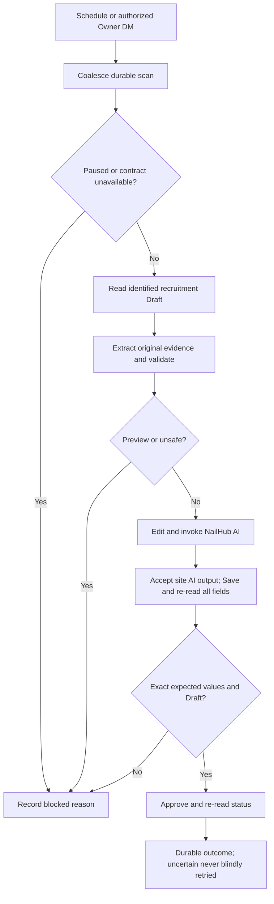

# NailHub product

Version: v1.0.9. Approved Master and implementation direction delegated by Owner through controller; no additional scope.

## Persona
Owner moderates recruitment posts; secondary user is the listener operator. Harness/data owner is AlexChu.
## Scenario
Current: manual Draft review. Desired: periodic scan and authorized private DM commands produce verified proposals and approve only proven safe posts. Benefit: fewer repetitive edits without lost facts.
## Audit
Existing listener handles group triage only. Controller has verified authenticated listing, UUID detail and approval-confirmation read-only behavior. The full mutation flow still needs live evidence. Model output and posting instructions are untrusted.
## Solution (Product & UX)
Scope: recruitment Draft only; phone dedup, evidence-based missing location fields, salary conversion and Owner range display policy, built-in AI rewrite completion, post-save and approval readback. No rejection, public lookup without evidence, second Telegram session, or unsolicited group replies. Exact DM commands: `/nailhub scan|status|pause|resume`. Numeric sender must equal private peer and allowlisted Owner ID; empty allowlist denies all. Preview reads details and proposes only; it never edits or invokes AI. Live requires authenticated, VERIFIED mapping and independent review.
## User Flow

## Wireframe
N/A: reuses existing external admin interface; no layout, responsive breakpoint, or component changes.
## Design System Audit
N/A: no UI/CSS/tokens added. Existing admin labels must be mapped by authenticated inspection, not guessed.
## Acceptance
Zero unauthorized commands, zero preview mutation calls, zero approvals without completed site AI and exact persisted readback. Authenticated preview CPU timing is underway; full mutation flow and independent review remain required before live sign-off.

## Related Documents
- [master](../00-master/nailhub-postings-noissue_master_261012_v1.0.0.md)
- [engineering](../02-engineering/nailhub-postings-noissue_engineering_261012_v1.0.0.md)
- [qa](../03-qa/nailhub-postings-noissue_qa_261012_v1.0.0.md)
- [tasks](../04-tasks/nailhub-postings-noissue_tasks_261012_v1.0.0.md)
- GitHub issue / PR: none, authorized noissue local work.

## Changelog
| Version | Date | Time | Author | Change |
|---|---|---|---|---|
| v1.0.0 | 2026-10-12 | 17:22 | AlexChu (Codex executor) | Derived approved Master; implementation specification |
| v1.0.2 | 2026-10-12 | 18:08 | AlexChu (Codex executor) | Owner range policy and reviewer safety refinements; accessible-field preservation and live evidence limits |
| v1.0.3 | 2026-10-12 | 18:26 | AlexChu (Codex executor) | Runtime source-evidence correction and canonical salary/title validation; mutation gates retained |
| v1.0.4 | 2026-10-12 | 18:35 | AlexChu (Codex executor) | Empty locations never delete fields; source-proven amount period suffix normalization |
| v1.0.5 | 2026-10-12 | 18:45 | AlexChu (Codex executor) | Enforce existing Master contact/address completeness before any UI action |

## Implementation update
Owner runtime amendment: NailHub qwen3.5:9b uses think=false; original-source extraction and proposal validation remain required; no post-AI content checks or semantic call run. CPU preview with the earlier think=true setting timed out; amended runtime verification is pending.

Owner override 2026-10-12: explicit income/salary range uses its weekly upper value rounded DOWN to nearest USD 100 (6K–10K/month -> 2300/week); preserve original range and qualifiers. Single amounts retain cents. No assumption combining commission/tips. Evidence supports exact unique quotes resolved by code or validated Unicode spans. Original-source salary/contact evidence checks remain active. The site AI output is accepted without content fact, numeric or semantic checking under the latest Owner scope override.

Save originates from UI button. An exact pinned-origin/PUT/UUID guard restores ONLY omitted returned writable fields from freshly verified source, rejects conflicting included fields and verifies persisted readback. API-omitted metadata remains UNKNOWN, is not fabricated or sent, and is disclosed as a scope limitation. A separate UI page fresh-read before Save and inside the PUT guard detects source drift; backend atomic compare-and-swap is unverified, so a small residual concurrent-update race remains. Approved publication timestamp is the sole allowed source-backed server transition; all other exposed facts remain exact.

## Runtime validation amendment
Unchanged location suggestions are ignored only on exact current-field equality; conflicts still hold. Invalid literal evidence may receive one extraction correction with bounded path feedback, never fuzzy matching or mutation retry. Salary formatting must equal the full source Decimal range; explicit days/week schedules do not change monthly pay. Site AI output checking is outside scope; title/body returned by the completed site AI flow are accepted directly. Controller's amended preview JSON was valid but held on wrong source quotes; corrected runtime verification and complete live flow remain pending.

Controller's saved model JSON exposed empty ZIP suggestions and a pay-period suffix inside amount_text. Empty locations now mean no suggestion and preserve all fields. A known period suffix may be split from amount_text; period-plus-qualification tails additionally require the entire excerpt to be literally evidenced. Exact full source Decimal range, qualification and conflicting money/period checks still apply.

Validated entity sentences are reduced to every recognized exact current/source-proven proposed salon/location value. Surrounding prose may paraphrase; names/city/state/address/ZIP remain protected. No recognized source entity means extraction evidence correction or hold. These extraction checks do not validate the subsequent site AI output.

Required contact completeness follows the inspected form: salon, address, city, state, ZIP and main phone must be nonempty and valid before Edit/AI. Original source evidence may fill missing location values; otherwise the post needs human review. Tests cover missing/invalid required fields, source-filled address/ZIP pass and zero UI mutation calls for incomplete live posts.

## Owner scope override: site AI output

2026-10-12: after the built-in AI completes, accept its returned title and body directly. Do not run rewrite invariants, semantic verification, instruction prefixes or paragraph cleanup. Original-source salary/contact/address evidence and proposal checks remain active. Fresh-source checks before Save, exact UI payload and saved readback, pause/identity authorization, and approval/status readback remain required. Existing validator/model.verify helpers may remain for compatibility/offline tests but are not called for site AI output. This supersedes earlier rewrite-check requirements.

Structured extraction scope: model extracts original salary, missing location values and a short rationale only. The required compatibility facts keys all request empty arrays (maxItems=0), avoiding unused content-claim extraction after the Owner delegated rewrite quality to site AI. Salary/location/source proposal validation remains unchanged; previously captured valid responses remain compatible. No post-AI model verification runs.

Literal salary excerpt normalization: if amount_text includes original period/qualification text, code extracts its leading full amount/range only when the period prefix matches the claimed period and the entire excerpt is a literal substring of the already validated source evidence. The original full-range Decimal equality, qualification, extra-money and conflicting-period checks still run. Unsupported/invented tails or cherry-picked endpoints remain held. Monthly conversion ignores unused schedule values; day/hour conversion retains strict explicit schedule validation. This avoids another model request for the observed exact source excerpt and adds no post-AI content checking.

Owner start-date policy: only the exact backend default sentinel 0001-01-01T00:00:00 becomes the current processing date at UTC midnight. Backend validates against DateTime.UtcNow.Date; offset-free ISO matches the observed DTO representation. Proposal records old/new values and Owner policy in metadata_changes.startDate; the UI request normalizer restores that authorized date for omitted/null/sentinel input only. Conflicting UI dates or missing audit are rejected. Real past/future dates and null/missing source dates remain unchanged. An endDate not strictly after the repaired start date holds for review and is never changed. Exact persisted startDate and all other saved fields must match before approval. This date repair adds no post-AI content checking.
