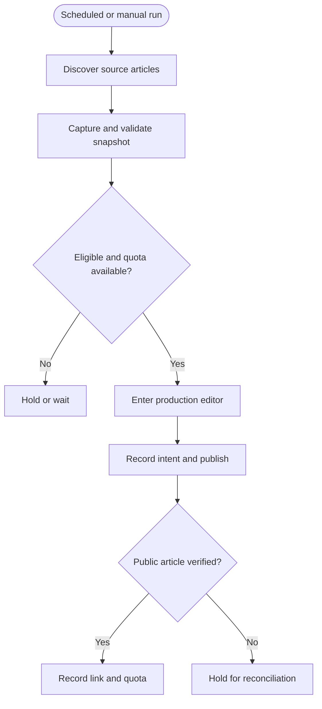

# Source Mirror — Product

Owner: AlexChu · Status: implementation authorized · Version: v1.0.8 (original filename retained)

## Persona
Primary: Owner/operator on THINKPAD. Secondary: readers of Nailhub.
## Scenario
A source article is manually reproduced today. The desired outcome is one faithful public article first, then four daily where eligible inventory exists.
## Audit
The source and production editor are distinct systems; interruptions, unsupported content, and invisible duplicate writes can cause loss or duplication. UI mappings must be observed, not assumed.
## Solution (Product & UX)
Independent local CLI and worker; select newest eligible Scratch step-by-step article including older unposted articles. Preserve words and media order, source link and attribution; hold unsupported material. Scheduled slots 08, 12, 16, 20 Vietnam time, daily ceiling four. No automatic cleanup. A submission with uncertain outcome blocks additional publishing until reconciled.
## User Flow

## Wireframe
No new graphical interface; operator uses status, pause, resume and reconcile CLI commands. No responsive UI change.

## Observed outcome and operating limits
The first Scratch article was published and independently opened by a guest, with the source link, ordered text and five images. The worker was enabled with the agreed Vietnam schedule but was temporarily stopped and paused while oversized article cards were corrected; a full operating day has not yet been established. Source selection follows the observed listing order, not a verified publication-date sort. The accepted source layout is deliberately narrow; unsupported articles are held. Archive pages can shift between visits, so exhaustive discovery is not guaranteed.

## Update at 19:45 VN

Two articles have now been published. A third attempt was held before submission when the editor split bold text around a link; it was reconciled as not created, and the schedule has resumed. A complete four-publication day remains to be checked.

## Update at 19:47 VN

Three articles are now published. The third was a controlled manual recovery after a scheduled attempt stopped before submission; it is not a scheduled trigger. The 20:00 slot remains to be observed.

## Update at 20:20 VN

All three published articles now have plain source-derived summaries. Their cards passed fresh desktop and mobile checks. The corrected worker resumed; the fourth article is still pending.

## Update at 20:24 VN

Four articles were published on 28 October Vietnam time: two via manual canary/recovery and two from scheduled catch-up. All four cards passed independent desktop and mobile checks. This partial rollout day is not evidence of four unattended scheduled triggers or a full unattended day.

## Related Documents
- [Master](../00-master/nailhub-source-mirror-noissue_master_261028_v1.0.0.md)
- Previous: Master
- [Engineering](../02-engineering/nailhub-source-mirror-noissue_engineering_261028_v1.0.0.md)
- Issue / PR: none.

## Localization slots — Owner authorized, implementation in progress

Future slots publish Vietnamese VI content and original English EN content in one article only after localization quality gates. Title, plain summary, body and SEO are locale-specific; hashtags global. Technical ambiguities or any unresolved translation errors hold the article with a persistent reason. The worker can select another eligible candidate, but must never substitute untranslated English or publish merely to fill four slots. Existing 08:00 publication is outside this change. No new website layout; use current editor and preserve plain summaries/card image behavior.

## Localization deployment — 2026-10-29

Bản v19 đã cài và worker cùng AGY broker active, unpaused. Cấu hình bắt buộc Gemini 3.8 Flash / medium và kiểm glossary/MQM; lỗi hoặc bất định kỹ thuật giữ bài trước reservation. Linux 38 tests PASS; review độc lập APPROVED. Form thật trên fixture đã qua guard VI/EN, Meta, hashtag; request cố ý chặn trước mạng nên không có bài thử PROD. Hai bài nguồn thật trên bản sao thử bị HOLD: thiếu thuật ngữ và JSON model không hợp lệ. Slot 12:00 chưa chạy ở thời điểm triển khai; chưa có bằng chứng bài Việt hóa publish hay public readback VI/EN. Đánh giá MQM tự động bằng model chỉ là heuristic. Không commit.

## Changelog
| Version | Date | Time (VN) | Change |
|---|---|---|---|
| v1.0.8 | 2026-10-29 | 10:40 | Deploy v19; Linux 38 tests and blocked native form guard passed; first actual localized slot pending |
| v1.0.7 | 2026-10-29 | 10:15 | Authorize and specify strict AGY localization gating for future slots; deployment pending checks |
| v1.0.0 | 2026-10-28 | 17:56 | Initial document |
| v1.0.1 | 2026-10-28 | 19:32 | Record verified canary, rollout and remaining operating limits |
| v1.0.2 | 2026-10-28 | 19:45 | Record second publication and verified inline-style fix |
| v1.0.3 | 2026-10-28 | 19:47 | Record third publication and manual recovery |
| v1.0.4 | 2026-10-28 | 20:05 | Record paused worker and card correction |
| v1.0.5 | 2026-10-28 | 20:20 | Record verified card correction and v15 resume |
| v1.0.6 | 2026-10-28 | 20:24 | Record four rollout-day publications and quota proof |
