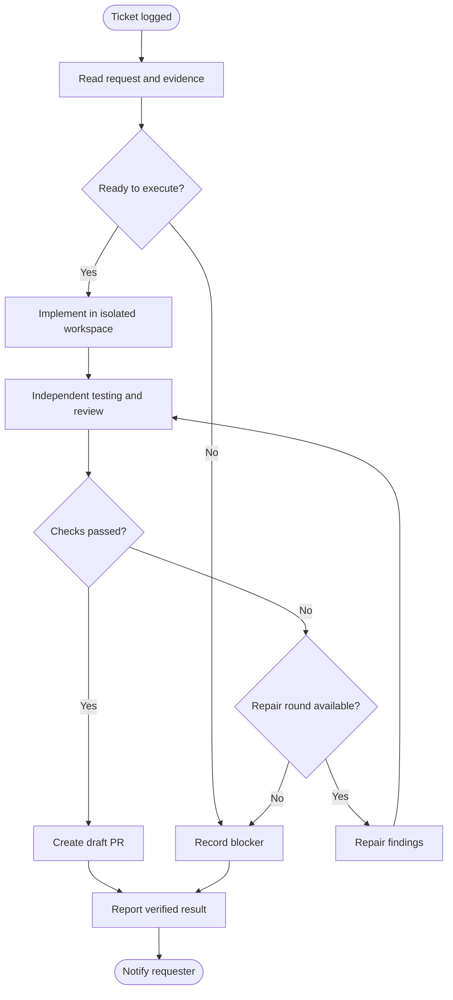
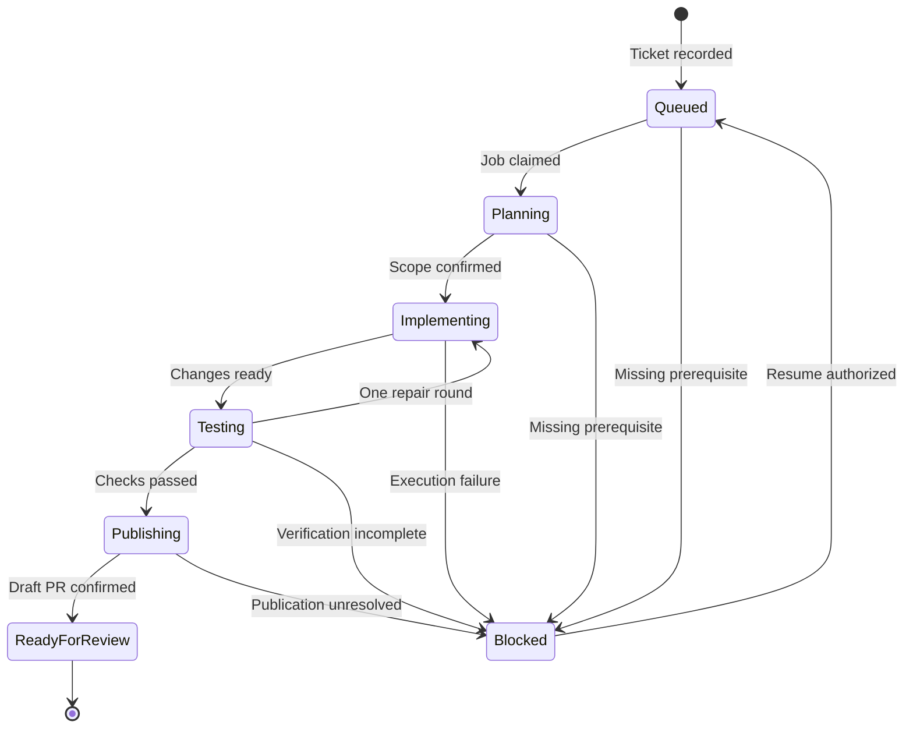

# Ticket-to-Draft-PR Agent Workflow

**Last Updated:** 2026-10-26 15:25 (Asia/Saigon)  
**Audience:** Product Owner, Engineering, QA, Operations  
**Status:** Draft — proposed capability, not deployed  
**Version:** v1.0.0  
**Harness Owner:** AlexChu  
**Prepared by:** Codex, executor for AlexChu  
**Tracking:** No dedicated GitHub issue has been assigned.

This business working draft records the solution and choices discussed with the owner. Saving it does not approve the parent Fleet Master, authorize deployment, or establish that the feature has been implemented.

## Overview

After a ticket is logged, the system automatically assigns agents to investigate, implement, test, and report the requested change. Successful work produces a draft pull request and a short Telegram notification. People retain responsibility for merging and deployment.

The first version uses one Python worker on THINKPAD, SQLite for durable execution state, and AGY CLI and Claude CLI running separate agent sessions. The roles run sequentially; four separate services and parallel coding agents are not required.

## Key Concepts

| Term | Definition |
|---|---|
| Ticket | The recorded request, including supporting messages, documents, and images. |
| Execution profile | An owner-approved backend, model, effort, and resource limit for an agent role. |
| Workspace | An isolated working copy used to implement one ticket. |
| Evidence | Actual test results, findings, screenshots, and other verification artifacts. |
| Draft PR | A proposed code change awaiting human review and merge. |

## User Roles

| Role | Responsibilities |
|---|---|
| Owner | Configure repositories and profiles; review draft PRs; authorize merge and deployment. |
| Coordinator — AlexChu | Investigate the ticket, identify tasks, define acceptance criteria, and assign work. |
| Executor | Implement the change and add relevant tests. |
| Tester | Independently verify behavior and review changes without editing source code. |
| Reporter | Summarize verified results, remaining limitations, and the draft PR link. |

Default assignment: Claude CLI for coordination, testing, and reporting; AGY CLI for implementation. Claude CLI can also execute tasks when selected in the approved profile. API adapters are outside the first version.

## End-to-End Workflows

### Workflow: Resolve a logged ticket

**Primary Actor:** Coordinator  
**Trigger:** A ticket is successfully logged.  
**Outcome:** A verified draft PR, or a clear blocked report.

**User Stories:**

- As an Owner, I want actionable tickets handled automatically so that I do not need to repeat requirements or manually assign each agent.
- As a developer, I want independently tested changes with evidence so that I can review the draft PR efficiently.
- As a requester, I want a short result or blocker notification so that I know what happened.

| Step | Who | Action | System Response |
|---|---|---|---|
| 1 | System | Record the ticket | Queue one execution job. |
| 2 | Coordinator | Read the request and supporting material | Confirm the configured source repository, scope, and acceptance criteria. |
| 3 | System | Prepare the workspace | Assign the approved executor profile. |
| 4 | Executor | Implement the change | Produce changes and implementation findings. |
| 5 | Tester | Run required checks and review behavior | Return evidence and pass/fail findings. |
| 6 | Executor | Address failed checks | Allow one repair round, followed by independent retesting. |
| 7 | System | Publish verified changes | Commit, push, and create or update the managed draft PR. |
| 8 | Reporter | Summarize the result | Publish the detailed report on GitHub and a short Telegram notification. |

## System Configuration & Administration

- Configure the mapping from project or domain to source repository, target branch, and verification commands.
- Select backend, model, and effort once for each role. Execution remains disabled until profiles are complete.
- Run one job at a time per repository.
- Use separate sessions for coordinator, executor, tester, and reporter.
- Keep execution state, active sessions, ticket revision, completed publication steps, and evidence across service restarts.
- Provide a switch that stops new execution jobs while Telegram ticket logging continues.
- Keep GitHub and Telegram publication credentials with the host controller. Executors implement within their assigned workspace; the host publishes validated results.
- Require both CLI adapters to return validated structured results, including status, findings, session identity, usage when available, and evidence locations.

## State Lifecycle

| Current Status | Trigger | New Status |
|---|---|---|
| Queued | Worker claims the job | Planning |
| Planning | Scope and repository confirmed | Implementing |
| Implementing | Changes ready | Testing |
| Testing | Repair required and available | Implementing |
| Testing | All required checks pass | Publishing |
| Publishing | Draft PR confirmed | Ready for Review |
| Any active status | Unresolved error or missing prerequisite | Blocked |
| Blocked | Prerequisite resolved and execution resumed | Queued |

## Business Rules

1. Execute only against explicitly configured source repositories. The ticket collection repository is not automatically the implementation repository.
2. Use owner-approved profiles without silently changing models or backends.
3. Permit automatic implementation, testing, commit, push, and draft PR creation within the configured repository and branch scope.
4. Never automatically merge, deploy, apply migrations, or modify production data.
5. Payment, permission, and migration tasks may proceed automatically to draft PR, but require independent technical and business review before publication.
6. A successful process exit alone does not prove completion. Required checks and evidence must be valid. A tester cannot approve its own implementation session.
7. Allow one repair round and a maximum execution duration of 60 minutes per job.
8. Recheck ticket content before publication. Changed requirements must be reassessed before publishing a result based on an older request.
9. Retry and recovery must reuse the managed branch and PR rather than create duplicates.
10. Send short Telegram notifications at job start and on completion or blockage. Store detailed findings and evidence on GitHub.
11. Missing information should block execution only when it materially prevents identifying the correct repository, scope, or acceptance criteria. The agent should infer routine implementation details from available evidence.
12. The fixed Harness identity and state owner remain AlexChu when executor backends, sessions, or models change.

## Edge Cases & Exception Handling

| Scenario | Expected Behavior |
|---|---|
| Repository cannot be identified | Record a blocker; request only the missing repository information. |
| Attachment cannot be read | Identify the affected attachment; do not claim it was analyzed. |
| Tests cannot run | Report incomplete verification; do not publish a successful result. |
| Repair round fails | Preserve the changes and findings; report that verification remains blocked. |
| Quota, authentication, or timeout failure | Save progress and report the specific blocker; do not silently switch profiles. |
| Service restarts | Recover the job from its saved checkpoint after checking ownership and completed side effects. |
| Duplicate ticket event arrives | Reuse the existing job or managed outcome rather than start duplicate execution. |
| Ticket requirements change | Reassess the latest request before publication. |
| PR creation result is uncertain | Check GitHub before retrying publication. |
| Reporter fails | Send a minimal system-generated status using verified job facts. |

## Frequently Asked Questions

**Does every ticket require manual assignment?**  
No. Actionable tickets with a configured repository start automatically.

**Will the system change production?**  
No. Automation stops at a draft PR.

**Does this also replace DeepSeek in Telegram analysis?**  
Provider replacement is a separate change. This document defines the workflow after ticket creation.

**Does this run the existing dispatch skill unchanged?**  
No. It adopts durable state, isolated workspaces, independent verification, and evidence-based reporting from dispatch. The new worker adds unattended execution, standing owner-approved profiles, and publication through draft PR, as selected by the owner for this feature.

## Pilot Acceptance & Rollout

Use a separate test repository before enabling real projects. Confirm the following scenarios with actual execution evidence:

1. A simple ticket produces a tested change, exactly one draft PR, and a short Telegram result.
2. A ticket with the original HTML and image attachments has its relevant requirements represented in the implementation and verification criteria.
3. Tester findings cause one repair and retest; persistent failures produce a blocked report.
4. Restart, duplicate delivery, and timeout after publication do not lose work or create a second PR.
5. Changed requirements or an unknown source repository do not publish stale or misdirected changes.
6. Missing authentication, quota, valid structured output, or required tests cannot produce a success report.
7. Sensitive tasks receive independent review without executing production migrations or changing production data.
8. Disabling the worker stops new execution while Telegram ticket logging remains available.

Enable real repositories individually only after the pilot passes. This draft records acceptance criteria; it contains no claim that these tests have already run.

## Related Documents

- [Worker Agent Fleet Master](../00-master/worker-agent-fleet-1_master_261007_v1.0.8.md) — parent roadmap; its existing Draft approval status is unchanged.
- [Telegram Triage Business Rules](telegram-triage-noissue_business_261015_v1.0.0.md) — existing ticket intake behavior.
- [Dispatch Skill](C:/Users/AD/Documents/GitHub/skill-repo-vlink/dispatch/SKILL.md) — workflow reference.
- GitHub issue: not assigned for this feature.
- Implementation PR: not created.
- Dedicated engineering, QA, and task documents: not created by this documentation-only change.

## Changelog

| Version | Date | Time | Author | Change |
|---|---|---|---|---|
| v1.0.0 | 2026-10-26 | 15:25 | Codex / owner AlexChu | Saved the business working draft from the conversation, including owner-selected automation to draft PR, AGY and Claude CLI backends, standing profiles, and a separate pilot repository. |
