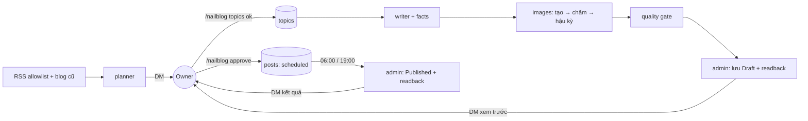

# Engineering Document: NailBlog — Agent tạo bài blog NailHub

Version: v1.0.11 · 2026-10-19 · Phase 2 build/test trên staging theo Owner.

Căn cứ: [Master v1.0.2](../00-master/nailhub-blog-noissue_master_261014_v1.0.0.md) · [Business v1.0.0](../01-product/nailhub-blog-noissue_business_261015_v1.0.0.md) · khuôn service tách riêng ở [service split](worker-agent-fleet-1_service-split_261013_v1.0.0.md) · package tham chiếu `nailhub/`.

Không có phần Frontend: Agent không thêm giao diện; trang quản trị và trang blog là của nailhub.ai. Phần console hiển thị worker để giai đoạn sau (mục 8).

---

## 0. Quyết định Owner 2026-10-16

| # | Quyết định | Ảnh hưởng thiết kế |
| --- | --- | --- |
| O-1 | Ảnh: Gemini API, **ưu tiên model miễn phí** | Model ảnh chọn theo ListModels + hạn mức free tier; model trả phí chỉ khi bật trong config |
| O-2 | Văn bản: **model local trước**, API key sau | Provider văn bản mặc định `ollama` (`qwen3.5:9b`, `think=false`, qua `MODEL_LOCK`, nhường triage); `deepseek` là tùy chọn config. Rủi ro: CPU THINKPAD chậm với bài 800–1.200 từ → viết theo từng mục, giới hạn token mỗi lần gọi, có timeout và lùi lịch theo TD-5 |
| O-3 | Truy cập THINKPAD qua **SSH** | Probe, deploy và chạy thử thực hiện qua SSH theo `deploy/README.md` |
| O-4 | **Dùng chung tài khoản admin** với worker duyệt tin | Bản sao file `{email,password}` 0600 thuộc user `tgnailblog`; profile trình duyệt vẫn riêng |
| O-5 | **Tạo blog chạy độc lập với Duyệt Posting** | Xem bảng ranh giới ngay dưới |

**Ranh giới độc lập NailBlog ↔ NailHub (duyệt Posting):**

| Thành phần | NailBlog | Duyệt Posting | Chung? |
| --- | --- | --- | --- |
| Package / venv / systemd unit / user | `nailblog`, `tg-nailblog`, `tgnailblog` | `nailhub`, `tg-nailhub`, `tgnailhub` | Không — deploy, restart, rollback riêng |
| State SQLite, thư mục `/var/lib/agentfleet/…` | `nailblog/` | `nailhub/` | Không |
| Browser profile, lock tiến trình | riêng | riêng | Không |
| Telegram session + namespace lệnh | `nailblog.session`, `/nailblog` | `nailhub.session`, `/nailhub` | Không (cùng tài khoản Telegram, mỗi service bỏ qua namespace kia) |
| Code | không import `nailhub`/`tg_triage` (test AST) | — | Không; chỉ `ai_transport.py`, `model_lock.py` là bản sao có parity test để giữ cùng giao thức khóa |
| Tài khoản admin nailhub.ai | O-4 | O-4 | **Có** — rủi ro **thấp**: Owner xác nhận 2026-10-16 tài khoản đang dùng đồng thời ở nhiều nơi (gồm worker duyệt tin và trình duyệt cá nhân) mà không bị đăng xuất. `probe` chỉ ghi nhận nếu mất phiên, không chặn |
| Ollama local + `/run/agentfleet/ollama.lock` | background | background | **Có** — cùng CPU THINKPAD; bài blog dài có thể làm chậm lượt duyệt tin. Giảm thiểu: gọi theo từng mục ngắn, nhường lock giữa các mục, không viết trong khung quét dày của duyệt tin; chuyển `deepseek` nếu đo thấy ảnh hưởng |
| Lỗi/crash | không làm dừng duyệt tin | không làm dừng tạo blog | Không |

## 1. Kiến trúc tổng thể

NailBlog là **service độc lập thứ ba** trong fleet, cùng khuôn với `tg-nailhub`: package riêng, venv riêng, systemd unit riêng, user riêng, Telegram session riêng, state riêng. Không import hoặc sửa package `nailhub`.

```
nailblog/
├── pyproject.toml              # telethon, playwright, Pillow (mới — cần vào wheel cache offline)
├── src/nailblog/
│   ├── __main__.py             # run | login-telegram | login | probe | preview | status | plan-week
│   ├── config.py               # NailBlogConfig (TOML, fail-closed)
│   ├── state.py                # SQLite WAL: control, topics, posts, images, runs, usage, notices
│   ├── service.py              # vòng lặp: lập lịch tạo bài + vòng đăng theo slot
│   ├── schedule.py             # 3 chế độ: fixed | random | adaptive; tính slot, hạn T-2h, cửa sổ trễ
│   ├── sources.py              # đọc RSS allowlist + GET /api/v1/blogs (bài cũ)
│   ├── planner.py              # lên chủ đề (DeepSeek), lọc trùng 90 ngày
│   ├── writer.py               # viết bài → JSON có cấu trúc → render HTML (code dựng HTML, không phải model)
│   ├── facts.py                # dò số/ngày/phí, đối chiếu với đoạn nguồn đã trích
│   ├── quality.py              # cổng chất lượng BB-01…12
│   ├── images/
│   │   ├── providers.py        # GeminiImage, OpenAIImage (chung interface)
│   │   ├── review.py           # chấm ảnh bằng model đọc ảnh
│   │   ├── post.py             # Pillow: crop 16:9, resize, WebP, dHash
│   │   └── templates/          # HTML template thumbnail + infographic (chụp bằng Playwright)
│   ├── admin.py                # Playwright: form Create/Edit Blog, upload ảnh, đổi trạng thái, readback
│   ├── telegram.py, commands.py, notices.py   # namespace /nailblog
│   ├── usage.py                # ghi chi phí + hạn mức ngày (mới so với fleet)
│   ├── ai_transport.py, model_lock.py         # bản sao giống hệt nailhub, có parity test
│   ├── receipt.py              # agentfleet-ready.json
│   └── AGENTS.md
└── tests/
```

### Luồng dữ liệu



---

## 2. Hợp đồng với nailhub.ai

Đọc từ JS công khai của site ngày 2026-10-16 (`BlogManagement-*.js`, `index-*.js`). **Chưa xác minh bằng phiên đăng nhập** — mục 9 Phase 0.

| Việc | Endpoint | Ghi chú |
| --- | --- | --- |
| Danh sách admin | `GET /api/v1/admin/blogs` | Lọc status, category |
| Chi tiết | `GET /api/v1/admin/blogs/{id}` | Dùng để readback |
| Tạo | `POST /api/v1/admin/blogs` | Form mặc định `status=Published`, `isPublic=true` → **Agent phải đổi sang Draft trước khi lưu** |
| Sửa | `PUT /api/v1/admin/blogs/{id}` | |
| Đổi trạng thái | `PATCH /api/v1/admin/blogs/{id}/status` | Draft · PendingApproval · Published · Archived |
| Danh mục | `GET /api/v1/admin/blog-categories` | 4 slug đang dùng: nail-job, nail-salon, hot-trend, did-you-know |
| Upload ảnh | `POST /api/v1/Images/quick-upload` | Trả `imageUrl`, `imageRelativePath`, `thumbnailUrl`, `thumbnailRelativePath` |
| Readback công khai | `GET /api/v1/blogs?pageSize=…` | Không cần đăng nhập |

**Payload bài** (form Create/Edit Blog):

| Trường | Giới hạn | Agent điền |
| --- | --- | --- |
| `categoryId` | bắt buộc | Theo danh mục chủ đề |
| `status` | enum | `Draft` khi tạo; `Published` lúc đăng |
| `publishedAt` | datetime-local | Giờ slot (xem D-04) |
| `isPublic`, `isFeatured` | bool | Theo D-02; `isFeatured=false` |
| `coverImage` | **bắt buộc** | Thumbnail 16:9 đã upload |
| `images[]` | **tối đa 10** | 3–5 ảnh thân bài (xem D-12) |
| `hashtags[]` | mỗi tag ≤ 50 | 3–5 |
| `externalSourceUrl` | ≤ 500 | Để trống |
| `translations[VI]` | title ≤ 200 · summary ≤ 500 · metaTitle ≤ 70 · metaDescription ≤ 160 · content (Quill HTML) | Bắt buộc VI title + content; EN để trống (D-05) |

**Rủi ro đã thấy:** ảnh chèn vào Quill qua nút toolbar chỉ mang `src`, không có `alt`. Editor của form tin tuyển dụng từng làm phẳng rich text. Phase 0 phải kiểm alt có sống qua lưu và trang công khai có hiển thị `images[]` hay không.

---

## 3. Quyết định kỹ thuật

### TD-1 — Ghi qua UI quản trị, không gọi API ghi trực tiếp
- **Bối cảnh:** `nailhub` chỉ ghi qua UI với route guard, không đoán API ghi, không tiêm token.
- **Quyết định:** NailBlog giữ cùng nguyên tắc: Playwright điền form Create/Edit Blog, dùng `set_input_files` cho ô upload, bấm Save; chỉ cho đúng `POST/PUT/PATCH` của blog và `quick-upload` đi qua guard; mọi thứ khác bị chặn. Preview chặn toàn bộ non-GET.
- **Hệ quả:** chậm hơn gọi API, nhưng dùng đúng validation của site và không cần giữ bearer token.
- **Phương án khác:** gọi API trực tiếp bằng token của phiên — nhanh, nhưng trái quy ước fleet.

### TD-2 — Model viết JSON, code dựng HTML
DeepSeek trả JSON theo schema (title_seo, title, summary, sections[{h2, paragraphs[], image_slot?}], faq[], cta, hashtags[], slug, claims[{text, source_id, quote}]). `writer.render()` dựng HTML với `<h2>`, `<p>`, `<figure><figcaption>`. Model không bao giờ chèn HTML tự do.

### TD-3 — Nhà cung cấp ảnh qua adapter
`ImageProvider.generate(prompt, aspect, n) -> list[bytes]` và `ImageReviewer.score(image, rubric) -> Score`.
- **Giai đoạn code:** Gemini (Owner cung cấp key). Ứng viên đầu: model Gemini Flash Image cho ảnh thân bài, Gemini Pro Image cho thumbnail. **Model ID và tỷ lệ khung hỗ trợ phải đọc từ ListModels khi có key**, không hard-code theo bài blog bên ngoài.
- **Kế hoạch production:** OpenAI GPT Image (Business BB-10). Đổi provider bằng config, không sửa code.
- Endpoint pin cứng: `generativelanguage.googleapis.com`, `api.openai.com`.

### TD-4 — Chữ tiếng Việt do template dựng
Thumbnail = ảnh AI làm nền + lớp chữ dựng bằng HTML template rồi Playwright chụp 1600×900. Infographic dự phòng dùng cùng cơ chế.

### TD-5 — Lập lịch tách khỏi đăng
`schedule.py` chỉ quyết định **lúc tạo ảnh**; vòng đăng chạy độc lập mỗi phút, chỉ đăng bài `scheduled` có `slot_at ≤ now ≤ slot_at + 15 phút`.

| Chế độ | Thời điểm chạy job tạo ảnh cho bài có slot S |
| --- | --- |
| `fixed` | `fixed_at` gần nhất trước `S − 3h` |
| `random` | Đều ngẫu nhiên trong `[S − 24h, S − 3h]`, seed ghi vào `runs` để tái lập |
| `adaptive` | Sớm nhất khi máy rảnh trong khung; lỗi/timeout API → lùi `2^n × 5 phút`, tối đa đến `S − 3h` |

Mọi chế độ: quá `S − 3h` mà chưa xong → ảnh dự phòng; quá `S − 2h` chưa duyệt → D-06.

### TD-6 — Hạn mức chi phí
Fleet hiện chỉ ghi chi phí, chưa có trần. `usage.py` ghi mỗi lần gọi (provider, model, token hoặc số ảnh, USD ước tính theo bảng giá trong config) và từ chối gọi mới khi tổng ngày (Asia/Ho_Chi_Minh) ≥ `budget.daily_usd`. Xuất `agentfleet-usage.json` cùng định dạng listener để console đọc sau này.

### TD-7 — Một lần đăng
Trạng thái `before_publish` ghi bền trước khi bấm. Khởi động lại thấy `before_publish` → chỉ readback, không bấm lại (giống `before_approve` của nailhub).

### TD-8 — Chốt chủ đề hằng ngày theo trend hôm nay (Owner chốt 2026-10-16: giờ 10:00/13:00/20:00, chỉ geo US, TikTok nhập tay; làm ở bước tiếp theo)
- **10:00 GMT+7 mỗi ngày**: DM Owner bảng trend hôm nay + **4 chủ đề ứng viên cho 2 slot ngày mai** (2/slot, đúng nhịp danh mục 06:00/19:00), mỗi chủ đề có điểm trend và nguồn.
- Owner trả lời `/nailblog pick <slot> <số>` trước **13:00**; không trả lời → lấy bài trong backlog tuần (evergreen) đã duyệt; backlog trống → chọn ứng viên điểm cao nhất nhưng vẫn phải qua duyệt bài T-2h.
- Sau khi chọn: viết + ảnh theo chế độ lập lịch (TD-5) → DM xem trước trước 20:00 → hạn duyệt: bài 06:00 trước 04:00 (khuyến nghị duyệt tối hôm trước), bài 19:00 trước 17:00.
- Kế hoạch tuần (`plan-week`) chuyển thành **backlog dự phòng**, không còn là nguồn chính.
- Hiện thực (bước B2): bảng `daily_runs` ghi dấu từng mốc theo ngày (idempotent, lưu nội dung DM để gửi lại); bảng `trend_snapshots`, `tiktok_tags`. Sau mốc chọn chủ đề có bước `write` riêng (viết bài preview vào `previews/<YYYY-MM-DD>/<HHMM>/`, thử lại sau 10′×n, bỏ sau 4 lần). Bài còn lỗi `fixable` sau 1 vòng sửa vẫn vào `review` (DM ghi rõ verdict); chỉ lỗi `hold` mới vào `held`. Danh sách bài đã đăng lấy bằng `GET /api/v1/blogs?pageNumber=N&pageSize=50`, dừng khi gặp trang có bài cũ hơn 90 ngày hoặc hết trang (trần 20).
- **Điểm trend**: hot hôm nay 20% (Google Trending RSS geo=US, lọc nail/beauty) · đà 3 ngày 40% · đà 7 ngày 30% (Google Trends API khi có quyền alpha; tạm thời đếm tần suất từ khóa trong Trending RSS + RSS báo làm đẹp lưu hằng ngày) · TikTok 10% (Owner nhập tay `/nailblog trend add #tag <lượt xem>` từ Creative Center). Không cào TikTok/Google Trends trái điều khoản.

---

## 4. Lưu trữ (SQLite, WAL, thư mục 0700, file 0600)

| Bảng | Cột chính | Mục đích |
| --- | --- | --- |
| `control` | paused, image_mode, last_result | Một dòng |
| `topics` | id, week, title, category, slot_at, score, sources_json, state | Backlog |
| `posts` | id, topic_id, slot_at, state, draft_json, fingerprint, admin_id, reason, details | Vòng đời bài |
| `images` | id, post_id, position, prompt, round, path, sha256, dhash, scores_json, chosen, uploaded_url | Ứng viên và ảnh chọn |
| `runs` | id, post_id, mode, seed, planned_at, started_at, ended_at, n_generated, n_pass_first, rounds, n_fallback, usd, met_deadline | **Số liệu cho báo cáo** |
| `usage` | at, provider, model, units, usd | Chi phí; giữ 90 ngày |
| `notices` | key, sent_at, attempts | Chống DM trùng |

Trạng thái `posts.state` (đồ thị đầy đủ, chốt 2026-10-16 sau verify bước A):

| Từ | Đến | Lý do |
| --- | --- | --- |
| writing | held, review | Thiếu căn cứ / qua cổng chất lượng |
| held | writing | Owner bổ sung căn cứ |
| review | writing, scheduled, held | Owner sửa / duyệt / giữ |
| scheduled | before_publish, held | Tới slot / Owner giữ |
| before_publish | published, uncertain | Readback xác nhận / không xác nhận được (TD-7) |
| uncertain | published, held | **Chỉ khi readback mới chứng minh đã công khai** / cần người xử lý |
| published | — | Kết thúc |

---

## 5. Logic chính

### 5.1 Tạo một bài
1. `writer`: DeepSeek (`deepseek-flash`) viết JSON → validate schema → `facts.check()`: mọi số/ngày/phí trong bài phải khớp một `quote` nằm nguyên văn trong đoạn nguồn; thiếu → `held`.
2. `images`: sinh prompt (không yêu cầu chữ) → `generate(n=2)` → `review.score()` theo 5 nhóm → chọn điểm cao nhất đạt hết; trượt → vòng 2, 3 → dự phòng.
3. `post.py`: crop/resize, WebP (≤ 200 KB cover, ≤ 150 KB thân bài, hạ quality dần), tên file `slug-vi-tri.webp`, dHash so với ảnh 90 ngày (khoảng cách Hamming ≤ 6 = trùng).
4. `quality.gate()` → `admin.save_draft()` → readback `GET /admin/blogs/{id}` khớp từng trường → DM xem trước.

### 5.2 Đăng
T−10′ kiểm fingerprint bài = bản đã duyệt, các `uploaded_url` trả 200 → tại slot ghi `before_publish` → đổi trạng thái Published qua UI → readback admin + public API: status, `publishedAt` lệch ≤ 15′, số ảnh, `/blog/{slug}` mở được → `published`. Không khẳng định được → `uncertain`, DM Owner.

### 5.3 Tình huống biên
- Nguồn RSS lỗi: dùng tư liệu tuần trước, ghi rõ trong DM chủ đề.
- Model văn bản lỗi (Ollama mặc định theo O-2, hoặc DeepSeek nếu bật): lùi lịch theo TD-5; không tự đổi provider giữa chừng. Gemini lỗi: tạo lại theo TD-5, quá hạn thì ảnh dự phòng.
- Phiên admin hết hạn: `login()` một lần như nailhub; lỗi/MFA → dừng, DM.
- Slug trùng (`BLOG_SLUG_ALREADY_EXISTS`): thêm hậu tố ngày, lưu lại một lần.
- Hai bài cùng slot: chặn ở `quality`.

---

## 6. Bảo mật

- Khóa: `/etc/nailblog/private/model-key.json` (DeepSeek) và `/etc/nailblog/private/image-key.json` (Gemini/OpenAI), định dạng scoped JSON của `ai_transport` (`{"scope":"<provider>|<base_url>","key":"…"}`), không group-writable, không world-readable. Không ghi khóa vào TOML, log, DM.
- Đăng nhập admin: file `{email,password}` 0600 như nailhub (Owner tạo).
- Telegram: session riêng `/var/lib/agentfleet/nailblog/nailblog.session`, Owner tự `login-telegram`; chỉ nhận `/nailblog` từ DM đúng ID số đã xác minh, bỏ qua mọi tin khác (mọi service đều nhận toàn bộ update).
- Chỉ gửi nội dung công khai tới API ngoài. Log không chứa nội dung nguồn, prompt đầy đủ hay khóa.
- Model lock: gọi qua `MODEL_LOCK.enter(background=True)` như nailhub để nhường triage.
- Origin pin: nailhub.ai, api.nailhub.ai, api.deepseek.com, generativelanguage.googleapis.com, api.openai.com, danh sách RSS.

## 7. Hiệu năng và tài nguyên

- Mỗi bài: ~1 phút viết, ~1–3 phút tạo/chấm ảnh, ~1 phút thao tác admin. 2 bài/ngày không gây tải đáng kể.
- Không chạy song song Browser profile với chính nó; browser NailBlog dùng profile riêng nên không tranh chấp với nailhub.
- Ảnh tạm lưu `/var/lib/agentfleet/nailblog/images/`, dọn ảnh không chọn sau 30 ngày.

## 8. Thay đổi ngoài package (giai đoạn deploy, làm sau)

| File | Thay đổi |
| --- | --- |
| `deploy/build_wheel.py` | Thêm `nailblog` vào `SERVICES` và fixture tests |
| `deploy/agentfleet_deploy.py` | Thêm đường dẫn code/config/state/unit; chờ log `NailBlog ready owner_verified=1` |
| `systemd/tg-nailblog.service` | User `tgnailblog`, group `agentfleet`, `/opt/agentfleet/nailblog`, `ReadWritePaths=/var/lib/agentfleet/nailblog /run/agentfleet` |
| `config/nailblog.example.toml` | Mẫu cấu hình |
| `console-ui/backend.py` | Thêm service vào `MAPS` (tùy chọn) |
| Wheel cache THINKPAD | Thêm Pillow |

---

## 9. Kế hoạch thực hiện

| Phase | Nội dung | Ghi chú |
| --- | --- | --- |
| **0** | Xác minh hợp đồng **bằng chính worker** như nailhub: lệnh `nailblog probe` (chỉ GET, đăng nhập bằng file credential của service, profile riêng) đọc danh mục + 1 bài qua `GET /admin/blogs/{id}`; sau đó một lượt `live` có kiểm soát tạo **1 bài Draft thử** (không public) có ảnh inline có alt + `images[]` để kiểm alt, cách trang công khai hiển thị, `publishedAt` tương lai. Kết quả ghi `contract.verification_ref` | Không dùng phiên trình duyệt cá nhân; lượt ghi thử cần Owner xác nhận |
| **1** | Package `nailblog` chế độ `preview` (không ghi website): planner, writer, facts, images (Gemini), quality, state, scheduler, Telegram | Unit test với provider giả, không gọi mạng |
| **2** | `admin.py` + chế độ `live`; chạy có kiểm soát 1 slot/ngày; review độc lập | Qua /dispatch, GATE 0b |
| **3** | Deploy THINKPAD, bật 2 slot, thử nghiệm 3 chế độ | |

### Kiểm thử
`unittest` như nailhub (`python -m unittest discover -s nailblog/tests -t nailblog`). Bắt buộc có:
- Schedule: 3 chế độ, ranh giới T−24h/T−3h/T−2h, cửa sổ trễ 15′, đổi giờ Mỹ không ảnh hưởng.
- Facts: số khớp/không khớp nguồn, trích dẫn ghép câu bị từ chối.
- Images: vòng tạo lại, dự phòng, hạn mức ngày, WebP đúng ngưỡng, dHash trùng.
- Admin: preview không gửi non-GET; `before_publish` sau crash chỉ readback; slug trùng.
- Commands: sai người gửi, nhóm, tin chuyển tiếp bị bỏ qua; namespace khác bị bỏ qua.
- Parity: `ai_transport.py`, `model_lock.py` giống hệt bản của nailhub.

---

## 10. Quyết định mở (thêm vào Master)

| ID | Câu hỏi | Đề xuất |
| --- | --- | --- |
| D-12 | Ảnh thân bài đặt inline trong `content` hay trong `images[]` | Kiểm ở Phase 0; ưu tiên inline nếu alt được giữ |
| D-13 | Tên service/user | `tg-nailblog` / `tgnailblog` |
| D-14 | Model ảnh Gemini cụ thể | Chọn sau ListModels + thử 10 prompt |

## Related Documents
- [Master](../00-master/nailhub-blog-noissue_master_261014_v1.0.0.md) · [Business](../01-product/nailhub-blog-noissue_business_261015_v1.0.0.md)
- QA Doc, Tasks Doc: chưa tạo.

## Changelog
### Phase 2 staging: solution vs codebase và technical

Owner duyệt tiếp tục build/test tại `https://staging.nailhub.ai/admin/dashboard`, credential ngoài repo và browser profile riêng. Login bằng UI đã trả 200 tại `https://api-staging.nailhub.ai/api/v1/authentication/signin`; danh mục và danh sách admin blog cũng trả 200. Không cho phép ghi production trong bản Phase 2 này.

Config thêm `[contract] environment="staging"` với cặp origin pin cứng và `[admin] credential_file/profile_path/timeout_seconds/headless`. Browser dùng context guard (kể cả popup), service_workers=block; preview không có ngoại lệ ghi. Login là ngoại lệ POST một lần đúng API/path, không ghi token từ code. Mọi thao tác ghi blog dùng UI, exact method/path/payload, không có generic API writer.

`admin.py` xử lý login/probe, thao tác form, upload và readback. `publication.py` chuẩn hóa snapshot và xác nhận readback. `admin_state.py` lưu intent/receipt/approval trong bảng riêng: không mất checkpoint khi `State.transition` ghi đè details. Create intent ghi trước click, outcome không rõ chỉ đối soát; publish claim ghi before_publish trong cùng SQLite transaction kiểm pause/state/fingerprint/slot/cap một bài mỗi ngày. Move hoặc rewrite làm snapshot cũ không còn hợp lệ. Scheduler live dùng adapter; preview giữ luồng offline. CLI login/probe không tự chứng nhận khả năng roundtrip ảnh/HTML.

Rich text đi qua clipboard HTML + paste thật vào Quill; không tiêm React/Quill state hoặc token. Kiểm cấu trúc HTML, ảnh, alt và caption ngay trong editor trước Create, rồi kiểm readback sau lưu. Nếu Quill không giữ chuẩn, fail closed và báo dependency nền tảng; không âm thầm bỏ caption/alt. Ảnh placeholder không được lưu/publish như ảnh thật. Test fixture khác acceptance bài sản xuất.

To-Do triển khai/verify: config environment, guard/credential/profile lock; payload và snapshot validator; durable intent/approval/publish claim; UI adapter + CLI; scheduler/commands integration; unit/integration/browser tests; review độc lập; staging acceptance chỉ với dữ liệu thử được Owner duyệt. Bằng chứng staging nằm ngoài Git, không lưu credential/token vào báo cáo. Xem [QA Phase 2](../03-qa/nailhub-blog-noissue_qa_261019_v1.0.0.md).

| Version | Date | Time | Author | Change |
|---|---|---|---|---|
| v1.0.11 | 2026-10-19 | 11:05 | AlexChu (Codex executor/review agents) | Dedicated Create GUID/unknown receipt reader,request-bound listing,read-only restart regression;630tests |
| v1.0.10 | 2026-10-19 | 10:10 | AlexChu (Codex executor) | Scope staging, origin đã quan sát, guard và durable intent/approval/readback; QA Phase 2 |
| v1.0.9 | 2026-10-16 | — | AlexChu (Claude executor) | TD-8: ghi phần hiện thực bước B2 (daily_runs, bước write, phân trang API) |
| v1.0.8 | 2026-10-16 | — | AlexChu (Claude executor) | Sửa 5.3 cho khớp O-2; cập nhật trạng thái doc |
| v1.0.7 | 2026-10-16 | — | AlexChu (Claude executor) | Owner chốt TD-8: 10:00/13:00/20:00, chỉ US, TikTok nhập tay; Owner nộp đơn Google Trends API alpha |
| v1.0.6 | 2026-10-16 | — | AlexChu (Claude executor) | TD-8: DM chốt chủ đề hằng ngày theo trend; plan-week thành backlog dự phòng |
| v1.0.5 | 2026-10-16 | — | AlexChu (Claude executor) | Hạ rủi ro dùng chung tài khoản admin xuống thấp theo xác nhận Owner |
| v1.0.4 | 2026-10-16 | — | AlexChu (Claude executor) | O-5: chạy độc lập với Duyệt Posting, bảng ranh giới + 2 tài nguyên chung |
| v1.0.3 | 2026-10-16 | — | AlexChu (Claude executor) | Đồ thị trạng thái đầy đủ (thêm hold từ review/scheduled, cạnh phục hồi) sau verify bước A |
| v1.0.2 | 2026-10-16 | — | AlexChu (Claude executor) | Quyết định O-1…O-4: Gemini free, model local trước, SSH, chung tài khoản admin |
| v1.0.1 | 2026-10-16 | — | AlexChu (Claude executor) | Owner: chạy cùng mô hình triage/duyệt tin — Phase 0 xác minh hợp đồng bằng `nailblog probe` của worker |
| v1.0.0 | 2026-10-16 | — | AlexChu (Claude executor) | Bản đầu: kiến trúc package riêng, hợp đồng admin blog đọc từ JS công khai, 7 quyết định kỹ thuật, kế hoạch Phase 0–3 |


### Phase2 Create201 correction

Create may return a JSON GUID rather than a dict. Dedicated create_receipt parses dict ID/GUID; unusable successful bodies trigger only full-payload Draft reconciliation. Exactly one valid Draft/readback is required; no POST retry. GET/upload dict schemas remain strict. Capability closes before readback. list_first observes a fresh GET request before navigation and reads that exact response, avoiding a canceled Create-triggered listing refresh. Durable uploaded-payload recovery tests confirm no second save/upload across restarted services. See QA v1.0.2 for actual630tests output and per-article staging publication exception. Naive API timestamps and public visibility flag discrepancy remain open contract dependencies; no normal quality/security gate weakened.

### Real image pipeline — implementation contract (2026-10-19)
Owner approved implementation and one separately controlled real API smoke with total ceiling USD1 including failed/uncertain requests and reviews. The explicit images CLI takes raw article JSON, private output directory and stable run_id. It does not upload, publish or enable scheduler image calls. AlexChu owns durable state.

Gemini image and multimodal review use a pinned, bounded, nonredirecting transport. Generation only accepts inline image data; final cropped/template WebP bytes are reviewed. Resolution, file size, SHA and dHash checks remain local and compulsory. Thumbnail Vietnamese title is rendered from an escaped packaged HTML template through network-disabled Playwright.

Every paid operation reserves a conservative configured bound atomically with a unique intent before network dispatch, under both stable run budget and shared daily budget. Active and uncertain reservations remain counted across midnight and are visible to paid text calls. Completed usage and released reservation change in the same transaction. A crash/unknown result never retries automatically. Output directory has an exclusive process lock and cache binds article, prompt, model, sizes, processing/template/review versions and prices/bounds. Completed output has image_hashes ordered cover then bodies and SHA-keyed image_reviews compatible with admin validation; separate metadata records rejected candidates/reasons. No automatic downgrade to PASS.

### Cloudflare free-only image continuation (2026-10-19)
Owner explicitly requested Cloudflare integration, nail-product prompt correction and a local cover+3body free-quota smoke. Gemini paid intents/reservations are preserved. Cloudflare generation is fixed to flux-2-klein-4b with multipart1600x960 cover/1280x720 body; review uses qwen3.8-27b on final WebP, thinking disabled, output1024, no tools or fallback.

A separate account-pinned SQLite neuron ledger uses UTC days (Cloudflare resets00:00UTC), atomic unique intents and immutable run ceilings. Pending/uncertain reservations survive midnight. Fresh Owner-controlled Workers Free proof, account, exclusive use, exact quota DB path and observed baseline are required immediately before each request. Prior smoke208.4neurons is imported once against its original UTC day. Reviewer input allowance is explicitly an estimate, not a fabricated countTokens result or a byte-derived vision guarantee; Workers Free server hard stop is the real protection against paid overage. Unknown/over-allowance usage holds reservation; no quota reset, upgrade, gateway or paid reviewer.

Versioned prompts describe transparent flat plastic nail swatch sticks with a single polished oval/almond nail-shaped tip. Distinct palettes/compositions per slot, no lipstick/cosmetic cylinders/bottles, no unnecessary hands or model-generated labels. Strict rubric topic review rejects those substitutions. Existing crop/WebP/dHash/SHA/template/admin contract remains. CLI requires --free-enabled --run-neurons for Cloudflare and never activates preview/daily generation.

### Strict environment and explicit one-post rollout (2026-10-19)

Owner approved the expanded editor/staging/THINKPAD/production plan. Worker origin binding now accepts only exact staging or production site/API pairs; the media origin is separately pinned and included in profile/state/report binding when configured. Production CDN was observed from public data and an actual HEAD200: `https://vlink-storages-prod.sgp1.cdn.digitaloceanspaces.com`. No inference converts naive timestamps: `instant` still requires an explicit offset; the separately approved backend UTC response correction must be deployed before strict acceptance.

`onepost.py` is an explicit CLI workflow, separate from preview/daily jobs: approved topic and actual published-list cache → configured text writer or reviewed writer JSON → facts/content gate PASS → real ImagePipeline or complete provenance-bound image document → actual SHA/byte/dHash checks → reviewable approval artifact → explicit human image acceptance → guarded upload/Create Draft and exact readback → new snapshot approval → ordinary deadline/slot/day-bound publish. Imported `manual_curated_preview` or `automatic_flow_verdict=HELD` documents are refused even when their five review booleans are true. Complete image manifest/document digest and generation/review intents remain bound on resume. Text intent precedes provider invocation; unknown text outcome requires reconciliation. Image resumes keep the same run ID. Create/Publish recovery retains existing read-only behavior and never repeats upload/Create after a durable Create intent. A new `onepost_runs` table stores phase, immutable run binding, local post ID and explicit image acceptance digest.

`onepost_topic_claims` uniquely owns each topic before the first model call, preventing two run IDs spending concurrently before local post creation. Known legacy topic ownership is backfilled without discarding runs; unresolved old ownership fails closed. OnePost-scoped pause callbacks run at the actual post-lock text/image dispatch boundary, including section calls and provider retries. A locally rejected request that provably has not reached transport is archived to `image_dispatch_cancellations` and its pending reservation released atomically; uncertain/settled requests are never eligible. A paused image review resumes its existing final WebP and review intent. An entirely unsent text writer can resume after pause; a partially dispatched writer remains a reconciliation case so earlier outline/sections are not silently charged twice. Standalone image CLI behavior retains its default when no callback is supplied.

Blog Quill's exact internal figure class/contenteditable pair and exact safe link `rel="noopener noreferrer"` / `target="_blank"` additions have narrow semantic normalization. All image alt/src/dimensions/caption structure, links and unknown attributes remain compared. Static normalization tests do not certify real editor roundtrip: actual worker probe after FE deployment is still required. Published readback now additionally opens a fresh anonymous browser, loads the four actual images, checks figure/alt/caption presence and follows an actual visible homepage card to the article.

Deployment adds the separate NailBlog target, `[service].db_path`, own ready marker, own service/user/profile/session and paused startup. `nailblog_bootstrap.py` prints a plan by default and never starts a service; applying provisioning is explicit. The reviewed snapshot path binds the full source inventory and records `commit=null`, `provenance=reviewed_worktree_snapshot`, `source_revision=snapshot:SHA`; source/archive/wheel mismatches are refused. Parity references are explicit staging fixtures. Existing stopped-target backups and post-start DB-preserving rollback remain. No remote changes or live provider/website calls were performed while implementing this delta. Real strict staging acceptance, production probe, complete Cloudflare ledger migration/fresh proof and deployment remain parent-controlled gates.

Optional reference_image_file/reference_image_sha256 now validates an absolute nonsymlink source, bounded4MiB/24MP decode and <=510px deterministic WebP. Raw/processed SHA and processing version bind the run. Binary multipart input_image_0 adds5.37 input neurons per generation. Reference guides geometry; article brief controls palette, finish and placement. Review explicitly rejects double-ended or painted handles. ImagePipeline.reject_selected verifies durable binding, output lock and exact SHA, preserves model verdict/intents/ledger, records operator veto and stale snapshots, then permits only untried candidates on the same run without raising caps.

Final verification:688tests206.802sOK(skipped3), wheel38 source/template files match and imports/resource/helper PASS. Real experiments produced a manually curated local cover+3body sample with independently verified exact provenance, not a single automatic end-to-end PASS. False-positive model reviews and strict image-fidelity failures keep automatic acceptance HELD. Future autonomous deployment requires dependable slot-specific geometry/finish guidance and visual acceptance. Final evidence: C:/Users/AD/.agentfleet/evidence/nailblog-cloudflare-full-set/FEATURE.md; see QA final execution section for accounting and limitations.

### Two-article Free policy and brief-specific image subjects (2026-10-20)

Owner-authorized continuation adds opt-in `cloudflare.two_article_free_day=true`. A shared account ledger atomically commits two UTC-day slots of4500 neurons each before the first image run. The remaining1000-neuron allowance includes baseline and all non-slot usage, including unresolved older intents/review holds; it is not an additional untouched margin. Admission fails if that other usage exceeds1000. A bound run requires immutable4500 ceiling, current UTC day, fresh existing Free proof and unchanged32768 input/1024 output review bounds. Two slots do not guarantee two quality-PASS articles: review uncertainty, retries or semantic failures can still HOLD. No paid fallback or quota reset exists. `admin.daily_publish_limit=2` separately opts into at most two actual publication claims per Asia/Saigon day; unknown/inflight claims consume their slot. Existing scheduling windows/deadlines and paused installation remain unchanged.

Generation reserves its own neuron estimate and a full conservative review hold in one shared SQLite transaction before outbound generation. The exact generated final image then transfers that hold to its SHA-bound review intent. A known-unsent queued review cancellation atomically archives the cancelled intent and restores the original generation hold; unknown reviews keep their reservation and cannot retry. UTC rollover never reassigns a run or erases unknown liabilities. Manifest/document/OnePost approval artifacts expose a neuron forecast separating charged/estimated use, pending/uncertain requests, review holds, commitments and headroom; token observations remain separate from neuron estimates. Yesterday's59 intents consumed7865.344 neurons plus208.4 baseline, with0 unresolved intents;29 reviews reported1255–2030 input and86–204 output tokens. Those observations do not justify lowering a future review bound.

Image prompt v5 defaults to `nail_editorial`, honoring the bounded article brief without forcing sample sticks into unrelated nail topics. Optional article fields `cover_image_subject` and `cover_image_brief` control the cover (brief fallback: title). Each image_slot may specify `subject`; supported subjects are `nail_editorial` and `nail_swatch_sticks`. Briefs are nonempty and at most2000 characters. Only explicit swatch subjects receive the pinned geometry reference and single-ended clear-handle/anti-tube review rules. All subjects retain exact requested count/palette/material/finish/placement and all five independent quality criteria. Source/provenance changes invalidate prior run bindings; old curated/held artifacts remain held.

Primary pricing reference rechecked2026-10-20: https://developers.cloudflare.com/workers-ai/platform/pricing/ (Free10000/day reset00:00UTC; Qwen40909/290909 neurons per million input/output tokens). Fresh image calibration uses no text-writing calls and cannot demonstrate Gemini text free-tier availability or two-new-article text throughput. Runtime/provider calls and THINKPAD deployment are separate controller actions after frozen-source review and tests.
