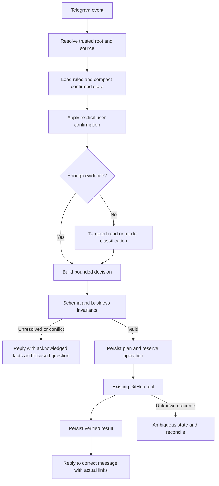

# Engineering: THINKING controller cho Telegram triage

**Version**: v1.0.0 · **Updated**: 2026-10-15 21:08 (Asia/Saigon) · **Owner**: AlexChu · **Executor**: Codex

**Status**: Đề xuất nghiên cứu, chưa triển khai; user yêu cầu nghiên cứu không đồng nghĩa phê duyệt migration.

## Related Documents

- [Fleet Master](../00-master/worker-agent-fleet-1_master_261007_v1.0.8.md)
- [Nguồn nghiệp vụ TG-01..TG-32](../01-product/telegram-triage-noissue_business_261015_v1.0.0.md)
- [PR #43](https://github.com/PersonalProjectJob/telegram-agent/pull/43) · không có issue riêng.

## Solution vs codebase

Status: research/design proposal only, inspected 2026-10-15. No runtime migration, provider/consent/model/auth changes, or canonical Harness edits authorized by this artifact.

## Conclusion

Telegram triage already has durable context, source provenance and safe execution. Recommend a bounded application THINKING controller reusing SQLite and existing tools, not installing a new framework. Developer Harness is a model for durable state and verification, not a directly deployable Telegram semantic brain. Keep Harness identity and lineage AlexChu independent of runtime executor. THINKING is state + evidence + bounded decision + execution feedback; `think=true` alone does not provide it. Never request, log or store private chain-of-thought; use short decision reasons and evidence IDs.

## Primary sources

All accessed 2026-10-15. The claims in this table are source-backed; later architecture and numeric targets are design inferences/proposals.

| Source | Supported claim |
| --- | --- |
| https://www.anthropic.com/engineering/building-effective-agents | Prefer simple composable workflows; routing/chaining with programmatic gates fit known paths; add complexity only when measured benefit justifies it. Published 2024-12-19. |
| https://www.anthropic.com/engineering/effective-context-engineering-for-ai-agents | Curate relevant context, structured notes and just-in-time retrieval; larger history alone does not solve context reliability. Published 2025-09-29. |
| https://www.anthropic.com/engineering/managed-agents | Separate orchestration brain, tool hands and durable session log; context window is not durable session storage. Published 2026-04-08. |
| https://docs.langchain.com/oss/python/langgraph/persistence | Thread-scoped checkpoints and cross-thread stores serve different memory purposes; RAM memory does not survive restart. |
| https://github.com/langchain-ai/docs/blob/main/src/oss/langgraph/functional-api.mdx | Resumed work may repeat incomplete side effects; checkpoint API tasks and design idempotency or verify prior results. |
| https://developers.openai.com/api/docs/guides/evaluation-best-practices | Evaluate task-specific real/edge/adversarial examples, calibrate with human labels and continuously rerun evals as behavior changes. |

No dependency adoption follows from citing LangGraph. No vendor eval API integration is proposed; use independent repository fixtures/runner.

## Local Harness inventory

Root: `C:/Users/AD/Documents/GitHub/skill-repo-vlink/harness`.

| File/symbol | Existing capability and boundary |
| --- | --- |
| `IDENTITY.json` | harnessName/dataOwner/stateOwner AlexChu; executor/runtime replaceable. Preserve identity. |
| `ROLES.json` | Role failover chains, reviewer differs from executor, scripted verification. Developer roles, not Telegram semantic intents. |
| `OPERATING-PROCEDURE.md` | Orient, durable plan, scope, execute, verify, handoff. Useful state-continuity pattern. |
| `KNOWLEDGE.md` | Shared files hold reusable knowledge; private agent memory cannot provide cross-runtime continuity. |
| `bin/harness-dispatch.mjs` | Read-only next-action controller; emits `harness.dispatch.action/v1`, run-command/run-agent/await-human, observed schema-2 CAS version. |
| `bin/harness-task.mjs`: withCas, atomicWrite, renewLease, requireLeaseOwner, validateArtifactPayload | Version checks, leases, atomic writes, verification tied to repo/head/diff. |
| `bin/harness-agent-adapter.mjs`: validateAction, validateTransitionCommands, assertReviewerSeparation, structuredResultSchema, applyTransitions | Validate actions and transition on acceptable verdict; actually invokes external executors, so do not embed into Telegram production. |
| `bin/harness-verify.mjs`: repositoryIdentity, loadTask, main | Script verification with stable repo identity; Node package-script assumptions do not verify Python bot semantics. |

## Current runtime inventory

Root: `C:/Users/AD/.codex/worktrees/telegram-ticket-reply/AgentBuilder`. Baseline inspected before this documentation task: commit9746ef2.

| Path/symbol | Existing behavior |
| --- | --- |
| listener/src/tg_triage/pipeline.py: Pipeline._process, _plan, _safety, _run, validate_partition | Initial ingress, grouping, guardrails, execution, source accounting. |
| followup_store.py: followup_source, followup_context, save_followup_context_state, followup_binding_history | Trusted same-chat sent-notice/source association; explicit confirmed state outlives history window. followup_context reads last5 history turns. |
| followups.py: _apply_context, _context, _anchor_split, _plan | Desired ticket count and source→ordinal confirmation, sender/reply evidence validation, conflicts; targeted semantic role analysis for remaining text. |
| classifier.py: analyze_followup, analyze_source_roles | Bounded semantic calls; source-role labels ancillary/request/unknown. |
| followup_model.py: validate_followup, parse_source_roles | Treat model output as untrusted, check schema/limits. |
| followup_store.py: save_followup_plan, reserve_followup_operation, finish_followup_operation, remember_followup_result, init_followups | Persist plan before external operations; reserve before POST; restart reserved→ambiguous; no blind duplicate POST. |
| followups.py: _run, sweep, _notify | Execute/resume and report known actual outcomes. |
| provider.py: CloudProvider._ask, _ask_cloud | Cloud consent, redaction, fallback and invalid-output retries; no semantic-turn-wide deadline. |
| ai_transport.py: complete, request_json, redact | Bounded transport response/input, endpoint validation and per-call timeout. |
| usage.py: UsageRecorder.record, build_summary | Usage/cost/latency available; model latency excludes waiting for MODEL_LOCK. |
| classifier.py: strip_thinking, parsers and _ask | Ignores message.thinking; keep this invariant. |

Full relative runtime paths above are under `listener/src/tg_triage/` unless explicitly given.

## Gap matrix

| Capability | Current | Proposed |
| --- | --- | --- |
| Unified policy | Prompt/code/docs scattered | Canonical rule IDs with examples and code/test mapping; prompt application with drift check. |
| Provenance context | Present in followups | Common compact context packet for initial + followup, root-scoped retrieval only. |
| Confirmed memory | context_state + split_plan | Explicit confirmed facts vs model hypotheses vs unresolved/conflicts; hypotheses never overwrite confirmed facts. |
| Decision trace | plan/result/context_reason dispersed | Versioned decision contract with rule/prompt/model lineage and concise evidence reason. |
| Plan-act-verify | Durable operation reservation already good | Unified preflight and postcondition check of actual issue/link/reply/accounting. Model cannot choose authoritative repo/URL. |
| Reasoning budget | Per-call timeout/retry | Total turn deadline and call/retrieval/context bounds; preserve anchors and ask focused question when exhausted. |
| Context quality eval | Strong deterministic tests | Human-labelled multi-turn replay; grouping/binding/repeated-question/outcome metrics. |
| Recovery | Jobs + reserved/ambiguous | Crash drills, eventual event journal and versioned state if multiple workers. |
| Learning from correction | Individual fixes | Correction→regression fixture→reviewed policy/prompt improvement; no self-modifying online policy. |

## Technical

### Proposed architecture



Separate semantic proposal from permission to execute. Code proves root, partition, desired count, quota and operation state before write. Load canonical policy version plus selected confirmed facts/source references, not arbitrary whole-group history. A targeted read is scoped by chat/root and returns evidence IDs, not new write authority.

## Proposed decision contract

Illustrative only. IDs are synthetic, not production replay inputs. Harness ownership here is lineage design, not an automatic ownership migration of current SQLite data.

```json
{
  "schema": "triage.decision/v1",
  "decision_id": "synthetic-example-001",
  "harness_owner": "AlexChu",
  "root_key": "synthetic-trusted-root",
  "input_message_id": 9006,
  "state_version": 7,
  "policy_version": "triage-rules-v1",
  "prompt_version": "sha256-placeholder",
  "intent": "split",
  "confirmed": {
    "desired_count": 2,
    "bindings": [
      {"source_id": 9001, "ordinal": 0, "evidence_id": 9005},
      {"source_id": 9002, "ordinal": 1, "evidence_id": 9006}
    ]
  },
  "unresolved_source_ids": [9003],
  "conflicts": [],
  "reason_code": "confirmed_anchors_with_unassigned_context",
  "reason_summary": "Hai yêu cầu đã được người gửi xác nhận; một nguồn phụ chưa được gán.",
  "next_action": "classify_source_roles",
  "reply_to_message_id": 9006,
  "budget": {"model_calls_used": 0, "max_model_calls": 2},
  "operation_refs": []
}
```

reason_summary explains the decision briefly; no private reasoning transcript. Model-proposed fields are validated; authoritative identity, state version, evidence references and operation handles come from trusted application code.

## To-Do List

### Pilot phases and proof criteria

These are proposed review targets, not current runtime configuration or achieved metrics.

1. P0 offline baseline: canonical rules + rule→code→test map. Seed60 anonymized labelled conversations:15 initial grouping,15 ordinal/update,10 multi-sender/conflict,10 media/provider failure,10 duplicate/restart. Split datasets by whole conversation/root to avoid leakage.
2. P1 offline decision contract and shadow replay: fake tools only, paired comparison against baseline. Safety invariants100%; binding/partition≥95% on clearly-labelled cases; repeated questions≤5% when user has already supplied enough confirmation. Report denominators and uncertainty intervals. Model-reported confidence is not accuracy.
3. P2 authorized production-input shadow: no added GitHub write or Telegram messages. Measure receipt→decision including lock wait, model calls and total usage per turn; human-review disagreements.
4. P3 separately reviewed narrow canary: retain existing reserve/dedup tools; kill switch on duplicate, wrong source or cross-root write. Roll back code without undoing database records of external side effects. Only then consider model upgrade.

P1 budget proposal: max2 semantic calls total including retry/fallback, max3 read-only lookups,8000 input tokens,512 output tokens per narrow decision,20seconds/call,40seconds total turn deadline. When exhausted, retain confirmed state and ask focused clarification. This task must not change current120second timeout/provider defaults/consent.

Required crash/replay tests: before/after plan persistence; before/after reserve; POST success then DB failure; Telegram notice success then persistence failure; two concurrent replies; restart before ticket2 confirmation; history trimmed; repository changed; model invents source; third request mislabelled ancillary; multiple senders contest ordinal; unknown profile.

## Baseline limits

727 passing code tests are code regression evidence, not model accuracy. `.context/role-live-diagnostics.log` contains one successful targeted-role call1961ms, but also invalid JSON around23–25seconds and fallback timeout120seconds. n=1 cannot establish latency percentiles or model accuracy. CloudProvider currently can try invalid outputs twice then local fallback retries, multiplying per-call timeouts; future controller budget must cover the total chain, and telemetry must distinguish MODEL_LOCK queue time.

No canonical Harness changes, no live operations, no provider/auth/model changes were made during this research.

## Quyết định đề xuất và quyền thực hiện

- **R-01 (đề xuất)**: tái sử dụng SQLite và tool đang có; không import CLI Harness developer vào daemon Telegram. Chỉ học mô hình state/CAS/lease/verify; chưa cần framework dependency.
- **R-02 (đề xuất)**: confirmed facts được chứng minh bằng source/reply và sender evidence; model hypothesis phải gắn nhãn riêng, không được ghi đè confirmed. Người dùng sửa ý định vẫn được xử lý bằng một confirmation mới có provenance.
- **R-03 (giữ invariant hiện hành)**: không lưu private chain-of-thought. Decision record chỉ giữ kết quả ngắn, reason code, rule version và evidence refs; một nút `think=true` không cung cấp durable context. Local `think` và hosted reasoning không được hứa cùng hiệu quả/giới hạn.
- [ ] Owner/Tech Lead duyệt contract và ngân sách pilot trước khi triển khai.
- [ ] Engineer thiết kế migration/version state và tổng deadline, đánh giá lock wait.
- [ ] QA tạo corpus có nhãn, crash drills và so sánh baseline; chạy offline trước shadow/canary.
- [ ] Review privacy/retention của telemetry và dữ liệu hội thoại trước shadow production.

FE/UI: không thay đổi trong nghiên cứu này. API/DB mới: chưa triển khai; decision JSON phía trên là mẫu thiết kế, không phải schema SQLite hiện hành. Ngân sách và mốc đánh giá phải đo lại theo cấu hình host/provider thực tế. Tài liệu này không cấp quyền truy xuất thêm group, gửi message, tạo issue hay bật cloud consent.

## Changelog

| Version | Ngày giờ (Asia/Saigon) | Tác giả | Thay đổi |
|---|---|---|---|
| v1.0.0 | 2026-10-15 21:08 | Codex / owner AlexChu | Nghiên cứu Harness và nguồn chính thức; kiến trúc/budget/pilot đề xuất, không đổi runtime. |
